# 🛁 คู่มือและเอกสารการทำงานระบบ Bathroom & Finishing (SketchUp Conceptual)

[🏠 กลับสู่หน้าหลัก (Master Documentation)](README.md) &bull; [🌐 เปิดอ่านบนเว็บเบราว์เซอร์ (GitHub Pages)](https://suteechu.github.io/manual-QHeim/Bathroom_Finishing_Doc.html)


> [!IMPORTANT]
> **📢 หมายเหตุสำคัญจากผู้พัฒนา (Developer's Note):**  
> โมดูล **Step 8: Bathroom & Finishing** นี้ ผู้พัฒนาเดิม (คุณสุธี) **ยังไม่ได้ลงมือเขียนโค้ด Ruby Plugin**  
> แต่ได้จัดทำ **คู่มือแนวคิดและพิมพ์เขียวการทำงาน (Conceptual Manual & System Blueprint)** ใส่ไว้ล่วงหน้าก่อน เพื่อให้คนรุ่นหลังหรือทีมงานถัดไปสามารถนำไปใช้เป็นแนวทางและข้อกำหนดความต้องการ (Requirements Specification) ในการลงมือเขียนโค้ด Plugin พัฒนาต่อยอดได้ทันที


เอกสารฉบับนี้จัดทำขึ้นเพื่ออธิบาย **พิมพ์เขียวสถาปัตยกรรมระบบ (System Architecture & Conceptual Blueprint)** ของระบบ **Bathroom & Finishing (BR)** ในส่วนขยาย **QHeim (SketchUp Ruby Extension & AutoCAD BIM Integration)** สำหรับการสร้างโมเดลห้องน้ำสำเร็จรูป 3D, ระบบเดินท่อน้ำดี-น้ำเสียอัตโนมัติ (Auto Run PVC & PPR), ระบบโครงสร้างเคาน์เตอร์อ่างล้างหน้า, โครงผนังกล่องสุขภัณฑ์, โครงสร้างฝ้าเพดานห้องน้ำ, แผ่นกันซึม, การตรวจเช็ก Recheck Data Grid, การออก Shop Drawing อัตโนมัติ (Auto Dimension & Bar Cut List), และการถอดรายการวัสดุ (BOM & BOQ Export)

---

## 📑 สารบัญ (Table of Contents)

1. [ภาพรวมและเป้าหมายของระบบ (System Overview)](#1-ภาพรวมและเป้าหมายของระบบ-system-overview)
2. [หน้าต่างเมนูและแถบเครื่องมือ (UI Toolbar & Controllers)](#2-หน้าต่างเมนูและแถบเครื่องมือ-ui-toolbar--controllers)
3. [กระบวนการทำงานหลัก 6 ขั้นตอน (6-Stage Conceptual Workflow)](#3-กระบวนการทำงานหลัก-6-ขั้นตอน-6-stage-conceptual-workflow)
   - [3.1 การนำเข้าไฟล์ CAD (CAD Import & Layer Management)](#31-การนำเข้าไฟล์-cad-cad-import--layer-management)
   - [3.2 การจำลองโมเดล 3D อัตโนมัติ (3D Modeling & Auto Run Subsystems)](#32-การจำลองโมเดล-3d-อัตโนมัติ-3d-modeling--auto-run-subsystems)
   - [3.3 กระบวนการคำนวณ BOQ (BOQ Calculation Engine)](#33-กระบวนการคำนวณ-boq-boq-calculation-engine)
   - [3.4 การตรวจสอบข้อมูล (Recheck & Auto Data Grid)](#34-การตรวจสอบข้อมูล-recheck--auto-data-grid)
   - [3.5 การแจ้งเตือนระบบ (Message Alert: IM SB New)](#35-การแจ้งเตือนระบบ-message-alert-im-sb-new)
   - [3.6 การส่งออกข้อมูล (BOM Export & Automated Shop Drawings)](#36-การส่งออกข้อมูล-bom-export--automated-shop-drawings)
4. [ตารางถอดแบบรายการวัสดุ 4 หมวดหลัก (BOM & Materials Matrix)](#4-ตารางถอดแบบรายการวัสดุ-4-หมวดหลัก-bom--materials-matrix)
5. [คลังภาพร่างแนวคิดและแบบก่อสร้าง (Conceptual Gallery & Shop Drawings)](#5-คลังภาพร่างแนวคิดและแบบก่อสร้าง-conceptual-gallery--shop-drawings)

---

## 1. ภาพรวมและเป้าหมายของระบบ (System Overview)

ในบ้านโครงสร้างเหล็กสำเร็จรูปโมดูลาร์ (Modular Unit) ของ SCG HEIM งานห้องน้ำเป็นพื้นที่ที่มีความหนาแน่นของงานระบบสูงสุด (Highest System Density) ประกอบด้วยงานท่อประปาสุขาภิบาล, ถาดกันซึม, งานโครงเหล็กซ่อนผนัง (Concealed Framing), เคาน์เตอร์, และฝ้าเพดาน

ระบบ **Bathroom (BR)** ใน QHeim ถูกออกแบบขึ้นเพื่อแปลงข้อมูลแบบร่างจาก AutoCAD สถาปัตยกรรมและสุขาภิบาล (DWG CAD.IN + SN) ให้กลายเป็นโมเดล 3D BIM อัจฉริยะบน SketchUp แบบ **กึ่งอัตโนมัติ (Semi-Automated)**:

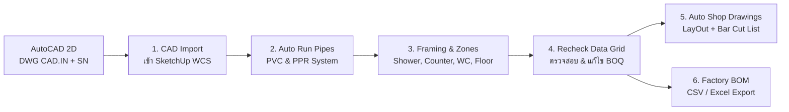

### วัตถุประสงค์หลักของระบบ:
1. **ลดเวลาเขียนแบบระบบท่อ:** จากเดิมที่ต้องขึ้นโมเดลท่อ 3D ทีละท่อน เปลี่ยนเป็นการอ่าน Sleeve Pipe จาก CAD แล้วรันเส้นท่อ PVC และ PPR ขึ้นมาใน 3D อัตโนมัติ (Auto Run)
2. **คำนวณความยาวตัดโครงสร้างเฟรม (Bar Cut List):** สร้างรายการตัดเหล็ก/อลูมิเนียมสำหรับโครงเคาน์เตอร์ โครงหลังชักโครก และโครงฝ้าเพดาน พร้อมตารางชิ้นส่วนเพื่อส่งตัดในโรงงานได้ทันที
3. **ลดข้อผิดพลาดงานกันซึม:** คำนวณระยะแผ่นกันซึม Evalon และการปูกระเบื้องแบบ Dry Lay อย่างแม่นยำ

---

## 2. หน้าต่างเมนูและแถบเครื่องมือ (UI Toolbar & Controllers)

ระบบทำงานผ่านปุ่ม **BR (Bathroom)** บนแถบเมนูหลักของ QHeim:

```
[SCG HEIM Toolbar]
 ├── Home
 ├── ST (Structure)
 ├── EW (Exterior Wall)
 ├── IW (Interior Wall)
 ├── EE (Electricity)
 ├── 👉 BR (Bathroom)  <-- เมนูระบบห้องน้ำและงานท่อสุขาภิบาล
 ├── IN (Part Install)
 ├── LT (Long lead time)
 └── Layout
```

### หน้าต่างควบคุมหลัก (Dialog Controller Actions):
* **ปุ่ม CAD:** นำเข้าและเชื่อมโยงไฟล์ CAD Xref (DWG CAD.IN + SN)
* **ปุ่ม CSV:** ส่งออกและนำเข้าตารางปริมาณวัสดุ
* **ปุ่ม Layers / Windows:** จัดการเปิด-ปิดเลเยอร์แสดงผลแบบ 2D/3D
* **ปุ่มฟังก์ชันย่อย A, B, C, D, E:** ควบคุมกระบวนการทำงานตามลำดับ

---

## 3. กระบวนการทำงานหลัก 6 ขั้นตอน (6-Stage Conceptual Workflow)

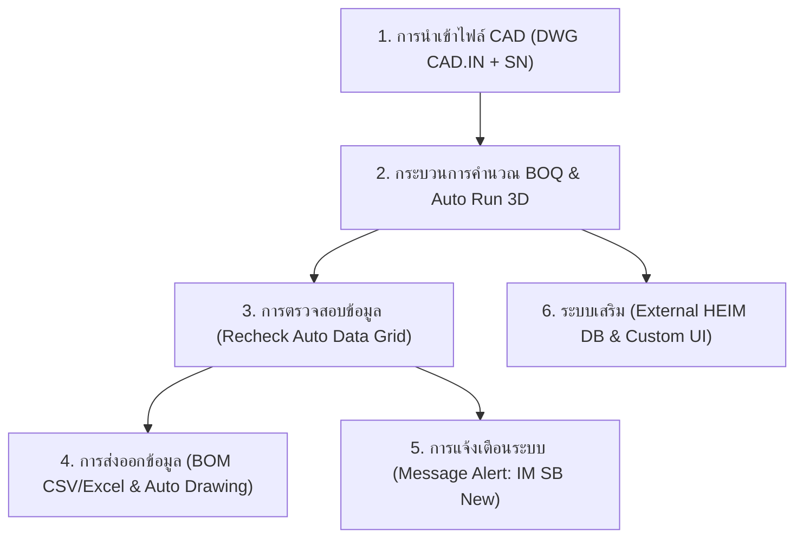

---

### 3.1 การนำเข้าไฟล์ CAD (CAD Import & Layer Management)
* **การนำเข้าไฟล์:** Import ไฟล์ 2D DWG จาก AutoCAD เข้าสู่ SketchUp โดยอ้างอิงพิกัดจุดกำเนิดเดิม (WCS 0,0,0)
* **การจัดการเลเยอร์:**
  * `DWG PDF. SN`: เลเยอร์งานระบบท่อสุขาภิบาล (Sleeve Pipe, Soil, Waste, Cold Water, Vent)
  * `DWG PDF. IN`: เลเยอร์งานสถาปัตยกรรมภายในห้องน้ำ (Floor Plan, Vanity Counter, Sanitary Fixtures, Tiles)
* ปิดเลเยอร์เส้นร่างที่ไม่เกี่ยวข้อง และเปิดเฉพาะเลเยอร์จุดอ้างอิงสำหรับการสร้างโมเดล

---

### 3.2 การจำลองโมเดล 3D อัตโนมัติ (3D Modeling & Auto Run Subsystems)

#### 🔹 ก. ระบบท่อสุขาภิบาลอัตโนมัติ (Pipe System Work: Auto Run PVC & PPR)
ระบบอ่านตำแหน่งท่อปลอก (Sleeve Pipe) จากแบบ CAD:
* ท่อระบายอากาศ (Vent Cap): $arnothing 2''\,	ext{VC}$
* ท่อโสโครก (Soil Pipe): $arnothing 4''\,	ext{S}$
* ท่อน้ำทิ้งจาก Floor Drain: $arnothing 3'' 	imes 2''\,	ext{W FD}$
* ท่อน้ำดีเย็น (Cold Water): $arnothing 2''\,	ext{CW}$ และ $	ext{PP-R } arnothing rac{1}{2}''$ (PN 20)
* **Auto Run Engine:** ผู้ใช้ติ๊กเลือก `Pipe PVC` และ/หรือ `Pipe PPR` ระบบจะสร้างเส้นท่อ 3D พร้อมข้อต่อข้องอ $90^\circ, 45^\circ$, สามทาง (Tee), และเกลียวนอก-ใน วิ่งขึ้นสู่ระดับสุขภัณฑ์ตามระยะ Elevation:
  * ระดับฝักบัวอาบน้ำ: $+1,995\,	ext{mm}$
  * ระดับวาล์วน้ำผสม: $+1,020\,	ext{mm}$
  * ระดับก๊อกอ่างล้างหน้า: $+540\,	ext{mm}$
  * ระดับท่อน้ำดีโถสุขภัณฑ์: $+190\,	ext{mm}$

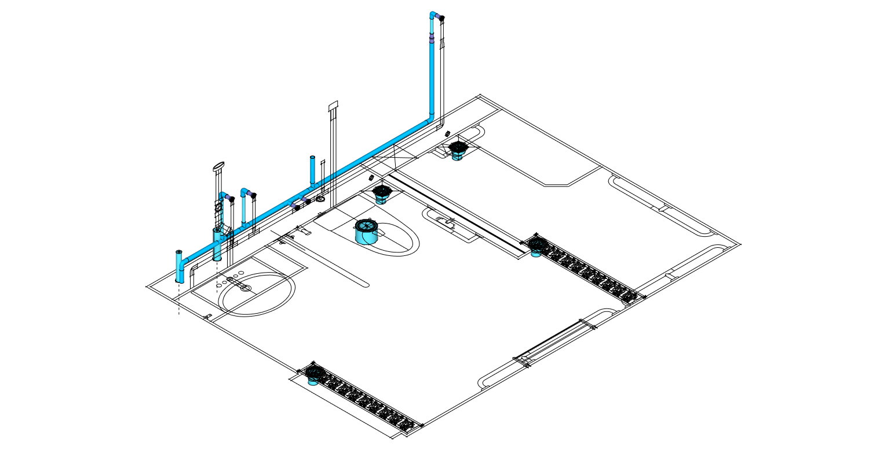

---

#### 🔹 ข. ระบบระบุโซนและระดับพื้น (Floor System Work: Mark the Location)
* วางมาร์กเกอร์และแอตทริบิวต์ 3D Text (เช่น `AD`, `BD`, `DD`) ลงบนระนาบพื้นห้องน้ำ
* กำหนดระดับความลาดเอียง (Slope) ลงสู่ Floor Drain
* คำนวณขอบเขตถาดรองพื้นกันซึมและรอยต่อแผ่นพื้น Smartboard

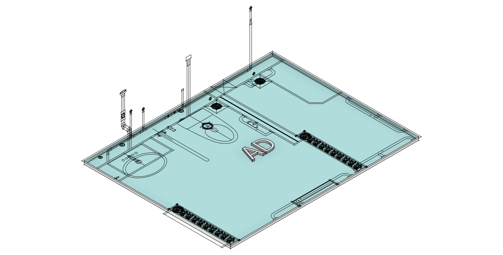

---

#### 🔹 ค. ระบบโซนอาบน้ำและช่องวางสบู่ (Shower System Work)
* จัดกลุ่มพื้นที่เปียก (Wet Area) แยกจากพื้นที่แห้ง (Dry Area)
* **Soap Niche Generator:** สร้างช่องเจาะผนังสำหรับวางสบู่/ยาสระผมอัตโนมัติ
  * ระดับความสูงมาตรฐาน: `Soap: high 970` ($+970\,	ext{mm}$ จากระดับพื้น)
  * ขนาดช่องเจาะ: กว้าง $900\,	ext{mm}$ พร้อมขอบคิ้วปิดมุมกันน้ำซึม

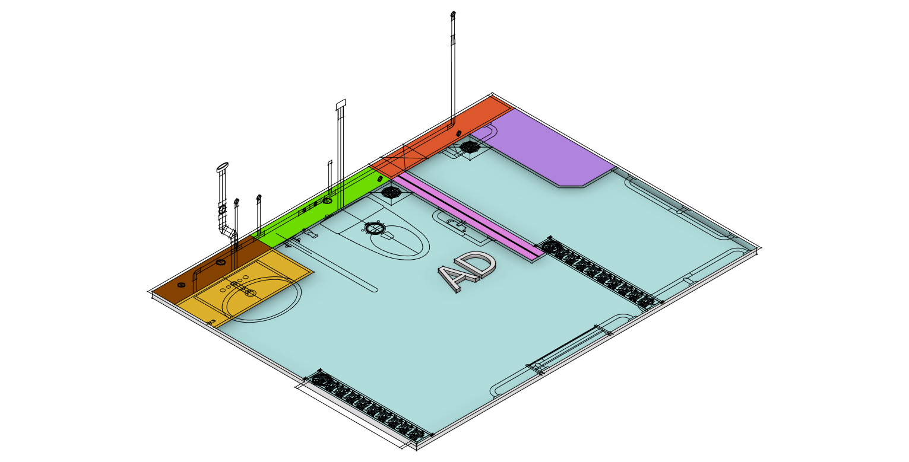

---

#### 🔹 ง. ระบบโครงเคาน์เตอร์อ่างล้างหน้า (Counter System Work)
* สร้างโครงสร้างรับน้ำหนักเคาน์เตอร์ด้วย **Smartframe 33.3**
* ประกอบด้วยโครงเหล็กกล่อง/อลูมิเนียมยึดรอบผนังและขาตั้ง
* รองรับระดับเคาน์เตอร์ท็อป $+850\,	ext{mm}$ และกระจกเงา Bevelled Mirror ขนาด $1,570 	imes 1,000\,	ext{mm}$

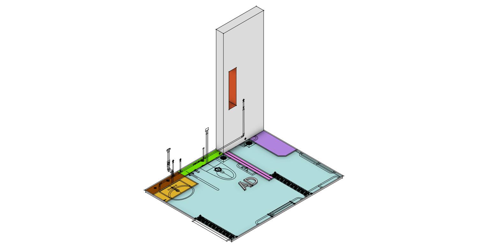

---

#### 🔹 จ. ระบบโครงสร้างฝ้าเพดานห้องน้ำ (Ceiling System Work)
* ระบบคำนวณโครงคร่าว C-Line และ Pro-Line รับแผ่นฝ้าทนชื้น
* คำนวณระยะห่างโครงซอย $400 - 450\,	ext{mm}$ หลบช่องดาวน์ไลท์และพัดลมดูดอากาศ
* ยึดด้วย **Clip Lock (`Cf Clip Lock`)** และเหล็กฉากยึดรอบผนัง (`Angle Steel L`)

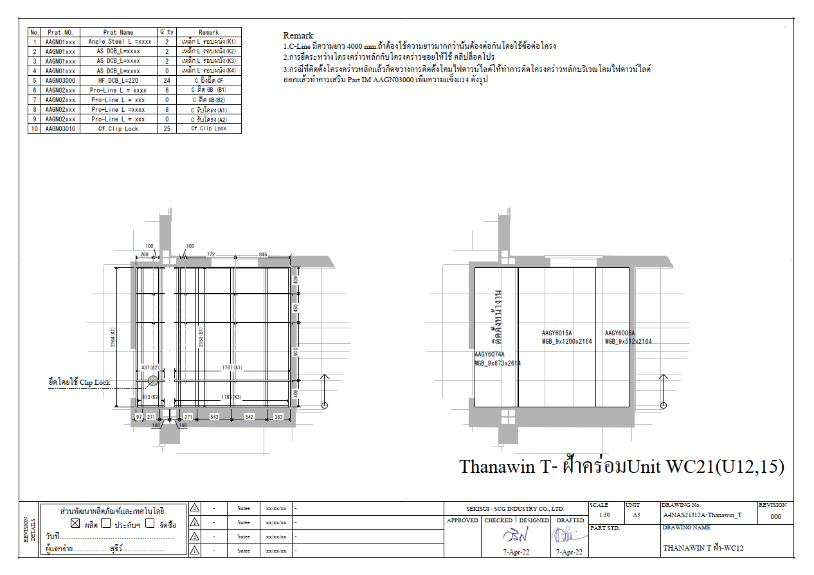

---

### 3.3 กระบวนการคำนวณ BOQ (BOQ Calculation Engine)
* ดึงข้อมูลปริมาตร ความยาว และจำนวนจาก Component และ Group 3D ในโมเดลโดยอัตโนมัติ
* คำนวณปริมาณวัสดุสำหรับงานโครงเฟรม (ฉากกั้นอาบน้ำ, อ่างล้างหน้า, ผนังหลังโถสุขภัณฑ์, ฝ้าเพดาน)
* รองรับระบบ **Auto Process** สำหรับการถอด BOQ งานมาตรฐาน
* มีฟังก์ชัน **Undo/Redo** และปรับขนาดสเปกวัสดุแบบเรียลไทม์

---

### 3.4 การตรวจสอบข้อมูล (Recheck & Auto Data Grid)
* หน้าต่างตารางตรวจสอบ **Auto Data Grid** แสดงรายการชิ้นส่วนทั้งหมดพร้อมพารามิเตอร์:
  * รหัสชิ้นส่วน (`Part No.`), ชื่อวัสดุ (`Description`), ขนาดความยาว (`Length`), จำนวน (`Q'ty`)
* ผู้ใช้สามารถคลิกตรวจสอบและ **Edit แก้ไขข้อมูลที่ผิดพลาด** ได้ทันทีก่อนส่งออก

---

### 3.5 การแจ้งเตือนระบบ (Message Alert: IM SB New)
* แจ้งเตือนเมื่อมีการอัปเดตรหัสชิ้นส่วนโรงงานใหม่ (`Update IM SB New`)
* แจ้งเตือนกรณีท่อหรือโครงเฟรมชนกับโครงสร้างหลัก (Clash Detection Alert)

---

### 3.6 การส่งออกข้อมูล (BOM Export & Automated Shop Drawings)

#### 1) การส่งออกรายการวัสดุ (Export BOM เป็น CSV / Excel)
แยกหมวดหมู่งานชัดเจน:
* **งานระบบท่อ:** จำนวนท่อ PVC, PPR, ข้อต่อตรง, ข้องอ, สามทาง, เกลียวนอก-เกลียวใน
* **งานเฟรม:** จำนวน Aluminium Frames, Box Frame ($50 	imes 40\,	ext{mm}$), U-Frame (`SB_8`)
* **งานฝ้าเพดาน:** จำนวน C-Line, Pro-Line, เหล็กฉาก L, Clip Lock
* **งานอื่นๆ:** พื้นที่แผ่นกันซึม Evalon ($	ext{m}^2$), กาวอีพ็อกซี่, ปูนกาว

#### 2) การสร้างแบบ Shop Drawing อัตโนมัติ (Automated Drawings)
* **Auto Template HEIM:** สร้างหน้ากระดาษพร้อม Title Block มาตรฐาน SCG HEIM
* **Auto 2D Views + 3D:** สร้างภาพแปลน Top-View, Elevation รูปด้าน 1-4, และ Isometric 3D
* **Auto Dimension:** บอกระยะความสูง ระดับ และพิกัดตำแหน่งท่ออัตโนมัติ
* **Auto Bar Cut List:** คำนวณตารางตัดวัสดุ (Cutting Schedule) แสดงรหัสท่อน, ความยาว (mm), จำนวน (ชิ้น), และเศษตัด (Scrap Percentage)

---

## 4. ตารางถอดแบบรายการวัสดุ 4 หมวดหลัก (BOM & Materials Matrix)

### 4.1 หมวดที่ 1: งานระบบท่อประปาและสุขาภิบาล (Piping System)
| รายการวัสดุ | มาตรฐาน / สเปก | หน้าที่ / ตำแหน่งติดตั้ง | รูปแบบการคิด BOM |
| :--- | :--- | :--- | :---: |
| **ท่อ PVC น้ำดี/น้ำทิ้ง** | PVC ตราช้าง 13.5 (ขนาด $1'', rac{3}{4}'', rac{1}{2}''$) | ท่อน้ำดีและท่อน้ำทิ้ง Floor Drain | ความยาวรวม (m.) |
| **ท่อ PVC โสโครก** | PVC 4" ชั้น 8.5/13.5 | ท่อส้วมจากโถสุขภัณฑ์ลงสู่ Shaft | ความยาวรวม (m.) |
| **ท่อ PP-R น้ำดีเย็น/ร้อน** | PP-R Class 20 ($25\,	ext{mm} / rac{1}{2}''$) | ท่อน้ำดีแรงดันสูงฝังผนัง | ความยาวรวม (m.) |
| **ข้อต่อตรง / ข้องอ 90° / 45°** | PVC / PPR ตามขนาดท่อ | จุดเปลี่ยนทิศทางท่อ | จำนวนชิ้น (EA) |
| **สามทาง (Tee) / ข้อต่อสะพาน** | PVC / PPR | แยกแขนงท่อน้ำดีและท่อระบายอากาศ | จำนวนชิ้น (EA) |
| **ข้อต่อเกลียวนอก-ใน / วาล์ว** | ทองเหลือง / PPR เกลียวโลหะ | จุดต่อสุขภัณฑ์และวาล์วผสม | จำนวนชิ้น (EA) |
| **Vent Cap** | Vent Cap Import | หมวกระบายอากาศบนหลังคา | จำนวนชิ้น (EA) |

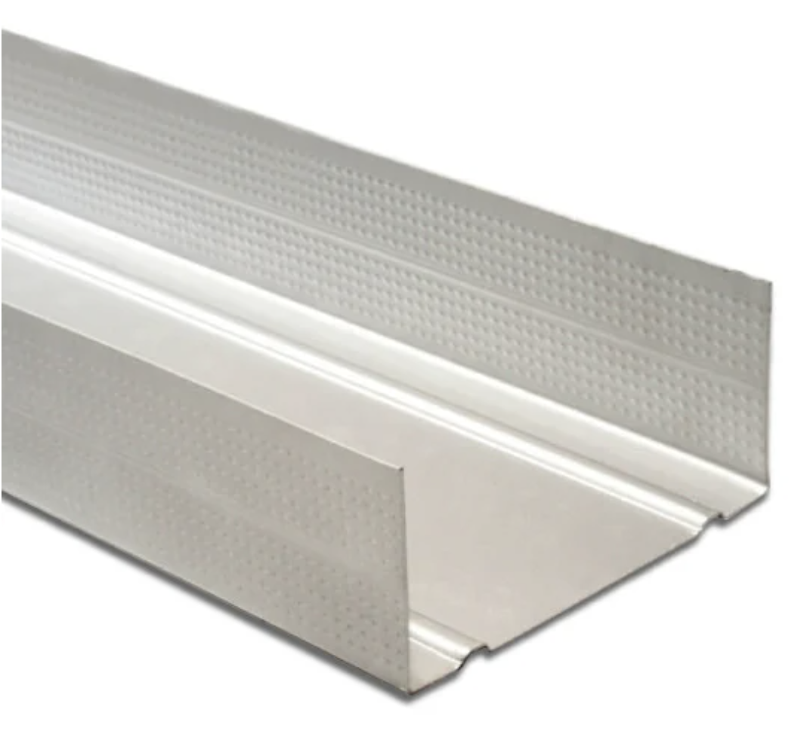

---

### 4.2 หมวดที่ 2: งานโครงสร้างเฟรม (Framing System & Bar Cut List)
| รหัสชิ้นส่วน | ชื่อชิ้นส่วน (Part Name) | สเปก / ขนาดหน้าตัด | ตำแหน่งการใช้งาน |
| :--- | :--- | :--- | :--- |
| **Smartframe 33.3** | โครงสร้างสมาร์ทเฟรม | C-Section เหล็กกัลวาไนซ์ $33.3\,	ext{mm}$ | โครงรับเคาน์เตอร์อ่างล้างหน้า |
| **BOX / U / C เฟรม** | กล่องเฟรมรับแรง | เหล็กกล่อง $50 	imes 40\,	ext{mm}$ ลายกันลื่น | โครงผนังหลังโถสุขภัณฑ์, โครงส่วนอาบน้ำ |
| **U-Frame (SB_8)** | โครงตัวยูรับแผ่น | ราง U กัลวาไนซ์สำหรับแผ่น Smartboard $8\,	ext{mm}$ | ขอบจบงานผนังเบาห้องน้ำ |
| **Aluminium Frame** | กรอบอลูมิเนียม Extrusion | รางอลูมิเนียม T-Slot | โครงฉากกั้นอาบน้ำกระจกนิรภัย |

**ตัวอย่างตารางตัดบาร์ (Bar Cut List สำหรับเคาน์เตอร์อ่างล้างหน้า):**
| ท่อนที่ (NO.) | ความยาวตัด (mm.) | จำนวน (Q'ty) | การใช้งาน / ตำแหน่ง |
| :---: | :---: | :---: | :--- |
| **a** | 225 | 4 | โครงขวางหัว-ท้าย |
| **b** | 1,120 | 4 | คานแนวนอนหลัก |
| **c** | 593 | 4 | เสาแนวตั้งรับน้ำหนัก |
| **d** | 1,053 | 2 | คานซอยเสริมระดับชั้นวาง |
| **f** | 101 | 2 | ตัวยึดขาเสริม |

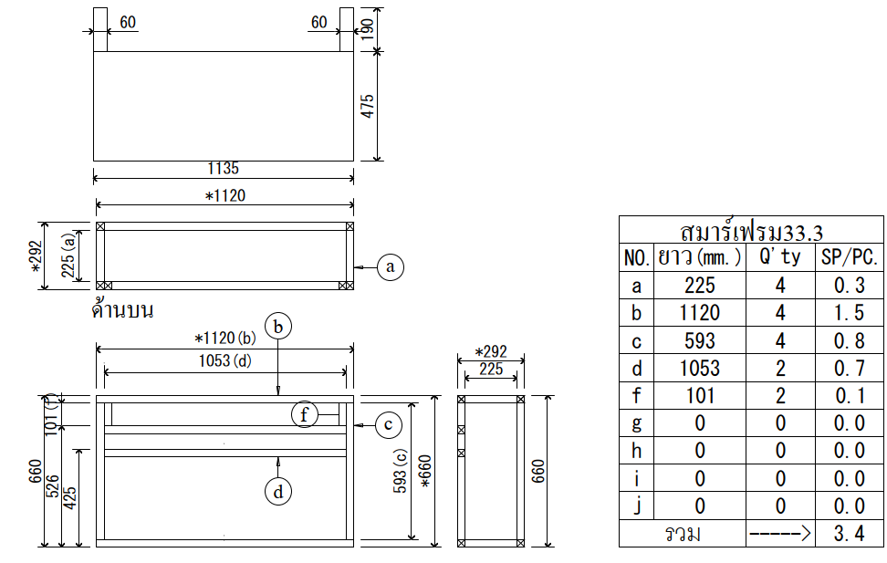

---

### 4.3 หมวดที่ 3: งานโครงสร้างฝ้าเพดาน (Ceiling System)
| ลำดับ | รหัสวัสดุ (Part No.) | ชื่อวัสดุ (Part Name) | จำนวน | หมายเหตุการใช้งาน |
| :---: | :--- | :--- | :---: | :--- |
| 1 | `AAGN01xxx` | **Angle Steel L** ($L=	ext{ตามแบบ}$) | 2 | เหล็กฉาก L รอบผนัง (K1) |
| 2 | `AAGN01xxx` | **AS DCB** ($L=	ext{ตามแบบ}$) | 2 | เหล็กฉาก L รอบผนัง (K2) |
| 3 | `AAGN01xxx` | **AS DCB** ($L=	ext{ตามแบบ}$) | 2 | เหล็กฉาก L รอบผนัง (K3) |
| 5 | `AAGN03000` | **HF DCB** ($L=220\,	ext{mm}$) | 24 | C ยิงยึด CF |
| 6 | `AAGN02xxx` | **Pro-Line** ($L=	ext{ตามแบบ}$) | 6 | โครง C ติดแผ่น GB (B1) |
| 8 | `AAGN02xxx` | **Pro-Line** ($L=	ext{ตามแบบ}$) | 8 | โครง C รับโครงหลัก (A1) |
| 10 | `AAGN03010` | **Cf Clip Lock** | 25 | คลิปล็อคยึดโครงคร่าวฝ้า |

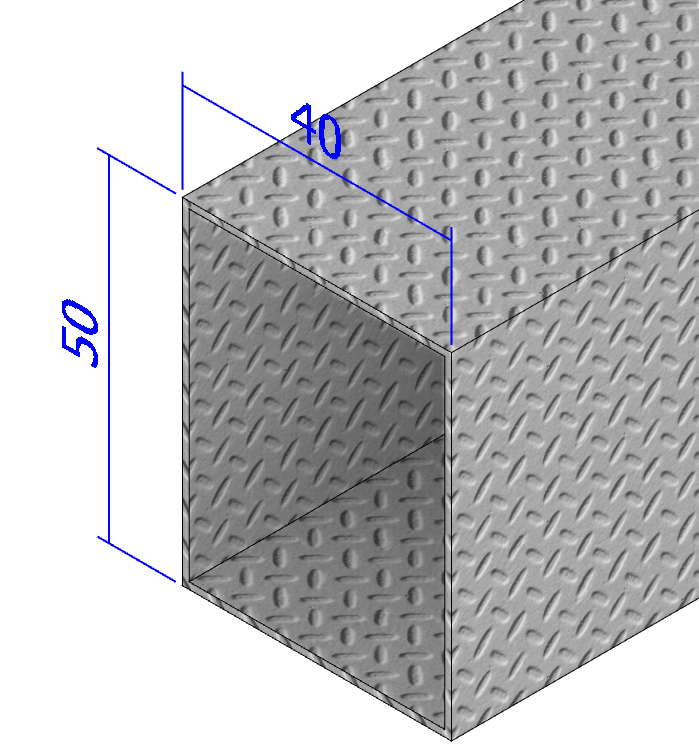

---

### 4.4 หมวดที่ 4: งานแผ่นกันซึมและวัสดุเคมีภัณฑ์ (Waterproofing & Chemicals)
| รายการวัสดุ | สเปก / คุณสมบัติ | ตำแหน่งใช้งาน |
| :--- | :--- | :--- |
| **แผ่นกันซึม Evalon** | แผ่นเมมเบรน EVA-PVC ยืดหยุ่นสูงกันรั่วซึม | ปูรองพื้นห้องน้ำและพับยกขอบบัวสูง $150\,	ext{mm}$ |
| **กาวอีพ็อกซี่ (Epoxy)** | กาวสองส่วนผสมแรงยึดเกาะสูง | ยึดข้อต่อโครงสร้างเหล็กกับพื้นคอนกรีต |
| **ปูนกาวติดกระเบื้อง** | ปูนกาวสูตรทนชื้นสำหรับห้องน้ำ | ปูกระเบื้องพื้นและผนังห้องน้ำ |
| **ยาแนวกันราดำ** | ยาแนวผสมสารยับยั้งเชื้อรา Microban | ยาแนวร่องกระเบื้องพื้นและผนัง |

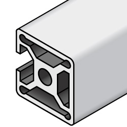

---

---

## 4.5 งาน Finishing: การคำนวณหา ปูนกาว, ปูนฉาบ, และเคมีภัณฑ์อื่นๆ (Finishing Calculation Engine)

> [!TIP]
> **นิยามของงาน Finishing ใน QHeim:**  
> ในระบบก่อสร้างบ้านสำเร็จรูปโมดูลาร์ คำว่า **Finishing** หัวใจสำคัญคือ **การถอดปริมาณพื้นที่ผิวเพื่อคำนวณหา ปูนกาว, ปูนฉาบ, แผ่นกันซึม, และเคมีภัณฑ์ประกอบอื่นๆ** ที่ต้องสั่งซื้อและจัดส่งล่วงหน้าให้สอดคล้องกับขนาดห้องจริง เพื่อลดความสูญเสีย (Material Waste) และควบคุมต้นทุนได้อย่างแม่นยำ

```mermaid
flowchart TD
    A["โมเดล 3D SketchUp (ห้องน้ำ & ผนัง)"] --> B{"วิเคราะห์พื้นที่ผิวและแนวรอยต่อ"}
    
    B -->|พื้นที่ปูกระเบื้องพื้นและผนัง (ตร.ม.)| C["1. คำนวณ ปูนกาว (Tile Adhesive)<br/>และ ปูนยาแนว (Grout)"]
    B -->|ความยาวรอยต่อแผ่น & พื้นที่ผิวผนัง| D["2. คำนวณ ปูนฉาบ (Plaster / Skim Coat)<br/>และ ตาข่ายไฟเบอร์ (Fiber Mesh)"]
    B -->|พื้นที่ถาดรองพื้นดรอป + พับขอบ| E["3. คำนวณ แผ่นกันซึม Evalon<br/>และ น้ำยากันซึม"]
    B -->|จุดยึดโครงสร้างและข้อต่อเฟรม| F["4. คำนวณ กาวอีพ็อกซี่ (Epoxy)<br/>และ ซิลิโคนกันเชื้อรา"]
    
    C & D & E & F --> G[("📊 ใบสรุปรายการวัสดุ Finishing BOM<br/>(ส่งออกเข้า Excel / ERP โรงงาน)")]
```

### 1) การคำนวณหา ปูนกาวติดกระเบื้อง (Tile Adhesive)
* **หลักการคำนวณ:** ดึงพื้นที่ผิว (Face Area) ของพื้นดรอปและผนังส่วนเปียก/แห้งที่ระบุแอตทริบิวต์เป็นงานปูกระเบื้อง
* **สูตรการคำนวณ:**
  $$\text{จำนวนถุงปูนกาว (ถุง)} = \left( \frac{\text{พื้นที่ปูกระเบื้อง (ตร.ม.)} \times \text{อัตราการใช้ (กก./ตร.ม.)}}{\text{น้ำหนักบรรจุต่อถุง (20 กก./ถุง)}} \right) \times (1 + \text{Waste } 5\%)$$
* **อัตราการสิ้นเปลืองมาตรฐาน:**
  * กระเบื้องเซรามิก/แกรนิตโต้ทั่วไป (หวีเกรียง 3-5 มม.): ประมาณ $3.5 - 5.0\,\text{กก./ตร.ม.}$ (1 ถุง 20 กก. ปูได้ประมาณ $4.0 - 5.0\,\text{ตร.ม.}$)
  * งานปูกระเบื้องทับกระเบื้องเดิมหรือพื้นผิวพิเศษ: ประมาณ $5.0 - 6.0\,\text{กก./ตร.ม.}$

---

### 2) การคำนวณหา ปูนฉาบและปูนฉาบรอยต่อ (Plaster & Skim Coat)
* **ก. ปูนฉาบรอยต่อแผ่นสมาร์ทบอร์ด (Joint Compound):**
  * คำนวณจากความยาวของรอยต่อแผ่นผนัง (Joint Length ในแนวตั้งและแนวนอน)
  * สูตร: $\text{จำนวนถุงปูนฉาบรอยต่อ} = \frac{\text{ความยาวรอยต่อรวม (เมตร)} \times \text{อัตราการใช้ (0.2 กก./ม.)}}{\text{น้ำหนักบรรจุ (20 กก.)}}$
  * บวกแถบผ้าใยแก้วหรือเทปผ้ารอยต่อ (Fiber Mesh Tape): ความยาวรวม $\times 1.05$ (เผื่อตัดต่อ 5%)
* **ข. ปูนฉาบผิวบางสกิมโค้ท (Skim Coat):**
  * สำหรับฉาบแต่งผิวเนียนเรียบก่อนทาสีบนผนังส่วนแห้งหรือฝ้าเพดาน
  * อัตราการใช้: $1.2 - 1.5\,\text{กก./ตร.ม./ความหนา 1 มม.}$ (1 ถุง 20 กก. ฉาบได้ประมาณ $13 - 16\,\text{ตร.ม.}$ ที่ความหนา 1 มม.)

---

### 3) การคำนวณหา แผ่นกันซึมและเคมีภัณฑ์อื่นๆ (Waterproofing & Chemicals)
* **แผ่นกันซึม Evalon (Evalon Waterproofing Membrane):**
  * คิดจากพื้นที่ถาดพื้นห้องน้ำ ($A_{floor}$) บวกพื้นที่พับขอบขึ้นผนังกันซึมสูงอย่างน้อย $150 - 200\,\text{mm}$ รอบห้อง ($A_{up}$) บวกระยะทาบทับรอยต่อ (Lap $100\,\text{mm}$):
    $$\text{พื้นที่แผ่นกันซึมรวม} = \left( A_{floor} + (\text{เส้นรอบรูปห้อง} \times 0.20\,\text{ม.}) \right) \times 1.15 \quad (\text{เผื่อ Lap } 15\%)$$
* **กาวอีพ็อกซี่ (Epoxy Adhesive):**
  * คำนวณตามจำนวนจุดยึดและข้อต่อโครงสร้างเหล็ก (ฐานเคาน์เตอร์, เสากล่องโถสุขภัณฑ์) อัตราเฉลี่ย $0.15 - 0.20\,\text{กก./จุด}$
* **ปูนยาแนวกันราดำ (Anti-Fungal Tile Grout):**
  * คำนวณจากพื้นที่ปูกระเบื้อง ขนาดแผ่นกระเบื้อง ($W \times L$) และความกว้างร่องยาแนว ($2 - 3\,\text{mm}$)
  * อัตราเฉลี่ย: ประมาณ $0.25 - 0.35\,\text{กก./ตร.ม.}$ (1 ถุง 1 กก. ยาแนวได้ประมาณ $3 - 4\,\text{ตร.ม.}$)
* **ซิลิโคนกันเชื้อรา (Sanitary Silicone Sealant):**
  * คำนวณจากความยาวแนวรอยต่อขอบสุขภัณฑ์, ขอบเคาน์เตอร์, และฉากกั้นอาบน้ำ:
    $$\text{จำนวนหลอดซิลิโคน} = \frac{\text{ความยาวแนวรอยต่อรวม (เมตร)}}{8 - 10\,\text{เมตร/หลอด (ขนาดรอยต่อ 5x5 มม.)}}$$

## 5. คลังภาพร่างแนวคิดและแบบก่อสร้าง (Conceptual Gallery & Shop Drawings)

### 5.1 ผังท่อและแบบสถาปัตยกรรมต้นฉบับ (AutoCAD Source Drawings)
* **DWG SN1-05 (Piping Detail):** แบบแปลน Floor Sleeve, ผังท่อน้ำทิ้ง-น้ำเสีย, และ Elevation ท่อประปา
* **DWG IN3-05 (Bathroom Detail):** แปลนพื้น, แปลนคาน, และ Elevation 1-4

| ผังท่อประปา (SN1-05) | ผังสถาปัตยกรรมห้องน้ำ (IN3-05) |
| :---: | :---: |
| 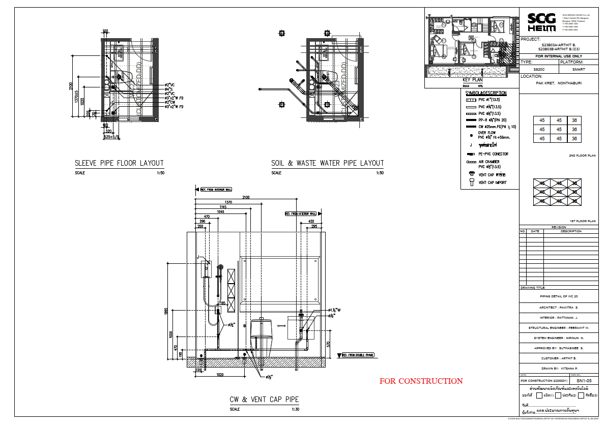 | 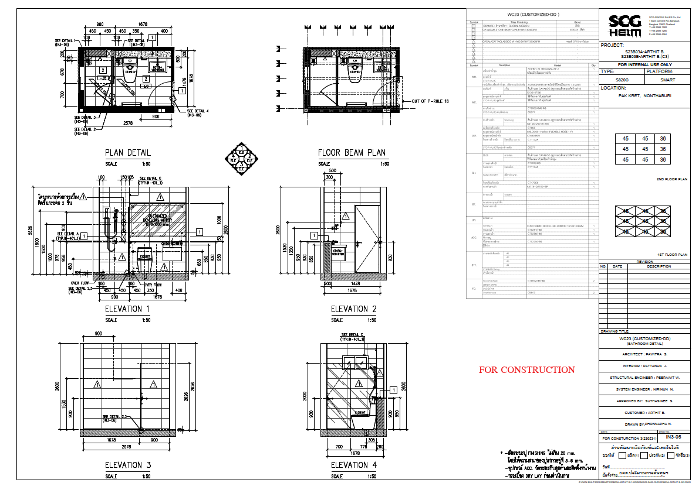 |

---

### 5.2 แบบ Shop Drawing การผลิตจริง (Fabrication Drawings)

#### 1) แบบเคาน์เตอร์และโครงผนังสุขภัณฑ์ (WC21 Shop Drawing)
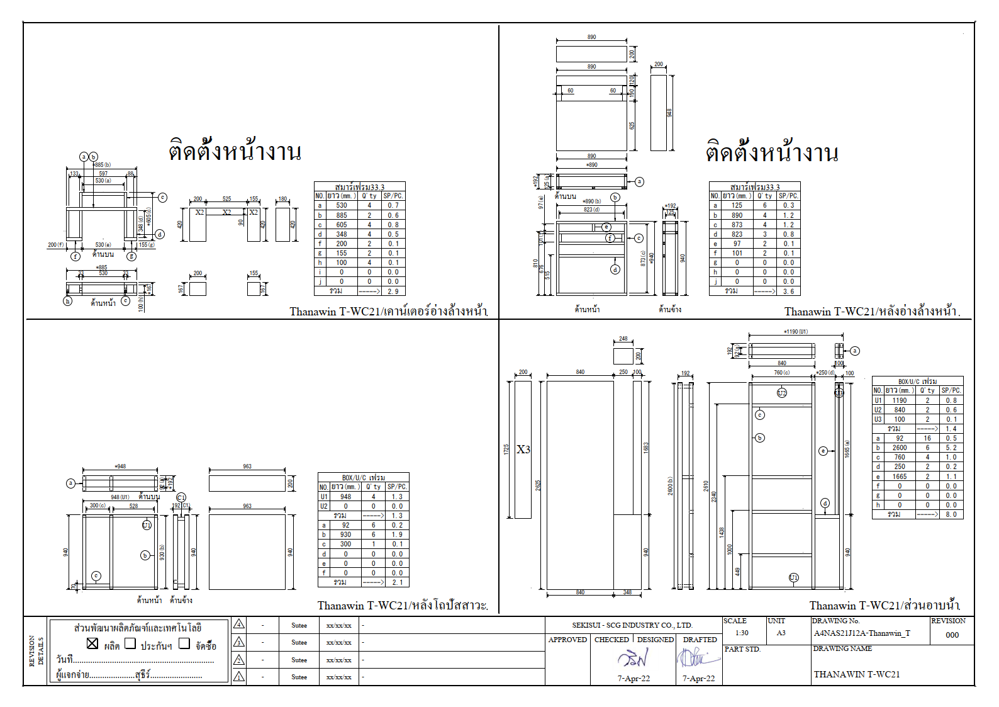

#### 2) แบบโครงผนังส่วนอาบน้ำและผนังหลังโถส้วม (WC22 Shop Drawing)
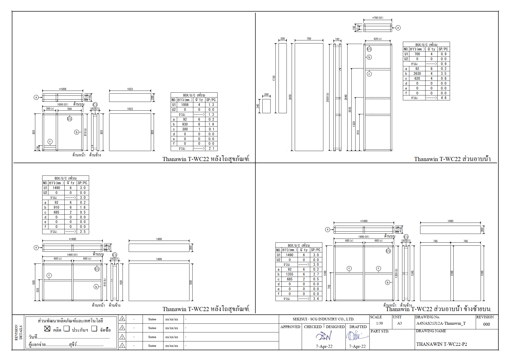

---

### 5.3 ภาพจำลอง 3D BIM ใน SketchUp (3D Assembly Views)

| การนำเข้าโครงร่างเส้น CAD 2D | Auto Run ท่อ PVC & PPR |
| :---: | :---: |
|  |  |

| การแบ่งโซนและช่องสบู่ (Soap Niche) | โมเดลรวมพร้อมเคาน์เตอร์ (3D Assembly) |
| :---: | :---: |
|  | 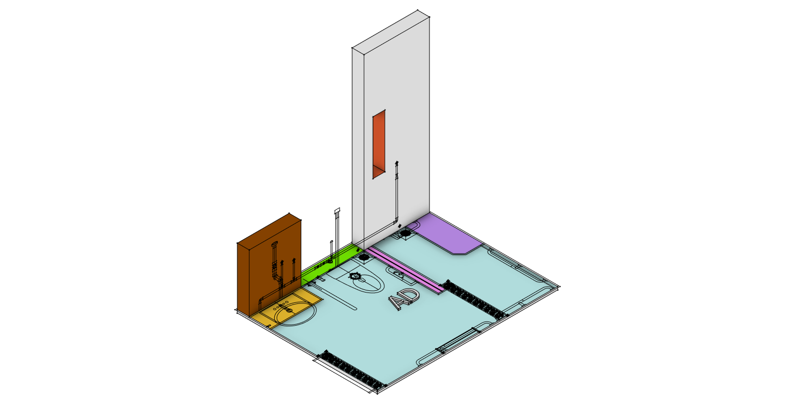 |

---

> 🏢 **ทีมพัฒนา:** SCG HEIM Engineering Automation & Modular BIM System  
> 🔗 **เอกสารหลัก:** [Master Documentation Portal](index.html) &bull; [README.md](README.md)  
> 📅 **เวอร์ชันแนวคิด (Conceptual Release):** ตุลาคม 2026


---

[🏠 กลับสู่หน้าหลัก (Master Documentation)](README.md) &bull; [🌐 เปิดอ่านบนเว็บเบราว์เซอร์ (GitHub Pages)](https://suteechu.github.io/manual-QHeim/Bathroom_Finishing_Doc.html)
