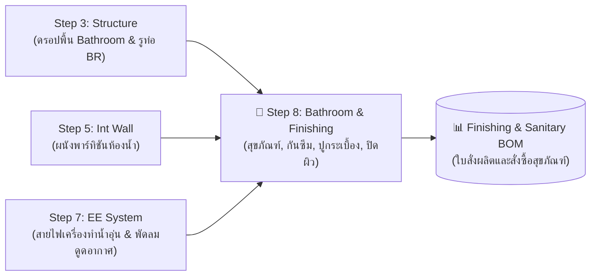

# 🚧 Step 8: คู่มือและเอกสารระบบ Bathroom & Finishing (QHeim)

> [!NOTE]
> **สถานะโมดูล (Module Status):**  
> 🛠️ **อยู่ระหว่างการคิดสร้างและพัฒนา (Under Active Development / Coming Soon)**  
> โมดูลระบบ **Bathroom & Finishing** กำลังอยู่ระหว่างการออกแบบสถาปัตยกรรมโค้ดและเตรียมฟังก์ชันการทำงาน โดยทีมพัฒนาจะนำเอกสารฉบับสมบูรณ์และสคริปต์ตัวเต็มมาอัปเดตเพิ่มเติมให้ในภายหลัง

---

## 1. ภาพรวมและขอบเขตของระบบที่กำลังพัฒนา (Planned Scope & Concept)

ระบบ **Bathroom & Finishing (งานห้องน้ำและวัสดุปิดผิวสำเร็จรูป)** ถูกออกแบบขึ้นเพื่อเติมเต็มกระบวนการทำงานแบบบูรณาการ (End-to-End Modular BIM) ในส่วนของงานสถาปัตยกรรมตกแต่งภายในและสุขอนามัย โดยเชื่อมโยงกับระบบโครงสร้างและงานระบบเดิมของ QHeim:

1. **ระบบห้องน้ำสำเร็จรูป (Modular Bathroom & WC Assembly):**
   * เชื่อมโยงกับฟังก์ชันพื้นดรอปห้องน้ำจาก **Step 3 (Structure: Bathroom Drop)**
   * ติดตั้งโมเดล 3D สุขภัณฑ์มาตรฐาน (โถสุขภัณฑ์, อ่างล้างหน้า, อ่างอาบน้ำ, ฉากกั้นอาบน้ำ, ก๊อกน้ำ, และฝักบัว)
   * การวางแนวท่อน้ำดีและท่อน้ำทิ้งเชื่อมต่อกับรูเจาะ Service Hole (BR) ที่คานโครงสร้างเตรียมไว้
2. **ระบบกันซึมและปูกระเบื้อง (Waterproofing Membrane & Tiling):**
   * ระบบคำนวณแผ่นกันซึมถาดรองพื้นห้องน้ำสำเร็จรูป
   * การคำนวณแนวการจัดเรียงกระเบื้องพื้นและกระเบื้องผนัง (Wall & Floor Tile Patterns)
3. **ระบบวัสดุปิดผิวสถาปัตยกรรม (Architectural Finishing):**
   * การปิดผิวพื้นภายในห้องต่างๆ (Laminate, SPC, Vinyl, ปาร์เก้)
   * งานบัวพื้น (Skirting Boards) และขอบคิ้วจบงานรอยต่อระหว่างยูนิต
   * งานปิดผิวฝ้าเพดาน (Ceiling Board Finishing) และช่องเซอร์วิส
4. **การถอดรายการวัสดุและปริมาณงาน (BOM Finishing):**
   * ถอดตารางสรุปรหัสสุขภัณฑ์ อุปกรณ์ประกอบห้องน้ำ
   * คำนวณพื้นที่วัสดุปิดผิว (ตร.ม.) และความยาวบัวเชิงผนัง (ม.) แยกตามรายยูนิตและรายห้อง ส่งออกสู่ Excel และระบบสั่งซื้อโรงงาน

---

## 2. ความสัมพันธ์กับระบบย่อยอื่นๆ ใน QHeim (System Interconnections)

---

## 3. หน้าต่างเมนูและไอคอนที่เกี่ยวข้องในระบบ (Preview)

* **ไอคอนระบบห้องน้ำ:** `ICON/M-Bathroom.png`
* **สคริปต์และคอมโพเนนต์ตั้งต้นในโฟลเดอร์ Ruby:**
  * `Ruby/Heim_MakeWC.rb`
  * `Ruby/Heim_WCgetCode.rb`
  * `Ruby/WCGetCode.html`

---

> 📅 **กำหนดการอัปเดต:** ทีมพัฒนาระบบ QHeim จะนำเอกสารฉบับสมบูรณ์ โค้ดการทำงาน และคู่มือ SOP มาอัปเดตให้ในเวอร์ชันถัดไป  
> 🔗 กลับสู่หน้าหลัก: [Master Documentation Portal](index.html) &bull; [README.md](README.md)
