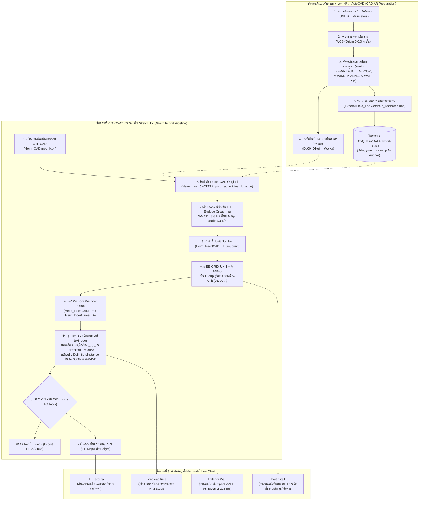
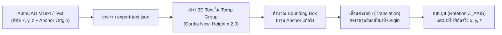

# คู่มือและเอกสารการทำงานระบบ นำเข้าและเตรียมไฟล์ CAD AR (QHeim)

[🏠 กลับสู่หน้าหลัก (Master Documentation)](README.md) &bull; [🌐 เปิดอ่านบนเว็บเบราว์เซอร์ (GitHub Pages)](https://suteechu.github.io/manual-QHeim/CAD_AR_Doc.html)


เอกสารฉบับนี้จัดทำขึ้นเพื่ออธิบายหลักการทำงาน, มาตรฐานการเตรียมไฟล์ AutoCAD สถาปัตยกรรม (CAD AR / Floor Plan DWG), การส่งออกข้อมูลตัวอักษรและพิกัดด้วย VBA/JSON, สถาปัตยกรรมโค้ด (Code Architecture), การนำเข้าแปลน 2D DWG สู่ SketchUp โดยคงพิกัดจุดกำเนิด (Preserve Origin), การจัดกลุ่มยูนิตเข้าสู่เลเยอร์โครงสร้าง (`S-Unit`), การจับคู่และเปลี่ยนชื่อบล็อกช่องเปิดประตู-หน้าต่างอัตโนมัติ (`text_door` / `A-DOOR` / `A-WIND`), การจัดการงานระบบไฟฟ้าและแอร์ (EE & AC Block/Text), และแนวทางแก้ปัญหา (Troubleshooting) ของระบบ **CAD AR / CAD LTF** ในส่วนขยาย **QHeim (SketchUp Ruby Extension)**

---

## 1. ภาพรวมระบบ (System Overview)

ระบบ **CAD AR Import (CAD LTF)** คือหัวใจเริ่มต้นในกระบวนการทำงานแบบบูรณาการ (End-to-End Modular BIM) ของ QHeim ทำหน้าที่แปลงข้อมูลแบบร่างสถาปัตยกรรม 2D จาก AutoCAD ให้อยู่ในรูปแบบ Smart 2D/3D Components บน SketchUp เพื่อเป็นฐานข้อมูลหลักส่งต่อไปยังระบบย่อยอื่นๆ ได้แก่:
1. **ระบบ LongleadTime:** ดึงชื่อช่องเปิดไปแม็ปกับรหัส MIM เพื่อสร้างโมเดลบานประตู-หน้าต่าง 3D และคำนวณ BOM ล่วงหน้า
2. **ระบบ Exterior Wall:** อ้างอิงกริดยูนิต `S-Unit`, เสามุม `EE-GRID-UNIT`, และตำแหน่งช่องเปิด `A-WIND` / `A-DOOR` เพื่อวางเสา Stud และแผ่นผนังภายนอก AAFP
3. **ระบบ PartInstall:** อ้างอิงยูนิต `S-Unit` เพื่อคำนวณ Direction Code (01-12) และติดตั้ง Flashing, Guide Pin, Antivibration, และ Joint Set
4. **ระบบ Electrical & Mechanical (EE & AC):** ดึงตำแหน่งอุปกรณ์ ปลั๊ก สวิตช์ และความสูง (`H=xxxx`) เข้าสู่โมเดลงานระบบ

### แผนผังลำดับขั้นตอนการทำงาน (Workflow Lifecycle)



> [!IMPORTANT]
> **กฎเหล็ก 3 ข้อในการเตรียมและนำเข้าไฟล์ CAD AR:**
> 1. **จุด Origin (0,0,0) ใน AutoCAD ต้องเป็นจุดอ้างอิงเดียวกันทุกชั้น (1F, 2F, 3F):** หากพิกัดเคลื่อนใน AutoCAD เมื่อนำเข้า SketchUp ด้วยตัวเลือก `Preserve Origin` โมเดลแต่ละชั้นจะไม่ซ้อนทับกันอย่างถูกต้อง
> 2. **ต้องรัน VBA Macro ส่งออกข้อความก่อนนำเข้า SketchUp เสมอ:** SketchUp ไม่สามารถอ่าน AutoCAD Dynamic Text / MText ภาษาไทยจากไฟล์ DWG ได้โดยตรง จึงต้องใช้ Macro บันทึกข้อมูลออกมาเป็น `C:/QHeim/DATA/export-text.json` ก่อนรันปุ่มนำเข้า
> 3. **ลำดับการกดปุ่มใน SketchUp ต้องเรียงตามลำดับ:**  
>    $$\text{Import CAD Original} \longrightarrow \text{Unit Number} \longrightarrow \text{Door Window Name}$$  
>    *ห้ามรันข้ามขั้นตอน* เพราะการตั้งชื่อประตู-หน้าต่างต้องอ้างอิงขอบเขตของยูนิตในเลเยอร์ `S-Unit`

---

## 2. หน้าต่างเมนูควบคุม (UI Controller)

ระบบนำเข้าไฟล์ CAD AR ทำงานผ่านหน้าต่างไดอะล็อกควบคุมแบบ HTML Dialog:
* **Ruby Controller:** [Heim_CADImportIcon.rb](file:///C:/QHeim/Ruby/Heim_CADImportIcon.rb)
* **HTML Dialog View:** [Heim_CADImport.html](file:///C:/QHeim/Ruby/Heim_CADImport.html)
* **Core Logic Engines:**
  * [Heim_InsertCADLTF.rb](file:///C:/QHeim/Ruby/CADLTF/Heim_InsertCADLTF.rb) (DWG Import & Text JSON Engine)
  * [Heim_DoorNameLTF.rb](file:///C:/QHeim/Ruby/CADLTF/Heim_DoorNameLTF.rb) (Door/Window Recognition & Naming Engine)
  * [Heim_EEGroup.rb](file:///C:/QHeim/Ruby/CADLTF/Heim_EEGroup.rb) (Electrical Component & Height Mapping)
  * [Heim_ACGroup.rb](file:///C:/QHeim/Ruby/CADLTF/Heim_ACGroup.rb) (Air Conditioning Component Manager)

*(นอกจากนี้ยังมีชุดคำสั่งเดิมผ่านหน้าต่าง Standard Controller: [Heim_StandardIcon.rb](file:///C:/QHeim/Ruby/Heim_StandardIcon.rb) / [Heim_Standard.html](file:///C:/QHeim/Ruby/Heim_Standard.html))*

### รายการไอคอนและปุ่มคำสั่ง (Tool Title & Actions)

| ไอคอน / ปุ่ม | ชื่อคำสั่ง (Tool Title) | Callback Function | ไฟล์ Ruby ที่ประมวลผล | หน้าที่หลัก |
| :---: | :--- | :--- | :--- | :--- |
|  | **Import CAD Original** | `import_cad` | [`Heim_InsertCADLTF.rb`](file:///C:/QHeim/Ruby/CADLTF/Heim_InsertCADLTF.rb) | นำเข้าไฟล์ DWG โดยรักษาพิกัดเดิม พร้อมสร้าง 3D Text จาก JSON อัตโนมัติ |
|  | **Unit Number** | `unit_number` | [`Heim_InsertCADLTF.rb`](file:///C:/QHeim/Ruby/CADLTF/Heim_InsertCADLTF.rb) | รวมกริดโมดูลาร์กับเลขยูนิต จัดเก็บลงเลเยอร์ `S-Unit` พร้อมใส่ Attribute |
|  | **Door Window Name** | `door_window_name` | [`Heim_DoorNameLTF.rb`](file:///C:/QHeim/Ruby/CADLTF/Heim_DoorNameLTF.rb) | จัดกลุ่ม Text ช่องเปิด และเปลี่ยนชื่อบล็อก 2D ใน `A-DOOR`/`A-WIND` พร้อมทิศทางเปิด |
|  | **Import EE Text Inside Block** | `import_text_inside` | [`Heim_InsertCADLTF.rb`](file:///C:/QHeim/Ruby/CADLTF/Heim_InsertCADLTF.rb) | นำเข้า Text ภายในบล็อกงานระบบไฟฟ้าจาก `export-text-inside-ee-block.json` |
|  | **Import AC Text Inside Block** | `import_text_inside_ac` | [`Heim_InsertCADLTF.rb`](file:///C:/QHeim/Ruby/CADLTF/Heim_InsertCADLTF.rb) | นำเข้า Text ภายในบล็อกงานระบบแอร์จาก `export-text-inside-ac-block.json` |
| <kbd>AC select comps</kbd> | **AC Component Selection** | `manage_ac_components` | [`Heim_ACGroup.rb`](file:///C:/QHeim/Ruby/CADLTF/Heim_ACGroup.rb) | เลือกและจัดการกลุ่ม Component งานระบบปรับอากาศในโมเดล |
| <kbd>EE select comps</kbd> | **EE Map Height** | `ee_map_height` | [`Heim_EEGroup.rb`](file:///C:/QHeim/Ruby/CADLTF/Heim_EEGroup.rb) | สแกนข้อความ `H=xxxx` ใน `EE-TEXT` และบันทึกค่าความสูงลงใน Attribute บล็อกไฟฟ้า |
| <kbd>EE change height</kbd> | **EE Change Height** | `ee_edit_height` | [`Heim_EEGroup.rb`](file:///C:/QHeim/Ruby/CADLTF/Heim_EEGroup.rb) | ปรับเปลี่ยนค่าระดับความสูงของบล็อกอุปกรณ์ไฟฟ้าที่เลือกพร้อมกัน |
| <kbd>EE show height</kbd> | **EE Show Height** | `ee_show_text_height` | [`Heim_EEGroup.rb`](file:///C:/QHeim/Ruby/CADLTF/Heim_EEGroup.rb) | สร้างป้าย 3D Text แสดงระดับความสูงจำลองเพื่อตรวจสอบความถูกต้องหน้างาน |

---

## 3. คู่มือขั้นตอนการปฏิบัติงาน (Standard Operating Procedure - SOP)

กระบวนการทำงานแบ่งออกเป็น 2 ช่วงหลักอย่างชัดเจน: **ช่วงที่ 1: การเตรียมและส่งออกไฟล์ใน AutoCAD** และ **ช่วงที่ 2: การนำเข้าและประมวลผลใน SketchUp**

---

### 📌 ช่วงที่ 1: การเตรียมและส่งออกไฟล์ใน AutoCAD (CAD AR Preparation)

ก่อนนำแบบเข้าสู่ SketchUp ผู้เขียนแบบ AutoCAD ต้องปฏิบัติตามมาตรฐานดังต่อไปนี้:

#### 1. การตั้งค่าหน่วย (Units Setting)
* พิมพ์คำสั่ง `UNITS` ใน AutoCAD
* กำหนด **Length Type:** `Decimal`
* กำหนด **Insertion Scale:** `Millimeters` (มิลลิเมตร)

#### 2. การกำหนดจุดกำเนิดและพิกัดร่วม (Origin & Coordinate System)
* แบบแปลนของทุกชั้น (Floor 1, Floor 2, Floor 3) **ต้องอ้างอิงจุดกำเนิดร่วม WCS `(0, 0, 0)` จุดเดียวกัน** (เช่น จุดตัดมุมเสากริด 1-A ของอาคาร)
* ห้ามย้ายหรือ Move แปลนหนีจุดกำเนิดใน AutoCAD มิฉะนั้นโมเดลแต่ละชั้นใน SketchUp จะไม่ตรงกัน
* หมุนมุมมองให้ทิศเหนือของอาคารชี้ขึ้นตามแนวแกน `+Y` มาตรฐาน

#### 3. การจัดโครงสร้างเลเยอร์ใน AutoCAD (ตามข้อกำหนด `floorplanlayers.txt`)
ตรวจสอบว่าวัตถุสถาปัตยกรรม 2D อยู่ในเลเยอร์ที่ถูกต้อง:
* กริดและขอบเขตยูนิต: อยู่ในเลเยอร์ `EE-GRID-UNIT` (หรือ `A-GENM-GM`, `A-GENM`, `A-GENM-450G`)
* ตัวเลขระบุชื่อยูนิต (เช่น 01, 02 หรือ H01, H02): อยู่ในเลเยอร์ `A-ANNO`
* บล็อกบานประตู 2D: อยู่ในเลเยอร์ `A-DOOR`
* บล็อกบานหน้าต่าง 2D: อยู่ในเลเยอร์ `A-WIND` หรือ `A-BLIN`
* ข้อความกำกับชื่อบานประตู: อยู่ในเลเยอร์ `A-ANNO-DOOR`
* ข้อความกำกับชื่อบานหน้าต่าง: อยู่ในเลเยอร์ `A-ANNO-WIND`
* ผนังและลวดลายผนัง: อยู่ในเลเยอร์ `A-WALL`, `A-PATT-WALL`
* เส้นขอบเขตพื้นที่ห้อง: อยู่ในเลเยอร์ `A-AREA`
* ท่อระบายอากาศ/ฮูดดูดควัน: อยู่ในเลเยอร์ `Hood`
* อุปกรณ์ไฟฟ้าและแสงสว่าง: อยู่ในเลเยอร์ `EE-EQPM-*`, `EE-WIRE`, `EE-TEXT`, `EE-DIM`

#### 4. การส่งออกข้อความตัวอักษรด้วย VBA Macro (Export Text JSON)
เนื่องจากระบบ Import ของ SketchUp ไม่รองรับ Font ภาษาไทยหรือการจัดเรียงข้อความ MText ของ AutoCAD โดยตรง จึงต้องรัน Macro เพื่อบันทึกพิกัดและขนาดตัวอักษร:
1. เปิดโปรแกรม AutoCAD ที่เปิดไฟล์แปลนชั้นนั้นอยู่
2. พิมพ์คำสั่ง `VBALOAD` แล้วเลือกไฟล์ [`C:\QHeim\ExportLTF.dvb`](file:///C:/QHeim/ExportLTF.dvb) (หรือ [`Export.dvb`](file:///C:/QHeim/Export.dvb))
   *(หากใช้ Macro แบบโมดูล ให้โหลดสคริปต์ [ExportAllText_ForSketchUp_Anchored.bas](file:///C:/QHeim/DATA/ExportAllText_ForSketchUp_Anchored.bas))*
3. พิมพ์คำสั่ง `VBARUN` เลือกฟังก์ชัน **`ExportAllText_ForSketchUp_Anchored`** (หรือเลือกจากเมนูลัด Heim)
4. โปรแกรมจะทำการสแกนข้อความทั้ง Text และ MText ใน ModelSpace ทั้งหมด แล้วส่งออกเป็นไฟล์:
   $$\texttt{C:/QHeim/DATA/export-text.json}$$
5. หน้าต่าง AutoCAD จะแสดงกล่องข้อความยืนยันจำนวนตัวอักษรที่ Export สำเร็จ (เช่น `Export complete. Text count: 485`)

#### 5. การบันทึกไฟล์ CAD DWG
* สั่ง Purge ขยะในไฟล์ด้วยคำสั่ง `-PURGE` -> `ALL`
* บันทึกไฟล์ `.dwg` ไว้ในโฟลเดอร์โครงการตามมาตรฐาน เช่น:
  $$\texttt{D:/00\_QHeim\_Work/<ชื่อโครงการ>/<ชื่อโมเดล>.dwg}$$

---

### 📌 ช่วงที่ 2: การนำเข้าและประมวลผลใน SketchUp (QHeim Import Pipeline)

เปิดไฟล์ SketchUp ของโครงการ แล้วรันขั้นตอนตามลำดับดังนี้:

#### สเต็ปที่ 1: นำเข้าแบบ CAD และข้อความตัวอักษร (Import CAD Original)
* **การเลือกคำสั่ง:** คลิกไอคอน **Import CAD Original** () บนแถบเครื่องมือ *Import OTF CAD*
* **การดำเนินการ:** หน้าต่างเลือกไฟล์จะเปิดขึ้นที่โฟลเดอร์โครงการ `D:/00_QHeim_Work/<Project_Name>/` &rarr; เลือกไฟล์ `.dwg` ที่เตรียมไว้แล้วกด Open
* **การประมวลผลเบื้องหลัง:**
  1. SketchUp ดึงไฟล์ DWG เข้ามาโดยตั้งค่า `preserve_origin: true` และหน่วย `mm` ทำให้ตำแหน่งตรงกับ AutoCAD 100%
  2. ระเบิดคอมโพเนนต์ชั้นนอกสุด (`explode`) 1 ระดับ เพื่อกระจายเลเยอร์
  3. อ่านไฟล์ `C:/QHeim/DATA/export-text.json` แล้วสร้าง 3D Text (ฟอนต์ `Cordia New`) พร้อมหมุนมุมและปรับจุด Anchor พิกัดตรงตามแบบเดิม
  4. ทำความสะอาดเลเยอร์ที่ไม่ได้ใช้งาน (`cleanup_untagged_layers`) และทำการ `Zoom Extents`
* **ผลลัพธ์ในโมเดล:** แบบแปลนเส้น 2D และตัวหนังสือภาษาไทย/อังกฤษ ปรากฏอยู่ในพิกัดที่ถูกต้องตามจริง

#### สเต็ปที่ 2: จัดกลุ่มและสร้างรหัสยูนิต (Unit Number)
* **การเลือกคำสั่ง:** คลิกไอคอน **Unit Number** ()
* **การดำเนินการ:** กดปุ่มคำสั่ง 1 ครั้ง ระบบจะทำงานอัตโนมัติ
* **การประมวลผลเบื้องหลัง:**
  1. ค้นหากลุ่มกริดยูนิตในเลเยอร์ `EE-GRID-UNIT`
  2. ค้นหาข้อความตัวเลขยูนิตในเลเยอร์ `A-ANNO` (เช่น "01", "02" หรือ "H01")
  3. นำ Bounding Box ของกริดมาตรวจสอบว่าครอบคลุมตำแหน่งพิกัดของข้อความใด
  4. รวมกริดและข้อความเข้าเป็น Group ยูนิตเดียวกัน
  5. ย้าย Group เข้าสู่เลเยอร์ **`S-Unit`**
  6. ตั้งชื่อ Group เป็นเลข 2 หลัก (เช่น `01`, `02`, `03`...) และบันทึก Attribute `QHeim -> position`
* **ผลลัพธ์ในโมเดล:** ได้ก้อนยูนิตมาตรฐานในเลเยอร์ `S-Unit` พร้อมสำหรับงานคำนวณโครงสร้าง

#### สเต็ปที่ 3: จับคู่และเปลี่ยนชื่อบล็อกช่องเปิด (Door Window Name)
* **การเลือกคำสั่ง:** คลิกไอคอน **Door Window Name** ()
* **การดำเนินการ:**
  1. ระบบจะแสดงกล่องข้อความถาม: *"Merge same-line text before grouping?"* &rarr; ให้ตอบ **Yes** เพื่อผสานข้อความที่อยู่บรรทัดเดียวกัน
  2. หากในแบบมีประตูทางเข้าหลัก ระบบจะเปิด Popup ถามประเภทย่อย (Entrance Type) &rarr; ให้เลือกประเภทประตูทางเข้าที่ถูกต้อง
* **การประมวลผลเบื้องหลัง:**
  1. รวบรวมข้อความสัญลักษณ์จากเลเยอร์ `A-ANNO-WIND`, `A-ANNO-DOOR`, `text_door`
  2. จัดกลุ่มข้อความตามระยะห่าง (Clustering) แล้วย้ายเข้าเลเยอร์ `text_door`
  3. ตรวจสอบบล็อก 2D ประตู-หน้าต่างในเลเยอร์ `A-DOOR` และ `A-WIND`
  4. คำนวณระยะขจัด (Distance) ระหว่างบล็อก 2D กับข้อความชื่อบานที่อยู่ใกล้ที่สุด (< 0.90 ม.)
  5. ตรวจสอบทิศทางการเปิดผ่านฟังก์ชัน `checkOpen` (เปรียบเทียบจุดหมุนกับขอบนอกยูนิต) เพื่อต่อท้ายชื่อด้วยทิศทาง เช่น `_L` หรือ `_R`
  6. เปลี่ยนชื่อ Definition และ Instance Name ของบล็อกช่องเปิดให้ตรงกับรหัสแบบสถาปัตย์ (เช่น `WW1222_R`, `EW0920_L`, `ENTDOOR_TYPE_A`)
  7. รวมกลุ่มเลเยอร์ `A-ANNO-A-AREA`
* **ผลลัพธ์ในโมเดล:** บล็อกประตู-หน้าต่าง 2D ทุกบานในโมเดลได้รับชื่อที่ถูกต้องตามแบบสถาปัตย์ 100% พร้อมส่งต่อให้ระบบ `LongleadTime` แปลงเป็นโมเดล 3D ได้ทันที

#### สเต็ปที่ 4: จัดการงานระบบอาคารเพิ่มเติม (EE & AC Tools - สำหรับงานระบบ)
* **Import EE/AC Text Inside Block:** คลิกปุ่มนำเข้าข้อความภายในบล็อกอุปกรณ์ เพื่อดึงเลเบลสัญลักษณ์ปลั๊ก/สวิตช์/แอร์
* **EE Map Height (<kbd>EE select comps</kbd>):** เลือกกลุ่มอุปกรณ์ไฟฟ้า แล้วกดปุ่ม ระบบจะสแกนข้อความ `H=xxxx` (เช่น `H=300`, `H=1100`, `H=2000`) จากเลเยอร์ `EE-TEXT` และบันทึกระดับความสูงเข้าสู่ตัวอุปกรณ์อัตโนมัติ
* **EE Change Height (<kbd>EE change height</kbd>):** ใช้เปลี่ยนระดับความสูงของอุปกรณ์ที่เลือกในกรณีที่มีการแก้สเปกหน้างาน
* **EE Show Height (<kbd>EE show height</kbd>):** สร้างตัวหนังสือบอกระดับความสูงลอยเหนืออุปกรณ์เพื่อตรวจสอบความถูกต้องก่อนทำงานจริง

---

## 4. สถาปัตยกรรมและตรรกะการทำงานเชิงลึก (Detailed Technical Logic)

### 4.1 ตรรกะการนำเข้า CAD แบบพิกัดเดิม ([`Heim_InsertCADLTF.rb`](file:///C:/QHeim/Ruby/CADLTF/Heim_InsertCADLTF.rb))

การนำเข้าใช้เมธอด `model.import` ร่วมกับ Options พิเศษเพื่อป้องกันปัญหาโมเดลคลาดเคลื่อน:

```ruby
options = {
  :units => "mm",                  # บังคับหน่วยมิลลิเมตรให้ตรงกับ AutoCAD
  :merge_coplanar_faces => false,  # ไม่ยุบระนาบ เพื่อรักษาเส้นแนวเดิม
  :show_summary => false,          # ปิดหน้าต่างสรุปเพื่อความรวดเร็ว
  :preserve_origin => true         # รักษาจุดกำเนิดเดิม (WCS 0,0,0) ห้าม Auto-center
}
status = model.import(path, options)
```

เมื่อนำเข้าเสร็จ สคริปต์จะหาความต่างของ Entity (`ents.to_a - before_import`) และทำการ `explode` วัตถุที่นำเข้า 1 ครั้งเพื่อแตก Wrapper Group ชั้นนอกสุดออก จากนั้นจะเรียกใช้ `import_cad_text_json(false, false)` ทันที

---

### 4.2 ตรรกะการอ่าน JSON และสร้าง 3D Text ภาษาไทย

เนื่องจาก 3D Text ใน SketchUp จะสร้างขึ้นโดยอ้างอิงจุดซ้ายล่าง (`bottom_left`) เสมอ แต่ใน AutoCAD จุด Insertion Point ของตัวหนังสือสามารถเป็นได้ทั้ง `top_left`, `middle_center`, `bottom_right` ฯลฯ

ระบบจึงใช้การคำนวณจุดชดเชย (Anchor Compensation) ในฟังก์ชัน `move_cad_text_anchor_to_origin`:



#### สูตรการแปลงและปรับสเกลตัวอักษร:
* ความสูงตัวอักษรจริง:
  $$\text{Text Height} = \text{CAD Height} \times 2.0 \quad (\text{ชดเชยขนาดฟอนต์ 3D Text})$$
* การคำนวณจุด Anchor สำหรับข้อความหลายบรรทัด (Multiline):
  $$\text{Line Offset} = [0, -\text{Line Spacing} \times \text{Index}, 0]$$
* แปลงการจัดชิดข้อความ (Alignment):
  $$\text{Alignment} = \begin{cases} \text{TextAlignCenter} & \text{เมื่อค่าระบุ Center หรือ Middle} \\ \text{TextAlignRight} & \text{เมื่อค่าระบุ Right} \\ \text{TextAlignLeft} & \text{กรณีทั่วไป} \end{cases}$$

---

### 4.3 ตรรกะการจัดกลุ่มยูนิต (`groupunit`)

โมดูลจะวนลูปตรวจสอบ Entity ทั้งหมดใน Model:
1. เก็บกริดยูนิตจาก `EE-GRID-UNIT` และเซ็ตเอนทิตีภายใน Definition ให้อยู่ใน `Layer0`
2. เก็บข้อความชื่อยูนิตจากเลเยอร์ `A-ANNO` ที่มีชื่อเป็นตัวเลข (`^\d+$`) หรือขึ้นต้นด้วย H (`^H\d+$`)
3. ตรวจสอบการซ้อนทับด้วย Bounding Box:
   $$\text{grid.bounds.contains?(anno.transformation.origin)} == \text{true}$$
4. รวม Entity เข้าเป็น Group เดียวกัน:
   $$\text{Group Name} = \text{format}("\%02d", \text{label.name})$$
   $$\text{Group Layer} = \texttt{S-Unit}$$
   $$\text{Set Attribute: } \texttt{("QHeim", "position", UnitNumber)}$$

---

### 4.4 ตรรกะการตรวจจับและตั้งชื่อช่องเปิด (`groupdoorwindowtext` & `Heim_DoorNameLTF`)

กระบวนการเชื่อมโยงบล็อก 2D กับข้อความสถาปัตยกรรม:

1. **การผสานข้อความบรรทัดเดียวกัน (Merge Same-Line Texts):**
   * ตรวจสอบว่าข้อความมีมุมเอียงเดียวกัน (`same_text_direction?`)
   * หากเป็นแนวนอน: ตรวจสอบระยะห่างแกน Y ว่าต่ำกว่า $20\,\text{mm}$ และช่องว่างระหว่างตัวอักษรไม่เกิน $120\,\text{mm}$
   * รวมข้อความเรียงลำดับจากซ้ายไปขวา เข้าเป็นก้อน Group เดียวกัน

2. **การจับคู่บล็อกช่องเปิดกับชื่อบาน:**
   * สแกนหาบล็อกในเลเยอร์ `A-DOOR` และ `A-WIND`
   * คำนวณระยะขจัดระหว่างจุดกึ่งกลางบล็อก ($C_{\text{door}}$) กับจุดกึ่งกลางข้อความ ($C_{\text{text}}$):
     $$D = \sqrt{(x_{\text{door}} - x_{\text{text}})^2 + (y_{\text{door}} - y_{\text{text}})^2}$$
   * เลือกรหัสข้อความที่มีค่า $D$ น้อยที่สุด ($D < 0.90\,\text{m}$)

3. **การตรวจสอบทิศทางการเปิด (`checkOpen`):**
   * ยิงพิกัดจุด Insertion Point เทียบกับ Bounding Box ของก้อน `S-Unit`
   * วิเคราะห์ว่าบานเปิดสวิงออกสู่ภายนอกหรือภายในอาคาร และบานพับอยู่ด้านซ้ายหรือขวา
   * เพิ่มคำลงท้าย (Suffix) เข้ากับชื่อ Definition และ Instance:
     $$\text{Final Name} = \text{TextName} + \text{DirectionSuffix} \quad (\text{เช่น } \texttt{WW1222\_R}, \texttt{EW0920\_L})$$

4. **การตรวจจับบานประตูทางเข้าพิเศษ (Entrance Detection):**
   * หากชื่อมีคำว่า `ENTRANCE` หรือ `ENTDOOR` ระบบจะเรียกเมธอด `askforentrancetype` เพื่อให้ผู้ใช้เลือก Sub-type ผ่าน Popup ก่อนบันทึกชื่อ

---

## 5. ตารางสรุปเลเยอร์และมาตรฐานข้อมูล (Layer & Component Standards Matrix)

| ชื่อเลเยอร์ใน AutoCAD | ชื่อเลเยอร์ใน SketchUp | บทบาทและหน้าที่ในระบบ QHeim | กระบวนการที่เกี่ยวข้อง | ปลายทางส่งต่อ |
| :--- | :--- | :--- | :--- | :--- |
| `EE-GRID-UNIT` / `A-GENM-GM` | `EE-GRID-UNIT` | กริดบอกขอบเขตโครงสร้างยูนิตโมดูลาร์ | สเต็ป 1: Import DWG | รวมเข้า `S-Unit` |
| `A-ANNO` | `A-ANNO` &rarr; `S-Unit` | ตัวเลขกำกับเบอร์ยูนิต (01, 02... / H01) | สเต็ป 2: Unit Number | Exterior Wall, PartInstall |
| `A-DOOR` | `A-DOOR` | บล็อกสัญลักษณ์ประตู 2D | สเต็ป 3: Door Window Name | LongleadTime (Door3D) |
| `A-WIND` / `A-BLIN` | `A-WIND` | บล็อกสัญลักษณ์หน้าต่างและมู่ลี่ 2D | สเต็ป 3: Door Window Name | LongleadTime (Door3D) |
| `A-ANNO-DOOR` | `text_door` | ข้อความชื่อเบอร์ประตู (เช่น D01, ENTRANCE) | สเต็ป 3: Group Door Text | ซิงค์ชื่อเข้า `A-DOOR` |
| `A-ANNO-WIND` | `text_door` | ข้อความชื่อเบอร์หน้าต่าง (เช่น WW1222, EW0920) | สเต็ป 3: Group Window Text | ซิงค์ชื่อเข้า `A-WIND` |
| `A-WALL` / `A-PATT-WALL` | `A-WALL` | แนวกำแพงและลวดลายผนังสถาปัตย์ 2D | สเต็ป 1: Import DWG | อ้างอิงแนวผนัง Interior |
| `A-AREA` | `A-AREA` / `A-ANNO` | เส้นขอบเขตและชื่อพื้นที่ห้อง (Room Area) | สเต็ป 3: groupANNOAREA | ถอดพื้นที่ Floor Area |
| `Hood` | `Hood` | ตำแหน่งท่อระบายอากาศ / ฮูดดูดควัน | สเต็ป 1: Import DWG | Exterior Wall (เจาะ Hood) |
| `IN-SAN-WARE` | `IN-SAN-WARE` | สุขภัณฑ์และอุปกรณ์ห้องน้ำ 2D | สเต็ป 1: Import DWG | อ้างอิงแนววางห้องน้ำ (WC) |
| `EE-TEXT` | `EE-TEXT` | ข้อความกำกับความสูงอุปกรณ์ไฟฟ้า (`H=xxxx`) | สเต็ป 4: EE Map Height | แม็ป Attribute ลงอุปกรณ์ |
| `EE-EQPM-*` | `02-eeblock` | บล็อกอุปกรณ์ไฟฟ้า (สวิตช์, เต้ารับ, ตู้ควบคุม) | สเต็ป 4: EE Select Comps | EE System (เดินสายไฟ) |

---

## 6. ลำดับขั้นตอนการทำงานและข้อแนะนำ (Best Practices & Troubleshooting)

### 📌 ลำดับขั้นตอนการทำงานที่ถูกต้อง (Standard Workflow Checklist)

1. **AutoCAD:** ตรวจสอบหน่วยเป็น `Millimeters` และพิกัด `(0, 0, 0)` ให้ตรงกันทุกชั้น
2. **AutoCAD:** ตรวจสอบเลเยอร์ตามตาราง `floorplanlayers.txt` และ Purge ขยะ
3. **AutoCAD:** รัน VBA Macro `ExportAllText_ForSketchUp_Anchored` ได้ไฟล์ `C:/QHeim/DATA/export-text.json`
4. **SketchUp:** เปิดหน้าต่าง **Import OTF CAD**
5. **SketchUp:** กดปุ่ม **Import CAD Original** เลือกไฟล์ `.dwg` จากโฟลเดอร์โครงการ
6. **SketchUp:** ตรวจสอบว่าเส้นแปลนและตัวหนังสือ 3D Text เข้ามาตรงตำแหน่งครบถ้วน
7. **SketchUp:** กดปุ่ม **Unit Number** รวมกริดเข้าเป็น `S-Unit` (ตรวจสอบว่าชื่อเปลี่ยนเป็น 01, 02...)
8. **SketchUp:** กดปุ่ม **Door Window Name** ผสานชื่อและต่อท้ายทิศทาง `_L`, `_R` ให้บล็อกช่องเปิด
9. **SketchUp:** (ถ้ามีงานระบบ) รันปุ่ม **EE Map Height** เพื่อผูกค่าความสูงอุปกรณ์ไฟฟ้า

---

### 🛠️ แนวทางแก้ไขปัญหาที่พบบ่อย (Troubleshooting Guide)

#### 1. นำเข้าแบบแล้วโมเดลแต่ละชั้นไม่ตรงกัน (แปลนชั้น 1 กับชั้น 2 เหลื่อมกัน)
* **สาเหตุ:** จุด Origin `(0, 0, 0)` ใน AutoCAD ของแต่ละชั้นไม่ได้อยู่ที่ตำแหน่งเสาเดียวกัน หรือตอนนำเข้าไม่ได้ใช้ตัวเลือก `preserve_origin: true`
* **วิธีแก้:** เปิดไฟล์ AutoCAD ทั้งสองชั้น ใช้คำสั่ง `ID` หรือ `DIST` เช็คพิกัดมุมเสาหลักของอาคาร (เช่น เสา A-1) ว่าอยู่ที่ `(0, 0, 0)` หรือไม่ หากไม่ตรง ให้ใช้คำสั่ง `MOVE` ย้ายมุมเสาไปยังจุด `0,0,0` แล้วเซฟไฟล์ จากนั้น Import เข้า SketchUp ใหม่

#### 2. ตัวหนังสือภาษาไทยไม่มา หรือขึ้นข้อความเตือน "CAD text JSON file not found"
* **สาเหตุ:** ยังไม่ได้รัน VBA Macro ใน AutoCAD หรือรันแล้วแต่ไฟล์ `C:/QHeim/DATA/export-text.json` ถูกลบหรือเขียนไม่สำเร็จ
* **วิธีแก้:** สลับไปที่หน้าต่าง AutoCAD เปิดไฟล์แปลนที่ต้องการ รันคำสั่ง `VBARUN` &rarr; `ExportAllText_ForSketchUp_Anchored` รอจนมี Popup ยืนยันว่า Export ข้อความสำเร็จ แล้วจึงกลับมากดปุ่ม **Import CAD Original** ใน SketchUp

#### 3. สระหรือวรรณยุกต์ภาษาไทยลอย หรืออ่านไม่รู้เรื่อง (Encoding Error)
* **สาเหตุ:** Encoding ของไฟล์ JSON ไม่ตรงกันระหว่าง UTF-8, UTF-16LE, หรือ ANSI
* **วิธีแก้:** ฟังก์ชัน `read_cad_text_json` ในเวอร์ชันปัจจุบันรองรับการตรวจจับ Byte Order Mark (BOM) อัตโนมัติแล้ว หากยังพบปัญหาให้เปิดไฟล์ `C:/QHeim/DATA/export-text.json` ในโปรแกรม Notepad แล้วเลือก Save As โดยกำหนด Encoding เป็น **UTF-8 with BOM**

#### 4. บล็อกประตู-หน้าต่าง 2D ไม่ยอมเปลี่ยนชื่อตามเบอร์ในแบบ
* **สาเหตุ:** 
  1. บล็อก 2D ใน AutoCAD ไม่ได้อยู่ในเลเยอร์ `A-DOOR` หรือ `A-WIND`
  2. ตัวหนังสือชื่อบานไม่ได้อยู่ในเลเยอร์ `A-ANNO-DOOR` หรือ `A-ANNO-WIND`
  3. ระยะห่างระหว่างตัวหนังสือกับบล็อกเกินเกณฑ์ความคลาดเคลื่อน ($0.90\,\text{m}$)
* **วิธีแก้:** ตรวจสอบว่าเลเยอร์ถูกต้องตามมาตรฐานหรือไม่ หากถูกต้องแต่ข้อความอยู่ไกลเกินไป ให้ย้ายตำแหน่งตัวหนังสือในโมเดลเข้ามาใกล้จุดศูนย์กลางของบานมากขึ้น แล้วกดปุ่ม **Door Window Name** ใหม่อีกครั้ง

#### 5. กดปุ่ม Unit Number แล้วไม่มีอะไรเกิดขึ้น หรือไม่สร้างเลเยอร์ `S-Unit`
* **สาเหตุ:** กริดไม่ได้อยู่ในเลเยอร์ `EE-GRID-UNIT` หรือตัวเลขยูนิตในเลเยอร์ `A-ANNO` ไม่ได้วางอยู่ภายในกรอบสี่เหลี่ยมของกริด
* **วิธีแก้:** เช็คว่าข้อความตัวเลขยูนิตอยู่ในขอบเขต Bounding Box ของกริดโมดูลาร์หรือไม่ และชื่อข้อความต้องเป็นตัวเลขล้วน (เช่น `01`, `02`) หรือขึ้นต้นด้วยตัว H (เช่น `H01`)


---

[🏠 กลับสู่หน้าหลัก (Master Documentation)](README.md) &bull; [🌐 เปิดอ่านบนเว็บเบราว์เซอร์ (GitHub Pages)](https://suteechu.github.io/manual-QHeim/CAD_AR_Doc.html)
