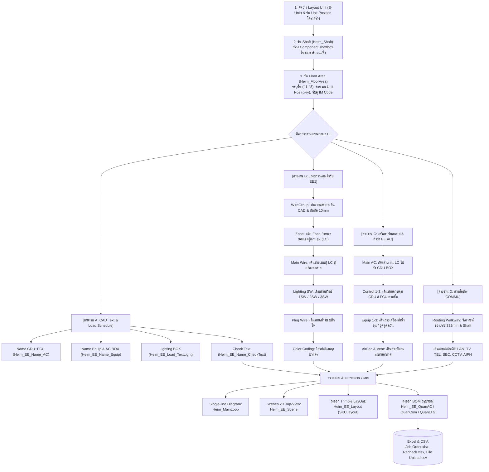
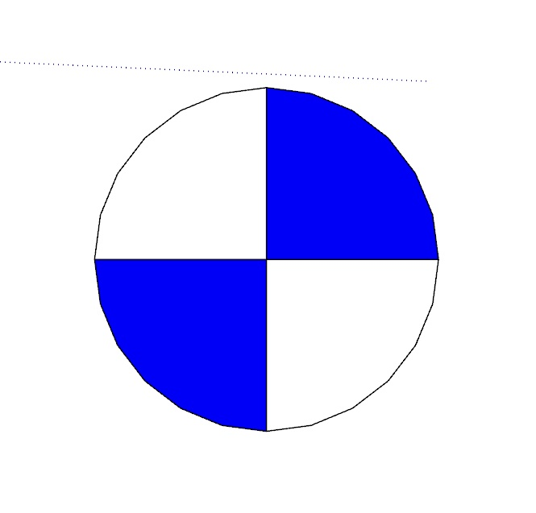
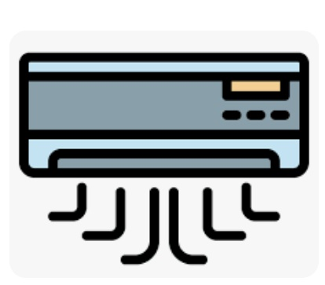
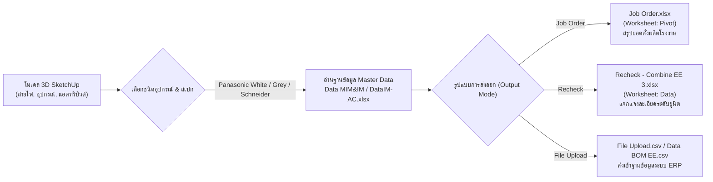

# คู่มือและเอกสารการทำงานระบบ Electricity & Communication (EE) - QHeim

เอกสารฉบับนี้จัดทำขึ้นเพื่ออธิบายหลักการทำงาน, สถาปัตยกรรมโค้ด (Code Architecture), ตรรกะการวิเคราะห์เส้นทางเดินสายอัตโนมัติ (Pathfinding Walkway Logic), ระบบไฟฟ้าแสงสว่างและสวิตช์ (Lighting & Switches), ระบบเต้ารับไฟฟ้า (Power Receptacles / Plugs), ระบบเครื่องปรับอากาศ (Air Conditioning CDU/FCU & Control Wiring), ระบบสายสื่อสารและรักษาความปลอดภัย (COMMU: LAN, TV, TEL, CCTV, Security, Aiphone), การจำแนกสีวงจร (Wire Color Coding), การเขียนไดอะแกรม Single-Line Loop, การส่งออก LayOut 2D Shop Drawing, และการถอดรายการวัสดุ (BOM) เชื่อมต่อระบบโรงงานของระบบ **Electricity (EE)** ในส่วนขยาย **QHeim (SketchUp Ruby Extension)**

---

## 1. ภาพรวมระบบ (System Overview)

ระบบ **Electricity (EE)** ใน QHeim ทำหน้าที่บริหารจัดการระบบวิศวกรรมไฟฟ้า สื่อสาร และปรับอากาศ สำหรับบ้านโครงสร้างเหล็กสำเร็จรูปโมดูลาร์ (Modular Unit) โดยมีความซับซ้อนกว่าอาคารทั่วไปเนื่องจากสายไฟและท่อร้อยสาย **ไม่สามารถวิ่งตัดผ่านโครงสร้างได้อย่างอิสระ** แต่จะต้องวิ่งผ่านช่องทางเดินสายเฉพาะ (Service Cavities, Beam Holes, Corridors, Ceiling Plenums) และช่องเปิดแนวดิ่ง (Vertical Shafts) ระหว่างยูนิตกล่องโมดูลาร์

### ขอบเขตการทำงานของระบบ EE ครอบคลุม 4 เสาหลัก:
1. **ระบบไฟฟ้าแสงสว่างและกำลัง (Lighting & Power Receptacles):** คำนวณแนวการเดินสายสวิตช์ 1 ทาง, 2 ทาง, 3 ทาง, เต้ารับไฟฟ้าภายในและภายนอกอาคาร, ตลอดจนสายเมนเชื่อมโยงตู้ควบคุมหลัก (Load Center / Panel)
2. **ระบบปรับอากาศและระบายอากาศ (Air Conditioning & Ventilation):** จัดการจับคู่วงจร CDU (Condensing Unit) และ FCU (Fan Coil Unit) จากตารางโหลด CAD, เดินสายเมนกำลัง และสายควบคุม (Control Wires 1-3) ข้ามยูนิต
3. **ระบบสื่อสารและสัญญาณความปลอดภัย (Communication & Low-Voltage):** เดินสาย LAN Cat.6 (C), สายสัญญาณโทรทัศน์ RG6 (D), สายโทรศัพท์ (E), สัญญาณเตือนภัย (Security SEC), กริ่งวิดีโอ Aiphone (AIPH), และกล้องวงจรปิด (CCTV) ผ่านช่องชาร์ป
4. **ระบบออกผังแบบและสรุปยอดวัสดุ (Shop Drawing & BOM):** สร้างเส้น Single-line Loop Diagram, จัดทำ SketchUp Scene 2D Plan อัตโนมัติ, ส่งออกไฟล์ Trimble LayOut A3, และประมวลผลยอดวัสดุสายไฟ/อุปกรณ์เข้าสู่ระบบ Excel (Job Order, Recheck, File Upload)

---

### แผนผังลำดับขั้นตอนการทำงาน (Workflow Lifecycle)



> [!IMPORTANT]
> **ข้อกำหนดสำคัญที่สุดก่อนเริ่มระบบ EE (Prerequisites):**
> 1. ในโมเดล SketchUp ต้องมีการตั้งชื่อยูนิตและกำหนดเลเยอร์ `S-Unit` ให้เรียบร้อย
> 2. ก่อนเดินสายสัญญาณหรือท่อใดๆ **ต้องรันปุ่ม `Shaft` และปุ่ม `Floor Area` เป็นลำดับแรกเสมอ** เพื่อให้ระบบลงทะเบียนพิกัดกริดยูนิต `ix-iy` และทราบตำแหน่งช่องชาร์ป มิฉะนั้นอัลกอริทึมค้นหาเส้นทางจะไม่สามารถคำนวณแนวการเจาะข้ามยูนิตได้

---

## 2. หน้าต่างเมนูควบคุม (UI Controllers & Dialogs)

ระบบทำงานผ่านตัวควบคุมหลักและหน้าต่าง HTML Dialog ย่อยที่แยกตามหมวดหมู่งาน:

* **Ruby Main Controller:** [Heim_ElectricityIcon.rb](file:///C:/QHeim/Ruby/EE/Heim_ElectricityIcon.rb)
* **HTML Main Dialog View:** [Heim_Electricity.html](file:///C:/QHeim/Ruby/EE/Heim_Electricity.html)

```
[เมนูหลัก Electricity]
 ├── 1. EE EQPM (Text)   --> [Heim_EEText.html] (จับคู่วงจรโหลดจาก CAD)
 ├── 2. Floor Area       --> [Heim_Floor.html] (กำหนดชั้น & แมปพิกัดยูนิต)
 ├── 3. Shaft            --> วางคอมโพเนนต์ shaftbox ในช่องชาร์ป
 ├── 4. Wiring (COMMU)   --> [Heim_UnitPos.html] (เดินสายสื่อสาร & BOM Com)
 ├── 5. Air (EE AC)      --> [Heim_EE_AirIcon.html] (เดินสายแอร์ & เครื่องใช้ไฟฟ้า)
 ├── 6. Light (EE1)      --> [Heim_EE_LightIcon.html] (เดินสายไฟแสงสว่าง & สวิตช์)
 └── 7. Layout           --> [Heim_EE_Layout.html] (สร้าง Scene & ส่งออก LayOut)
```

### 2.1 รายการไอคอนบนแถบเมนูหลัก (Main Toolbar)

| ไอคอน | ชื่อคำสั่ง (Tool Title) | Action / Dialog | ไฟล์ประมวลผลหลัก | หน้าที่หลัก |
| :---: | :--- | :--- | :--- | :--- |
|  | **EE EQPM(Text)** | เปิด Dialog `Electrical AC` | [`Heim_EEText.html`](file:///C:/QHeim/Ruby/EE/AC/Heim_EEText.html) | เมนูนำเข้าและจับคู่วงจรโหลด CDU, FCU, Bair, Lighting Box จาก CAD |
|  | **Floor Area** | เปิด Dialog `Floor` | [`Heim_FloorArea.rb`](file:///C:/QHeim/Ruby/EE/Heim_FloorArea.rb) | กำหนดชั้น (fl1-fl3), คำนวณพิกัดยูนิต `ix-iy`, จัดกลุ่มผนัง และแมป IM |
|  | **Shaft** | ประมวลผลทันที | [`Heim_Shaft.rb`](file:///C:/QHeim/Ruby/EE/Heim_Shaft.rb) | ตรวจหาช่องชาร์ปจาก `A-DETL` แล้ววาง `shaftbox` พร้อมบันทึกมุม 0-3 |
|  | **Wiring (COMMU)** | เปิด Dialog `Wiring EE3` | [`Heim_EE_UnitPos.rb`](file:///C:/QHeim/Ruby/EE/Heim_EE_UnitPos.rb) | ประมวลผลเดินสายสื่อสาร LAN, TV, TEL, SEC, CCTV, AIPH และคำนวณ BOM Com |
|  | **Air** | เปิด Dialog `EE AC` | [`Heim_EE_AirIcon.rb`](file:///C:/QHeim/Ruby/EE/Heim_EE_AirIcon.rb) | เมนูจัดการระบบแอร์: สายเมนแอร์, สายควบคุม 1-3, สายอุปกรณ์กำลัง, และ BOM AC |
|  | **Light** | เปิด Dialog `EE1` | [`Heim_EE_LightIcon.rb`](file:///C:/QHeim/Ruby/EE/Heim_EE_LightIcon.rb) | เมนูระบบไฟส่องสว่าง: WireGroup, Zone, สายเมน LC, สวิตช์ 1-3, ปลั๊ก, แยกสี, BOM |
|  | **Layout** | เปิด Dialog `Layout EE` | [`Heim_EE_LayoutIcon.rb`](file:///C:/QHeim/Ruby/EE/Layout/Heim_EE_LayoutIcon.rb) | เมนูสร้าง Single-line Loop Diagram, จัด Scene 2D, และส่งออก Trimble LayOut |

---

### 2.2 รายละเอียดเมนูย่อยชุดที่ 1: EE EQPM Text ([`Heim_EEText.html`](file:///C:/QHeim/Ruby/EE/AC/Heim_EEText.html))

| ไอคอน | ชื่อคำสั่ง | ฟังก์ชัน Callback | สคริปต์ Ruby | หน้าที่ |
| :---: | :--- | :--- | :--- | :--- |
|  | **Name CDU+FCU** | `ac` | [`Heim_EE_Name_AC.rb`](file:///C:/QHeim/Ruby/EE/AC/Heim_EE_Name_AC.rb) | อ่าน `EELoadLC*.txt` จับคู่วงจร CDU/FCU สร้าง 3D Text บนโมเดล |
|  | **Name Equip+AC BOX** | `ac2` | [`Heim_EE_Name_Equip.rb`](file:///C:/QHeim/Ruby/EE/AC/Heim_EE_Name_Equip.rb) | วางกล่อง Bair (AC Box) และ 3D Text อุปกรณ์กำลังตามตารางวงจร |
|  | **Lighting BOX** | `light` | [`Heim_EE_Load_TextLight.rb`](file:///C:/QHeim/Ruby/EE/AC/Heim_EE_Load_TextLight.rb) | อ่านวงจรไฟส่องสว่างจากตารางโหลด แล้ววางกล่องต่อสาย Lighting Box |
|  | **Check Text** | `Text` | [`Heim_EE_Name_CheckText.rb`](file:///C:/QHeim/Ruby/EE/AC/Heim_EE_Name_CheckText.rb) | ตรวจสอบความถูกต้องระหว่าง Text ข้อความในแปลนกับรหัสตู้โหลด |

---

### 2.3 รายละเอียดเมนูย่อยชุดที่ 2: EE AC Wiring ([`Heim_EE_AirIcon.html`](file:///C:/QHeim/Ruby/EE/Heim_EE_AirIcon.html))

| เมนู Dropdown | สคริปต์ Ruby ที่ประมวลผล | หน้าที่การทำงาน |
| :--- | :--- | :--- |
| **Main** | [`Heim_EE_UnitPosAC.rb`](file:///C:/QHeim/Ruby/EE/AC/Heim_EE_UnitPosAC.rb) | เดินสายเมนแอร์ (Layer `MAIN AC1..3`) เชื่อมจาก Load Center สู่ CDU Box |
| **Control1** | [`Heim_EE_AC_Control.rb`](file:///C:/QHeim/Ruby/EE/AC/Heim_EE_AC_Control.rb) | เดินสายควบคุมเครื่องปรับอากาศ ชั้น 1 (Layer `CONTROL AC1`) จาก CDU สู่ FCU |
| **Control2** | [`Heim_EE_AC_Control2.rb`](file:///C:/QHeim/Ruby/EE/AC/Heim_EE_AC_Control2.rb) | เดินสายควบคุมเครื่องปรับอากาศ ชั้น 2 (Layer `CONTROL AC2`) |
| **Control3** | [`Heim_EE_AC_Control3.rb`](file:///C:/QHeim/Ruby/EE/AC/Heim_EE_AC_Control3.rb) | เดินสายควบคุมเครื่องปรับอากาศ ชั้น 3 (Layer `CONTROL AC3`) |
| **QuanAC** | [`Heim_EE_QuanAC.rb`](file:///C:/QHeim/Ruby/EE/AC/Heim_EE_QuanAC.rb) | ถอดแบบสรุปปริมาณสายแอร์ อุปกรณ์ และเบรกเกอร์ ออกเป็นไฟล์ Excel/CSV |
| **Equip1** | [`Heim_EE_UnitPosAC2.rb`](file:///C:/QHeim/Ruby/EE/AC/Heim_EE_UnitPosAC2.rb) | เดินสายอุปกรณ์กำลัง ชั้น 1 (เครื่องทำน้ำอุ่น, เตาไฟฟ้า, ปั๊มน้ำ, ตู้เย็น) |
| **Equip2** | [`Heim_EE_UnitPosAC2_2.rb`](file:///C:/QHeim/Ruby/EE/AC/Heim_EE_UnitPosAC2_2.rb) | เดินสายอุปกรณ์กำลัง ชั้น 2 |
| **Equip3** | [`Heim_EE_UnitPosAC2_3.rb`](file:///C:/QHeim/Ruby/EE/AC/Heim_EE_UnitPosAC2_3.rb) | เดินสายอุปกรณ์กำลัง ชั้น 3 |
| **QuanEquip** | [`Heim_EE_QuanAC2.rb`](file:///C:/QHeim/Ruby/EE/AC/Heim_EE_QuanAC2.rb) | ถอดแบบสรุปปริมาณอุปกรณ์กำลัง (Equipment BOM) ออกสู่ Excel |
| **AirFac** | [`Heim_EE_AC2AirFac.rb`](file:///C:/QHeim/Ruby/EE/AC/Heim_EE_AC2AirFac.rb) | เดินสายระบบฟอกอากาศ Air Factory |
| **Vent** | [`Heim_EE_AC2Vent.rb`](file:///C:/QHeim/Ruby/EE/AC/Heim_EE_AC2Vent.rb) | เดินสายพัดลมระบายอากาศ (Ventilation Fan) |

---

### 2.4 รายละเอียดเมนูย่อยชุดที่ 3: EE Light / EE1 ([`Heim_EE_LightIcon.html`](file:///C:/QHeim/Ruby/EE/Heim_EE_LightIcon.html))

| เมนู Dropdown | สคริปต์ Ruby ที่ประมวลผล | หน้าที่การทำงาน |
| :--- | :--- | :--- |
| **WireGroup** | [`Heim_EE_WireGroup.rb`](file:///C:/QHeim/Ruby/EE/Light/Heim_EE_WireGroup.rb) | คัดกรองเส้นโค้ง/เส้นตรง CAD ใน Layer `EE-WIRE`, ตัดต่อระยะ 10 mm หลบโคมไฟ แล้วจัด Group |
| **Zone** | [`Heim_EE_Zone.rb`](file:///C:/QHeim/Ruby/EE/Light/Heim_EE_Zone.rb) | ผู้ใช้คลิก Face ผิวพื้นเพื่อตั้งชื่อ Zone ประจำตู้ Load Center (LC) และจัดหมวดอุปกรณ์ใน Face |
| **Main** | [`Heim_EE_MainWire.rb`](file:///C:/QHeim/Ruby/EE/Light/Heim_EE_MainWire.rb) | เปิดหน้าต่างเลือกชั้น แล้วเรียก [`MainWire1..3.rb`](file:///C:/QHeim/Ruby/EE/Light/Heim_EE_MainWire1.rb) เดินสายเมน `MAIN-LC` |
| **Lighting** | [`Heim_EE_LightSW.rb`](file:///C:/QHeim/Ruby/EE/Light/Heim_EE_LightSW.rb) | เปิด Dialog เลือกสเปกสวิตช์ (1SW, 2SW, 3SW) แล้วเดินสายสวิตช์เข้าหากลุ่มโคมไฟ |
| **Plug** | [`Heim_EE_PlugWire.rb`](file:///C:/QHeim/Ruby/EE/Light/Heim_EE_PlugWire.rb) | เดินสายเต้ารับ ปลั๊กไฟ (Layer `PLUG`) เชื่อมโยงอุปกรณ์ `EE-EQPM-REC` เข้าสู่ระบบ |
| **Color** | [`Heim_WireColor.rb`](file:///C:/QHeim/Ruby/EE/Layout/Heim_WireColor.rb) | กำหนดโค้ดสีสวิตช์และดวงโคม (Color1 ถึง Color4) ให้ตรงกันเพื่อตรวจเช็คลูปวงจร |
| **QuanLTG** | [`Heim_EE_QuanLTG.rb`](file:///C:/QHeim/Ruby/EE/Light/Heim_EE_QuanLTG.rb) | ถอดแบบสรุปปริมาณสวิตช์ โคมไฟ เต้ารับ และสายไฟวงจรย่อยแสงสว่าง |
| **SeeWire** | `Heim_EE_SeeWire.rb` | ซ่อน/แสดงเส้นสายไฟเพื่อตรวจสอบความเรียบร้อยของเส้นทางเดินสาย |
| **Outside** | [`Heim_EE_PlugSWoutside.rb`](file:///C:/QHeim/Ruby/EE/Light/Heim_EE_PlugSWoutside.rb) | เดินสายสวิตช์และเต้ารับชนิดกันน้ำภายนอกอาคาร |

---

### 2.5 รายละเอียดเมนูย่อยชุดที่ 4: Layout EE ([`Heim_EE_Layout.html`](file:///C:/QHeim/Ruby/EE/Layout/Heim_EE_Layout.html))

| ไอคอน | คำสั่ง | สคริปต์ Ruby | หน้าที่ |
| :---: | :--- | :--- | :--- |
|  | **MainWire** | [`Heim_MainLoop.rb`](file:///C:/QHeim/Ruby/EE/Layout/Heim_MainLoop.rb) | วาดไดอะแกรม Single-line Loop Diagram แสดงความสัมพันธ์ตู้ LC เบรกเกอร์ และกล่องต่อสาย |
|  | **Color** | [`Heim_WireColor.rb`](file:///C:/QHeim/Ruby/EE/Layout/Heim_WireColor.rb) | ไฮไลต์สีเส้นสายไฟและอุปกรณ์ตามกลุ่มควบคุม |
|  | **Scene** | [`Heim_EE_Scene.rb`](file:///C:/QHeim/Ruby/EE/Layout/Heim_EE_Scene.rb) | ตั้งค่ามุมกล้อง Top-View Orthographic (2D) สร้าง Scene Tab: `FL1`, `FL2`, `FL3`, `Home` |
|  | **Layout** | [`Heim_EE_Layout.rb`](file:///C:/QHeim/Ruby/EE/Layout/Heim_EE_Layout.rb) | โคลนเทมเพลต `New-A3.layout` เข้า Workspace แล้วนำ Scene 2D สเกล 1:70 วางลงหน้า LayOut |

---

## 3. คู่มือขั้นตอนการปฏิบัติงานสำหรับคนทำงาน (SOP Operator Guide)

### 📌 สรุปลำดับการทำงาน 6 สเต็ปมาตรฐาน:

```
[สเต็ป 1: Setup ฐานรากและโครงสร้าง]
  └── ตรวจสอบชื่อยูนิต (S-Unit) -> กดปุ่ม Shaft -> กดปุ่ม Floor Area เลือกชั้น fl1/fl2/fl3

[สเต็ป 2: ผูกข้อมูลวงจร CAD เข้ากับอุปกรณ์]
  └── กดปุ่ม EE EQPM (Text) -> รัน Name CDU+FCU -> รัน Name Equip -> รัน Lighting BOX

[สเต็ป 3: เดินสายระบบไฟส่องสว่างและเต้ารับ]
  └── เปิดเมนู Light -> รัน WireGroup -> รัน Zone -> รัน Main -> รัน Lighting (1-3SW) -> รัน Plug

[สเต็ป 4: เดินสายระบบปรับอากาศและอุปกรณ์กำลัง]
  └── เปิดเมนู Air -> รัน Main (LC ไป CDU) -> รัน Control1..3 (CDU ไป FCU) -> รัน Equip1..3

[สเต็ป 5: เดินสายระบบสื่อสารและกล้องวงจรปิด]
  └── เปิดเมนู Wiring (COMMU) -> เลือกชั้น fl1/fl2/fl3 -> ระบบเดินสาย LAN, TV, TEL, CCTV อัตโนมัติ

[สเต็ป 6: สร้างแบบและส่งออกรายการวัสดุ (BOM)]
  └── เปิด Layout -> รัน MainWire (Single-line) -> รัน Scene -> รัน Layout (สร้างไฟล์ SKU.layout)
  └── กดปุ่ม Quan (QuanAC, QuanCom, QuanLTG) ส่งออก Excel และ File Upload
```

---

### 📋 รายละเอียดการกดใช้งานทีละคำสั่ง:

#### 1. ติดตั้งกล่องชาร์ปแนวดิ่ง (Shaft)
* **การเลือกวัตถุ:** ไม่ต้องเลือกวัตถุในโมเดลล่วงหน้า (สคริปต์สแกนโมเดลเอง)
* **การคลิก & ดำเนินการ:** กดไอคอน **Shaft** (รูปท่อชาร์ป)
* **ผลลัพธ์ในโมเดล:** ระบบจะค้นหาคอมโพเนนต์ชาร์ปใน Layer `A-DETL` แล้วโหลดคอมโพเนนต์ `shaftbox.skp` วางลงที่มุมยูนิตที่ตรงกัน พร้อมบันทึก Attribute `[s0, s1, s2, s3]` ลงในยูนิต และแสดงกล่องข้อความ `"Insert Main Shaft EE"`

#### 2. กำหนดพื้นที่ชั้นและพิกัดยูนิต (Floor Area)
* **การเลือกวัตถุ:** ลากเมาส์ครอบวัตถุทั้งหมดของชั้นที่กำลังทำ (Unit, ผนัง, ประตู, อุปกรณ์ไฟฟ้า)
* **การคลิก & ดำเนินการ:** กดไอคอน **Floor Area** &rarr; เลือกชั้นในหน้าต่าง Popup (`fl1`, `fl2`, หรือ `fl3`)
* **ผลลัพธ์ในโมเดล:**
  1. จัดกลุ่มเส้นและผิวผนังเป็น `wallgroup.flX` ใน Layer `A-WLL`
  2. กำหนดพิกัดกริดยูนิต `ix-iy` (เช่น `1-1`, `1-2`, `2-1`) ให้กับยูนิตทั้งหมด
  3. ผูกแอตทริบิวต์ `Com` &rarr; `Floor` และจับคู่รหัส `IM` จากไฟล์ `Data MIM&IM - Component Block.xlsx` ให้กับอุปกรณ์ทั้งหมด

#### 3. แมปวงจรและวางข้อความ 3D จากตารางโหลด CAD (EE EQPM Text)
* **การเลือกวัตถุ:** เปิดไฟล์ CAD ตารางโหลดที่แปลงเป็น Text ไฟล์ไว้ใน `C:/QHeim/DATA/EELoadLC*.txt`
* **การคลิก & ดำเนินการ:**
  1. กดปุ่ม **EE EQPM(Text)** &rarr; กด **Name CDU+FCU** &rarr; เลือกตู้โหลด (`LC1`, `LC2`, หรือ `LC3`) &rarr; ระบบจะสร้าง 3D Text และกำหนดชื่อวงจรให้ CDU/FCU อัตโนมัติ
  2. กดปุ่ม **Name Equip+AC BOX** &rarr; เลือกตู้โหลด &rarr; วางกล่องต่อสาย Bair และอุปกรณ์กำลัง
  3. กดปุ่ม **Lighting BOX** &rarr; วางกล่องต่อสายไฟส่องสว่างประจำวงจร
  4. กดปุ่ม **Check Text** &rarr; ตรวจสอบความถูกต้องของข้อความในโมเดล

#### 4. เดินสายระบบไฟฟ้าแสงสว่างและสวิตช์ (Light / EE1)
* **การคลิก & ดำเนินการตามลำดับ:**
  1. **WireGroup:** เลือกกลุ่มเส้น CAD ของชั้นนั้น &rarr; เลือกเมนู `WireGroup` ใน Dropdown &rarr; เลือกรหัสชั้น &rarr; ระบบจะตัดต่อระยะห่างจากขอบโคมไฟ 10 mm และรวมเส้นเชื่อมโยงเป็น Group
  2. **Zone:** เลือกเมนู `Zone` &rarr; ระบุ Floor และชื่อ Zone (เช่น `LC`) &rarr; **นำเมาส์ไปคลิกบนผิวพื้น (Face)** ของโซนนั้น &rarr; ระบบจะผูกอุปกรณ์ทั้งหมดใน Face เข้ากับ Zone นั้น
  3. **Main:** เลือกเมนู `Main` &rarr; เลือกชั้น (`fl1`, `fl2`, `fl3`) &rarr; ระบบเดินสายเมนสีน้ำเงิน `MAIN-LC` จากตู้ LC ไปยังกล่องต่อสาย
  4. **Lighting:** เลือกเมนู `Lighting` &rarr; เลือกประเภทสวิตช์ (`1SW`, `2SW`, `3SW`) และเลือกชั้น &rarr; ระบบจะลากสายเชื่อมโยงระหว่างสวิตช์ผนังไปยังดวงโคมตามลูปวงจร
  5. **Plug:** เลือกเมนู `Plug` &rarr; เลือกชั้น &rarr; ระบบเดินสายเต้ารับสีเขียว `PLUG` จากตู้ LC สู่เต้ารับทุกจุด
  6. **Color:** เลือกเมนู `Color` เพื่อไฮไลต์คู่สีสวิตช์และดวงโคมให้ตรงกัน

#### 5. เดินสายระบบเครื่องปรับอากาศและอุปกรณ์กำลัง (Air / EE AC)
* **การคลิก & ดำเนินการตามลำดับ:**
  1. **Main:** เลือกเมนู `Main` &rarr; ระบบค้นหาตำแหน่งตู้ LC และกล่อง CDU BOX แล้วเดินสายเมนสีบานเย็น `MAIN AC` ข้ามยูนิต
  2. **Control1, 2, 3:** เลือกเมนู `Control1` สำหรับชั้น 1, `Control2` สำหรับชั้น 2 &rarr; ระบบจะเดินสายสัญญาณควบคุมสีฟ้า `CONTROL AC` เชื่อมระหว่างตัวเครื่องภายนอก (CDU) และเครื่องภายใน (FCU)
  3. **Equip1, 2, 3:** เลือกเมนู `Equip1..3` เพื่อเดินสายเครื่องทำน้ำอุ่นและอุปกรณ์ไฟฟ้ากำลัง
  4. **AirFac / Vent:** เลือกเพื่อเดินสายพัดลมระบายอากาศและระบบฟอกอากาศ

#### 6. เดินสายระบบสื่อสารและรักษาความปลอดภัย (Wiring COMMU)
* **การเลือกวัตถุ:** ตรวจสอบให้แน่ใจว่าได้รัน `Shaft` และ `Floor Area` แล้ว
* **การคลิก & ดำเนินการ:** กดไอคอน **Wiring (COMMU)** &rarr; เลือกชั้นใน Dropdown (`fl1`, `fl2`, หรือ `fl3`)
* **ผลลัพธ์ในโมเดล:** ระบบจะประมวลผลอัลกอริทึมค้นหาเส้นทาง (Pathfinding) เจาะผ่านผนังและรูรอยต่อยูนิต เดินสาย LAN (Cat.C), TV (Cat.D), TEL (Cat.E), Security (SEC), Video Door Phone (AIPH), และ CCTV เข้าสู่ตู้เราเตอร์หลัก

#### 7. สร้างไดอะแกรมวงจร, Scene และส่งออก LayOut (Layout EE)
* **การคลิก & ดำเนินการ:**
  1. กดไอคอน **Layout** &rarr; กดปุ่ม **MainWire** &rarr; ระบบวาด Single-line Loop Diagram แสดงโฟลว์วงจรไฟฟ้า
  2. กดปุ่ม **Scene** &rarr; ระบบปรับมุมกล้องขนาน (Parallel Projection Top-View) และสร้าง Scene Tab: `FL1`, `FL2`, `FL3`, `Home`
  3. กดปุ่ม **Layout** &rarr; สคริปต์จะโคลนเทมเพลต `New-A3.layout` เข้าโฟลเดอร์โปรเจกต์ วาง Viewport สเกล 1:70 ครบทุกชั้น พร้อมส่งพิมพ์หรือทำ Shop Drawing ได้ทันที

#### 8. ถอดแบบสรุปปริมาณวัสดุ (BOM Export)
* **การคลิก & ดำเนินการ:**
  * สำหรับระบบแอร์: ในเมนู Air เลือก **QuanAC** หรือ **QuanEquip**
  * สำหรับระบบสื่อสาร: ในเมนู Wiring เลือก **Quan**
  * สำหรับระบบแสงสว่าง: ในเมนู Light เลือก **QuanLTG**
* **การตั้งค่าใน Popup:**
  * เลือก **Device Type:** `Panasonic(White)`, `Panasonic(Grey)`, หรือ `Schneider`
  * เลือก **Quan Format:**
    * `Job Order` &rarr; สรุปรายการลงในไฟล์ `Job Order.xlsx` (Sheet: *Pivot*)
    * `Recheck` &rarr; ตรวจสอบรายละเอียดต่อชิ้นส่วนลงใน `Recheck - Combine EE 3.xlsx` (Sheet: *Data*)
    * `File Upload` &rarr; สร้างไฟล์ CSV ส่งเข้าฐานข้อมูลกลางโรงงาน (`File Upload.csv` / `Data BOM EE.csv`)

---

## 4. สถาปัตยกรรมและตรรกะการทำงานเชิงลึก (Detailed Module Logic)

### 4.1 อัลกอริทึมการค้นหาเส้นทางเดินสายอัตโนมัติ ([`findwalkway.rb`](file:///C:/QHeim/Ruby/EE/findwalkway.rb) & [`ClassEE.rb`](file:///C:/QHeim/Ruby/EE/ClassEE.rb))

หัวใจสำคัญที่สุดของระบบ EE คือการคำนวณเส้นทางเดินสายข้ามยูนิตโมดูลาร์โดยอัตโนมัติ สคริปต์ทำงานดังนี้:

1. **การวิเคราะห์กริดและความสัมพันธ์ของยูนิต (`findnextgrid` & `genunitposition`):**
   * ตรวจสอบว่าขอบด้านใดของยูนิตติดกับเพื่อนบ้าน หรือเปิดออกสู่ภายนอก โดยอ้างอิงตาราง `$dcposborder`:
     ```ruby
     $dcposborder = {
       "01"=>["T","L","R"], "02"=>["L","R"],     "03"=>["L","R","B"],
       "04"=>["T","L"],     "05"=>["L"],         "06"=>["L","B"],
       "07"=>["T"],         "08"=>[],            "09"=>["B"],
       "10"=>["T","R"],     "11"=>["R"],         "12"=>["R","B"]
     }
     ```
   * เมื่อ $T=\text{บน (Top)}, B=\text{ล่าง (Bottom)}, L=\text{ซ้าย (Left)}, R=\text{ขวา (Right)}$

2. **ตำแหน่งรูเจาะบริการที่มุมยูนิต (`getholeposition`):**
   * ยูนิตแต่ละกล่องจะมีช่องรูเจาะโครงสร้างสำหรับร้อยสายไฟที่ระยะเยื้อง (Offset) เข้ามาจากมุมยูนิต $332\,\text{mm}$:
     $$P_{corner} = P_{center} \pm \left( \frac{\text{Width}}{2} - 332\,\text{mm},\, \frac{\text{Height}}{2} - 332\,\text{mm},\, 0 \right)$$
   * ระบบสร้างจุดผ่าน $pc_0, pc_1, pc_2, pc_3$ เพื่อใช้เป็นโหนดหลักในการเปลี่ยนทิศทางสายไฟ

3. **ตรรกะการหาเส้นทางแบบ Manhattan Route (`makeroute`):**
   * ตรวจสอบแนวระนาบแกน $X$ และ $Y$ ผ่านฟังก์ชัน `throughx` และ `throughy`
   * หากแนวทางเดินตรงมีสิ่งกีดขวาง (เช่น ผนังทึบหรือผนังเบิ้ลที่ไม่มีช่องเปิด) ระบบจะเลี้ยวเข้าสู่ Walkway แนวขนานในระยะปลอดภัย
   * ทำการตรวจสอบการชนช่องชาร์ปด้วยเทคนิค Raycast (`rayShaft2` และ `rayShaft3`) เพื่อป้องกันสายไฟพาดผ่านช่องเปิดท่อโดยไม่มีโครงรับ

---

### 4.2 โมดูลตำแหน่งชั้นและช่องชาร์ป ([`Heim_FloorArea.rb`](file:///C:/QHeim/Ruby/EE/Heim_FloorArea.rb) & [`Heim_Shaft.rb`](file:///C:/QHeim/Ruby/EE/Heim_Shaft.rb))

* **Heim_Shaft.rb:**
  * สแกนโมเดลหาวัตถุใน Layer `A-DETL` ที่มีขนาดความกว้าง/ยาวมากกว่า $150\,\text{mm}$
  * วาง Component `shaftbox.skp` (จาก `C:/QHeim/Comp/EE/`) ลงใน Layer `EE-Shaft`
  * ตรวจสอบว่าชาร์ปนั้นอยู่ในมุมใดของยูนิต (Corner $0, 1, 2, 3$) แล้วบันทึกแอตทริบิวต์ `"Shaft"`, `"Corner"`
  * ยิงรังสี Raytest ตรวจสอบความต่อเนื่องแนวดิ่ง และบันทึกสถานะช่องชาร์ปลงในตัวแปรยูนิต:
    ```ruby
    e.set_attribute "Unit", "Shaft", [s0, s1, s2, s3]
    ```

* **Heim_FloorArea.rb:**
  * รับค่ารหัสชั้น (`fl1`, `fl2`, `fl3`)
  * จัดเรียงพิกัดศูนย์กลางยูนิตตามลำดับแกน $X$ จากน้อยไปมาก และ $Y$ จากมากไปน้อย เพื่อกำหนดรหัสตำแหน่งแบบพิกัดฉาก:
    $$\text{Unit Pos} = \texttt{ix-iy} \quad (\text{เช่น } \texttt{1-1}, \texttt{1-2}, \texttt{2-1})$$
  * เชื่อมโยงฐานข้อมูล Excel `Data MIM&IM - Component Block.xlsx` โดยอ่านชีต:
    * `COMMU C D E (Schneider)` &rarr; ระบบสื่อสาร
    * `COMMU AIPH` &rarr; ระบบอินเตอร์คอม Aiphone
    * `CCTV` &rarr; กล้องวงจรปิด
    * `SEC` &rarr; ระบบกันขโมย
  * บันทึกรหัส `IM` และ `Floor` ลงในแอตทริบิวต์ของคอมโพเนนต์อุปกรณ์ทุกชิ้น

---

### 4.3 โมดูลนำเข้าข้อความวงจรและตารางโหลด CAD ([`Heim_EE_Name_*.rb`](file:///C:/QHeim/Ruby/EE/AC/))

1. **Heim_EE_Name_AC.rb (จับคู่วงจรแอร์):**
   * อ่านข้อมูลจากไฟล์ตารางโหลด `C:/QHeim/DATA/EELoadLC*.txt`
   * สแกนหาแถวที่มีคำว่า `CDU` และอ่านพิกัดแกน $X, Y$ ของข้อความในตาราง
   * แยกแยะว่าวงจรอยู่ฝั่งซ้ายหรือฝั่งขวาของตารางโหลด เพื่อจับคู่เบรกเกอร์กับชื่อเครื่องปรับอากาศ
   * อ่านไฟล์พิกัดจริง `C:/QHeim/DATA/EEAC.txt` ที่ส่งออกจาก AutoCAD
   * สร้าง 3D Text ขนาด $0.1\,\text{m}$ วางลงบนเลเยอร์ `EE-EQPM-AC` พร้อมหมุนองศาตามแบบใน CAD

2. **Heim_EE_Name_Equip.rb (จับคู่อุปกรณ์กำลังและกล่องแอร์):**
   * อ่านคอลัมน์ `CIRCUIT` หรือ `CIRCUIT NO.` จาก `EELoadLC*.txt`
   * นำเข้าข้อมูลตำแหน่งอุปกรณ์จาก `EEAC2.txt` และ `EE_ACBOX.txt`
   * สร้างกล่องต่อสาย Bair และวาง 3D Text ประจำอุปกรณ์กำลัง

3. **Heim_EE_Load_TextLight.rb (กล่องต่อสายไฟส่องสว่าง):**
   * อ่านวงจรไฟส่องสว่างประจำแต่ละเบรกเกอร์
   * วางกล่องกระจายสายไฟแสงสว่างลงในโมเดล พร้อมบันทึกหมายเลขวงจร

---

### 4.4 โมดูลระบบแสงสว่างและสวิตช์ ([`Heim_EE_LightIcon.rb`](file:///C:/QHeim/Ruby/EE/Heim_EE_LightIcon.rb))

* **Heim_EE_WireGroup.rb:**
  * ทำความสะอาดเส้นแนวสายไฟจาก Layer `EE-WIRE`
  * ค้นหาจุดปลายเส้นที่ชนกับศูนย์กลางโคมไฟ (`EE-EQPM-LTG`) หรือพัดลม (`EE-EQPM-FAN`)
  * หากเส้นยาวกว่า $10\,\text{mm}$ จะทำการตัดทอนปลายเส้นออก $10\,\text{mm}$ เพื่อไม่ให้เส้นสายไฟพาดทับทะลุสัญลักษณ์อุปกรณ์ แล้วรวมเป็น Group วงจร
* **Heim_EE_Zone.rb:**
  * แบ่งพื้นที่ควบคุมของตู้ Load Center ผู้ใช้คลิกเลือก Face ผิวพื้น
  * ดึงอุปกรณ์เต้ารับและสวิตช์ทั้งหมดที่พิกัดตกอยู่ภายในขอบเขต Face (`e1.classify_point(cen) == 1`) เข้าสู่ Zone เดียวกัน
* **Heim_EE_SwitchWire.rb / 22 / 3:**
  * คำนวณเส้นทางเดินสายระหว่างสวิตช์ผนัง (`EE-EQPM-SW`) กับกลุ่มดวงโคม
  * รองรับสวิตช์ 1 ตอน (1SW), 2 ตอน (2SW), และ 3 ตอน (3SW)
  * แยกเลเยอร์ชัดเจน: `SW1WAY`, `SW2WAYS`, `SW3WAYS`
* **Heim_WireColor.rb:**
  * โหลดคอมโพเนนต์มาร์กเกอร์สีจาก `C:/QHeim/DATA/EE/Color/Color*.skp`
  * วางมาร์กเกอร์สัญลักษณ์สีลงที่ตัวสวิตช์และดวงโคมที่จับคู่กัน เพื่อให้ช่างหน้างานและโรงงานดูวงจรสายไฟได้ทันทีโดยไม่ต้องไล่แบบ

---

### 4.5 โมดูลระบบเครื่องปรับอากาศ ([`Heim_EE_UnitPosAC.rb`](file:///C:/QHeim/Ruby/EE/AC/))

* **Heim_EE_UnitPosAC.rb (Main AC):**
  * สร้าง Layer Folder: `WIRE-AC` บรรจุเลเยอร์:
    * `MAIN AC1`, `MAIN AC2`, `MAIN AC3` (สีบานเย็น `Sketchup::Color.new(255, 0, 255)`)
    * `CONTROL AC1`, `CONTROL AC2`, `CONTROL AC3` (สีน้ำเงิน `Sketchup::Color.new(0, 80, 255)`)
  * คำนวณตำแหน่งตู้ `LC` และค้นหากล่อง `CDU BOX`
  * กำหนดทิศทางการร้อยท่อออกจากกล่องด้วยเวกเตอร์ทิศทางชดเชย $410\,\text{mm}$
  * วิ่งสายไฟเมนกำลังข้ามยูนิตผ่านโครงสร้างช่องบริการ
* **Heim_EE_AC_Control.rb / 2 / 3:**
  * เชื่อมโยงสายควบคุมจากจุดต่อ CDU ภายนอกอาคาร เข้าสู่จุดติดตั้งเครื่อง FCU ภายในห้องของแต่ละชั้น

---

### 4.6 โมดูลสร้างแบบ 2D และส่งออก LayOut ([`Heim_EE_Layout.rb`](file:///C:/QHeim/Ruby/EE/Layout/))

1. **Heim_MainLoop.rb (Single-line Loop Diagram):**
   * รวบรวมข้อมูลตู้ `LC`, กล่องต่อสาย `EE-LOGIC-MAIN`, เส้นเมน `MAIN-LC`, และ `EE-ZONE`
   * วาดผังเส้นวงจรไฟฟ้าแบบ Single-line Diagram บนระนาบ พร้อมใส่สัญลักษณ์ลูกศรและกล่องเบรกเกอร์
2. **Heim_EE_Scene.rb (จัดมุมมอง 2D):**
   * ตั้งค่ากล้องเป็น Parallel Projection (ไม่มี Perspective) มองจากด้านบนลงล่าง:
     ```ruby
     camera.set [0,0,1000], [0,0,0], [0,1,0], false
     camera.perspective = false
     ```
   * ซ่อนเลเยอร์ที่ไม่จำเป็นสำหรับแบบ 2D เช่น `EE-WIRE`, `EE-ARROW`, `EE-Shaft`, `EE-ZONE`
   * แสดงเฉพาะโครงสร้างกริด `EE-GRID-UNIT` และอุปกรณ์
   * สร้าง Scene ประจำแต่ละชั้น: `FL1`, `FL2`, `FL3`, และ `Home`
3. **Heim_EE_Layout.rb (Trimble LayOut Export):**
   * คัดลอกไฟล์เทมเพลตมาตรฐาน `C:/QHeim/DATA/New-A3.layout` ไปยังโฟลเดอร์งาน `fileName/SKU.layout`
   * เรียกใช้ **SketchUp LayOut Ruby API** (`Layout::Document.open`)
   * นำ Scene แต่ละชั้นวางลงในแต่ละหน้ากระดาษ A3 ด้วยอัตราส่วนมาตราส่วนมาตรฐาน $\text{Scale} = 1:70$ ภายในกรอบขอบเขต `Geom::Bounds2d.new(0.01.m, 0.01.m, 0.35.m, 0.28.m)`

---

## 5. ตารางสรุปเลเยอร์, แมตทีเรียล และคอมโพเนนต์ (EE Matrix)

### 5.1 โครงสร้างโฟลเดอร์เลเยอร์และสายไฟ (Layer & Folder Hierarchy)

| โฟลเดอร์เลเยอร์ (Folder) | ชื่อ Layer ใน SketchUp | โค้ดสี (RGB) | หน้าที่และรายละเอียด |
| :--- | :--- | :---: | :--- |
| **`WIRE-COMMU`** | `LAN(C)` | ดำ / Mat | สายสัญญาณคอมพิวเตอร์ LAN Cat.6 (Material: `twotwenty`) |
| | `TV(D)` | ดำ / Mat | สายสัญญาณโทรทัศน์ Coaxial RG6 (Material: `matD`) |
| | `TEL(E)` | ดำ / Mat | สายสัญญาณโทรศัพท์ (Material: `matE`) |
| | `SEC` | ดำ / Mat | สายระบบเตือนภัยและกันขโมย (Material: `matSEC`) |
| | `AIPH` | ดำ | สายระบบอินเตอร์คอม / กริ่งวิดีโอ Aiphone |
| | `CCTV` | ดำ / Mat | สายสัญญาณกล้องวงจรปิด (Material: `matCCTV`) |
| **`WIRE-AC`** | `MAIN AC1..3` | `(255, 0, 255)` | สายไฟเมนกำลังจ่ายเครื่องปรับอากาศ ชั้น 1-3 |
| | `CONTROL AC1..3`| `(0, 80, 255)` | สายสัญญาณควบคุม CDU ไปยัง FCU ชั้น 1-3 |
| **`WIRE-LTG&REC`** | `MAIN-LC` | `(0, 80, 255)` | สายเมนกำลังจ่ายตู้ Load Center สู่กล่องต่อสาย |
| | `PLUG` | `(0, 255, 85)` | สายไฟวงจรเต้ารับไฟฟ้า ปลั๊กไฟทั่วไป |
| | `SW1WAY` | ตามสีวงจร | สายไฟสวิตช์ควบคุมดวงโคม 1 ทาง |
| | `SW2WAYS` | ตามสีวงจร | สายไฟสวิตช์ควบคุมดวงโคม 2 ทาง (สวิตช์บันได) |
| | `SW3WAYS` | ตามสีวงจร | สายไฟสวิตช์ควบคุมดวงโคม 3 ทาง |
| | `WireColor` | ตามมาร์กเกอร์ | สัญลักษณ์มาร์กเกอร์สีประจำวงจรย่อย |
| *(เลเยอร์อ้างอิง)* | `EE-Shaft` | เทา | ตำแหน่งบล็อกช่องชาร์ปแนวดิ่ง (`shaftbox.skp`) |
| | `EE-ZONE` | โปร่งใส | ขอบเขตพื้นที่ควบคุมของตู้ Load Center |
| | `EE-GRID-UNIT` | น้ำเงิน | เส้นและรหัสกริดอ้างอิงยูนิตโมดูลาร์ |
| | `A-WLL` / `wallgroup.*` | เทา | ผนังที่ถูกจัดกลุ่มแยกตามชั้น |

---

### 5.2 หมวดหมู่อุปกรณ์และสัญลักษณ์ไฟฟ้า (`EE-EQPM-*`)

| หมวดหมู่ Layer | สัญลักษณ์ / คอมโพเนนต์หลัก | รายละเอียดอุปกรณ์ | หน่วย BOM |
| :--- | :--- | :--- | :---: |
| `EE-PANEL` / `EE-EQPM-LOAD CENTER` | `LC1`, `LC2`, `LC3` | ตู้ควบคุมไฟฟ้าหลัก (Main Load Center Panel) | ตู้ (Set) |
| `EE-EQPM-LTG` | Downlight, Fluorescent, Tube | โคมไฟส่องสว่างดาวน์ไลท์, ไฟราง, โคมเพดาน | ชุด (EA) |
| `EE-EQPM-SW` | Switch 1G, 2G, 3G, 2-Way | สวิตช์ไฟ 1 ตอน, 2 ตอน, 3 ตอน, สวิตช์บันได | ชุด (EA) |
| `EE-EQPM-REC` | Duplex Receptacle, Waterproof | เต้ารับไฟฟ้าคู่มีกราวด์, เต้ารับกันน้ำภายนอก | ชุด (EA) |
| `EE-EQPM-AC` | CDU, FCU, CDU BOX | เครื่องปรับอากาศส่วนภายนอก, ภายใน, กล่องแอร์ | ชุด (EA) |
| `EE-EQPM-FAN` | Exhaust Fan, Ceiling Fan | พัดลมดูดอากาศระบายกลิ่น, พัดลมโคจรเพดาน | ชุด (EA) |
| `EE-EQPM-COMMU` | LAN Outlet, TV Outlet, Tel Outlet | หน้ากากเต้ารับสัญญาณคอมพิวเตอร์, ทีวี, โทรศัพท์ | ชุด (EA) |
| `EE-EQPM-CCTV` | CCTV Camera | กล้องวงจรปิดบันทึกภาพ | จุด (EA) |
| `EE-EQPM-AIPH` | Video Door Phone, Master Monitor | กริ่งหน้าบ้านพร้อมกล้อง, จอควบคุมภายในห้อง | ชุด (EA) |
| `EE-EQPM-SEC` | Magnetic Sensor, Motion PIR | เซ็นเซอร์ตรวจจับการบุกรุกหน้าต่างและประตู | จุด (EA) |
| `EE-EQPM-POW` / `KC` / `BR` | Water Heater, Hood, Cooktop | เต้ารับกำลังเครื่องทำน้ำอุ่น, เครื่องดูดควัน, เตาอบ | ชุด (EA) |

---

### 5.3 โครงสร้างข้อมูล Attribute ใน SketchUp Entity

| Entity Target | Dictionary Name | Attribute Key | ชนิดข้อมูล | ตัวอย่างค่าและความหมาย |
| :--- | :--- | :--- | :---: | :--- |
| **Unit (`S-Unit`)** | `"Unit"` | `"FL"` | String | `"fl1"`, `"fl2"`, `"fl3"` (ระบุชั้น) |
| | `"Unit"` | `"Pos"` | String | `"1-1"`, `"2-3"` (พิกัดกริดยูนิตในระนาบ) |
| | `"Unit"` | `"Shaft"` | Array | `[1, 0, 0, 1]` (มุมที่มีช่องชาร์ป 0 ถึง 3) |
| **อุปกรณ์ (`EE-EQPM-*`)**| `"Com"` | `"Floor"` | String | `"fl1"` (ชั้นที่อุปกรณ์ติดตั้งอยู่) |
| | `"Com"` | `"IM"` | String | `"IM_APA_001"` (รหัสวัสดุมาตรฐานโรงงาน) |
| | `"Com"` | `"Unit"` | Array | `[UnitName, pc0, pc1, pc2, pc3, center, pos]` |
| | `"Com"` | `"UnitID"` | String | GUID ของยูนิตที่ครอบครองอุปกรณ์ |
| | `"REC"` / `"BOX"` | `"ZONE"` | String | `"LC1"` (โซนตู้โหลดเซ็นเตอร์ที่ควบคุม) |
| **ตู้โหลด (`EE-PANEL`)** | `"Router"` | `"Pos"` | String | พิกัดกริดยูนิตที่ตู้ตั้งอยู่ |
| | `"Router"` | `"Unit"` | String | ชื่อยูนิตโมดูลาร์ที่บรรจุตู้ควบคุม |
| **ชาร์ป (`EE-Shaft`)** | `"Shaft"` | `"Unit"` | String | ชื่อยูนิตโมดูลาร์ที่ชาร์ปแนบอยู่ |
| | `"Shaft"` | `"Corner"` | String | `"0"`, `"1"`, `"2"`, `"3"` (ตำแหน่งมุมยูนิต) |
| **โซน (`EE-ZONE`)** | `"Zone"` | `"Floor"` | String | `"fl1"` (ชั้นที่โซนครอบคลุม) |

---

## 6. การถอดปริมาณงานและระบบเชื่อมต่อข้อมูล (BOM & Data Integration)

ระบบถอดแบบของ EE แบ่งออกเป็น 3 โมดูลตามหมวดงาน:
1. **[`Heim_EE_QuanAC.rb`](file:///C:/QHeim/Ruby/EE/AC/Heim_EE_QuanAC.rb):** ถอดแบบระบบแอร์และอุปกรณ์กำลัง
2. **[`Heim_EE_QuanCom.rb`](file:///C:/QHeim/Ruby/EE/Heim_EE_QuanCom.rb):** ถอดแบบระบบสื่อสาร LAN, TV, TEL, CCTV, AIPH
3. **[`Heim_EE_QuanLTG.rb`](file:///C:/QHeim/Ruby/EE/Light/Heim_EE_QuanLTG.rb):** ถอดแบบระบบไฟส่องสว่าง, สวิตช์ และเต้ารับ

### กระบวนการประมวลผลข้อมูล (Data Flow):



### รายละเอียดการส่งออกแต่ละรูปแบบ:
* **Job Order (`Job Order.xlsx`):**
  * สรุปจำนวนชิ้นส่วน (EA) และความยาวสายไฟรวม (m.) แยกตามรหัสยูนิตโมดูลาร์ เพื่อใช้ในการสั่งตัดสายไฟและจัดกล่องอุปกรณ์ประกอบล่วงหน้าจากโรงงาน
* **Recheck (`Recheck - Combine EE 3.xlsx`):**
  * แสดงความสัมพันธ์แบบ Matrix ระหว่าง `House_ID`, `Unit_Name`, `Part_ID`, `Description`, `Circuit_NO`, `Location`, และ `Quantity` สำหรับวิศวกรใช้ตรวจสอบความถูกต้องร่วมกับแบบไฟฟ้า
* **File Upload (`File Upload.csv`):**
  * ไฟล์ข้อความคั่นด้วยจุลภาค (Comma-delimited) ฟอร์แมตมาตรฐานสำหรับอัปโหลดเข้าสู่ระบบบริหารการผลิต ERP (SAP/MES) ของโรงงาน SCG Heim

---

## 7. ข้อควรระวังและการแก้ไขปัญหา (Best Practices & Troubleshooting)

### 📌 กฎเหล็กและข้อแนะนำการทำงาน (Best Practices):
1. **ลำดับการกดปุ่มห้ามข้ามขั้นตอน:** ลำดับที่ถูกต้องคือ **Shaft $\rightarrow$ Floor Area $\rightarrow$ Text & Load $\rightarrow$ Wiring $\rightarrow$ Layout/BOM** หากไม่รัน Floor Area สายไฟจะไม่ทราบความสัมพันธ์ของยูนิต
2. **ห้ามย้ายหรือหมุน Unit หลังจากรัน Floor Area:** หากมีการขยับตำแหน่งยูนิตโมดูลาร์ในภายหลัง ผู้ใช้ **ต้องกดปุ่ม Floor Area ใหม่เสมอ** เพื่ออัปเดตค่าพิกัด `ix-iy` ใหม่
3. **การคลีนเส้น CAD ก่อนทำ WireGroup:** เส้นแนวสายไฟที่ Import เข้ามาจาก AutoCAD ในเลเยอร์ `EE-WIRE` ต้องอยู่ในระนาบเดียวกัน ($Z=0$ หรือระดับเพดานเดียวกัน) ไม่ควรมีเส้นขาดเป็นจุดเล็กๆ สั้นกว่า $10\,\text{mm}$
4. **การตั้งชื่อ Zone ตู้ Load Center:** ให้ตั้งชื่อตรงกับรหัสตู้ เช่น `LC1`, `LC2` เพื่อให้การแมปวงจรใน Single-line Diagram ทำงานได้อย่างสมบูรณ์

---

### 🛠️ การแก้ไขปัญหาที่พบบ่อย (Troubleshooting):

| อาการปัญหาที่พบ | สาเหตุที่เป็นไปได้ | แนวทางการแก้ไขที่ถูกต้อง |
| :--- | :--- | :--- |
| **1. ระบบแจ้งเตือน "Please Set FloorArea"** | กดรันเมนูเดินสายโดยที่ยังไม่ได้รัน Floor Area ประจำชั้นนั้น | ลากครอบโมเดลของชั้นนั้น กดไอคอน **Floor Area** เลือกชั้น (`fl1..3`) รอให้ขึ้น `"OK"` แล้วจึงกดเดินสายใหม่ |
| **2. เส้นสายไฟไม่ยอมวิ่ง หรือขึ้น "cannot find route"** | ไม่มีช่องเปิดระหว่างยูนิต หรือยูนิตไม่ได้วางชิดแนบสนิทกัน | 1. ตรวจสอบว่าโมเดลยูนิตแตะกันสนิทหรือไม่<br/>2. ตรวจสอบว่าช่องชาร์ป (`EE-Shaft`) ถูกบังหรือไม่<br/>3. เช็คว่ารหัส Direction ทิศทางของยูนิตเปิดถูกด้านหรือไม่ |
| **3. กดปุ่ม Name CDU+FCU แล้วขึ้น "NO AC"** | ไม่มีข้อมูลในไฟล์ `C:/QHeim/DATA/EEAC.txt` | ตรวจสอบว่าได้ทำการ Export ข้อมูลข้อความจากไฟล์ CAD ด้วยสคริปต์ส่งออกข้อความแล้วหรือไม่ และตรวจสอบว่าไฟล์ `EEAC.txt` ไม่เป็นไฟล์ว่าง |
| **4. ส่งออก BOM แล้วโปรแกรมค้าง หรือเกิด Error Excel** | ไฟล์ `Job Order.xlsx` หรือ `Recheck - Combine EE 3.xlsx` ถูกเปิดค้างไว้ใน Microsoft Excel | สลับหน้าต่างไปที่ Microsoft Excel แล้วกด **ปิดไฟล์งาน (Close) ทั้งหมด** ก่อน แล้วจึงกลับมากดปุ่ม Quan ใหม่อีกครั้ง |
| **5. สีมาร์กเกอร์สวิตช์และโคมไฟไม่เปลี่ยนสี** | ขาดโฟลเดอร์คอมโพเนนต์สีในระบบ | ตรวจสอบว่ามีโฟลเดอร์ `C:/QHeim/DATA/EE/Color/` และมีไฟล์คอมโพเนนต์ `Color1.skp` ถึง `Color4.skp` อยู่ครบถ้วน |
| **6. สัญลักษณ์ LayOut ใน SKU.layout เปิดแล้วภาพว่างเปล่า** | ไม่ได้รันคำสั่ง **Scene** ก่อนกดปุ่ม **Layout** | กดปุ่มไอคอน **Scene** เพื่อให้ระบบสร้าง Scene Tab `FL1..3` ใน SketchUp ให้เรียบร้อย บันทึกโมเดล แล้วกดปุ่ม **Layout** ใหม่อีกครั้ง |
