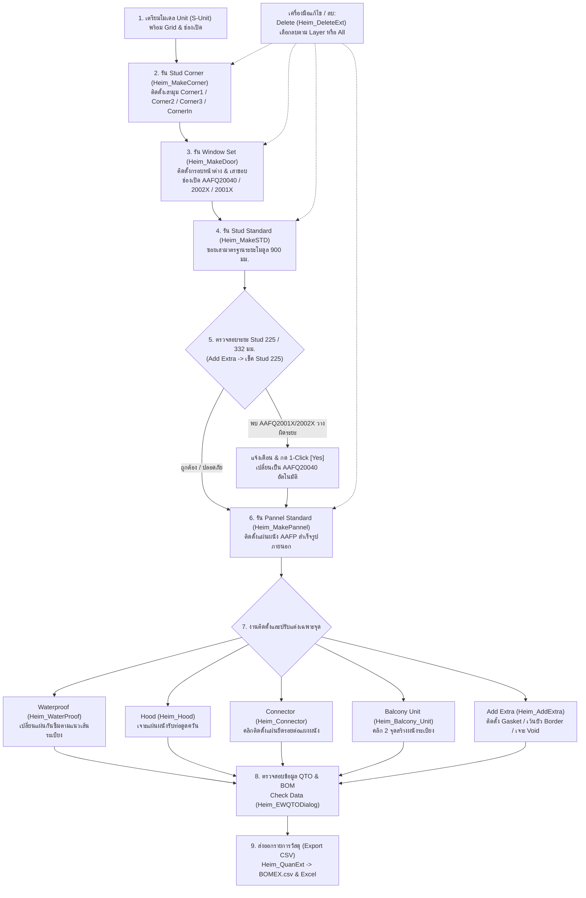
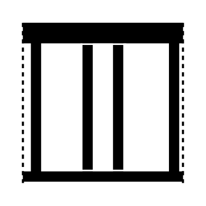
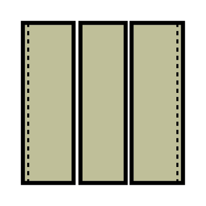
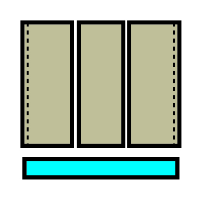
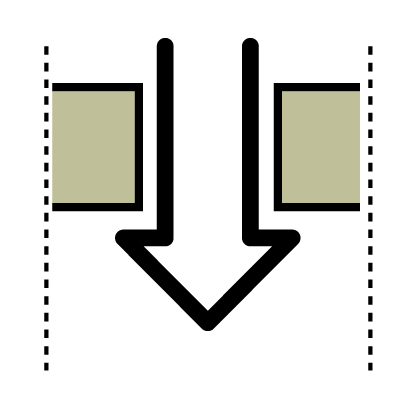
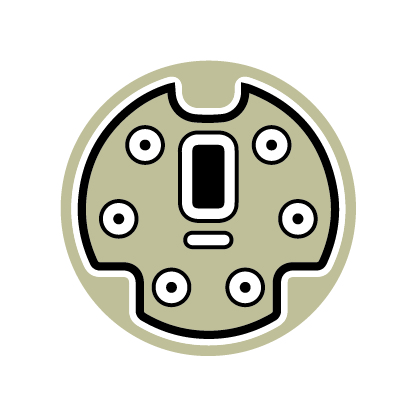
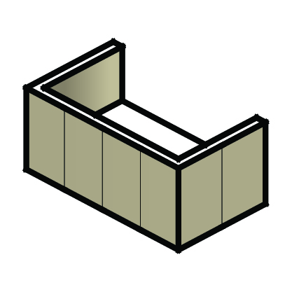
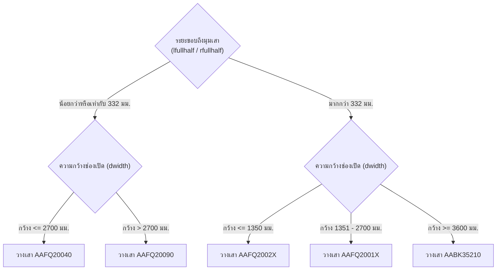

# คู่มือและเอกสารการทำงานระบบ Exterior Wall (QHeim)

[🏠 กลับสู่หน้าหลัก (Master Documentation)](README.md) &bull; [🌐 เปิดอ่านบนเว็บเบราว์เซอร์ (GitHub Pages)](https://suteechu.github.io/manual-QHeim/ExteriorWall_Doc.html)


เอกสารฉบับนี้จัดทำขึ้นเพื่ออธิบายหลักการทำงาน, สถาปัตยกรรมโค้ด (Code Architecture), ตรรกะการคำนวณ (Business Logic), โครงสร้างเลเยอร์ (Layers), กระบวนการวางโครงเหล็กและแผ่นผนัง 3D, ระบบแจ้งเตือนตรวจสอบเสาช่องเปิด 225/332 มม., และการถอดรายการวัสดุ (BOM) ของระบบ **Exterior Wall** ในส่วนขยาย **QHeim (SketchUp Ruby Extension)**

---

## 1. ภาพรวมระบบ (System Overview)

ระบบ **Exterior Wall** ทำหน้าที่สร้างผนังภายนอกของบ้านโครงสร้างเหล็กสำเร็จรูปโมดูลาร์ (Modular Unit) ครอบคลุมตั้งแต่การวางเสามุม (Corner Studs), เสาประกบช่องเปิดประตู-หน้าต่าง (Window Studs), เสาซอยย่อยมาตรฐานตามระยะโมดูล (Intermediate STD Studs), การกรุแผ่นผนังสำเร็จรูปภายนอก (Exterior Panels / AAFP), ระบบผนังกันซึมระเบียง (Waterproofing), ช่องท่อดูดควัน (Hood), ข้อต่อยึดแผงผนัง (Connector), ผนังยูนิตระเบียง (Balcony Unit), อุปกรณ์พิเศษ (Gasket, Border, Void), ระบบตรวจสอบเสาระยะ 225 มม. อัตโนมัติ, ไปจนถึงการส่งออกรายการวัสดุ (BOM)

### แผนผังลำดับขั้นตอนการทำงาน (Workflow Lifecycle)



> [!IMPORTANT]
> **กฎเหล็กและข้อกำหนดสำคัญที่สุดในการทำงาน:**
> 1. **ต้องรันคำสั่งตามลำดับจากซ้ายไปขวา:**  
>    $$\text{Corner} \longrightarrow \text{Window Set} \longrightarrow \text{Stud} \longrightarrow \text{Pannel}$$  
>    *ห้ามรันข้ามขั้นตอน* เพราะ `Window Set` ต้องใช้อ้างอิงเสามุม `Corner`, `Stud` ต้องใช้อ้างอิงระยะระหว่างเสามุมกับหน้าต่าง, และ `Pannel` ต้องอ้างอิงช่วงเสาของ `Stud` ทั้งหมด
> 2. **เลเยอร์ตั้งต้นที่ต้องมีในโมเดล:** ก่อนเริ่มทำงาน ต้องมีกลุ่มยูนิตอยู่ในเลเยอร์ `S-Unit`, มีกริดอยู่ในเลเยอร์ `EE-GRID-UNIT`, และบล็อกช่องเปิด 2D อยู่ในเลเยอร์ `A-WIND`, `A-DOOR` หรือ `Hood`
> 3. **ห้ามลบเสามุม `Corner1 / Corner2 / Corner3` ทิ้งทั้งหมด:** หากมีการปรับแก้ด้วยมือแล้วต้องการรันปุ่ม `Stud` ซ้ำ ต้องคงเสามุมหลักไว้เสมอ มิฉะนั้นคำสั่ง `Heim_MakeSTD` จะหาจุดเริ่มต้นในการยิง Raytest ไม่เจอ
> 4. **ปิดไฟล์ Excel ก่อนกด Export:** ก่อนกดไอคอน **Export CSV** กรุณาปิดไฟล์ `BOMEX.csv` ที่เปิดค้างไว้ใน Microsoft Excel ก่อนเสมอ เพื่อป้องกันข้อผิดพลาดสิทธิ์การบันทึกไฟล์ (Permission Denied)

---

## 2. หน้าต่างเมนูควบคุม (UI Controller)

ระบบทำงานผ่านไดอะล็อกแถบเครื่องมือ HTML (Toolbar):
* **Ruby Controller:** [Heim_ExteriorIcon.rb](file:///C:/QHeim/Ruby/Heim_ExteriorIcon.rb)
* **HTML Dialog View:** [Heim_Exterior.html](file:///C:/QHeim/Ruby/Heim_Exterior.html)

### รายการไอคอนและฟังก์ชันเรียกใช้งาน

| ไอคอน | ชื่อคำสั่ง (Tool Title) | ไฟล์ Ruby ที่ประมวลผล | หน้าที่หลัก |
| :---: | :--- | :--- | :--- |
|  | **Stud Corner** | [`Heim_MakeCorner.rb`](file:///C:/QHeim/Ruby/STD/Heim_MakeCorner.rb) | วิเคราะห์จุดมุมยูนิต ติดตั้งเสามุม `Corner1`, `Corner2`, `Corner3`, `CornerIn` |
|  | **Pannel Window Set** | [`Heim_MakeDoor.rb`](file:///C:/QHeim/Ruby/STD/Heim_MakeDoor.rb) | วางชุดกรอบหน้าต่าง 3D พร้อมเสาขอบช่องเปิดซ้าย-ขวา ตามระยะชิดขอบ |
|  | **Stud Standard** | [`Heim_MakeSTD.rb`](file:///C:/QHeim/Ruby/STD/Heim_MakeSTD.rb) | คำนวณระยะห่างเสาและซอยเสามาตรฐานตามระยะโมดูล 900 มม. อัตโนมัติ |
|  | **Pannel Standard** | [`Heim_MakePannel.rb`](file:///C:/QHeim/Ruby/STD/Heim_MakePannel.rb) | วางแผ่นผนังสำเร็จรูปภายนอก (AAFP) ตามช่วงเสา และตัดขอบช่องเปิด |
|  | **Pannel WaterProof** | [`Heim_WaterProof.rb`](file:///C:/QHeim/Ruby/Switch/Heim_WaterProof.rb) | เลือกเส้นเพื่อเปลี่ยนแผ่นผนังธรรมดาเป็นแผ่นผนังกันซึม (WA) บริเวณระเบียง |
|  | **Pannel Hood** | [`Heim_Hood.rb`](file:///C:/QHeim/Ruby/Switch/Heim_Hood.rb) | เลือกคอมโพเนนต์ Hood เพื่อตัดเจาะแผ่นผนังรับท่อดูดควัน |
|  | **Pannel Connector** | [`Heim_Connector.rb`](file:///C:/QHeim/Ruby/Switch/Heim_Connector.rb) | คลิกเลือกตำแหน่งแผงผนังเพื่อติดตั้งแผ่นเหล็กยึดรอยต่อแผงผนัง |
|  | **Balcony Unit** | [`Heim_Balcony_Unit.rb`](file:///C:/QHeim/Ruby/Switch/Heim_Balcony_Unit.rb) | คลิก 2 จุด เพื่อสร้างผนังยูนิตระเบียงและแผ่นผนังข้าง |
|  | **Add Extra** | [`Heim_AddExtra.rb`](file:///C:/QHeim/Ruby/Switch/Heim_AddExtra.rb) / [`Heim_Check332.rb`](file:///C:/QHeim/Ruby/Heim_Check332.rb) | เมนู Dropdown: **เช็ค Stud 225**, ติดตั้ง Gasket, กันซึมชั้น 2, เว้นบัว, เจาะ Void |
|  | **Check Data** | [`Heim_EWQTODialog.rb`](file:///C:/QHeim/Ruby/Heim_QTODialog.rb) | เปิดหน้าต่างตาราง HTML ตรวจสอบยอด Takeoff เปรียบเทียบฐานข้อมูล SQL |
|  | **Export CSV** | [`Heim_QuanExt.rb`](file:///C:/QHeim/Ruby/STD/Heim_QuanExt.rb) | สรุปยอดรายการวัสดุผนังทั้งหมดออกเป็นไฟล์ `BOMEX.csv` และเปิด Excel |
|  | **Delete** | [`Heim_DeleteExt.rb`](file:///C:/QHeim/Ruby/STD/Heim_DeleteExt.rb) | เลือกลบชิ้นส่วนผนังตามหมวดเลเยอร์ หรือลบทั้งหมดในคราวเดียว |

---

## 3. คู่มือขั้นตอนการกดใช้งานแต่ละไอคอน (SOP สำหรับคนทำงาน)

### 📌 สรุปขั้นตอนมาตรฐาน 4 สเต็ปหลัก:
1. **สเต็ป 1 (โครงสร้างเสา):** ครอบยูนิต `S-Unit` &rarr; กด **Stud Corner** &rarr; กด **Pannel Window Set** &rarr; กด **Stud Standard**
2. **สเต็ป 2 (ตรวจสอบเสาระยะ 225 มม.):** กดปุ่ม **Add Extra** &rarr; เลือก **`เช็ค Stud 225`** &rarr; หากระบบแจ้งเตือนว่ามี `AAFQ2001X / AAFQ2002X` วางที่ระยะ 225 มม. ให้กด **[Yes]** เพื่อเปลี่ยนเป็น `AAFQ20040` อัตโนมัติทันที
3. **สเต็ป 3 (แผ่นผนัง & จุดพิเศษ):** ครอบยูนิต &rarr; กด **Pannel Standard** &rarr; ปรับแต่งงานระเบียงด้วย **Waterproof**, **Hood**, **Connector**, **Balcony Unit** หรือ **Extra Gasket**
4. **สเต็ป 4 (ตรวจสอบ & ถอดแบบ):** กด **Check Data** ตรวจสอบ &rarr; กด **Export CSV** เพื่อรับไฟล์ Excel สรุปยอด

---

### 📋 รายละเอียดการกดใช้งานทีละไอคอน:

#### 1. Stud Corner ([`Heim_MakeCorner.rb`](file:///C:/QHeim/Ruby/STD/Heim_MakeCorner.rb))
* **🎯 การเลือกวัตถุ:** ลากเมาส์ครอบ Unit ที่ต้องการทำในเลเยอร์ `S-Unit`
* **🖱️ การคลิก & ตั้งค่า:** กดไอคอน **Stud Corner** ครั้งเดียว ระบบจะทำงานอัตโนมัติ
* **📦 ผลลัพธ์ในโมเดล:** สร้างเสามุมอาคารรอบยูนิตในเลเยอร์ `S-STD`:
  * เสามุมนอก: `Corner1` (รหัส `AAFQ1013X` ความหนา 1.6 มม. หรือ `AAFQ1003X` หนา 2.3 มม.)
  * เสามุมที่มี 3 ยูนิตมาชนกัน: `Corner3`
  * เสามุมในเว้า: `CornerIn`
* **⚠️ ข้อควรระวัง:** ถ้ายูนิตนั้นเคยรัน Stud มาก่อน ระบบจะเด้งเตือน `Stud exist in Unit = ... - Please Check` ให้ลบ Stud เก่าออกก่อน

#### 2. Pannel Window Set ([`Heim_MakeDoor.rb`](file:///C:/QHeim/Ruby/STD/Heim_MakeDoor.rb))
* **🎯 การเลือกวัตถุ:** ลากเมาส์ครอบ Unit ที่มีบล็อกหน้าต่าง/ประตู 2D อยู่บนเลเยอร์ `A-WIND` หรือ `A-DOOR`
* **🖱️ การคลิก & ตั้งค่า:** กดไอคอน **Pannel Window Set** ครั้งเดียว
* **📦 ผลลัพธ์ในโมเดล:**
  * สร้างกรอบหน้าต่าง 3D (`Window_Set`) วางลงในเลเยอร์ `S-Window`
  * วางเสาประกบขอบหน้าต่างซ้าย-ขวา (`lname`, `rname` = `Corner2`) ลงในเลเยอร์ `S-STD`:
    * ถ้าระยะถึงมุม $\le 332\,\text{mm}$: ใส่เสารหัส **`AAFQ20040`** (หรือ `AAFQ20090` ถ้าบานกว้าง $> 2700$)
    * ถ้าระยะถึงมุม $> 332\,\text{mm}$: ใส่เสารหัส **`AAFQ2002X`** (บาน $\le 1350$), **`AAFQ2001X`** (บาน $1350-2700$), หรือ **`AABK35210`** (บาน $\ge 3600$)
    * บานประเภท NOTATAKI: ใส่เสารหัส **`YYFQ00060`**
* **⚠️ ข้อควรระวัง:** หน้าต่าง 2D ต้องตั้งชื่อสัญลักษณ์ตรงตามสเปก เช่น `Hi-C1800`, `Middle-K900`, `Tall-Z1800`

#### 3. Stud Standard ([`Heim_MakeSTD.rb`](file:///C:/QHeim/Ruby/STD/Heim_MakeSTD.rb))
* **🎯 การเลือกวัตถุ:** ลากเมาส์ครอบ Unit ในเลเยอร์ `S-Unit` (ที่ผ่านการรัน Corner และ Window มาแล้ว)
* **🖱️ การคลิก & ตั้งค่า:** กดไอคอน **Stud Standard** ครั้งเดียว
* **📦 ผลลัพธ์ในโมเดล:** ระบบจะยิง Raytest วัดระยะระหว่างเสา `Corner1`, `Corner2`, `Corner3` และเติมเสาซอยย่อยรหัส **`AAFQ2002X`** / **`AAFQ2001X`** ตามระยะโมดูล 900 มม. ลงในเลเยอร์ `S-STD`
* **⚠️ ข้อควรระวัง:** หากครอบยูนิตที่ไม่พบเสามุม `Corner` อยู่ใน `S-STD` ระบบจะไม่สามารถคำนวณระยะซอยได้

#### 4. Add Extra &rarr; เมนู "เช็ค Stud 225" ([`Heim_Check332.rb`](file:///C:/QHeim/Ruby/Heim_Check332.rb))
* **🎯 การเลือกวัตถุ:** เลือก Unit ที่ต้องการ หรือ**ไม่ต้องเลือกอะไรเลย** (ระบบจะกวาดตรวจทั้งโมเดล)
* **🖱️ การคลิก & ตั้งค่า:** กดปุ่ม **Add Extra** &rarr; ในช่อง Dropdown (Type) ให้คลิกเลือก **`เช็ค Stud 225`**
* **📦 ผลลัพธ์ในโมเดล:**
  * **กรณีตรวจพบ:** ระบบจะไฮไลต์ชิ้นงานที่เป็นปัญหา (Select สีน้ำเงิน) และเปิดกล่องข้อความถามยืนยัน:
    ```text
    ⚠️ คำเตือน: พบ AAFQ2001X / AAFQ2002X | วาง 225 (ปรับเป็น AAFQ20040)

    1. Unit-12 (AAFQ2002X)
    2. Unit-12 (AAFQ2002X)

    ระบบได้ไฮไลต์ (Select) ชิ้นงานที่พบให้เรียบร้อยแล้วครับ

    ต้องการเปลี่ยนเป็น AAFQ20040 ทันทีเลยหรือไม่?
    [ Yes ]  [ No ]
    ```
    *กด **[Yes]**:* ระบบจะสลับชิ้นงานเป็น **`AAFQ20040`** ให้ทันทีอัตโนมัติทุกจุด  
    *กด **[No]**:* คงสภาพเดิมไว้สำหรับตรวจสอบด้วยตนเอง
  * **กรณีปลอดภัย:** จะแสดงข้อความ:
    ```text
    ✅ ปลอดภัย! ไม่พบ AAFQ2001X หรือ AAFQ2002X | วาง 225 |
    ```

#### 5. Pannel Standard ([`Heim_MakePannel.rb`](file:///C:/QHeim/Ruby/STD/Heim_MakePannel.rb))
* **🎯 การเลือกวัตถุ:** ลากเมาส์ครอบ Unit ในเลเยอร์ `S-Unit`
* **🖱️ การคลิก & ตั้งค่า:** กดไอคอน **Pannel Standard** ครั้งเดียว
* **📦 ผลลัพธ์ในโมเดล:** ติดตั้งแผ่นผนังสำเร็จรูปภายนอก (รหัสตระกูล **`AAFP...`**) ลงในเลเยอร์ `S-Pannel` ครอบคลุมทั้งแผ่นมุมนอก (Corner Panel), แผ่นเรียบมาตรฐาน, แผ่นขอบหน้าต่าง พร้อมรันฟังก์ชัน `checkDupSTD` เคลียร์ Stud ที่ซ้ำซ้อนออกให้อัตโนมัติ

#### 6. Pannel WaterProof ([`Heim_WaterProof.rb`](file:///C:/QHeim/Ruby/Switch/Heim_WaterProof.rb))
* **🎯 การเลือกวัตถุ:** **ลากเส้น Line (Edge)** ในเลเยอร์ `Layer0` หรือ `Untagged` ตามแนวผนังระเบียงที่ต้องการทำกันซึม (เส้นต้องอยู่ในขอบเขตยูนิต) จากนั้น **คลิกเลือกเส้นที่ลากไว้**
* **🖱️ การคลิก & ตั้งค่า:** กดไอคอน **Pannel WaterProof**
* **📦 ผลลัพธ์ในโมเดล:** แปลงแผ่นผนังธรรมดา (`AAFP...`) ให้กลายเป็นแผ่นผนังกันซึม (รหัสขึ้นต้นด้วย `WA...`) และปรับเปลี่ยนเสามุมเป็นชนิดกันซึมตามฐานข้อมูล `Code_Component-WaterProof.xlsx` ลงในเลเยอร์ `S-WaterProof`

#### 7. Pannel Hood ([`Heim_Hood.rb`](file:///C:/QHeim/Ruby/Switch/Heim_Hood.rb))
* **🎯 การเลือกวัตถุ:** คลิกเลือกชิ้นส่วนช่องเปิดดูดควัน (ต้องอยู่บนเลเยอร์ `Hood`)
* **🖱️ การคลิก & ตั้งค่า:** กดไอคอน **Pannel Hood**
* **📦 ผลลัพธ์ในโมเดล:** เจาะช่องและปรับขนาดแผ่นผนังรอบท่อดูดควัน พร้อมใส่แผ่นสำเร็จรูปสำหรับรับ Hood ลงในเลเยอร์ `S-Hood`

#### 8. Pannel Connector ([`Heim_Connector.rb`](file:///C:/QHeim/Ruby/Switch/Heim_Connector.rb))
* **🎯 การเลือกวัตถุ:** **ไม่ต้องเลือกวัตถุล่วงหน้า** (เป็นเครื่องมือ Interactive Pick)
* **🖱️ การคลิก & ตั้งค่า:** กดไอคอน **Pannel Connector** &rarr; นำเมาส์ไปคลิกที่ตำแหน่งแผงผนังที่ต้องการติดข้อต่อ
* **📦 ผลลัพธ์ในโมเดล:** ติดตั้งแผ่นเหล็กยึดรอยต่อแผงผนังตามสเปกใน `Code_Component-Connector.xlsx` ลงในเลเยอร์ `S-Connector`

#### 9. Balcony Unit ([`Heim_Balcony_Unit.rb`](file:///C:/QHeim/Ruby/Switch/Heim_Balcony_Unit.rb))
* **🎯 การเลือกวัตถุ:** **ไม่ต้องเลือกวัตถุล่วงหน้า** (เป็นเครื่องมือ Interactive 2 คลิก)
* **🖱️ การคลิก & ตั้งค่า:** กดไอคอน **Balcony Unit** &rarr; คลิกจุดที่ 1 (จุดเริ่มผนังระเบียง) &rarr; คลิกจุดที่ 2 (จุดสิ้นสุดผนังระเบียง)
* **📦 ผลลัพธ์ในโมเดล:** วาดแผงผนังระเบียงและแผ่นผนังข้าง (Side / Clash Panel) ตามสเปก `Code_Component-Balcony Unit.xlsx` ลงในเลเยอร์ `S-BalconyUnit`

#### 10. Add Extra ([`Heim_AddExtra.rb`](file:///C:/QHeim/Ruby/Switch/Heim_AddExtra.rb))
* **🎯 การเลือกวัตถุ:** ลากครอบ Unit ที่ต้องการติดตั้งอุปกรณ์เสริม
* **🖱️ การคลิก & ตั้งค่า:** กดไอคอน **Add Extra** &rarr; จะมีหน้าต่างเล็กเปิดขึ้นมา เลือกรายการใน Dropdown:
  * **เช็ค Stud 225:** ตรวจสอบเสาขอบหน้าต่าง 225 มม. และสลับเป็น `AAFQ20040`
  * **Gasket:** ติดตั้งเส้นยางกันรั่วซึมรอบรอยต่อ (`AATE00210`, `AATE00220`, `AATE00200`)
  * **WaterProof (เฉพาะชั้น 2):** ติดตั้งระบบกันซึมภายนอกชั้น 2
  * **Border (เว้นบัวผนัง):** เรียกเครื่องมือ [`Heim_Border.rb`](file:///C:/QHeim/Ruby/Switch/Heim_Border.rb) เว้นระยะบัวผนัง
  * **Void (เจาะรูพิเศษ):** เรียกเครื่องมือ [`Heim_Void.rb`](file:///C:/QHeim/Ruby/Switch/Heim_Void.rb) เจาะช่องเปิดสี่เหลี่ยมหรือวงกลม

#### 11. Check Data ([`Heim_EWQTODialog.rb`](file:///C:/QHeim/Ruby/Heim_QTODialog.rb))
* **🎯 การเลือกวัตถุ:** ลากครอบ Unit หรือเลือก 1 ชิ้นงานที่ต้องการตรวจสอบ
* **🖱️ การคลิก & ตั้งค่า:** กดไอคอน **Check Data**
* **📦 ผลลัพธ์ในโมเดล:** เปิดหน้าต่างไดอะล็อก HTML แสดงรายการ Takeoff ถอดแบบเปรียบเทียบกับฐานข้อมูล SQL Server (PS / MIM Lookup)

#### 12. Export CSV ([`Heim_QuanExt.rb`](file:///C:/QHeim/Ruby/STD/Heim_QuanExt.rb))
* **🎯 การเลือกวัตถุ:** ลากครอบ Unit ทั้งหมดที่ต้องการสรุปยอดในเลเยอร์ `S-Unit`
* **🖱️ การคลิก & ตั้งค่า:** ตรวจสอบว่าปิดไฟล์ Excel เก่าแล้ว &rarr; กดไอคอน **Export CSV**
* **📦 ผลลัพธ์ในโมเดล:** สแกนชิ้นงานทั้งหมดในเลเยอร์หมวด `S-*`, สรุปจำนวนชิ้นงานลงในไฟล์ `BOMEX.csv` ในโฟลเดอร์โครงการ และเปิดโปรแกรม Microsoft Excel ขึ้นมาแสดงผลทันที

#### 13. Delete ([`Heim_DeleteExt.rb`](file:///C:/QHeim/Ruby/STD/Heim_DeleteExt.rb))
* **🎯 การเลือกวัตถุ:** เลือก Unit ที่ต้องการลบ (หรือกดไอคอนแล้วคลิกที่ยูนิต)
* **🖱️ การคลิก & ตั้งค่า:** กดไอคอน **Delete** &rarr; เลือกประเภทที่ต้องการลบในหน้าต่าง Popup:
  `Pannel | STD | Window | Hood | WaterProof | Connector | Gasket | Border | OutWaterProof | All`
* **📦 ผลลัพธ์ในโมเดล:** ลบเฉพาะชิ้นงานในหมวดที่เลือกออกจากยูนิตอย่างปลอดภัย โดยไม่กระทบโครงสร้างหลักของยูนิต

---

## 4. สถาปัตยกรรมและตรรกะการทำงานแต่ละโมดูล (Detailed Module Logic)

### 4.1 โมดูลเสามุม (Heim_MakeCorner.rb)
* ตรวจสอบว่าในยูนิตมีเลเยอร์ `S-STD` หรือยัง หากมีจะหยุดเพื่อป้องกันการรันซ้ำ
* ค้นหาพิกัด 4 มุมของยูนิตจากคอมโพเนนต์ `EE-GRID-UNIT` (Corner 0, 1, 2, 3)
* ใช้ฟังก์ชัน `checkCorner` ยิงลำแสง Vector ตรวจสอบว่าแต่ละด้านชนกับยูนิตอื่นหรือไม่:
  * **มุมนอก (Exterior Corner):** วางคอมโพเนนต์ `Corner1` (รหัส `AAFQ1013X` หนา 1.6 มม. หรือ `AAFQ1003X` หนา 2.3 มม.)
  * **มุมที่มี 3 ยูนิตมาบรรจบกัน:** วางคอมโพเนนต์ `Corner3`
  * **มุมเว้าใน (Internal Corner):** วางคอมโพเนนต์ `CornerIn`

---

### 4.2 โมดูลกรอบช่องเปิดและเสาประกบหน้าต่าง (Heim_MakeDoor.rb)
* โหลดข้อมูลขนาดช่องเปิดจากคลาส `OpeningData`:
  * ประเภทบาน: `Down-C`, `Hi-Z`, `Tall-Z`, `Hi-C`, `Hi-Waist`, `Middle-K`, `Hi-K`, `Hi-S`
  * ขนาดความกว้างมาตรฐาน ($W$): $225, 450, 675, 900, 1125, 1350, 1575, 1800, 2025, 2250, 2475, 2700, 3600, 4500\,\text{mm}$
* คำนวณระยะขอบซ้าย (`lfullhalf`) และขอบขวา (`rfullhalf`) จากขอบยูนิตถึงขอบช่องเปิด:



* **บานประเภทพิเศษ NOTATAKI:** หากชื่อช่องเปิดมีคำว่า `NOTATAKI` ทั้งสองข้างจะถูกบังคับวางเป็นเสารหัส **`YYFQ00060`**

---

### 4.3 โมดูลเสาซอยมาตรฐาน (Heim_MakeSTD.rb)
* วิ่งค้นหาเสาตั้งต้นทั้งหมดในเลเยอร์ `S-STD` (`Corner1`, `Corner2`, `Corner3`, `CornerIn`)
* ยิง Raytest วัดระยะห่างระหว่างเสาคู่ใดๆ ($dx$):
  * ช่วงเสาต่อเสา ($Corner \rightarrow Corner$)
  * ช่วงเสาต่อหน้าต่าง ($Corner \rightarrow Window$)
  * ช่วงหน้าต่างต่อหน้าต่าง ($Window \rightarrow Window$)
* คำนวณจำนวนช่วงเสา: $nx = \lfloor \frac{dx}{0.90} \rfloor$
* หากระยะ $dx > 0.90\,\text{m}$:
  * กรณีลงตัวพอดี (ไม่มีเศษ): วางเสา `AAFQ2002X` ทุกๆ ระยะก้าว 900 มม.
  * กรณีมีเศษ: คำนวณกระจายระยะจากสองฝั่งเข้าหากึ่งกลาง เพื่อให้รอยต่อแผ่นผนังลงตัว

---

### 4.4 โมดูลตรวจสอบและสลับเสาระยะ 225 มม. อัตโนมัติ (Heim_Check332.rb)
* **ฟังก์ชันการทำงาน:** สแกนค้นหาเสารหัส **`AAFQ2001X`** และ **`AAFQ2002X`** ในโมเดล
* **ตรรกะการวัดระยะ:**
  * วัดระยะ $3D$ จากตัว Stud ไปยังจุดกึ่งกลางเสามุม `Corner1 / Corner3` หรือขอบยูนิต
  * หากระยะตกอยู่ในช่วง **$200.0 - 370.0\,\text{mm}$** (ครอบคลุมทั้งระยะโมดูล $225\,\text{mm}$ จากหน้าเสา และระยะ $332\,\text{mm}$ จากจุดศูนย์กลางเสามุม)
* **ระบบสลับเปลี่ยนอัตโนมัติ (1-Click Auto Replace):**
  * เมื่อผู้ใช้กดยืนยัน **[Yes]** ระบบจะเรียกคอมโพเนนต์ **`AAFQ20040`** จาก `EW Component.skp`
  * สลับค่า `instance.definition = def40` ให้ทันทีทุกจุดภายใต้ Transaction เดียว (`start_operation`) จึงรักษาพิกัด ทิศทาง และมุมหมุนเดิมไว้อย่างแม่นยำ 100%

---

### 4.5 โมดูลแผ่นผนังสำเร็จรูป (Heim_MakePannel.rb)
* อ่านตารางจับคู่รหัสแผ่นผนังจากไฟล์ Excel `C:/QHeim/DATA/IM.xlsx` (Worksheet: `STD Panel`)
* วางแผ่นผนังภายนอกรหัสตระกูล **`AAFP...`** ตามแนวเสาภายนอกอาคาร
* ติดตั้งแผ่นเข้ามุม `AAFP...` สำหรับตำแหน่ง Corner
* มีระบบตรวจสอบ `checkDupSTD` ทำหน้าที่ลบ Stud ที่วางทับซ้อนกับแนวแผ่นหน้าต่างโดยอัตโนมัติ

---

### 4.6 โมดูลแผ่นกันซึมระเบียง (Heim_WaterProof.rb)
* อ้างอิงฐานข้อมูลจาก `C:/QHeim/DATA/Code_Component-WaterProof.xlsx` (Worksheet: `BAC3`)
* ตรวจสอบเส้น Line ในเลเยอร์ `Layer0` ที่ผู้ใช้เลือก
* แปลงแผ่นผนังในแนวเส้นจากรหัสมาตรฐานเป็นแผ่นรหัสกันซึม (Prefix: `WA_...`) พร้อมทั้งเปลี่ยนเสามุมและขอบหน้าต่างที่เกี่ยวข้องให้เป็นเวอร์ชันกันซึม

---

### 4.7 โมดูลช่องเปิดท่อดูดควัน (Heim_Hood.rb)
* อ้างอิงฐานข้อมูลจาก `Code_Component-Hood-EW.xlsx` (Worksheet: `Hood`)
* ตรวจสอบบล็อกคอมโพเนนต์บนเลเยอร์ `Hood`
* ทำการเจาะช่องบนแผ่นผนังภายนอกและแทนที่ด้วยแผ่นผนังสำเร็จรูปที่มีช่องสำหรับติดตั้งท่อดูดควัน

---

### 4.8 โมดูลส่งออกรายการวัสดุ (Heim_QuanExt.rb)
* สแกนวัตถุทั้งหมดที่อยู่ในเลเยอร์หมวด `S-*` ภายใต้ยูนิต `S-Unit` ที่เลือก
* จำแนกรายการวัสดุ: เสามุม, เสาหน้าต่าง, เสามาตรฐาน, แผ่นผนัง AAFP, แผ่นกันซึม WA, อุปกรณ์ Gasket, และข้อต่อ Connector
* สรุปรายการลงในไฟล์ `BOMEX.csv` ในโฟลเดอร์ของโครงการ และสั่งเปิดโปรแกรม Microsoft Excel ขึ้นมาแสดงผลทันที

---

## 5. ตารางสรุปเลเยอร์และคอมโพเนนต์ (Component & Layer Matrix)

| หมวดหมู่ | ชื่อ Layer ใน SketchUp | รหัสชิ้นส่วน (Part ID) | รายละเอียดชิ้นส่วน | หน่วยใน BOM |
| :--- | :--- | :--- | :--- | :---: |
| **เสามุม (Corner)** | `S-STD` | `AAFQ1013X` | เสามุมภายนอก Corner1 (เหล็กหนา 1.6 มม.) | ชิ้น (EA) |
| | | `AAFQ1003X` | เสามุมภายนอก Corner1 (เหล็กหนา 2.3 มม.) | ชิ้น (EA) |
| | | `Corner3` | เสามุมสำหรับจุดบรรจบ 3 ยูนิต | ชิ้น (EA) |
| | | `CornerIn` | เสามุมเว้าใน (Internal Corner) | ชิ้น (EA) |
| **เสาขอบหน้าต่าง** | `S-STD` | `AAFQ20040` | เสาขอบหน้าต่างระยะชิดมุม $\le 332\,\text{mm}$ (บาน $\le 2700$) | ชิ้น (EA) |
| | | `AAFQ20090` | เสาขอบหน้าต่างระยะชิดมุม $\le 332\,\text{mm}$ (บาน $> 2700$) | ชิ้น (EA) |
| | | `AAFQ2002X` | เสาขอบหน้าต่างระยะทั่วไป (บาน $\le 1350\,\text{mm}$) | ชิ้น (EA) |
| | | `AAFQ2001X` | เสาขอบหน้าต่างระยะทั่วไป (บาน $1350 - 2700\,\text{mm}$) | ชิ้น (EA) |
| | | `AABK35210` | เสาขอบหน้าต่างขนาดใหญ่ (บาน $\ge 3600\,\text{mm}$) | ชิ้น (EA) |
| | | `YYFQ00060` | เสาขอบประตูทางเข้าประเภท NOTATAKI | ชิ้น (EA) |
| **กรอบช่องเปิด 3D** | `S-Window` | `Window_Set` | บล็อกชุดกรอบหน้าต่างและประตู 3D | ชุด (Set) |
| **เสาซอยมาตรฐาน** | `S-STD` | `AAFQ2002X` / `AAFQ2001X` | เสาซอยย่อยก้าวระยะโมดูล 900 มม. | ชิ้น (EA) |
| **แผ่นผนังภายนอก** | `S-Pannel` | `AAFP...` | แผ่นผนังไฟเบอร์ซีเมนต์/เซรามิกสำเร็จรูปภายนอก | แผ่น (Sheet) |
| **ผนังกันซึมระเบียง**| `S-WaterProof` | `WA_...` | แผ่นผนังสำเร็จรูปเคลือบสารกันซึมสำหรับระเบียง | แผ่น (Sheet) |
| **ช่องท่อดูดควัน** | `S-Hood` | `Hood_Pannel` | แผ่นผนังเจาะช่องสำเร็จรูปสำหรับท่อระบายควัน | แผ่น (Sheet) |
| **ข้อต่อแผงผนัง** | `S-Connector` | `Connector` | แผ่นเหล็กข้อต่อยึดประสานแผงผนัง | ชิ้น (EA) |
| **ผนังยูนิตระเบียง** | `S-BalconyUnit`| `Balcony_Wall` | แผงผนังปิดข้างยูนิตระเบียง | แผง (Set) |
| **อุปกรณ์ซีลกันรั่ว**| `S-Gasket` | `AATE00210` | ยางกันรั่วซึม Gasket Type P1 | เส้น (M) |
| | | `AATE00220` | ยางกันรั่วซึม Gasket Type P2 | เส้น (M) |
| | | `AATE00200` | ยางกันรั่วซึม Gasket Type U / IC | เส้น (M) |

---

## 6. ข้อแนะนำและการแก้ไขปัญหาที่พบบ่อย (Best Practices & Troubleshooting)

1. **ลำดับการทำงานที่ถูกต้อง:**  
   รันตามลำดับ: **Corner $\rightarrow$ Window Set $\rightarrow$ Stud $\rightarrow$ เช็ค Stud 225 $\rightarrow$ Pannel** เสมอ หากมีการย้ายตำแหน่งหน้าต่าง ให้ลบชิ้นงานออกด้วยปุ่ม **Delete** แล้วรันใหม่ตามลำดับ
2. **ขึ้นเตือน "Stud exist in Unit - Please Check":**  
   เกิดจากในยูนิตนั้นมีชิ้นส่วนบนเลเยอร์ `S-STD` อยู่แล้ว ให้ใช้เครื่องมือ **Delete** เลือกหมวด `STD` เพื่อเคลียร์ออกก่อน แล้วจึงรันคำสั่งใหม่
3. **เสาขอบหน้าต่างกลายเป็น AAFQ2002X ทั้งที่ระยะวัดได้ 225 หรือ 332 มม.:**  
   เกิดจากเศษทศนิยมในการวางบานหน้าต่างคลาดเคลื่อนเกิน 332.0 มม. เล็กน้อย ทำให้ตรรกะเดิมตกไปเข้าเงื่อนไขเสาขนาดทั่วไป  
   *วิธีแก้:* ให้กดปุ่ม **Add Extra** &rarr; เลือก **`เช็ค Stud 225`** &rarr; กด **[Yes]** ระบบจะสลับเป็น `AAFQ20040` ให้ทันทีโดยไม่ต้องแก้ไขโมเดลใหม่
4. **พอกดรัน Stud Standard แล้วเงียบ ไม่ยอมวางเสา:**  
   ตรวจสอบว่าในเลเยอร์ `S-STD` มีเสามุม `Corner1 / Corner2 / Corner3` อยู่หรือไม่ หากเผลอลบเสามุมทิ้งไป คำสั่งจะไม่สามารถยิง Raytest ได้ ให้รัน `Stud Corner` และ `Window Set` ใหม่
5. **ขึ้น Error ตอนกด Export CSV:**  
   เกิดจากไฟล์ `BOMEX.csv` กำลังเปิดค้างอยู่ใน Microsoft Excel ให้ปิดโปรแกรม Excel ก่อนแล้วกด Export ใหม่อีกครั้ง
6. **แผ่น Pannel ไม่ยอมตัดช่องเปิดหน้าต่าง:**  
   ตรวจสอบว่าเลเยอร์ `S-Window` ถูกเปิดแสดงผล (Visible) อยู่หรือไม่ และตำแหน่งหน้าต่างต้องแนบสนิทกับขอบเขตภายนอกของยูนิต


---

[🏠 กลับสู่หน้าหลัก (Master Documentation)](README.md) &bull; [🌐 เปิดอ่านบนเว็บเบราว์เซอร์ (GitHub Pages)](https://suteechu.github.io/manual-QHeim/ExteriorWall_Doc.html)
