# คู่มือและเอกสารการทำงานระบบ Interior Wall (QHeim)

เอกสารฉบับนี้จัดทำขึ้นเพื่ออธิบายหลักการทำงาน, สถาปัตยกรรมโค้ด (Code Architecture), ตรรกะการคำนวณ (Business Logic), โครงสร้างเลเยอร์ (Layers), กระบวนการสร้างผนัง 3D, ระบบโครงเหล็กและแผ่นสมาร์ทบอร์ดผนังใน (IW Frame & Board), ระบบผนังกั้นห้อง (Partition Wall), ระบบเจาะช่องบล็อกไฟฟ้าและแอร์ (EE Punching), การออก Tag มิติ, และการถอดรายการวัสดุ (BOM) เชื่อมต่อฐานข้อมูล SSIC ของระบบ **Interior Wall** ในส่วนขยาย **QHeim (SketchUp Ruby Extension)**

---

## 1. ภาพรวมระบบ (System Overview)

ระบบ **Interior Wall** ทำหน้าที่สร้างและจัดการองค์ประกอบสถาปัตยกรรมภายในอาคารของบ้านโครงสร้างเหล็กสำเร็จรูปโมดูลาร์ (Modular Unit) โดยแบ่งออกเป็น 4 ระบบย่อยหลัก:
1. **ระบบสร้างผนัง 3D และท่อชาร์ป (3D Wall & Pipe Shaft):** ดึงแนวเส้น CAD ผนัง 41 มม. สร้างเป็น Solid Wall ทั้ง Single Wall และ Double Wall พร้อมจัดการจุดต่อและช่องเปิด
2. **ระบบผนังด้านในของยูนิต (Interior Wall - IW):** วางโครงเหล็กแนวยูนิต (IW Frame: U-Steel, Box Frame), กรุแผ่น Smartboard 8/12 มม. ตามระดับความสูงอาคาร (Low, Normal, High), และติดตั้งแผ่นรอยต่อบอร์ด (Board Joint)
3. **ระบบผนังกั้นห้องและประตู (Partition Wall - PT):** กำหนดระดับความสูงผนัง, วิเคราะห์ช่องเปิดประตู (Door Spec & Legs), วางโครงสร้างแผง Partition สำเร็จรูปจากโรงงานหรือกำหนดเป็นงานประกอบหน้างาน (ON-SITE), ติดตั้ง Joint ข้อต่อ, จัดการช่อง Shaft และ Void บันได, พร้อมระบบให้มิติและ Tag รหัสผนัง
4. **ระบบเจาะแผ่นสมาร์ทบอร์ด (EE Punching System):** ตรวจจับตำแหน่งบล็อกสวิตช์-เต้ารับไฟฟ้า และบล็อกเครื่องปรับอากาศ (AC) เจาะรูทะลุแผ่น Smartboard 3D อัตโนมัติ, พร้อมสร้างแบบขยาย 2D Drawing และส่งออกไฟล์ AutoCAD DWG เข้าสู่กระบวนการผลิตโรงงาน

### แผนผังลำดับขั้นตอนการทำงาน (Workflow Lifecycle)

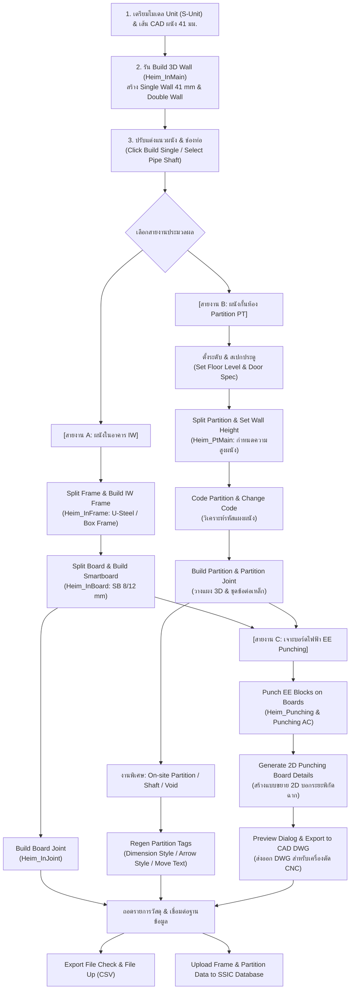

> [!IMPORTANT]
> **กฎเหล็กและข้อกำหนดสำคัญที่สุดในการทำงาน:**
> 1. **โมเดลยูนิตต้องมี Attribute `position` ครบถ้วน:** ยูนิตทั้งหมดในเลเยอร์ `S-Unit` ต้องผ่านการรันระบุตำแหน่งพิกัด (`Heim_Positionx`) แล้ว เพื่อให้มีค่า Attribute `position` (เช่น "01", "04") มิฉะนั้นคำสั่งสร้างผนังและคำนวณขอบเขตจะพังด้วย Error `#<NoMethodError: undefined method 'include?' for nil:NilClass>`
> 2. **ตรวจสอบจุด Origin ประตู (Door Origin) ให้อยู่ในช่องว่างผนัง:** การวาง Component ประตู ต้องให้จุดอ้างอิง (Origin/Center) ตกอยู่ภายใน "ช่องว่างระหว่างชิ้นส่วนผนังชั่วคราว" อย่างพอดี หากวางเหลื่อมทับตัวเนื้อผนัง ระบบจะฟ้อง `Current selection door have problem: Door's origin is outside the temporary wall`
> 3. **ลำดับการทำ Partition ห้ามข้ามขั้นตอน:** ต้องทำตามลำดับ  
>    $$\text{Door Spec} \longrightarrow \text{Set Height} \longrightarrow \text{Split Partition} \longrightarrow \text{Code Partition} \longrightarrow \text{Build Partition}$$  
>    หากกด `Build Partition` โดยที่ผนังยังไม่มี Code ระบบจะแจ้งเตือนและหยุดทำงานทันที
> 4. **ปิดโปรแกรม Excel ก่อน Export CSV:** ก่อนคลิกปุ่ม **Export File Check** หรือ **Export File Up** ให้ปิดโปรแกรม Microsoft Excel ที่เปิดไฟล์ CSV ค้างไว้เสมอ เพื่อป้องกันข้อผิดพลาดการเขียนไฟล์ล้มเหลว (Permission Denied)

---

## 2. หน้าต่างเมนูควบคุม (UI Controller)

ระบบ Interior ทำงานผ่านไดอะล็อกแถบเครื่องมือ HTML (Toolbar):
* **Ruby Controller:** [Heim_InteriorIcon.rb](file:///C:/QHeim/Ruby/Heim_InteriorIcon.rb)
* **HTML Dialog View:** [Heim_Interior.html](file:///C:/QHeim/Ruby/Heim_Interior.html)
* **ที่จัดเก็บไอคอน:** [ICON/Interior](ICON/Interior/)

### รายการไอคอนและฟังก์ชันเรียกใช้งานครบทั้ง 37 คำสั่ง

#### กลุ่มที่ 1: งานสร้างผนัง 3D และท่อชาร์ป (3D Wall & Pipe Shaft)

| ไอคอน | ชื่อคำสั่ง (Tool Title) | ไฟล์ Ruby ที่ประมวลผล | หน้าที่หลัก |
| :---: | :--- | :--- | :--- |
| 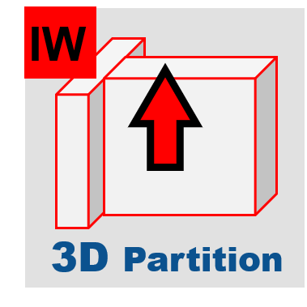 | **Build 3D wall** | [`Heim_InMain.rb`](file:///C:/QHeim/Ruby/Interior/Heim_InMain.rb)<br/>[`Heim_BuildWall.rb`](file:///C:/QHeim/Ruby/Interior/Heim_BuildWall.rb) | สร้าง Single Wall (41 mm) และ Double Wall 3D จากเส้น CAD พร้อมเคลียร์รอยต่อเสา |
|  | **Click Single Wall** | [`Heim_BuildWall.rb`](file:///C:/QHeim/Ruby/Interior/Heim_BuildWall.rb) | เครื่องมือคลิกด้วยมือภายในแนวเส้นคู่ระยะ 41 มม. 3 เส้น เพื่อสร้าง Single Wall เฉพาะจุด |
| 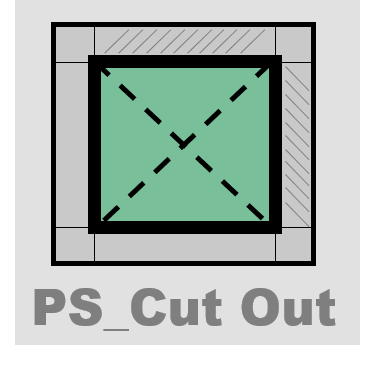 | **Select Pipe Shaft** | [`Heim_BuildWall.rb`](file:///C:/QHeim/Ruby/Interior/Heim_BuildWall.rb) | คลิกเลือกชิ้น Single Wall เพื่อแปลงเลเยอร์และสเปกเป็นช่องท่อสุขาภิบาล (Pipe Shaft) |

#### กลุ่มที่ 2: งานโครงเหล็กและแผ่นสมาร์ทบอร์ดผนังใน (Interior Wall Frame & Board)

| ไอคอน | ชื่อคำสั่ง (Tool Title) | ไฟล์ Ruby ที่ประมวลผล | หน้าที่หลัก |
| :---: | :--- | :--- | :--- |
| 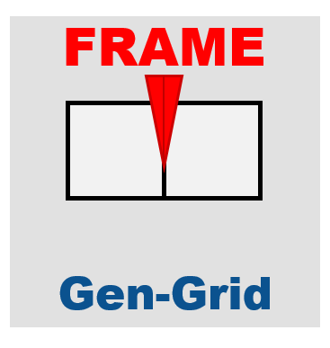 | **Split Frame** | [`Heim_InMain.rb`](file:///C:/QHeim/Ruby/Interior/Heim_InMain.rb) | ซอยเส้นแนวโครงเหล็กผนังใน (IW Frame) ตามแนวเสาและช่องเปิดประตู-หน้าต่าง |
| 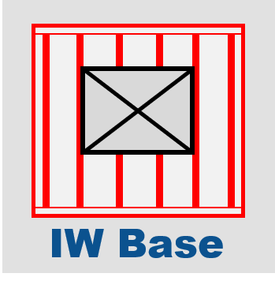 | **Build Frame** | [`Heim_InFrame.rb`](file:///C:/QHeim/Ruby/Interior/Heim_InFrame.rb) | ประกอบโครงเหล็กผนังใน 3D (U-Steel, Box Frame) พร้อมใส่โค้ดและสีวัสดุ |
|  | **Switch Frame Code** | [`Heim_InMain.rb`](file:///C:/QHeim/Ruby/Interior/Heim_InMain.rb) | สลับทิศทางและโค้ดของโครงเหล็กบริเวณจุดมุมที่มาบรรจบกัน (Corner) |
|  | **Split Smartboard** | [`Heim_InBoard.rb`](file:///C:/QHeim/Ruby/Interior/Heim_InBoard.rb) | ซอยแบ่งระยะแผ่น Smartboard ตามมาตรฐานความกว้างและความสูงอาคาร |
| 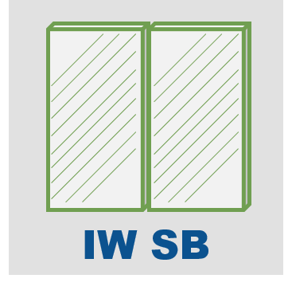 | **Build Smartboard** | [`Heim_InBoard.rb`](file:///C:/QHeim/Ruby/Interior/Heim_InBoard.rb) | สร้างแผ่น Smartboard ผนังใน 3D (หนา 8/12 มม.) พร้อมตัดช่องเปิดตามหน้าต่าง |
| 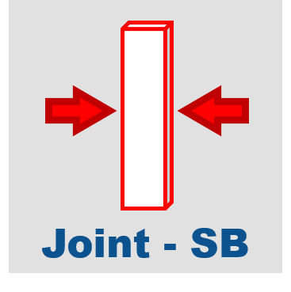 | **Build Board Joint** | [`Heim_inJoint.rb`](file:///C:/QHeim/Ruby/Interior/Heim_inJoint.rb) | ติดตั้งแผ่นเหล็กประกบรอยต่อ Joint และรอยต่อมุมระหว่างแผ่น Smartboard |

#### กลุ่มที่ 3: งานแผงกั้นห้องและประตู (Partition Wall & Door Spec)

| ไอคอน | ชื่อคำสั่ง (Tool Title) | ไฟล์ Ruby ที่ประมวลผล | หน้าที่หลัก |
| :---: | :--- | :--- | :--- |
|  | **Attribute Editor** | [`QJ_util.rb`](file:///C:/QHeim/Ruby/QJ_util.rb) | เปิดหน้าต่างดูและแก้ไขพารามิเตอร์ Attributes ในหมวด `QHeim` ของวัตถุที่เลือก |
| 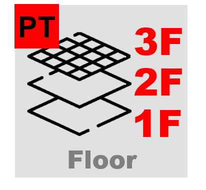 | **Set Floor Level** | [`Heim_InVoid.rb`](file:///C:/QHeim/Ruby/Interior/Heim_InVoid.rb) | กำหนดระดับชั้นของ Grid Unit สำหรับอ้างอิงความสูงผนังและช่องเปิด |
| 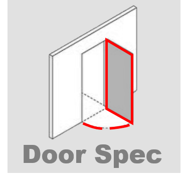 | **Door Spec** | [`Heim_PtMain.rb`](file:///C:/QHeim/Ruby/Interior/Heim_PtMain.rb) | เปิดหน้าต่างตรวจสอบและกำหนดสเปกประตู, ทิศทางการเปิด (U, D, L, R) และระยะขา |
|  | **Split Partition** | [`Heim_PtMain.rb`](file:///C:/QHeim/Ruby/Interior/Heim_PtMain.rb) | ตัดแบ่งเส้นแนว Single Wall ตามระยะโมดูลและเคลียร์แนวชนเสาเพื่อเตรียมทำแผง |
| 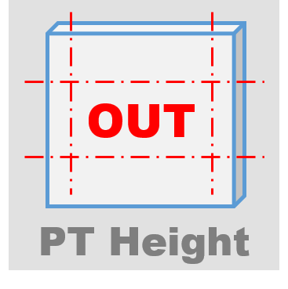 | **Set Wall Height** | [`Heim_PtMain.rb`](file:///C:/QHeim/Ruby/Interior/Heim_PtMain.rb) | กล่องโต้ตอบตั้งค่าระดับท้องผนัง (Bottom elevation) และความสูงแผง Partition (mm) |
| 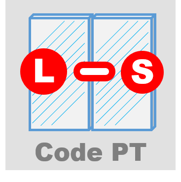 | **Code Partition** | [`Heim_PtMain.rb`](file:///C:/QHeim/Ruby/Interior/Heim_PtMain.rb) | วิเคราะห์ทิศทาง ยิง Raytest และสร้างรหัสโค้ดกำกับบนแผง Partition ชั่วคราว |
|  | **Change Partition Code** | [`Heim_PtMain.rb`](file:///C:/QHeim/Ruby/Interior/Heim_PtMain.rb) | กล่องแก้ไขรหัส Top/Bottom หรือ Left/Right Code บนแผง Partition ที่เลือก |
| 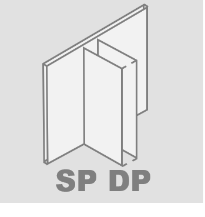 | **Build Partition** | [`Heim_PtMain.rb`](file:///C:/QHeim/Ruby/Interior/Heim_PtMain.rb) | วางโครงสร้างแผง Partition 3D จริงลงในเลเยอร์ `01-partition` พร้อมแท็ก |
| 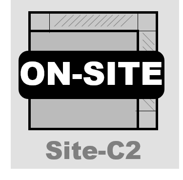 | **Make Partition Onsite** | [`Heim_PtMain.rb`](file:///C:/QHeim/Ruby/Interior/Heim_PtMain.rb) | คลิกเปลี่ยนแผง Partition เป็นงานประกอบหน้างาน (ON-SITE) ไฮไลต์สีส้ม |
|  | **Partition Joint** | [`Heim_PtJoint.rb`](file:///C:/QHeim/Ruby/Interior/Heim_PtJoint.rb) | ติดตั้งอุปกรณ์ข้อต่อเหล็กยึดระหว่างแผง Partition ในเลเยอร์ `01-ptjoint` |
| 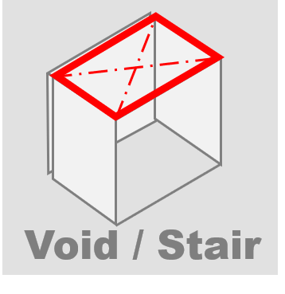 | **Set Void or Stair** | [`Heim_InVoid.rb`](file:///C:/QHeim/Ruby/Interior/Heim_InVoid.rb) | เจาะช่องเปิด Void บันได, ตัดขอบบอร์ด, ใส่ Box Frame เสริม และสร้าง Void Joint |
| 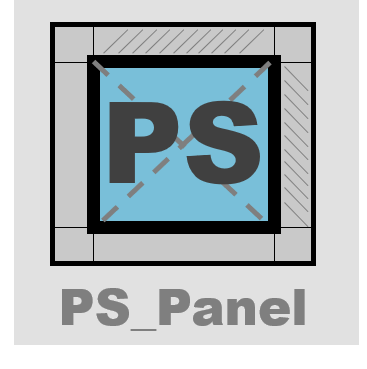 | **Service Partition** | [`Heim_Shaft.rb`](file:///C:/QHeim/Ruby/Interior/Heim_Shaft.rb) | สร้างแผงปิดช่อง Service Pipe Shaft พร้อมโครงเหล็กและสมาร์ทบอร์ด |

#### กลุ่มที่ 4: งานระบุพิกัด มิติ และ Tag ผนัง (Partition Tagging & Dimension)

| ไอคอน | ชื่อคำสั่ง (Tool Title) | ไฟล์ Ruby ที่ประมวลผล | หน้าที่หลัก |
| :---: | :--- | :--- | :--- |
|  | **Regen Partition Tags** | [`Heim_PtTag.rb`](file:///C:/QHeim/Ruby/Interior/Heim_PtTag.rb) | รันสร้าง/อัปเดต Tag มิติและรหัสผนัง (เลือกได้ระหว่าง Dimension Style และ Arrow Style) |
| 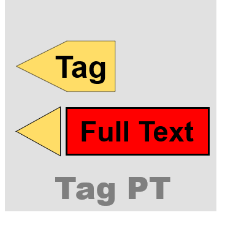 | **Change Tag Type** | [`Heim_PtTag.rb`](file:///C:/QHeim/Ruby/Interior/Heim_PtTag.rb) | คลิกเปลี่ยนสไตล์ Tag: Dimension, 3-Line Tag, Tri-Tag, หรือ Long Tag |
|  | **Move Tag Text** | [`Heim_PtTag.rb`](file:///C:/QHeim/Ruby/Interior/Heim_PtTag.rb) | เครื่องมือคลิกและลากขยับตำแหน่งข้อความบอกระยะของ Tag หลบแนวผนังหรือช่องเปิด |
|  | **Resize Tag Text & Line** | [`Heim_PtTag.rb`](file:///C:/QHeim/Ruby/Interior/Heim_PtTag.rb) | ตั้งค่าความสูงตัวอักษร (Text height) และความหนาเส้น (Line thickness) ของ Tag |

#### กลุ่มที่ 5: งานเจาะช่องไฟฟ้าและแอร์ 2D/3D (EE Punching System & CAD Export)

| ไอคอน | ชื่อคำสั่ง (Tool Title) | ไฟล์ Ruby ที่ประมวลผล | หน้าที่หลัก |
| :---: | :--- | :--- | :--- |
|  | **Punch EE Blocks** | [`Heim_Punching.rb`](file:///C:/QHeim/Ruby/Interior/Heim_Punching.rb)<br/>[`Heim_PunchingAC.rb`](file:///C:/QHeim/Ruby/Interior/Heim_PunchingAC.rb) | ตรวจจับบล็อกไฟฟ้า (สวิตช์/เต้ารับ) และบล็อกแอร์ (AC) เจาะรูทะลุแผ่นบอร์ด 3D |
|  | **Gen 2D Punching** | [`Heim_Punching.rb`](file:///C:/QHeim/Ruby/Interior/Heim_Punching.rb) | สร้างแบบขยายแผ่นเจาะ 2D แบนราบ พร้อมเส้น Dimension บอกระยะและพิกัดฉาก |
|  | **Punching Preview** | [`Heim_Punching.rb`](file:///C:/QHeim/Ruby/Interior/Heim_Punching.rb) | หน้าต่าง HTML แสดงรายการแผ่นที่ถูกเจาะทั้งหมด พร้อมสถานะและปุ่มกระโดดดูตำแหน่ง |
|  | **Export Punching to CAD** | [`Heim_Punching.rb`](file:///C:/QHeim/Ruby/Interior/Heim_Punching.rb) | ส่งออก Drawing แผ่นเจาะ 2D ทั้งหมดออกเป็นไฟล์ AutoCAD (.DWG) สำหรับส่งโรงงาน |

#### กลุ่มที่ 6: งานมุมมองและการแสดงผลเลเยอร์ (Layout Views & Layer Control)

| ไอคอน | ชื่อคำสั่ง (Tool Title) | ไฟล์ Ruby ที่ประมวลผล | หน้าที่หลัก |
| :---: | :--- | :--- | :--- |
| 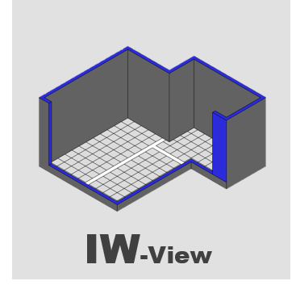 | **Interior Layout View** | [`Heim_InteriorIcon.rb`](file:///C:/QHeim/Ruby/Heim_InteriorIcon.rb) | สลับเปิดเฉพาะเลเยอร์งานผนังในอาคาร (IW Layers) และซ่อนเลเยอร์ Partition |
| 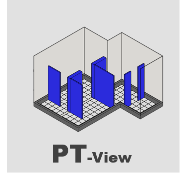 | **Partition Layout View** | [`Heim_InteriorIcon.rb`](file:///C:/QHeim/Ruby/Heim_InteriorIcon.rb) | สลับเปิดเฉพาะเลเยอร์งานแผงกั้นห้อง (Partition Layers) และซ่อนเลเยอร์ IW |
| 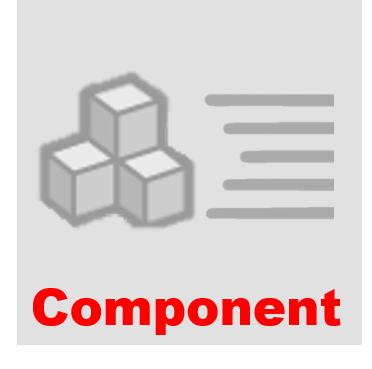 | **Show All Layers** | [`Heim_InteriorIcon.rb`](file:///C:/QHeim/Ruby/Heim_InteriorIcon.rb) | เปิดแสดงผลทุกเลเยอร์ในโมเดลทั้งหมด เพื่อตรวจทานภาพรวมอาคาร |

#### กลุ่มที่ 7: งานถอดแบบ BOM ตรวจสอบไฟล์ และฐานข้อมูล (Takeoff, CSV & SSIC Database)

| ไอคอน | ชื่อคำสั่ง (Tool Title) | ไฟล์ Ruby ที่ประมวลผล | หน้าที่หลัก |
| :---: | :--- | :--- | :--- |
| 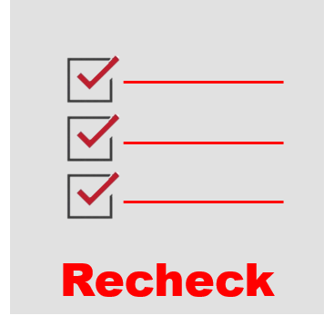 | **Export File Check** | [`Heim_InBom.rb`](file:///C:/QHeim/Ruby/Interior/Heim_InBom.rb) | ตรวจสอบความถูกต้องและส่งออกรายงานตรวจสอบโครงเหล็กและสมาร์ทบอร์ด (CSV) |
|  | **Upload Frame Data (DB)** | [`Heim_InBom.rb`](file:///C:/QHeim/Ruby/Interior/Heim_InBom.rb) | อ่านโครงเหล็ก Frame PS เปรียบเทียบกับฐานข้อมูล SSIC และอัปโหลดข้อมูลใหม่ |
|  | **Export File Up (IW)** | [`Heim_InBom.rb`](file:///C:/QHeim/Ruby/Interior/Heim_InBom.rb) | สรุปยอดรายการวัสดุผนังใน (IW Takeoff) ส่งออกเป็นไฟล์ CSV |
|  | **Upload Partition Data (DB)** | [`Heim_InBom.rb`](file:///C:/QHeim/Ruby/Interior/Heim_InBom.rb) | อ่านแผง Partition PS เปรียบเทียบกับฐานข้อมูล SSIC และอัปโหลดข้อมูลใหม่ |
|  | **Export File Up (PT)** | [`Heim_InBom.rb`](file:///C:/QHeim/Ruby/Interior/Heim_InBom.rb) | สรุปยอดรายการวัสดุแผงกั้นห้อง (Partition Takeoff) ส่งออกเป็นไฟล์ CSV |

---

## 3. คู่มือขั้นตอนการกดใช้งานแต่ละไอคอน (SOP สำหรับคนทำงาน)

### 📌 สรุปขั้นตอนมาตรฐาน 5 สเต็ปหลัก:

```
[สเต็ป 1: 3D Wall] ──> [สเต็ป 2: Interior Wall (IW)] ──> [สเต็ป 3: Partition (PT)] ──> [สเต็ป 4: EE Punching] ──> [สเต็ป 5: BOM & SSIC]
- Build 3D Wall        - Split Frame                     - Door Spec                     - Punch EE Blocks          - File Check
- Single / Double Wall - Build IW Frame                  - Set Height                    - Gen 2D Details           - File Up (IW & PT)
- Pipe Shaft           - Split Board & Smartboard        - Split & Code Partition        - Preview Dialog           - Upload Database
                       - Board Joint                     - Build Partition & Joint       - Export CAD (.DWG)
                                                         - Partition On-site / Tags
```

---

### 📋 รายละเอียดการกดใช้งานทีละคำสั่ง:

#### 1. Build 3D wall ([`Heim_InMain.rb`](file:///C:/QHeim/Ruby/Interior/Heim_InMain.rb) / [`Heim_BuildWall.rb`](file:///C:/QHeim/Ruby/Interior/Heim_BuildWall.rb))
* **🎯 การเลือกวัตถุ:** เปิดเลเยอร์เส้น CAD ผนัง (`A-WALL`, `Hood`, `A-DOOR`) พร้อมเลเยอร์ยูนิต `S-Unit` (ไม่ต้องเลือกวัตถุก็ได้ ระบบจะค้นหาทั่วโมเดล)
* **🖱️ การคลิก & ตั้งค่า:** กดไอคอน **Build 3D wall** ครั้งเดียว ระบบจะทำงานอัตโนมัติ
* **📦 ผลลัพธ์ในโมเดล:** สร้างก้อนผนัง 3D สูง 1000 มม. ลงในเลเยอร์ `01-3dsinglewall` (ผนังเดี่ยวหนา 41 มม.) และ `01-3ddoublewall` (ผนังคู่) พร้อมตัดส่วนที่ทับซ้อนกับเสาโครงสร้างให้เรียบร้อย
* **⚠️ ข้อควรระวัง:** ยูนิต `S-Unit` ต้องมี Attribute `position` ครบถ้วน หากยังไม่ได้รัน Unit Position ให้รันก่อนเสมอ

#### 2. Click Single Wall ([`Heim_BuildWall.rb`](file:///C:/QHeim/Ruby/Interior/Heim_BuildWall.rb))
* **🎯 การเลือกวัตถุ:** ไม่ต้องเลือกวัตถุล่วงหน้า
* **🖱️ การคลิก & ตั้งค่า:** กดไอคอน &rarr; เลื่อนเมาส์ไปคลิกในช่องว่างระหว่างแนวเส้นคู่ 3 เส้นที่มีระยะห่าง 41 มม.
* **📦 ผลลัพธ์ในโมเดล:** สร้าง Single Wall ทรง 3D เฉพาะจุดที่คลิก เหมาะสำหรับจุดที่เส้น CAD ไม่ต่อเนื่องหรือคำสั่งอัตโนมัติจับไม่เจอ

#### 3. Select Pipe Shaft ([`Heim_BuildWall.rb`](file:///C:/QHeim/Ruby/Interior/Heim_BuildWall.rb))
* **🎯 การเลือกวัตถุ:** ไม่ต้องเลือกวัตถุล่วงหน้า
* **🖱️ การคลิก & ตั้งค่า:** กดไอคอน &rarr; นำเมาส์ไปคลิกที่ชิ้น Single Wall บริเวณที่เป็นช่องท่อสุขาภิบาล
* **📦 ผลลัพธ์ในโมเดล:** ผนังชิ้นนั้นจะถูกเปลี่ยน Layer และ Material เป็น Pipe Shaft ทันที เพื่อป้องกันไม่ให้ถูกนำไปซอยเป็นผนังห้องทั่วไป

#### 4. Split Frame ([`Heim_InMain.rb`](file:///C:/QHeim/Ruby/Interior/Heim_InMain.rb))
* **🎯 การเลือกวัตถุ:** ไม่ต้องเลือกวัตถุล่วงหน้า
* **🖱️ การคลิก & ตั้งค่า:** กดไอคอน **Split Frame**
* **📦 ผลลัพธ์ในโมเดล:** ซอยแบ่งแนวโครงเหล็กผนังใน (IW Frame) ออกเป็นช่วงๆ ตามแนวเสาอาคารและตำแหน่งช่องเปิดหน้าต่าง/ประตู

#### 5. Build Frame ([`Heim_InFrame.rb`](file:///C:/QHeim/Ruby/Interior/Heim_InFrame.rb))
* **🎯 การเลือกวัตถุ:** ไม่ต้องเลือกวัตถุล่วงหน้า
* **🖱️ การคลิก & ตั้งค่า:** กดไอคอน **Build Frame**
* **📦 ผลลัพธ์ในโมเดล:** วางโครงเหล็ก C-Stud (`AAHA01100`), U52, U66, และเสากล่อง Box Frame (`AAHA09040`) ในเลเยอร์ `01-iwframe` พร้อมกำหนดโค้ดและลงสีวัสดุ `usteelcolor`

#### 6. Switch Frame Code ([`Heim_InMain.rb`](file:///C:/QHeim/Ruby/Interior/Heim_InMain.rb))
* **🎯 การเลือกวัตถุ:** คลิกเลือกโครงเหล็กบริเวณมุมห้องที่ชนกัน
* **🖱️ การคลิก & ตั้งค่า:** กดไอคอน **Switch Frame Code**
* **📦 ผลลัพธ์ในโมเดล:** สลับลำดับความสำคัญของโครงเหล็กตัวชนกับตัววิ่งยาว เพื่อให้สามารถยึดสกรูและติดบอร์ดได้ถูกต้องตามหลักวิศวกรรม

#### 7. Split Smartboard ([`Heim_InBoard.rb`](file:///C:/QHeim/Ruby/Interior/Heim_InBoard.rb))
* **🎯 การเลือกวัตถุ:** ไม่ต้องเลือกวัตถุล่วงหน้า
* **🖱️ การคลิก & ตั้งค่า:** กดไอคอน **Split Smartboard**
* **📦 ผลลัพธ์ในโมเดล:** ซอยแบ่งระยะแผ่น Smartboard ตามระยะโมดูลมาตรฐาน (450, 900 มม.) และตัดแบ่งตามช่องเปิดหน้าต่าง

#### 8. Build Smartboard ([`Heim_InBoard.rb`](file:///C:/QHeim/Ruby/Interior/Heim_InBoard.rb))
* **🎯 การเลือกวัตถุ:** ไม่ต้องเลือกวัตถุล่วงหน้า
* **🖱️ การคลิก & ตั้งค่า:** กดไอคอน **Build Smartboard**
* **📦 ผลลัพธ์ในโมเดล:** สร้างแผ่น Smartboard 3D หนา 8/12 มม. (`AAHZ0061X`, `AAHW`) ในเลเยอร์ `01-iwboard` พร้อมตัดรูหน้าต่างตามชนิด (HI-Z, TALL-Z, HI-WAIST, ฯลฯ)

#### 9. Build Board Joint ([`Heim_inJoint.rb`](file:///C:/QHeim/Ruby/Interior/Heim_inJoint.rb))
* **🎯 การเลือกวัตถุ:** ไม่ต้องเลือกวัตถุล่วงหน้า
* **🖱️ การคลิก & ตั้งค่า:** กดไอคอน **Build Board Joint**
* **📦 ผลลัพธ์ในโมเดล:** สร้างแผ่นเหล็กประกบรอยต่อแผ่นบอร์ดในเลเยอร์ `01-iwboard-joint` และรอยต่อมุมห้อง

#### 10. Set Floor Level ([`Heim_InVoid.rb`](file:///C:/QHeim/Ruby/Interior/Heim_InVoid.rb))
* **🎯 การเลือกวัตถุ:** เลือก Grid Unit ที่ต้องการระบุชั้น
* **🖱️ การคลิก & ตั้งค่า:** กดไอคอน **Set Floor Level** &rarr; ระบุหมายเลขชั้น
* **📦 ผลลัพธ์ในโมเดล:** บันทึก Attribute ชั้นลงบน Grid สำหรับใช้คำนวณระดับความสูงผนังและช่องเปิด

#### 11. Door Spec ([`Heim_PtMain.rb`](file:///C:/QHeim/Ruby/Interior/Heim_PtMain.rb))
* **🎯 การเลือกวัตถุ:** ไม่ต้องเลือกวัตถุล่วงหน้า
* **🖱️ การคลิก & ตั้งค่า:** กดไอคอน **Door Spec** &rarr; หน้าต่าง Dialog จะแสดงรายการประตูทั้งหมดในโมเดล &rarr; ตรวจสอบขนาด ความกว้าง และทิศทางเปิด &rarr; กดบันทึก (Save)
* **📦 ผลลัพธ์ในโมเดล:** ซิงค์ข้อมูลสเปกประตูเข้าสู่ Temp Walls สำหรับใช้อ้างอิงการซอยผนังและเว้นช่องเปิด

#### 12. Split Partition ([`Heim_PtMain.rb`](file:///C:/QHeim/Ruby/Interior/Heim_PtMain.rb))
* **🎯 การเลือกวัตถุ:** ไม่ต้องเลือกวัตถุล่วงหน้า
* **🖱️ การคลิก & ตั้งค่า:** กดไอคอน **Split Partition**
* **📦 ผลลัพธ์ในโมเดล:** ตัดแบ่งเส้นแนว Single Wall ออกเป็นชิ้นส่วนตามแนวโมดูลและเว้นระยะรอบเสาอาคาร

#### 13. Set Wall Height ([`Heim_PtMain.rb`](file:///C:/QHeim/Ruby/Interior/Heim_PtMain.rb))
* **🎯 การเลือกวัตถุ:** เลือกกลุ่มก้อนผนัง Partition ที่ต้องการปรับความสูง
* **🖱️ การคลิก & ตั้งค่า:** กดไอคอน &rarr; ป้อนค่า `Bottom elevation (mm)` (ระดับท้องผนัง) และ `Partition height (mm)` (ความสูงแผงผนัง เช่น 2400 มม.) &rarr; กดตกลง
* **📦 ผลลัพธ์ในโมเดล:** ผนังกลุ่มที่เลือกจะเปลี่ยนความสูงและบันทึกค่าลง Attribute

#### 14. Code Partition ([`Heim_PtMain.rb`](file:///C:/QHeim/Ruby/Interior/Heim_PtMain.rb))
* **🎯 การเลือกวัตถุ:** ไม่ต้องเลือกวัตถุล่วงหน้า
* **🖱️ การคลิก & ตั้งค่า:** กดไอคอน **Code Partition**
* **📦 ผลลัพธ์ในโมเดล:** วิเคราะห์จุดตัด จุดหักมุม และทิศทาง แล้ววางลูกศรพร้อมใส่รหัสโค้ดกำกับลงบนแผง Partition ชั่วคราวในเลเยอร์ `01-temp-ptwall`

#### 15. Change Partition Code ([`Heim_PtMain.rb`](file:///C:/QHeim/Ruby/Interior/Heim_PtMain.rb))
* **🎯 การเลือกวัตถุ:** เลือกแผง Partition ชั่วคราวที่ต้องการแก้โค้ด (ต้องอยู่แนวเดียวกัน)
* **🖱️ การคลิก & ตั้งค่า:** กดไอคอน &rarr; แก้ไขรหัสโค้ด Top/Bottom หรือ Left/Right ในหน้าต่าง Popup &rarr; กดตกลง
* **📦 ผลลัพธ์ในโมเดล:** อัปเดตรหัสโค้ดของแผงผนังนั้นทันที

#### 16. Build Partition ([`Heim_PtMain.rb`](file:///C:/QHeim/Ruby/Interior/Heim_PtMain.rb))
* **🎯 การเลือกวัตถุ:** ไม่ต้องเลือกวัตถุ (สร้างทั้งหมด) หรือเลือกเฉพาะแผงที่ต้องการ Re-generate
* **🖱️ การคลิก & ตั้งค่า:** กดไอคอน **Build Partition** &rarr; ยืนยันการสร้างในกล่องข้อความ
* **📦 ผลลัพธ์ในโมเดล:** สร้างแผงโครงสร้าง Partition 3D จริงลงในเลเยอร์ `01-partition` พร้อมเสา โครงเหล็ก และแผ่นปิดตามรหัสโค้ด

#### 17. Make Partition Onsite ([`Heim_PtMain.rb`](file:///C:/QHeim/Ruby/Interior/Heim_PtMain.rb))
* **🎯 การเลือกวัตถุ:** ไม่ต้องเลือกวัตถุล่วงหน้า
* **🖱️ การคลิก & ตั้งค่า:** กดไอคอน &rarr; เคอร์เซอร์เปลี่ยนเป็นเครื่องมือจิ้ม &rarr; คลิกที่แผง Partition ที่ต้องการประกอบหน้างาน
* **📦 ผลลัพธ์ในโมเดล:** แผงนั้นจะถูกเปลี่ยนสถานะเป็น `ON-SITE`, เปลี่ยนสีเป็น **สีส้ม** (`Color(255,165,0)`), และอัปเดตสูตรถอดแบบ BOM เป็นแบบหน้างาน

#### 18. Build Partition Joint ([`Heim_PtJoint.rb`](file:///C:/QHeim/Ruby/Interior/Heim_PtJoint.rb))
* **🎯 การเลือกวัตถุ:** ไม่ต้องเลือกวัตถุล่วงหน้า
* **🖱️ การคลิก & ตั้งค่า:** กดไอคอน **Build Partition Joint**
* **📦 ผลลัพธ์ในโมเดล:** ติดตั้งชุดข้อต่อเหล็กยึดระหว่างแผง Partition ในเลเยอร์ `01-ptjoint` ตามจุดบรรจบผนังและมุมห้อง

#### 19. Set Void or Stair ([`Heim_InVoid.rb`](file:///C:/QHeim/Ruby/Interior/Heim_InVoid.rb))
* **🎯 การเลือกวัตถุ:** เลือกกลุ่มพื้นที่ Void หรือแนวบันได
* **🖱️ การคลิก & ตั้งค่า:** กดไอคอน **Set Void or Stair**
* **📦 ผลลัพธ์ในโมเดล:** เจาะช่องเปิด Void, ตัดขอบบอร์ด Smartboard, ใส่ Box Frame เสริมขอบ และติดตั้ง Void Joint

#### 20. Service Partition ([`Heim_Shaft.rb`](file:///C:/QHeim/Ruby/Interior/Heim_Shaft.rb))
* **🎯 การเลือกวัตถุ:** ไม่ต้องเลือกวัตถุล่วงหน้า
* **🖱️ การคลิก & ตั้งค่า:** กดไอคอน **Service Partition**
* **📦 ผลลัพธ์ในโมเดล:** สร้างแผงปิดช่อง Service Pipe Shaft พร้อมโครงเหล็กและสมาร์ทบอร์ดในเลเยอร์ `01-ptshaft`

#### 21. Regen Partition Tags ([`Heim_PtTag.rb`](file:///C:/QHeim/Ruby/Interior/Heim_PtTag.rb))
* **🎯 การเลือกวัตถุ:** ไม่ต้องเลือก (ทำทุกแผง) หรือเลือกเฉพาะแผง Partition ที่ต้องการสร้างแท็ก
* **🖱️ การคลิก & ตั้งค่า:** กดไอคอน &rarr; เลือกสไตล์ใน Popup: **`Dimension style`** หรือ **`Arrow style`** &rarr; กดตกลง
* **📦 ผลลัพธ์ในโมเดล:** รันหมายเลขผนังอัตโนมัติ และสร้างเส้นบอกระยะมิติ พร้อมรหัสโค้ดผนังลงในเลเยอร์ `01-pttag`

#### 22. Move Tag Text ([`Heim_PtTag.rb`](file:///C:/QHeim/Ruby/Interior/Heim_PtTag.rb))
* **🎯 การเลือกวัตถุ:** ไม่ต้องเลือกวัตถุล่วงหน้า
* **🖱️ การคลิก & ตั้งค่า:** กดไอคอน &rarr; คลิกที่ข้อความบอกระยะของ Tag แล้วลากเลื่อนไปยังตำแหน่งที่ต้องการ
* **📦 ผลลัพธ์ในโมเดล:** ข้อความ Tag จะย้ายตำแหน่งโดยรักษาเส้น Leader Line และความสัมพันธ์กับแผงผนังเดิมไว้

#### 23. Resize Tag Text & Line ([`Heim_PtTag.rb`](file:///C:/QHeim/Ruby/Interior/Heim_PtTag.rb))
* **🎯 การเลือกวัตถุ:** ไม่ต้องเลือกวัตถุล่วงหน้า
* **🖱️ การคลิก & ตั้งค่า:** กดไอคอน &rarr; กรอกค่า `Text height (mm)` และ `Line thickness (mm)` ในหน้าต่าง Inputbox &rarr; กดตกลง
* **📦 ผลลัพธ์ในโมเดล:** ปรับขนาดตัวอักษรและความหนาเส้นของแท็กมิติทั้งหมดในโมเดลให้มีขนาดตามที่ระบุ

#### 24. Punch EE Blocks ([`Heim_Punching.rb`](file:///C:/QHeim/Ruby/Interior/Heim_Punching.rb) / [`Heim_PunchingAC.rb`](file:///C:/QHeim/Ruby/Interior/Heim_PunchingAC.rb))
* **🎯 การเลือกวัตถุ:** วางบล็อกไฟฟ้า/เต้ารับ/สวิตช์ หรือบล็อกแอร์ (AC) ไว้ในตำแหน่งที่ต้องการ (ไม่ต้องเลือกวัตถุล่วงหน้า)
* **🖱️ การคลิก & ตั้งค่า:** กดไอคอน **Punch EE Blocks** &rarr; กดยืนยันในกล่องข้อความ
* **📦 ผลลัพธ์ในโมเดล:** ระบบจะยิง Raytest ตรวจจับระนาบ Smartboard และเจาะรูทะลุแผ่นบอร์ด 3D ตามขนาดและรูปแบบบล็อก (Single, Double, Triple, A2, A3, AC)
* **⚠️ ข้อควรระวัง:** มีระบบ Live Validator ตรวจจับ หากบล็อกตัวใดหลุดขอบแผ่นบอร์ด (Off-board) ตัวบล็อกจะเปลี่ยนสีแจ้งเตือนทันที

#### 25. Gen 2D Punching ([`Heim_Punching.rb`](file:///C:/QHeim/Ruby/Interior/Heim_Punching.rb))
* **🎯 การเลือกวัตถุ:** ไม่ต้องเลือกวัตถุล่วงหน้า
* **🖱️ การคลิก & ตั้งค่า:** กดไอคอน **Gen 2D Punching** &rarr; กดยืนยัน
* **📦 ผลลัพธ์ในโมเดล:** สร้างแบบขยายแผ่นเจาะ 2D แบนราบ วางเรียงตามยูนิต พร้อมเส้นมิติกำกับระยะขอบซ้าย-ขวา-บน-ล่าง และระบุรหัสบอร์ด

#### 26. Punching Preview ([`Heim_Punching.rb`](file:///C:/QHeim/Ruby/Interior/Heim_Punching.rb))
* **🎯 การเลือกวัตถุ:** ไม่ต้องเลือกวัตถุล่วงหน้า
* **🖱️ การคลิก & ตั้งค่า:** กดไอคอน **Punching Preview**
* **📦 ผลลัพธ์ในโมเดล:** เปิดหน้าต่าง HTML Viewer แสดงรายการแผ่นเจาะทั้งหมด, จำนวนรูเจาะ, ยูนิตที่สังกัด, พร้อมปุ่มคลิกเพื่อ Zoom ไปยังแผ่นนั้นในโมเดล 3D

#### 27. Export Punching to CAD ([`Heim_Punching.rb`](file:///C:/QHeim/Ruby/Interior/Heim_Punching.rb))
* **🎯 การเลือกวัตถุ:** ไม่ต้องเลือกวัตถุล่วงหน้า
* **🖱️ การคลิก & ตั้งค่า:** กดไอคอน **Export Punching to CAD** &rarr; กดยืนยัน
* **📦 ผลลัพธ์ในโมเดล:** รัน Background Worker ส่งออก Drawing 2D ของแผ่นเจาะทุกแผ่นออกเป็นไฟล์ `.DWG` แยกตามยูนิต เพื่อส่งให้โรงงานตัดฉลุแผ่น

#### 28. Export File Check & File Up ([`Heim_InBom.rb`](file:///C:/QHeim/Ruby/Interior/Heim_InBom.rb))
* **🎯 การเลือกวัตถุ:** ไม่ต้องเลือกวัตถุล่วงหน้า
* **🖱️ การคลิก & ตั้งค่า:** 
  * กด **Export File Check** เพื่อตรวจสอบความถูกต้องของรหัสชิ้นส่วน
  * กด **Export File Up (IW)** หรือ **Export File Up (PT)** เพื่อสร้างไฟล์ CSV Takeoff
* **📦 ผลลัพธ์ในโมเดล:** สร้างไฟล์สรุปรายการวัสดุและปริมาณในโฟลเดอร์โครงการเพื่อใช้ทำเอกสารจัดซื้อและประกอบแบบ

#### 29. Upload Frame & Partition Data to SSIC Database ([`Heim_InBom.rb`](file:///C:/QHeim/Ruby/Interior/Heim_InBom.rb))
* **🎯 การเลือกวัตถุ:** ไม่ต้องเลือกวัตถุล่วงหน้า
* **🖱️ การคลิก & ตั้งค่า:** กดไอคอน **Upload DB** (มีทั้งปุ่ม Frame และ Partition) &rarr; ตรวจสอบตารางแสดงข้อมูลเดิม (Existing Data) และข้อมูลใหม่ (New Data) ใน Dialog &rarr; กดยืนยัน (OK)
* **📦 ผลลัพธ์ในโมเดล:** บันทึกรหัสโครงสร้างใหม่และสูตรประกอบชิ้นส่วนเข้าสู่ฐานข้อมูลกลาง SSIC Database อัตโนมัติ

---

## 4. สถาปัตยกรรมและตรรกะการทำงานแต่ละโมดูล (Detailed Module Logic)

### 4.1 โมดูลสร้างผนัง 3D (Heim_BuildWall.rb & Heim_InMain.rb)

โมดูลนี้ทำหน้าที่แปลงเส้นร่าง 2D CAD เป็นก้อนผนัง 3D:
1. **การสร้าง Single Wall (ผนังเดี่ยวหนา 41 มม.):**
   * ฟังก์ชัน `SinglePartition.buildsinglewall()` สแกนกลุ่มเส้นในเลเยอร์ `Hood` หรือเส้นขนานที่มีระยะห่าง $41\,\text{mm}$ (Tolerance $\pm 0.5\,\text{mm}$)
   * สร้าง Face รูปสี่เหลี่ยมผืนผ้าและยืดด้วยคำสั่ง `face.pushpull(-1000.mm, false)`
   * กำหนดชื่อกลุ่มเป็น `"keta"` หรือ `"tsuma"` และจัดเก็บในเลเยอร์ `01-3dsinglewall` พร้อมทาสีวัสดุ `'singlewall'`
2. **การสร้าง Double Wall (ผนังคู่):**
   * ฟังก์ชัน `DoublePartition.builddoublewall()` ตรวจสอบแนวผนังที่วิ่งประกบกัน 2 ชั้นระหว่างยูนิต
   * จัดเก็บในเลเยอร์ `01-3ddoublewall`
3. **การเคลียร์รอยชนเสาและผนังซ้อนทับ (`Opening` class):**
   * `Opening.clearsingleatcolumn()`: ตรวจสอบและตัดทอน Single Wall ไม่ให้วิ่งล้ำเข้าไปในตำแหน่งเสาเหล็กของยูนิต
   * `Opening.mergesinglewall()`: เชื่อมต่อท่อนผนังเดี่ยวที่อยู่บนแนวเดียวกันให้กลายเป็นท่อนยาวต่อเนื่อง
   * `Opening.checkwalloverlap()`: ตรวจจับและลบผนังที่สร้างซ้ำซ้อนกันในพิกัดเดียวกัน

---

### 4.2 โมดูลโครงเหล็กและแผ่นสมาร์ทบอร์ดผนังใน (Heim_InFrame.rb, Heim_InBoard.rb, Heim_InJoint.rb)

โมดูลนี้จัดการงานผนังในอาคาร (Interior Wall - IW) ตามมาตรฐานความสูงของโมดูลาร์:

#### ตารางระดับความสูงอาคารและโครงสร้าง ($hunitheight):
| รหัสความสูง | ชนิดยูนิต | ความสูงโครงเหล็ก (inframe) | ความสูงแผ่นบอร์ด (inboard) |
| :---: | :--- | :---: | :---: |
| **L** | Low | $2,540\,\text{mm}$ | $2,544\,\text{mm}$ |
| **N** | Normal | $2,810\,\text{mm}$ | $2,815\,\text{mm}$ |
| **H** | High | $3,210\,\text{mm}$ | $3,223\,\text{mm}$ |

#### ตรรกะโครงเหล็กผนังใน (IW Frame):
* **เสาโครงหลัก:** ใช้เสา C-Stud `AAHA01100`, เหล็กตัวยู `Tag-U-Steel`, `Tag-U52`, `Tag-U66`, และเสากล่อง `AAHA09040` (Box Frame 2810 mm)
* **ระยะซอยโครง:** คำนวณตามระยะโมดูล $450\,\text{mm}$ หรือ $225\,\text{mm}$ จากฟังก์ชัน `interior_frame_grid`
* **ช่องเปิดตามสเปก ($iwframe):**
  * `HI-Z`: สูง $2,290\,\text{mm}$ ระดับยกพื้น $e = 0$
  * `TALL-Z`: สูง $2,138\,\text{mm}$ ระดับยกพื้น $e = 0$
  * `HI-WAIST`: สูง $1,518\,\text{mm}$ ระดับยกพื้น $e = 722\,\text{mm}$
  * `HI-K`: สูง $1,327\,\text{mm}$ ระดับยกพื้น $e = 963\,\text{mm}$
  * `TATAKI`: ประตูทางเข้ามีระดับธรณี สูง $2,206\,\text{mm}$
  * `NOTATAKI`: ประตูทางเข้าไม่มีธรณี สูง $2,383\,\text{mm}$

#### ตรรกะแผ่นสมาร์ทบอร์ดผนังใน (IW Board):
* ใช้แผ่น Smartboard หนา $8\,\text{mm}$ หรือ $12\,\text{mm}$ (รหัส `AAHZ0061X`, `AAHW`)
* แยกชนิดการเจาะแผ่นตามตำแหน่งรอบช่องเปิด:
  * `genboardtp0`: แผ่นเต็มมาตรฐาน
  * `genboardtp2`: แผ่นข้างช่องเปิด
  * `genboardtp3`: แผ่นใต้กรอบล่างหน้าต่าง (Sill)
  * `genboardtp4`: แผ่นเหนือก รอบบนหน้าต่าง (Lintel)
  * `genboardtp2upperleft` / `upperright`: แผ่นมุมขอบบนหน้าต่าง

---

### 4.3 โมดูลวิเคราะห์แผง Partition และช่องเปิดประตู (Heim_PtMain.rb, Heim_PtFrame.rb, Heim_PtJoint.rb)

โมดูลนี้ทำหน้าที่แปลงแนว Single Wall ให้กลายเป็นแผงกั้นห้องสำเร็จรูป (Partition):

1. **การวิเคราะห์ช่องเปิดประตู (Door Opening & Door Origin):**
   * ฟังก์ชัน `gettempwallbetweendoor(door, point, isketa)` ทำหน้าที่ยิงค้นหาชิ้นส่วนผนังชั่วคราว (`lstketa` หรือ `lsttsuma`) ที่ขนาบอยู่ทั้งสองข้างของประตู
   * **สูตรการตรวจสอบ:**
     $$\text{samewall}[index-1][1] < \text{point}.x < \text{samewall}[index][0]$$
     *จุดพิกัด Origin/Center ของประตู ($point$) ต้องตกอยู่ภายใน "ช่องว่าง" ระหว่างผนังชิ้นซ้ายกับชิ้นขวาอย่างสมบูรณ์*
   * หากมีผนังน้อยกว่า 2 ชิ้น (`samewall.length < 2`) หรือจุด Origin ตกอยู่นอกช่องว่าง ระบบจะคืนค่า `nil` และแสดง Error Messagebox ทันที
2. **การใส่รหัสโค้ดแผง Partition (Wall Coding):**
   * วิเคราะห์ทิศทางและจุดบรรจบกับเสาอาคารหรือผนังตัวอื่น
   * สร้างรหัสประกอบแผง เช่น `PT-01-2400-L` และแสดงผลเป็น 3D Arrow และข้อความกำกับ
3. **การแปลงเป็นแผงประกอบหน้างาน (On-site Partition):**
   * เมื่อใช้เครื่องมือ `setpartitiononsite` คลิกที่แผงใด แผงนั้นจะได้รับ Attribute `status = "ON-SITE"`
   * เปลี่ยนสีแผงและแผ่นบอร์ดเป็นสีส้ม (`Color(255,165,0)`)
   * ปรับระบบถอดแบบ BOM ให้ตัดยอดเป็นชิ้นส่วนแยกประกอบสำหรับหน้างาน
4. **ชุดข้อต่อเหล็ก Partition Joint (`Heim_PtJoint.rb`):**
   * ตรวจสอบระยะห่างระหว่างหัวแผงผนังกับเสาอาคาร หรือระหว่างแผงด้วยกัน
   * วางชุด Bracket ข้อต่อเหล็กยึดในเลเยอร์ `01-ptjoint` อัตโนมัติ

---

### 4.4 โมดูลการออก Tag และจัดระยะมิติ (Heim_PtTag.rb)

1. **รูปแบบแท็ก (Tag Styles):**
   * **Dimension style:** วางเส้นบอกขนาดจริงของแต่ละแผงผนัง พร้อมระบุรหัสกำกับแผงและรหัสชิ้นส่วน
   * **Arrow style:** วางสัญลักษณ์ลูกศรทิศทางพร้อมรหัสย่อ
2. **เครื่องมือจัดแต่งแบบ Interactive:**
   * `movedimensiontagtext`: คลิกเลือกข้อความแล้วลากขยับไปวางในตำแหน่งที่โล่ง หลบสิ่งกีดขวาง
   * `resizedimensiontagtext`: ป้อนค่าความสูงตัวอักษรและความหนาเส้นมิติใหม่ ระบบจะอัปเดตทุกแท็กในโมเดลพร้อมกันทันที
   * `changetagtype`: สลับการแสดงผลแบบ Dimension, 3-Line Tag, Tri-Tag, หรือ Long Tag

---

### 4.5 โมดูลระบบเจาะแผ่น Smartboard EE Punching & Export CAD (Heim_Punching.rb, Heim_PunchingAC.rb)

โมดูลอัจฉริยะสำหรับงานระบบไฟฟ้าและเครื่องปรับอากาศ:

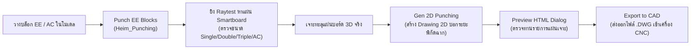

1. **การตรวจจับและเจาะช่อง 3D:**
   * สแกนบล็อกไฟฟ้าในโมเดล เช่น สวิตช์, เต้ารับเดี่ยว, เต้ารับคู่ (Double), เต้ารับ 3 ช่อง (Triple), บล็อก A2, บล็อก A3, และบล็อกแอร์ (AC)
   * ใช้เทคนิค Raytest ยิงจากกึ่งกลางบล็อกไปยังผิวหน้าแผ่น Smartboard (`01-iwboard` และ `01-partition`)
   * คำนวณขนาดและเจาะช่องเปิดทะลุเนื้อบอร์ดจริง
2. **ระบบตรวจจับบล็อกตกขอบ (Off-board Validator):**
   * มี ModelObserver ตรวจสอบแบบเรียลไทม์ หากขอบเขตของบล็อกไฟฟ้าหลุดออกนอกระนาบของแผ่น Smartboard บล็อกนั้นจะถูกทาสีแจ้งเตือนทันที
3. **การสร้างแบบ 2D และส่งออก DWG:**
   * คลี่แผ่น Smartboard ที่ถูกเจาะออกมาเป็นภาพ 2D แบนราบ
   * ให้มิติบอกระยะขอบและพิกัดฉากอย่างแม่นยำ
   * ส่งออกเป็นไฟล์ `.DWG` ด้วย Background Process ผ่าน SketchUp Export Engine

---

### 4.6 โมดูลการถอดแบบ BOM และเชื่อมต่อฐานข้อมูล SSIC (Heim_InBom.rb)

จัดการรวบรวมข้อมูลชิ้นส่วนเพื่อทำเอกสารจัดซื้อและลงฐานข้อมูลโรงงาน:
* **การจำแนกหมวดหมู่วัสดุ:**
  * `AAIW`: โครงเหล็กผนังใน (Interior Wall Frame)
  * `AAIP`: แผง Partition มาตรฐานโรงงาน
  * `AAPI`: แผง Partition ปรับแต่งพิเศษ
  * `AAVS`: แผง Partition บริเวณช่อง Void หรือ Shaft
  * `AAHA` / `AAIA` / `AAIK`: เหล็กโครงสร้าง, U-Steel, Box Frame
  * `AAHZ` / `AAHW` / `AAHE`: แผ่น Smartboard ขนาดต่างๆ
* **รายการอุปกรณ์ฟิตติ้งมาตรฐาน:**
  * `AASK03320`: ขอยึดเพดาน (Ceiling bracket)
  * `AASB20090`: สกรูยึดแผ่นสมาร์ทบอร์ด (Smartboard screw)
  * `AASB20660`: ขอยึดพื้น (Floor bracket)
* **การซิงค์ฐานข้อมูล SSIC:**
  * เมื่อกดปุ่ม **Upload DB** ระบบจะสแกนรายการ PS ทั้งหมดแล้ว Query เทียบกับตาราง `im` และ `ps` ในฐานข้อมูล SSIC
  * แสดง Dialog สรุปจำนวน Existing Data และ New Data เพื่อให้วิศวกรตรวจสอบก่อนกดยืนยันการบันทึก

---

## 5. ตารางสรุปเลเยอร์และคอมโพเนนต์ (Component & Layer Matrix)

| หมวดหมู่ | ชื่อ Layer ใน SketchUp | รหัสชิ้นส่วน / Definition | รายละเอียดชิ้นส่วน | หน่วยนับ |
| :--- | :--- | :--- | :--- | :---: |
| **3D Wall** | `01-3dsinglewall` | `keta`, `tsuma` | ผนังเดี่ยวหนา 41 มม. สูง 1000 มม. ชั่วคราว | ท่อน |
| | `01-3ddoublewall` | `doublewall` | ผนังคู่ระหว่างยูนิต | ท่อน |
| **IW Frame** | `01-iwframe` | `AAHA01100` | เหล็กตัวซี C-Stud 50x40 มม. | ท่อน |
| | | `AAHA09040` | เสากล่อง Box Frame 2810 มม. | ท่อน |
| | | `Tag-U-Steel` | เหล็กตัวยูมาตรฐาน | ท่อน |
| | | `Tag-U52`, `Tag-U66` | เหล็กตัวยูขนาด 52 มม. และ 66 มม. | ท่อน |
| **IW Board** | `01-iwboard` | `AAHZ0061X` | แผ่น Smartboard ผนังใน หนา 8/12 มม. | แผ่น/ตร.ม. |
| | | `AAHW` | แผ่น Smartboard ขอบช่องเปิดหน้าต่าง/ประตู | แผ่น |
| | `01-iwboard-joint` | `iwboardjoint` | แผ่นเหล็กประกบรอยต่อแผ่นบอร์ด | ชิ้น (EA) |
| **Partition** | `01-partition` | `AAIP...` | แผง Partition สำเร็จรูปจากโรงงาน | แผง (EA) |
| | | `AAIP... (Onsite)` | แผง Partition ประกอบหน้างาน (สีส้ม) | แผง (EA) |
| | `01-ptjoint` | `ptjoint` | ชุดข้อต่อเหล็กยึดระหว่างแผง Partition | ชิ้น (EA) |
| | `01-ptshaft` | `AAVS...` | แผงปิดช่อง Service Pipe Shaft | แผง (EA) |
| | `01-temp-ptwall` | `spframept` | ลูกศรและรหัสโค้ดแผง Partition ชั่วคราว | ชิ้น |
| **Tag & Anno** | `01-pttag` | `ptdimensiontag` | เส้นบอกขนาดมิติแผง Partition พร้อมรหัส | ชุด |
| | `01-pttagdetail` | `pttagdetail` | ข้อความรายละเอียดกำกับแท็ก | ข้อความ |
| **EE Punching** | `01-punching-2d` | `punchdetail_...` | แบบขยายแผ่นเจาะ 2D พร้อมเส้นบอกระยะ | แผ่น |
| | `01-punching-ee` | `block_ee_...` | ก้อน Cutter เจาะช่องบล็อกไฟฟ้า | ชิ้น |
| **BOM & Data** | `IN-BOM` | `AASK03320` | ขอยึดเพดาน (Ceiling Bracket) | ชิ้น (EA) |
| | | `AASB20090` | สกรูยึดสมาร์ทบอร์ด (Screw) | ตัว |
| | | `AASB20660` | ขอยึดพื้น (Floor Bracket) | ชิ้น (EA) |

---

## 6. ลำดับการใช้งานและข้อแนะนำ (Best Practices & Troubleshooting)

### 1. ลำดับการทำงานที่ถูกต้อง (Standard Operating Procedure Checklist):
1. **เตรียมโมเดล:** ตรวจสอบว่าโมเดลยูนิตอยู่ในเลเยอร์ `S-Unit` และผ่านการรัน `Unit Position` เรียบร้อยแล้ว
2. **สร้างผนัง 3D:** กดปุ่ม **Build 3D wall** เพื่อสร้าง Single Wall 41 mm และ Double Wall
3. **ปรับแต่งเฉพาะจุด:** หากมีช่องท่อสุขาภิบาล ให้ใช้ปุ่ม **Select Pipe Shaft** คลิกแปลงผนัง
4. **ทำผนังในอาคาร (IW):** รันตามลำดับ **Split Frame &rarr; Build Frame &rarr; Split Smartboard &rarr; Build Smartboard &rarr; Build Board Joint**
5. **ทำแผงกั้นห้อง (PT):** รันตามลำดับ **Door Spec &rarr; Set Wall Height &rarr; Split Partition &rarr; Code Partition &rarr; Build Partition &rarr; Partition Joint**
6. **ปรับแต่งหน้างาน:** หากมีแผงที่ต้องประกอบหน้างาน ให้ใช้ **Make Partition Onsite** คลิกเปลี่ยนเป็นสีส้ม
7. **เจาะช่องไฟฟ้า:** นำบล็อกไฟฟ้า/แอร์มาวางตามตำแหน่ง แล้วกด **Punch EE Blocks &rarr; Gen 2D Punching &rarr; Export to CAD**
8. **ออกแท็กมิติ:** กด **Regen Partition Tags** เพื่อสร้างเส้นบอกขนาดมิติ และใช้ **Move Tag Text** ขยับจัดระเบียบแบบ
9. **ถอดแบบส่งออก:** กด **Export File Check &rarr; Export File Up &rarr; Upload DB** เพื่อส่งข้อมูลเข้า SSIC

---

### 2. การแก้ไขปัญหาที่พบบ่อย (Troubleshooting & FAQs):

#### ❌ ปัญหาที่ 1: `Current selection door have problem: 1. Door's origin is outside the temporary wall...`
* **สาเหตุ:** จุดกำเนิด (Origin หรือกึ่งกลาง) ของ Component ประตูไม่ได้ตกลงไปใน "ช่องว่างระหว่างผนังชั่วคราว" พอดี เช่น วางประตูล้ำเข้าไปทับเนื้อผนัง, ผนังในแนวนั้นมีไม่ถึง 2 ชิ้น, หรือระยะ Offset ของขาประตูคลาดเคลื่อน (เช่น ระยะ Fix 41/42 มม.)
* **วิธีแก้:** 
  1. ตรวจสอบดูว่าบริเวณประตูมีชิ้น Single Wall ขนาบอยู่ทั้งซ้ายและขวาหรือไม่
  2. ขยับตำแหน่งประตูให้กึ่งกลางตกลงในช่องเปิดอย่างพอดี
  3. ตรวจสอบว่า Attribute ประตูมีค่าทิศทาง `opening` (`U`, `D`, `L`, `R`) ถูกต้อง

#### ❌ ปัญหาที่ 2: `NoMethodError: undefined method 'include?' for nil:NilClass` ใน `Heim_BuildWall.rb:629`
* **สาเหตุ:** มี Group ในเลเยอร์ `S-Unit` บางชิ้นไม่มีข้อมูล Attribute `position` (เป็นค่าว่าง `nil`) ทำให้คำสั่ง `$dcposborder[nil]` ได้ค่า `nil` แล้วนำไปรัน `.include?("L")` ไม่ได้
* **วิธีแก้:**
  1. เลือกยูนิตทั้งหมดแล้วรันคำสั่ง **Unit Position** ซ้ำ เพื่อใส่ Attribute ให้ครบ
  2. แก้ไขโค้ดบรรทัดที่ 626 ใน `Heim_BuildWall.rb` เป็น `exside = $dcposborder[grid.get_attribute("QHeim","position")] || []` เพื่อดักจับค่าว่าง

#### ❌ ปัญหาที่ 3: `Some walls do not have wall code. Please generate the wall code first...`
* **สาเหตุ:** กดปุ่ม **Build Partition** โดยที่ยังมีแผงผนังบางชิ้นยังไม่ได้รับการคำนวณโค้ด
* **วิธีแก้:** กดปุ่ม **Code Partition** ก่อน เพื่อให้ระบบใส่โค้ดบนแผงชั่วคราวให้ครบทุกชิ้น แล้วจึงกด Build Partition

#### ❌ ปัญหาที่ 4: บล็อกไฟฟ้าแสดงสีส้ม/แดงเตือน (Off-board Warning)
* **สาเหตุ:** บล็อกไฟฟ้าตัวนั้นวางเหลื่อมล้ำออกไปนอกขอบแผ่น Smartboard ทำให้ระบบ Raytest ไม่สามารถเจาะรูทะลุแผ่นได้
* **วิธีแก้:** ขยับบล็อกไฟฟ้าให้เข้ามาอยู่ภายในพื้นที่ของแผ่น Smartboard หรือตรวจสอบว่าแผ่น Smartboard บริเวณนั้นถูกสร้างขึ้นเรียบร้อยแล้วหรือไม่

#### ❌ ปัญหาที่ 5: Export CSV แล้วโปรแกรมค้าง หรือแจ้งเตือน Permission Denied
* **สาเหตุ:** ไฟล์ CSV ปลายทางกำลังถูกเปิดใช้งานค้างอยู่ในโปรแกรม Microsoft Excel
* **วิธีแก้:** ปิดหน้าต่างโปรแกรม Microsoft Excel ทั้งหมด แล้วกด Export ใหม่อีกครั้ง
