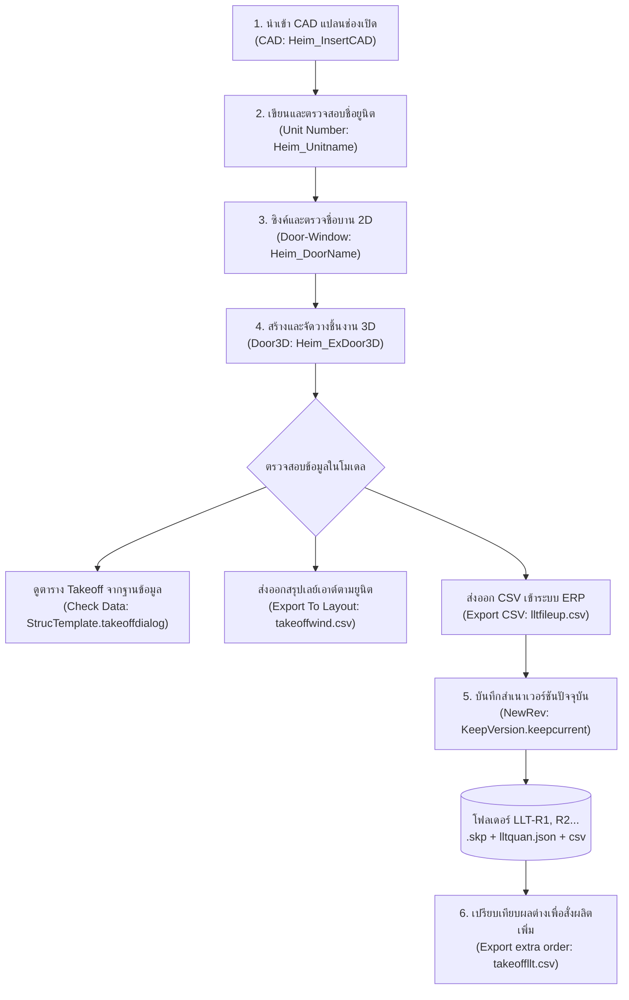
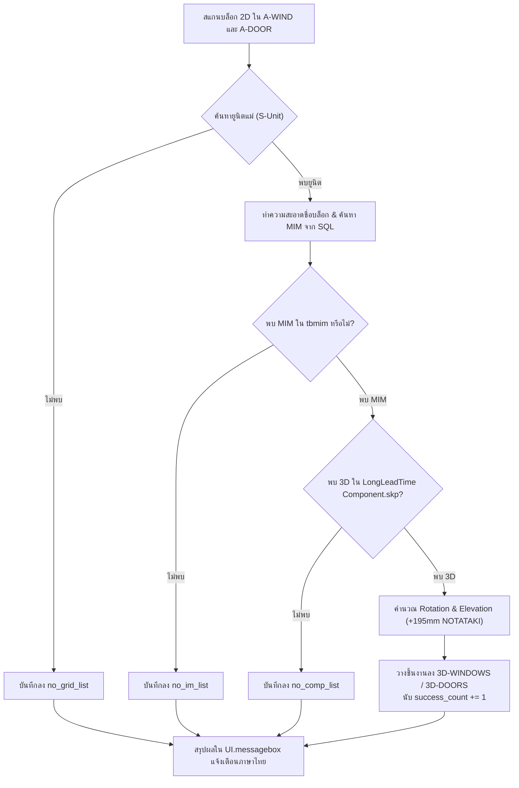

# คู่มือและเอกสารการทำงานระบบ LongleadTime (QHeim)

[🏠 กลับสู่หน้าหลัก (Master Documentation)](README.md) &bull; [🌐 เปิดอ่านบนเว็บเบราว์เซอร์ (GitHub Pages)](https://suteechu.github.io/manual-QHeim/LongleadTime_Doc.html)


เอกสารฉบับนี้จัดทำขึ้นเพื่ออธิบายหลักการทำงาน, สถาปัตยกรรมโค้ด (Code Architecture), ตรรกะการคำนวณ (Business Logic), โครงสร้างเลเยอร์ (Layers), กระบวนการวางชิ้นงาน 3D และการถอดรายการสั่งซื้อล่วงหน้า (Long Lead Time BOM & Extra Order Request) ของระบบ **LongleadTime** ในส่วนขยาย **QHeim (SketchUp Ruby Extension)**

---

## 1. ภาพรวมระบบ (System Overview)

ระบบ **LongleadTime** ทำหน้าที่จัดการงานประตูและหน้าต่าง (Door & Window Work) ของบ้านโครงสร้างสำเร็จรูป โดยครอบคลุมตั้งแต่การนำเข้าแบบแปลน CAD, การจับคู่รหัสยูนิต (Unit Grid), การตรวจรับชื่อสัญลักษณ์ 2D, การสร้างและจัดวางโมเดล 3D เสมือนจริงลงในพิกัดที่ถูกต้อง, การตรวจสอบฐานข้อมูล MIM (Material Information Management), ไปจนถึงการเก็บประวัติเวอร์ชัน (Revision Management) และการเปรียบเทียบเพื่อออกใบสั่งของสั่งผลิตล่วงหน้า (Extra Order Request / BOM)

### แผนผังลำดับขั้นตอนการทำงาน (Workflow Lifecycle)



> [!IMPORTANT]
> **ข้อกำหนดสำคัญที่สุดในการทำงาน:**
> 1. การทำงานต้องเรียงลำดับจากซ้ายไปขวา: **CAD $\rightarrow$ Unit Number $\rightarrow$ Door-Window $\rightarrow$ Door3D** เสมอ เพื่อให้ชิ้นงานมีข้อมูลกริดและพิกัดยูนิตรองรับ
> 2. ก่อนรันคำสั่ง **Door3D** ต้องตรวจสอบให้แน่ใจว่าเลเยอร์ `S-Unit` มีกลุ่มยูนิตครอบคลุม และบล็อก 2D ประตูหน้าต่างอยู่บนเลเยอร์ `A-WIND` หรือ `A-DOOR`
> 3. ก่อนกดสั่งออกรายงาน CSV ใดๆ (**Export CSV, Export To Layout, NewRev, Export extra order**) กรุณา **ปิดไฟล์ Excel ที่เปิดค้างไว้ทั้งหมด** เพื่อป้องกันข้อผิดพลาดไฟล์ถูกล็อก (Permission Denied)

---

## 2. หน้าต่างเมนูควบคุม (UI Controller)

ระบบทำงานผ่านแถบเครื่องมือ HTML Dialog:
* **Ruby Controller:** [Heim_LongleadtimeIcon.rb](file:///C:/QHeim/Ruby/LongleadTime/Heim_LongleadtimeIcon.rb)
* **HTML Dialog View:** [Heim_Longleadtime.html](file:///C:/QHeim/Ruby/LongleadTime/Heim_Longleadtime.html)

### รายการไอคอนและฟังก์ชันเรียกใช้งาน

| ไอคอน | ชื่อคำสั่ง (Tool Title) | ไฟล์ Ruby ที่ประมวลผล | หน้าที่หลัก |
| :--- | :--- | :--- | :--- |
|  | **Insert CAD** | [`Heim_CAD.rb`](file:///C:/QHeim/Ruby/CAD/Heim_CAD.rb) / `Heim_InsertCAD.new` | นำเข้าไฟล์ DWG จากโฟลเดอร์โครงการ และคัดแยกเลเยอร์กริดยูนิตอัตโนมัติ |
|  | **Unit Number** | [`Heim_Unitname.rb`](file:///C:/QHeim/Ruby/CAD/Heim_Unitname.rb) / `Heim_Unitname.new` | ระบุชื่อยูนิตลงเลเยอร์ `S-Unit` และจับคู่ช่องเปิดดูดควัน (Hood) |
|  | **Door-Window** | [`Heim_DoorName.rb`](file:///C:/QHeim/Ruby/CAD/Heim_DoorName.rb) / `Heim_DoorName.new` | ตรวจสอบและซิงค์ชื่อ Component 2D บนเลเยอร์ `A-WIND` และ `A-DOOR` |
|  | **Door3D** | [`Heim_ExDoor3D.rb`](file:///C:/QHeim/Ruby/LongleadTime/Heim_ExDoor3D.rb) / `Heim_ExDoor3D.new` | ดึง MIM จาก SQL และวางชิ้นงาน 3D ลงในเลเยอร์ `3D-WINDOWS` / `3D-DOORS` พร้อมรายงานผล |
|  | **Check Data** | [`Heim_LoadComp.rb`](file:///C:/QHeim/Ruby/Struc/Heim_LoadComp.rb) / `StrucTemplate.takeoffdialog` | เปิดหน้าต่างไดอะล็อกตาราง HTML แสดงรายการ Takeoff เทียบฐานข้อมูล SQL |
|  | **Export To Layout** | [`Heim_ExportExtra.rb`](file:///C:/QHeim/Ruby/LongleadTime/Heim_ExportExtra.rb) / `ExportLLT.quanexport` | ส่งออกรายการชิ้นงานแยกตามยูนิตเป็นไฟล์ `takeoffwind.csv` และเปิด Excel |
|  | **Export CSV** | [`Heim_ExportExtra.rb`](file:///C:/QHeim/Ruby/LongleadTime/Heim_ExportExtra.rb) / `ExportLLT.fileupexport` | ส่งออกรายการไฟล์อัปโหลดเข้าระบบ ERP `lltfileup.csv` พร้อมข้อมูล Station/Method |
|  | **Save a revision of current model** | [`Heim_ExportExtra.rb`](file:///C:/QHeim/Ruby/LongleadTime/Heim_ExportExtra.rb) / `KeepVersion.keepcurrent` | บันทึกสำเนาไฟล์โมเดล .skp, ค่าปริมาณ lltquan.json และ takeoffllt.csv แยกโฟลเดอร์ LLT-R1, R2... |
|  | **Export extra order request** | [`Heim_ExportExtra.rb`](file:///C:/QHeim/Ruby/LongleadTime/Heim_ExportExtra.rb) / `ExportLLT.comparepart(true)` | เปรียบเทียบชิ้นงานกับเวอร์ชันล่าสุด คำนวณยอดเปลี่ยนแปลง และส่งออก `takeoffllt.csv` |

---

## 3. คู่มือขั้นตอนการกดใช้งานแต่ละไอคอน (SOP สำหรับคนทำงาน)

### 📌 สรุปขั้นตอนหลัก 3 สเต็ป:
1. **ขั้นตอนที่ 1: เตรียมโครงสร้างแปลนและชื่อยูนิต**
   * กดไอคอน **Insert CAD** เพื่อดึงไฟล์ DWG เข้ามา $\rightarrow$ กดไอคอน **Unit Number** เพื่อสร้างชื่อยูนิตกำกับ $\rightarrow$ กดไอคอน **Door-Window** เพื่อตรวจเช็คชื่อบล็อก 2D ให้สมบูรณ์
2. **ขั้นตอนที่ 2: สร้างและจัดวางชิ้นงาน 3D**
   * เลือกยูนิตหรือชิ้นงานบนเลเยอร์ `A-WIND`/`A-DOOR` (หรือปล่อยว่างให้ระบบประมวลผลทั้งโมเดล) $\rightarrow$ กดไอคอน **Door3D**
   * ระบบจะจับคู่ฐานข้อมูล SQL, ดึง 3D Component จากไฟล์ Master, หมุนองศาตามทิศวงเปิด, จัดการระดับความสูง และสรุปผลการทำงานแจ้งเตือน
3. **ขั้นตอนที่ 3: สรุปยอด, บันทึกเวอร์ชัน และเปรียบเทียบสั่งซื้อล่วงหน้า**
   * กด **Check Data** หรือ **Export To Layout** เพื่อตรวจทานความถูกต้อง
   * กด **Save a revision (NewRev)** เพื่อเก็บสำเนาไว้เปรียบเทียบในอนาคต (เช่น เมื่อเริ่มออกแปลนรอบแรก R1)
   * เมื่อมีการแก้ไขแบบในภายหลัง ให้กด **Export extra order request** ระบบจะเทียบกับเวอร์ชันล่าสุดและเปิดไฟล์ Excel แสดงรายการสั่งเพิ่ม (Add) หรือยกเลิก (Close) ทันที

---

### 📋 รายละเอียดการกดใช้งานทีละไอคอน:

#### 1. Insert CAD ([`Heim_CAD.rb`](file:///C:/QHeim/Ruby/CAD/Heim_CAD.rb) / [`Heim_InsertCAD.rb`](file:///C:/QHeim/Ruby/CAD/Heim_InsertCAD.rb))
* **🎯 การเลือกวัตถุ:** **ไม่ต้องเลือกวัตถุล่วงหน้า**
* **🖱️ การคลิก & ตั้งค่า:** กดไอคอน **Insert CAD** &rarr; จะมีหน้าต่าง Open File ขึ้นมา ให้เลือกไฟล์ CAD (`.dwg`) ประจำโครงการที่เก็บไว้ในไดเรกทอรี `D:/00_QHeim_Work/<ชื่อโครงการ>/`
* **📦 ผลลัพธ์ในโมเดล:** 
  * นำเข้าเส้นและบล็อก CAD เข้ามาในโมเดล
  * ทำการ Explode บล็อก และคัดแยกเฉพาะชิ้นส่วนที่เป็นกริดและโครงสร้างยูนิต (`EE-GRID-UNIT`, `A-GENM-GM`, `A-GENM`, `A-GENM-450G`) นำไปเก็บไว้ในเลเยอร์ `EE-GRID-UNIT`
  * ล้าง Component ย่อยที่ถูกซ่อน (Hidden Elements) ของ Dynamic Block ทิ้งโดยอัตโนมัติ พร้อม Zoom Extents ปรับมุมมองเต็มจอ

#### 2. Unit Number ([`Heim_Unitname.rb`](file:///C:/QHeim/Ruby/CAD/Heim_Unitname.rb))
* **🎯 การเลือกวัตถุ:** ตรวจสอบให้แน่ใจว่ากริดยูนิตแสดงผลอยู่ในโมเดล
* **🖱️ การคลิก & ตั้งค่า:** กดไอคอน **Unit Number** ครั้งเดียว ระบบจะทำงานอัตโนมัติ
* **📦 ผลลัพธ์ในโมเดล:** 
  * สร้างและกำหนดชื่อยูนิตลงในเลเยอร์ `S-Unit` และ `UnitName`
  * อ่านค่าพิกัดจากไฟล์ `C:/QHeim/DATA/hood.txt` เพื่อวางตำแหน่งช่องเปิด Hood ดูดควัน
  * เปิดแสดงผลเลเยอร์ `text_door` เพื่อเตรียมความพร้อมสำหรับการตรวจสอบประตูหน้าต่าง

#### 3. Door-Window ([`Heim_DoorName.rb`](file:///C:/QHeim/Ruby/CAD/Heim_DoorName.rb))
* **🎯 การเลือกวัตถุ:** **ไม่ต้องเลือกวัตถุล่วงหน้า** (หรือเลือกกลุ่มผนังที่ต้องการตรวจสอบ)
* **🖱️ การคลิก & ตั้งค่า:** กดไอคอน **Door-Window**
* **📦 ผลลัพธ์ในโมเดล:** 
  * วิ่งตรวจสอบคอมโพเนนต์ 2D ทั้งหมดบนเลเยอร์ `A-WIND` และ `A-DOOR`
  * ตรวจสอบว่าชื่อ Instance Name และ Definition Name สอดคล้องกันหรือไม่ หากมีการแก้ไขจะสั่ง `make_unique` และเปลี่ยนชื่อให้ตรงกันเพื่อป้องกันข้อผิดพลาด
  * สร้างเลเยอร์ `text_door` และ `text_room` พร้อมเปิดแสดงผลป้ายข้อความกำกับตำแหน่ง

#### 4. Door3D ([`Heim_ExDoor3D.rb`](file:///C:/QHeim/Ruby/LongleadTime/Heim_ExDoor3D.rb))
* **🎯 การเลือกวัตถุ:** สามารถลากเมาส์ครอบเฉพาะยูนิตที่ต้องการ หรือ**ไม่ต้องเลือกวัตถุ** (หากไม่เลือก ระบบจะตรวจหาจากกลุ่ม `wallgroup` หรือชิ้นงานทั้งหมดใน `A-WIND` และ `A-DOOR` อัตโนมัติ)
* **🖱️ การคลิก & ตั้งค่า:** กดไอคอน **Door3D**
* **📦 ผลลัพธ์ในโมเดล:** 
  * ระบบตรวจหารหัส MIM จากฐานข้อมูล SQL `tbmim` ผ่านตัวแปร `$dcajname`
  * โหลดชิ้นงาน 3D จากไฟล์ `C:/QHeim/Longleadtime/LongLeadTime Component.skp`
  * วางชิ้นงานลงในเลเยอร์ `3D-WINDOWS` สำหรับหน้าต่าง และเลเยอร์ `3D-DOORS` สำหรับประตู
  * ปรับองศาการหมุนตามแนวการเปิด (ซ้าย, ขวา, บน, ล่าง) และตรวจสอบทิศทางเทียบกับจุดศูนย์กลางของยูนิต
  * กรณีเป็นประตูที่มีรหัส `NOTATAKI` ระบบจะยกชดเชยระดับความสูงขึ้น $+195\,\text{mm}$ ให้อัตโนมัติ
  * **ระบบรายงานผล:** แสดงกล่องข้อความสรุปรายการสำเร็จและรายการที่ติดปัญหา (ดูหัวข้อ 4.4)

#### 5. Check Data ([`Heim_LoadComp.rb`](file:///C:/QHeim/Ruby/Struc/Heim_LoadComp.rb))
* **🎯 การเลือกวัตถุ:** **ไม่ต้องเลือกวัตถุล่วงหน้า**
* **🖱️ การคลิก & ตั้งค่า:** กดไอคอน **Check Data**
* **📦 ผลลัพธ์ในโมเดล:** เปิดหน้าต่างไดอะล็อก HTML แสดงตารางถอดแบบสรุปปริมาณชิ้นงานประตูหน้าต่างทั้งหมด เทียบกับข้อมูลมาตรฐานจาก SQL Database ให้ผู้ใช้งานตรวจทานความถูกต้องได้ทันที

#### 6. Export To Layout ([`Heim_ExportExtra.rb`](file:///C:/QHeim/Ruby/LongleadTime/Heim_ExportExtra.rb) / `ExportLLT.quanexport`)
* **🎯 การเลือกวัตถุ:** มีชิ้นงานในเลเยอร์ `3D-WINDOWS`, `3D-DOORS` และ `S-Unit` ครบถ้วน
* **🖱️ การคลิก & ตั้งค่า:** กดไอคอน **Export To Layout** (ตรวจสอบว่าปิดไฟล์ Excel เก่าก่อนกด)
* **📦 ผลลัพธ์ในโมเดล:** 
  * ระบบจับคู่ชิ้นงาน 3D เข้ากับยูนิตแม่ (`getparentunit`)
  * ดึงรายละเอียดจากฐานข้อมูล SQL `tbmim`
  * สร้างไฟล์ `C:/QHeim/takeoffwind.csv` โครงสร้าง: `menu_id, unit, menuidchild, part_name, amount, method, place, station`
  * สั่งเปิดโปรแกรม Microsoft Excel แสดงผลตารางบน Taskbar ทันที

#### 7. Export CSV ([`Heim_ExportExtra.rb`](file:///C:/QHeim/Ruby/LongleadTime/Heim_ExportExtra.rb) / `ExportLLT.fileupexport`)
* **🎯 การเลือกวัตถุ:** มีชิ้นงานในเลเยอร์ `3D-WINDOWS`, `3D-DOORS` และ `S-Unit`
* **🖱️ การคลิก & ตั้งค่า:** กดไอคอน **Export CSV**
* **📦 ผลลัพธ์ในโมเดล:** 
  * จัดกลุ่มตามหมายเลขยูนิตในรูปแบบสองหลัก เช่น `="01"`, `="02"`
  * แยกประเภทชิ้นงาน โดยหากเป็นชิ้นส่วนกลุ่ม `AAJO` จะกำหนดค่ากระบวนการผลิตให้อัตโนมัติ: `Method = "2"`, `Place = "F"`, `Station = "SL-WS"`
  * สร้างไฟล์ `C:/QHeim/lltfileup.csv` โครงสร้าง: `House_ID, Unit(XX), Part_ID, Qty, Method, Place, Station, Position`
  * เด้งเปิดโปรแกรม Microsoft Excel เพื่อนำไฟล์ไปใช้อัปโหลดเข้าระบบ ERP ต่อไป

#### 8. Save a revision of current model (NewRev) ([`Heim_ExportExtra.rb`](file:///C:/QHeim/Ruby/LongleadTime/Heim_ExportExtra.rb) / `KeepVersion.keepcurrent`)
* **🎯 การเลือกวัตถุ:** **ไม่ต้องเลือกวัตถุล่วงหน้า**
* **🖱️ การคลิก & ตั้งค่า:** กดไอคอน **NewRev**
* **📦 ผลลัพธ์ในโมเดล:** 
  * ถอดแบบปริมาณชิ้นงานปัจจุบันลงไฟล์ `takeoffllt.csv` และ `lltquan.json` ในโฟลเดอร์โครงการ
  * ตรวจสอบโฟลเดอร์โครงการใน `D:/00_QHeim_Work/<ชื่อโครงการ>/` เพื่อหาเลข Revision สูงสุด
  * สร้างโฟลเดอร์ย่อยใหม่แบบอัตโนมัติ เช่น `LLT-R1`, `LLT-R2`, `LLT-R3`...
  * บันทึกไฟล์ `.skp` ฉบับเต็ม, คัดลอก `lltquan.json` และ `takeoffllt.csv` เข้าไปเก็บไว้ในโฟลเดอร์ Revision นั้นๆ
  * แจ้งเตือนข้อความยืนยัน: `Keep current file to D:/00_QHeim_Work/.../LLT-RX`

#### 9. Export extra order request ([`Heim_ExportExtra.rb`](file:///C:/QHeim/Ruby/LongleadTime/Heim_ExportExtra.rb) / `ExportLLT.comparepart(true)`)
* **🎯 การเลือกวัตถุ:** **ไม่ต้องเลือกวัตถุล่วงหน้า**
* **🖱️ การคลิก & ตั้งค่า:** กดไอคอน **Order** (รูปตระกร้า/ใบสั่งของ)
* **📦 ผลลัพธ์ในโมเดล:** 
  * ระบบค้นหาโฟลเดอร์ Revision ล่าสุด (เช่น `LLT-R1`) และอ่านไฟล์ประวัติ `lltquan.json`
  * คำนวณปริมาณชิ้นงานโมเดลปัจจุบัน เปรียบเทียบกับเวอร์ชันที่บันทึกไว้
  * คัดกรองรหัสอะไหล่ตามเงื่อนไข Whitelist และกฎเฉพาะของบานเลื่อน 4 บาน (`S4`)
  * บันทึกไฟล์ `D:/00_QHeim_Work/<ชื่อโครงการ>/takeoffllt.csv` พร้อมระบุ Demand (`Add` สำหรับสั่งเพิ่ม / `Close` สำหรับขอลดจำนวน)
  * เด้งเปิดโปรแกรม Microsoft Excel แสดงผลตารางพร้อมส่งให้ฝ่ายผลิตทันที

---

## 4. สถาปัตยกรรมและตรรกะการทำงานแต่ละโมดูล (Detailed Module Logic)

### 4.1 การนำเข้าและประมวลผลไฟล์ CAD (Heim_InsertCAD.rb)

โมดูลนี้ทำหน้าที่แปลงข้อมูลแปลน AutoCAD ให้เป็นโครงสร้างข้อมูล SketchUp:
1. เปิดหน้าต่างเลือกไฟล์ DWG จากเส้นทางโครงการ: `D:/00_QHeim_Work/<ModelTitle>/*.dwg`
2. กำหนด Option การนำเข้า: `:units => "model"`, `:merge_coplanar_faces => false`, `:show_summary => false`
3. สั่ง Explode คอมโพเนนต์ที่นำเข้ามา แล้วคัดกรองเลเยอร์:
   * คัดเฉพาะวัตถุบนเลเยอร์ `EE-GRID-UNIT`, `A-GENM-GM`, `A-GENM`, และ `A-GENM-450G`
   * ย้ายวัตถุทั้งหมดที่เข้าเกณฑ์ไปไว้ที่เลเยอร์มาตรฐาน **`EE-GRID-UNIT`**
4. ลบชิ้นส่วนย่อยที่เป็นคอมโพเนนต์ซ่อนอยู่ (`hidden? == true`) ของบล็อก Dynamic CAD ออกอย่างปลอดภัย
5. เปิดเลเยอร์ `EE-GRID-UNIT` และสั่งปรับมุมมองหน้าจอแบบ `zoom_extents`

---

### 4.2 การระบุยูนิตและอุปกรณ์ดูดควัน (Heim_Unitname.rb)

1. สร้างเลเยอร์มาตรฐาน `UnitName` และ `S-Unit`
2. อ่านข้อมูลพิกัดและทิศทางการวางฮู้ดดูดควันจากไฟล์ `C:/QHeim/DATA/hood.txt`:
   $$\text{Format ใน hood.txt: } \texttt{Type|Position|X(mm)|Y(mm)|Rotation}$$
3. วางชิ้นงานและสัญลักษณ์ตัวอักษร 3D ระบุชื่อและตำแหน่งยูนิต พร้อมเปิดเลเยอร์ `text_door`

---

### 4.3 การตรวจสอบและปรับมาตรฐาน 2D Door/Window (Heim_DoorName.rb)

โมดูลนี้ทำหน้าที่ทำความสะอาด (Data Cleansing) บล็อก 2D ก่อนนำไปสร้าง 3D:
1. สแกนคอมโพเนนต์ในเลเยอร์ `A-WIND` และ `A-DOOR`
2. ลบเครื่องหมายวรรคตอนและช่องว่างออกจากชื่อ: `namex = e5.name.gsub(/[" "]/, "")`
3. ตรวจสอบว่าชื่อ Instance Name ตรงกับ Definition Name หรือไม่:
   * หากไม่ตรงกัน สคริปต์จะทำการ `make_unique` แล้วตั้งชื่อ `definition.name = namex`
   * ช่วยป้องกันปัญหาที่ผู้เขียนแบบ Copy บานเดิมไปใช้แต่แก้ไขเฉพาะ Instance Name แล้วทำให้ระบบดึงชิ้นงาน 3D ผิดแบบ

---

### 4.4 สถาปัตยกรรมการวาง 3D และจับคู่ฐานข้อมูล (Heim_ExDoor3D.rb)

โมดูล **Heim_ExDoor3D** คือแกนกลางของระบบ มีขั้นตอนการประมวลผลอย่างเป็นระบบดังนี้:



#### 1. การทำความสะอาดและจับคู่ MIM ในฐานข้อมูล SQL (`findIMfromDb`):
* ดึงข้อมูล Mapping ทั้งหมดจากตาราง `tbmim` ผ่านตัวแปร `$dcajname` (หมวด `AJAE`, `AJDE`, `AJDW`, `AJFW`, `AJAW`, `AKBD`)
* ตัดคำต่อท้ายที่ไม่เกี่ยวข้องออก เช่น `(FT)`, `FT`, `SLITSHUTTER`, `TATAKI`, `NOTATAKI`, `S(W)`, `S(D)`
* **กรณีหน้าต่างกลุ่ม TOP3:**
  * มีระบบ Multi-tier Fallback Matching:
    1. **ระดับที่ 1 (สมบูรณ์แบบ):** เทียบ Base Target + ตรวจสอบสถานะว่ามี Lock/Crescent, Frost, และ IGU ตรงกันทั้งคู่
    2. **ระดับที่ 2 (ผ่อนปรน IGU):** เทียบ Base Target + Lock/Crescent + Frost
    3. **ระดับที่ 3 (Base เท่านั้น):** เทียบ Base Target หลัก
* **กรณีประตู ENTRANCE (TOSTEM):**
  * ค้นหาขนาดบาน `1380` หรือ `1800`
  * หากเป็นขนาด `1800` จะตัดอักษรทิศทาง `L` หรือ `R` ท้ายชื่อออก เพื่อให้ตรงกับมาตรฐานรหัสในฐานข้อมูล

#### 2. การตรวจหาคอมโพเนนต์ 3D ในไฟล์ Template:
* โหลดไฟล์คอมโพเนนต์แม่แบบ: `C:/QHeim/Longleadtime/LongLeadTime Component.skp`
* เปรียบเทียบชื่อ Definition ในไฟล์กับรหัส MIM หรือชื่อบล็อก 2D โดยตัดช่องว่างและวงเล็บออกเพื่อความแม่นยำ

#### 3. การคำนวณทิศทางการหมุนและการยกระดับ:
* ฟังก์ชัน `checkOpen` ตรวจหาเส้นโค้งบานเปิด (`ArcCurve`) หรือตรวจสอบพิกัดเทียบกับกึ่งกลางยูนิตแม่ เพื่อจำแนกทิศ `Top`, `Bot`, `Left`, `Right`
* ใช้เมทริกซ์การแปลง Transformation:
  * **ประตู (`A-DOOR`):**
    * `Right`: หมุน $+90^\circ$
    * `Left`: หมุน $-90^\circ$
    * `Top`: หมุน $180^\circ$
    * `Bot`: มุม $0^\circ$ (Transformation.new)
  * **หน้าต่าง (`A-WIND`):**
    * `Right`: หมุน $-90^\circ$
    * `Left`: หมุน $+90^\circ$
    * `Bot`: หมุน $180^\circ$
    * `Top`: มุม $0^\circ$
* **การชดเชยระดับความสูงประตู:** หากชื่อคอมโพเนนต์มีคำว่า **`NOTATAKI`** ระบบจะยกตัวคอมโพเนนต์ขึ้นแกน Z:
  $$\text{Transformation: } \texttt{comp.transform!([0, 0, 195.mm])}$$

#### 4. ระบบรายงานผลการวาง 3D (Thai UI Dialog Format):
เมื่อทำงานเสร็จ ระบบจะรวบรวมรายการทั้งหมดและแจ้งเตือนผ่านกล่องข้อความภาษาไทยในหน้าต่างเดียว:

```text
✅ วางชิ้นงาน 3D สำเร็จ: X รายการ

⚠️ พบรายการที่ติดปัญหา (ข้ามการทำงาน):

• ไม่พบ MIM ใน (database) : X แบบ
   - [ชื่อแบบที่ 1]
   - [ชื่อแบบที่ 2]

• ไม่พบ 3D ใน (File ปั้น Component): X บาน
   - [ชื่อแบบที่ 1]

• ไม่พบตำแหน่ง Grid Unit: X รายการ
   - [ชื่อแบบที่ 1]
```

---

### 4.5 การถอดแบบและส่งออกเลย์เอาต์ (Heim_ExportExtra.rb & ExportLLT)

#### 1. การค้นหายูนิตแม่ (`getparentunit`):
* ดึงขอบเขตของกลุ่มยูนิตในเลเยอร์ `S-Unit`
* ใช้ฟังก์ชัน `MakeService.findobjwithinobj(comp, unit_group)` เพื่อตรวจสอบว่าจุดกึ่งกลางของบานประตูหน้าต่างตั้งอยู่ภายในขอบเขตของยูนิตใด

#### 2. การส่งออกไฟล์ `takeoffwind.csv` (`ExportLLT.quanexport`):
* สรุปปริมาณตามยูนิตและดึงข้อมูลจาก SQL `tbmim`
* หัวตาราง: `menu_id, unit, menuidchild, part_name, amount, method, place, station`
* บันทึกไฟล์ลงที่ `C:/QHeim/takeoffwind.csv` และเปิด Microsoft Excel

#### 3. การส่งออกไฟล์ ERP `lltfileup.csv` (`ExportLLT.fileupexport`):
* หัวตาราง: `House_ID, Unit(XX), Part_ID, Qty, Method, Place, Station, Position`
* จัดรูปแบบรหัสยูนิตด้วย Text Formula: `="01"`, `="02"` เพื่อไม่ให้โปรแกรม Excel ตัดเลข 0 ด้านหน้า
* ชิ้นส่วนกลุ่ม `AAJO` จะได้รับการตั้งค่า:
  * `Method = "2"`
  * `Place = "F"`
  * `Station = "SL-WS"`
  * `Position = "Window"`
* บันทึกไฟล์ลงที่ `C:/QHeim/lltfileup.csv` และเปิด Excel อัตโนมัติ

---

### 4.6 ระบบจัดการเวอร์ชัน (Revision Management - KeepVersion)

เมื่อผู้ใช้กดไอคอน **NewRev** ([`KeepVersion.keepcurrent`](file:///C:/QHeim/Ruby/LongleadTime/Heim_ExportExtra.rb#L526)):
1. เรียกคำสั่ง `ExportLLT.lltexport(false)` เพื่อถอดแบบปริมาณชิ้นงานปัจจุบันลง `takeoffllt.csv` และ `lltquan.json`
2. ตรวจสอบโฟลเดอร์โครงการ: `D:/00_QHeim_Work/<ชื่อไฟล์งาน>/`
3. สแกนหาโฟลเดอร์ย่อยที่ขึ้นต้นด้วย `LLT-R`:
   * หากยังไม่มี จะเริ่มต้นที่ `LLT-R1`
   * หากมีอยู่แล้ว (เช่น `LLT-R1`) จะคำนวณลำดับถัดไปเป็น `LLT-R2`, `LLT-R3`...
4. สร้างโฟลเดอร์ใหม่และทำการสำเนาไฟล์ 3 ไฟล์หลัก:
   * บันทึกไฟล์โมเดล: `Sketchup.active_model.save_copy("<NewPath>/<Filename>.skp")`
   * คัดลอกฐานข้อมูล JSON: `FileUtils.copy_file('.../lltquan.json', '<NewPath>/lltquan.json')`
   * คัดลอกรายการสั่งของ: `FileUtils.copy_file('.../takeoffllt.csv', '<NewPath>/takeoffllt.csv')`
5. แจ้งเตือน Popup ยืนยันการบันทึกสำเร็จ

---

### 4.7 ตรรกะการเปรียบเทียบ Extra Order และเงื่อนไขเฉพาะกลุ่ม AAJO (Export extra order)

เมื่อกดไอคอน **Order** ([`ExportLLT.comparepart`](file:///C:/QHeim/Ruby/LongleadTime/Heim_ExportExtra.rb#L66)):
1. ค้นหาโฟลเดอร์ Revision ล่าสุดจาก `getlastversion()`
2. อ่านข้อมูล JSON เดิมจาก `<LastRev>/lltquan.json` มาเก็บเป็น `lastquan`
3. ถอดแบบชิ้นงานจากโมเดลปัจจุบันผ่านฟังก์ชัน `takeoffwindows()` และคัดกรองด้วย `filterllt()` ได้เป็น `currentquan`
4. คำนวณผลต่าง ($\Delta$ Quantity):
   $$\Delta Q = Q_{\text{current}} - Q_{\text{last}}$$
   * หาก $\Delta Q > 0$: มีการเพิ่มชิ้นงาน $\rightarrow$ กำหนด **`Add/Close Demand = "Add"`**, `Qty = ΔQ`
   * หาก $\Delta Q < 0$: มีการลบหรือลดชิ้นงาน $\rightarrow$ กำหนด **`Add/Close Demand = "Close"`**, `Qty = -ΔQ`

#### กฎการคัดกรองอะไหล่ (Filter Whitelist Rules):
ระบบกรองเฉพาะกลุ่มรหัสอะไหล่ที่อยู่ในรายการ Whitelist:
`['AAJA', 'AAJC', 'AAJM', 'AAJS', 'AAJU', 'AAJP', 'AAKI', 'AAKJ', 'AAJE', 'AAJB', 'AAJO']`
*(หากโครงการตั้งค่า `HaveScreen = true` ระบบจะรวมกลุ่ม `AAJI` มุ้งลวด เข้ามาด้วย)*

#### ⚠️ กฎพิเศษเฉพาะกลุ่ม AAJO (Curve Handles & S4 Sliding Doors):
เพื่อป้องกันการสั่งมือจับผิดรุ่น ระบบมีตรรกะบังคับใช้ดังนี้:
1. **รหัสมือจับทรงโค้ง (Curve Handles) ที่อนุญาต:** มีเพียง 5 รหัสเท่านั้น
   * `AAJO10360`
   * `AAJO10370`
   * `AAJO10380`
   * `AAJO10390`
   * `AAJO10400`
2. **เงื่อนไขประเภทบาน:** ต้องเป็น **บานเลื่อน 4 บาน (`S4`) เท่านั้น** โดยเช็คจาก:
   `row[1].to_s.upcase.include?('S4') || mim.to_s.upcase.include?('S4')`
3. **เงื่อนไขปริมาณ:** ต้องมี `amount > 0` จึงจะนำมารวมในรายการ
4. **Crescent Lock with Key:**
   * หากเป็นบานเลื่อน 4 บาน (`S4`): จ่ายคู่รหัส `AAJO01470` + `AAJO01480`
   * หากเป็นบานเลื่อน 2 บาน (`S2`): จ่ายเฉพาะรหัส `AAJO01470`

#### โครงสร้างฟิลด์ของไฟล์ takeoffllt.csv:
`Project, Task, Item, Due Date, Qty, Reason Code, Method To Carry, Extra Order No, FirstQTY, Reason Extra, Add/Close Deamand, Part Name, House Name, Draftby`

* `Task`: กำหนดตามประเภทสถานีผลิต (เช่น `SL-WS` = `2090`, `SL-WF` = `2035`, `ST-SP` = `2887`, `AL-PT` = `2510`)
* `Reason Code`: กำหนดเป็น `ZLD`
* `Reason Extra`: กำหนดเป็น `Advance order`

---

## 5. ตารางสรุปเลเยอร์ ฐานข้อมูล และรายการส่งออก (Layer, Component & Data Matrix)

### 1. โครงสร้างเลเยอร์ใน SketchUp (Layer Schema)

| ชื่อ Layer ใน SketchUp | บทบาทและหน้าที่ | วัตถุที่บรรจุอยู่ |
| :--- | :--- | :--- |
| **`EE-GRID-UNIT`** | เลเยอร์เส้นกริดยูนิตที่นำเข้าจาก CAD | เส้นและบล็อกกริดจาก AutoCAD (`A-GENM*`) |
| **`S-Unit`** | เลเยอร์กลุ่มขอบเขตยูนิต (Parent Unit Groups) | Group กรอบยูนิต ใช้คำนวณตำแหน่งและอ้างอิงยูนิตแม่ |
| **`UnitName`** | เลเยอร์ข้อความกำกับชื่อยูนิต | ตัวอักษร 3D ระบุชื่อยูนิต (เช่น `U01`, `U02`) |
| **`A-WIND`** | เลเยอร์บล็อกสัญลักษณ์หน้าต่าง 2D | Component 2D หน้าต่างจากสถาปัตย์ |
| **`A-DOOR`** | เลเยอร์บล็อกสัญลักษณ์ประตู 2D | Component 2D ประตูจากสถาปัตย์ |
| **`3D-WINDOWS`** | เลเยอร์ชิ้นงาน 3D หน้าต่างจริง | Component 3D หน้าต่างที่วางโดยคำสั่ง `Door3D` |
| **`3D-DOORS`** | เลเยอร์ชิ้นงาน 3D ประตูจริง | Component 3D ประตูที่วางโดยคำสั่ง `Door3D` |
| **`text_door`** | เลเยอร์ป้ายข้อความกำกับรหัสประตูหน้าต่าง | ข้อความแสดงชื่อสัญลักษณ์บาน |
| **`text_room`** | เลเยอร์ป้ายข้อความกำกับชื่อห้อง | ข้อความแสดงชื่อห้อง |

### 2. ตารางหมวดหมู่รหัสวัสดุ (MIM Prefix Matrix)

| รหัสกลุ่ม (Prefix) | รายละเอียดประเภทชิ้นงาน | สถานีการผลิตหลัก (Station) | Task Code |
| :--- | :--- | :--- | :---: |
| **`AAJA`** | วงกบหน้าต่าง (Window Frame) | SL-WF | 2035 |
| **`AAJC`** | กรอบบานหน้าต่าง (Window Sash) | SL-WS | 2090 |
| **`AAJM`** | เสากลาง/อุปกรณ์เสริมบานเลื่อน | SL-WS / SL-WF | 2090 / 2035 |
| **`AAJS`** | กรอบบานหน้าต่างระบายอากาศ | SL-WS / SL-WF | 2090 / 2035 |
| **`AAJU`** | กรอบบานตาย / Fixed Frame | SL-WF | 2035 |
| **`AAJP`** | กระจกหน้าต่าง (Glass Panel) | SL-WS | 2090 |
| **`AAKI` / `AAKJ`** | อุปกรณ์ชุดยึดและบานพับหน้าต่าง | SL-WS | 2090 |
| **`AAJE` / `AAJB`** | วงกบและกรอบบานประตูระเบียง | SL-WF / SL-DF | 2035 / 2082 |
| **`AAJO`** | อุปกรณ์มือจับและชุดล็อก (Curve Handle เฉพาะ S4) | SL-WS | 2090 |
| **`AAJI`** | มุ้งลวดกันแมลง (Screen) *(ส่งออกเมื่อ HaveScreen = true)* | ST-SP | 2887 |

### 3. ตารางสรุปไฟล์ส่งออก (Export Output Matrix)

| ชื่อไฟล์ | ไดเรกทอรีจัดเก็บ | คำสั่งที่สร้าง | วัตถุประสงค์การใช้งาน |
| :--- | :--- | :--- | :--- |
| **`takeoffwind.csv`** | `C:/QHeim/` | **Export To Layout** | ตรวจสอบปริมาณชิ้นงานแยกตามรายยูนิตและรายชิ้น |
| **`lltfileup.csv`** | `C:/QHeim/` | **Export CSV** | อัปโหลดเข้าระบบ ERP เพื่อสั่งเตรียมชิ้นส่วนเข้าสายการผลิต |
| **`takeoffllt.csv`** | `D:/00_QHeim_Work/<Project>/` | **NewRev** / **Order** | ใบสั่งของล่วงหน้า (Extra Order) ระบุยอด Add / Close |
| **`lltquan.json`** | `D:/00_QHeim_Work/<Project>/` | **NewRev** / **Order** | ฐานข้อมูล Snapshot ปริมาณชิ้นงานในรูปแบบ JSON |
| **`<Project>.skp`** | `D:/00_QHeim_Work/<Project>/LLT-RX/` | **NewRev** | สำเนาไฟล์โมเดล SketchUp ณ แต่ละรอบ Revision |

---

## 6. ลำดับการใช้งานและข้อแนะนำ (Best Practices & Troubleshooting)

### 1. ลำดับขั้นตอนการทำงานมาตรฐาน (Standard Operating Procedure)

1. **เปิดโมเดลโครงการและตรวจสอบข้อมูล:** ตรวจสอบว่าโมเดลมีการตั้งค่า `HouseID`, `Platform` และ `HaveScreen` ผ่านคำสั่งตั้งค่าโครงสร้างเรียบร้อยแล้ว
2. **นำเข้า CAD และจัดการกริด:**
   * กด **Insert CAD** $\rightarrow$ เลือกไฟล์ DWG ประจำหลัง
   * กด **Unit Number** $\rightarrow$ ระบบจะสร้างยูนิตและกริดอ้างอิง
3. **ตรวจสอบบาน 2D:**
   * กด **Door-Window** เพื่อตรวจเช็คชื่อ Definition และ Instance Name บนเลเยอร์ `A-WIND` และ `A-DOOR`
4. **สร้างชิ้นงาน 3D:**
   * กด **Door3D** $\rightarrow$ ตรวจดูผลการแจ้งเตือน หากมีรายการติดปัญหาให้บันทึกไว้แก้ไข
5. **บันทึกรอบแปลนแรก (Revision 1):**
   * กด **NewRev** เพื่อเก็บ `LLT-R1` ไว้เป็นฐานข้อมูลอ้างอิงรอบแรก
6. **เมื่อมีการแก้ไขแบบในอนาคต (Revision Comparison):**
   * ปรับแก้ชิ้นงาน 3D ในโมเดลตามแบบสถาปัตย์ใหม่
   * กด **Export extra order request (Order)** เพื่อเปรียบเทียบกับรอบล่าสุด ระบบจะคำนวณยอดผลต่าง ($\pm$) ออกมาเป็นไฟล์ `takeoffllt.csv` ให้ทันที
   * หากยืนยันการเปลี่ยนแปลงเรียบร้อยแล้ว ให้กด **NewRev** อีกครั้งเพื่อบันทึกเป็น `LLT-R2` ต่อไป

---

### 2. แนวทางแก้ไขปัญหาที่พบบ่อย (Troubleshooting)

* **⚠️ ปัญหา `Error. ...csv already open. please close file before continue.`**
  * *สาเหตุ:* ไฟล์ `takeoffwind.csv`, `lltfileup.csv` หรือ `takeoffllt.csv` กำลังถูกเปิดค้างอยู่ในโปรแกรม Microsoft Excel ทำให้ระบบไม่สามารถเขียนทับได้
  * *วิธีแก้:* สลับไปที่หน้าต่าง Excel บันทึกหรือปิดหน้าต่างนั้นทิ้ง แล้วกดย้อนกลับมารันคำสั่งใน SketchUp ใหม่อีกครั้ง
* **⚠️ ปัญหา `ไม่พบ MIM ใน (database) : X แบบ`**
  * *สาเหตุ:* ชื่อของบาน 2D ในโมเดลไม่ตรงกับฐานข้อมูล `tbmim` ใน SQL Server (อาจมีเว้นวรรคผิด หรือเป็นสเปกบานแบบใหม่)
  * *วิธีแก้:* ตรวจสอบชื่อใน Entity Info ของบานที่ระบบแจ้งเตือน ประสานงานกับผู้ดูแลฐานข้อมูลเพื่อเพิ่มรหัส MIM หรือแก้ไขชื่อบล็อกให้ตรงกับมาตรฐาน (โดยเฉพาะหน้าต่างตระกูล `TOP3` ต้องมีคีย์เวิร์ด Lock, Frost, IGU ให้ครบถ้วน)
* **⚠️ ปัญหา `ไม่พบ 3D ใน (File ปั้น Component): X บาน`**
  * *สาเหตุ:* ในฐานข้อมูล SQL มีรหัส MIM นี้ แต่ในไฟล์แม่แบบ `C:/QHeim/Longleadtime/LongLeadTime Component.skp` ยังไม่มีการปั้นโมเดล 3D ชิ้นงานชิ้นนี้ใส่ไว้
  * *วิธีแก้:* เปิดไฟล์ `C:/QHeim/Longleadtime/LongLeadTime Component.skp` แล้วปั้นหรือนำเข้า Component 3D ที่ตั้งชื่อ Definition ตรงกับรหัส MIM หรือชื่อบาน จากนั้นบันทึกไฟล์แล้วรันคำสั่ง `Door3D` ซ้ำ
* **⚠️ ปัญหา `ไม่พบตำแหน่ง Grid Unit: X รายการ`**
  * *สาเหตุ:* ชิ้นงาน 2D ประตูหน้าต่างวางอยู่นอกแนวเส้นกรอบยูนิตในเลเยอร์ `S-Unit` หรือคำสั่ง Raytest ยิงไม่โดนยูนิตในระยะ $0.50\,\text{m}$
  * *วิธีแก้:* ตรวจสอบว่าได้รันคำสั่ง **Unit Number** หรือยัง และตรวจดูว่าบานประตูหน้าต่างถูกจัดวางอยู่ในตำแหน่งผนังของยูนิตนั้นๆ อย่างแนบสนิทหรือไม่
* **⚠️ ปัญหา มือจับ Curve Handle (`AAJO`) ไม่ยอมคำนวณออกมาใน Extra Order:**
  * *สาเหตุ:* มือจับกลุ่ม Curve Handle (`AAJO10360` ถึง `AAJO10400`) มีเงื่อนไขเฉพาะว่าจะต้องใช้กับ **บานเลื่อน 4 บาน (`S4`) เท่านั้น**
  * *วิธีแก้:* ตรวจสอบว่าชื่อสัญลักษณ์ของบานหน้าต่างหรือประตูเลื่อนมีคำว่า `S4` ระบุอยู่ในชื่อหรือไม่ หากไม่มีระบบจะคัดกรองข้ามไปตามมาตรฐานวิศวกรรม


---

[🏠 กลับสู่หน้าหลัก (Master Documentation)](README.md) &bull; [🌐 เปิดอ่านบนเว็บเบราว์เซอร์ (GitHub Pages)](https://suteechu.github.io/manual-QHeim/LongleadTime_Doc.html)
