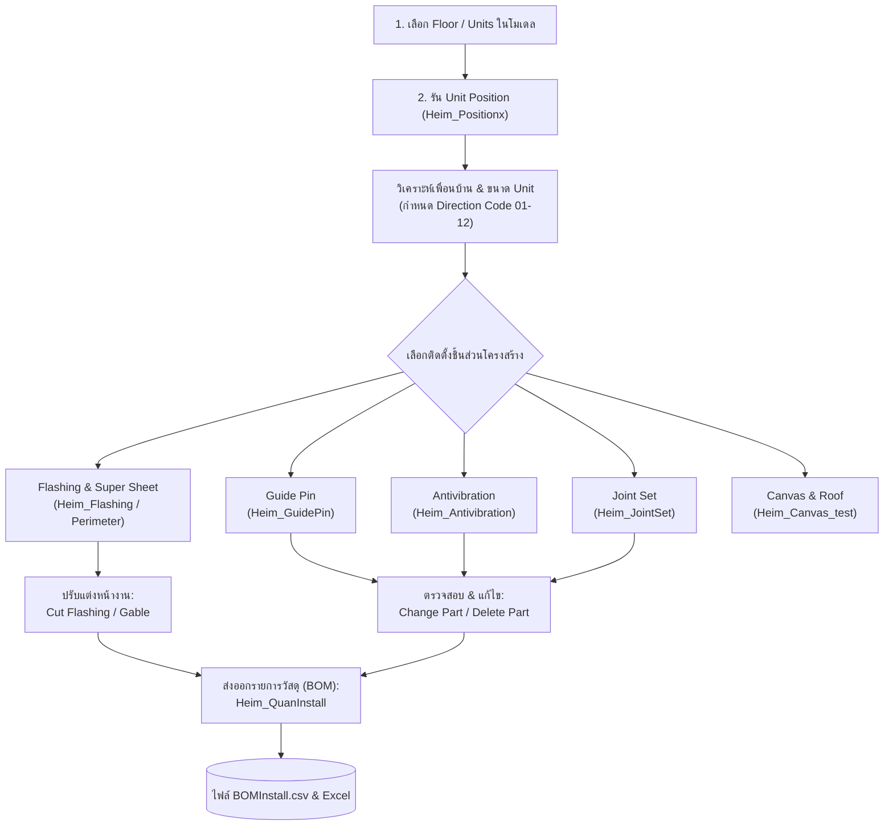
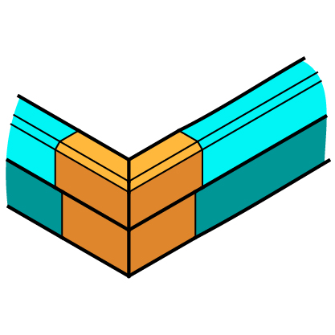
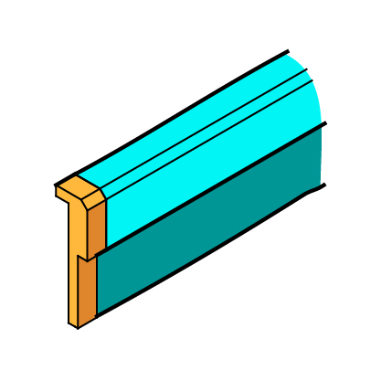
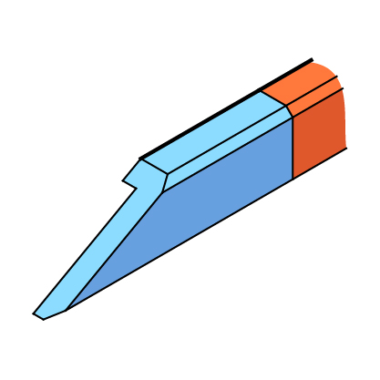
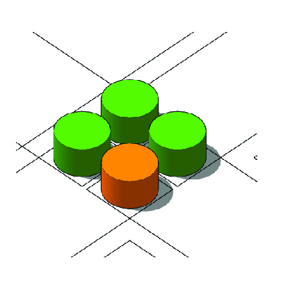
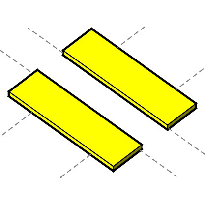
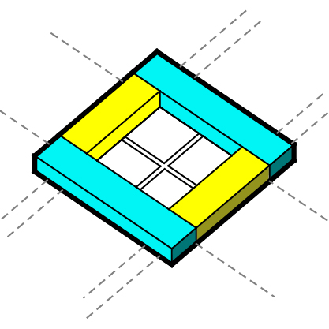
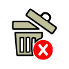
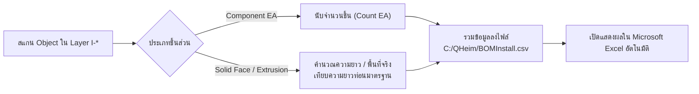

# คู่มือและเอกสารการทำงานระบบ PartInstall (QHeim)

[🏠 กลับสู่หน้าหลัก (Master Documentation)](README.md) &bull; [🌐 เปิดอ่านบนเว็บเบราว์เซอร์ (GitHub Pages)](https://suteechu.github.io/manual-QHeim/PartInstall_Doc.html)

เอกสารฉบับนี้จัดทำขึ้นเพื่ออธิบายหลักการทำงาน, สถาปัตยกรรมโค้ด (Code Architecture), ตรรกะการคำนวณ (Business Logic), โครงสร้างเลเยอร์ (Layers) และการถอดรายการวัสดุ (BOM) ของระบบ **PartInstall** ในส่วนขยาย **QHeim (SketchUp Ruby Extension)**

---

## 1. ภาพรวมระบบ (System Overview)

ระบบ **PartInstall** ทำหน้าที่ติดตั้งชิ้นส่วนข้อต่อ, แผ่นกันสั่น, หมุดนำศูนย์, รางระบายน้ำ/แผ่นครอบ (Flashing), และแผ่นยางกันซึม (Super Sheet) ให้กับบ้านโครงสร้างเหล็กสำเร็จรูปโมดูลาร์ (Modular Unit) โดยประมวลผลตำแหน่ง พิกัด และความสัมพันธ์ระหว่างยูนิตข้างเคียงโดยอัตโนมัติ

### แผนผังลำดับขั้นตอนการทำงาน (Workflow Lifecycle)

> [!IMPORTANT]
> **ข้อกำหนดสำคัญที่สุด:** ก่อนรันคำสั่งติดตั้งชิ้นส่วนใดๆ (Flashing, Joint, Guide Pin, Antivibration) ผู้ใช้ **ต้องเลือกยูนิตแล้วรัน `Unit Position` ก่อนเสมอ** เพื่อให้ Unit ได้รับรหัสกำกับชื่อ เช่น `U01|U36F|2|1|01` มิฉะนั้นสคริปต์ตัวอื่นจะไม่สามารถอ่านพิกัดและชั้นได้

---

## 2. หน้าต่างเมนูควบคุม (UI Controller)

ระบบทำงานผ่านไดอะล็อกแถบเครื่องมือ HTML:
* **Ruby Controller:** [Heim_PartInstallIcon.rb](file:///C:/QHeim/Ruby/Struc/PartInstall/Heim_PartInstallIcon.rb)
* **HTML Dialog View:** [Heim_PartInstall.html](file:///C:/QHeim/Ruby/Struc/PartInstall/Heim_PartInstall.html)

### รายการไอคอนและฟังก์ชันเรียกใช้งาน

| ไอคอน | ชื่อคำสั่ง (Tool Title) | ไฟล์ Ruby ที่ประมวลผล | หน้าที่หลัก |
| :--- | :--- | :--- | :--- |
|  | **Unit Position** | [`Heim_Positionx.rb`](file:///C:/QHeim/Ruby/Struc/PartInstall/Heim_Positionx.rb) | วิเคราะห์ทิศทางและใส่รหัสกำกับยูนิต |
|  | **Flashing+SuperSheet** | [`Heim_Flashing.rb`](file:///C:/QHeim/Ruby/Struc/PartInstall/Heim_Flashing.rb) | ติดตั้งราง Flashing รอบอาคาร และ Super Sheet |
|  | **Cut Flashing** | [`Heim_CutFlashing.rb`](file:///C:/QHeim/Ruby/Struc/PartInstall/Heim_CutFlashing.rb) | ตัดแบ่ง Flashing ตรงช่องเปิด/ประตู พร้อมใส่ฝาปิดซ้าย-ขวา |
|  | **Gable** | [`Heim_Gable.rb`](file:///C:/QHeim/Ruby/Struc/PartInstall/Heim_Gable.rb) | คลิกเลือก 2 จุด เพื่อติดตั้ง Flashing หน้าจั่ว |
|  | **Guide Pin** | [`Heim_GuidePin.rb`](file:///C:/QHeim/Ruby/Struc/PartInstall/Heim_GuidePin.rb) | ติดตั้งหมุดนำศูนย์สำหรับยกวางยูนิต |
|  | **Antivibration** | [`Heim_Antivibration.rb`](file:///C:/QHeim/Ruby/Struc/PartInstall/Heim_Antivibration.rb) | ติดตั้งลูกยาง/แผ่นซับแรงสั่นสะเทือน |
|  | **Joint Set** | [`Heim_JointSet.rb`](file:///C:/QHeim/Ruby/Struc/PartInstall/Heim_JointSet.rb) | ติดตั้งชุดเหล็กยึดรอยต่อยูนิต (Keta / Tsuma) |
|  | **Canvas** | [`Heim_Canvas_test.rb`](file:///C:/QHeim/Ruby/Struc/PartInstall/Heim_Canvas_test.rb) | คำนวณพื้นที่ผ้าใบคลุมหลังคาและจับภาพ Top View |
|  | **Change Part** | [`Heim_ChangePart.rb`](file:///C:/QHeim/Ruby/Struc/PartInstall/Heim_ChangePart.rb) | คลิกเปลี่ยนสเปกชิ้นส่วนที่ติดตั้งแล้วแบบ On-the-fly |
|  | **Delete Part** | [`Heim_DeletePart.rb`](file:///C:/QHeim/Ruby/Struc/PartInstall/Heim_DeletePart.rb) | ลบชิ้นส่วนติดตั้งตามเลเยอร์หรือลบทั้งหมด |
|  | **Export Install Part** | [`Heim_QuanInstall.rb`](file:///C:/QHeim/Ruby/Struc/PartInstall/Heim_QuanInstall.rb) | คำนวณสรุปยอดชิ้นส่วนติดตั้งออกเป็นไฟล์ BOMInstall.csv |

---

## 3. คู่มือขั้นตอนการกดใช้งานแต่ละไอคอน (SOP สำหรับคนทำงาน)

### 📌 สรุปขั้นตอนหลัก 2 สเต็ป:
1. **ขั้นตอนที่ 1: เลือกยูนิต & ตั้งชั้น (Unit Position)**
   * เปิดเลเยอร์ `S-Unit` &rarr; ลากเมาส์ครอบยูนิตทั้งหมดของชั้นที่กำลังทำ &rarr; กดไอคอน **Unit Position** &rarr; เลือกเลขชั้น `Floor NO. (1, 2, 3)` ในกล่องข้อความแล้วกด ตกลง
   * *วิธีเช็คผล:* คลิกที่ยูนิตเปิดดูหน้าต่าง Entity Info ชื่อจะเปลี่ยนเป็น `U01|U36F|2|1|04` แสดงว่าพร้อมทำงานขั้นต่อไป
2. **ขั้นตอนที่ 2: ครอบ Unit (S-Unit) & เลือกปุ่มติดตั้งทีละตัว**
   * เมื่อตั้งชื่อยูนิตเสร็จแล้ว ให้ลากเมาส์ **"ครอบกลุ่ม Unit (S-Unit)"** ของชั้นนั้น แล้วกดปุ่มชิ้นส่วนที่ต้องการติดตั้งเรียงตามลำดับหน้างาน: `Flashing` &rarr; `Guide Pin` &rarr; `Antivibration` &rarr; `Joint Set`

---

### 📋 รายละเอียดการกดใช้งานทีละไอคอน:

#### 1. Unit Position ([`Heim_Positionx.rb`](file:///C:/QHeim/Ruby/Struc/PartInstall/Heim_Positionx.rb))
* **การเลือกวัตถุ:** ลากเมาส์ครอบ Unit ทั้งหมดของชั้นในเลเยอร์ `S-Unit`
* **การคลิก & ตั้งค่า:** กดไอคอน &rarr; เลือก Floor NO. (1, 2 หรือ 3) ในหน้าต่าง Popup แล้วกดยืนยัน
* **ผลลัพธ์ในโมเดล:** ระบบยิง Raytest ตั้งรหัสทิศทาง 01-12 และบันทึกชื่อยูนิต (เช่น `U01|U36F|2|1|04`)

#### 2. Flashing+SuperSheet ([`Heim_Flashing.rb`](file:///C:/QHeim/Ruby/Struc/PartInstall/Heim_Flashing.rb))
* **การเลือกวัตถุ:** ลากเมาส์ครอบ Unit ทั้งหมดของชั้นนั้น (`S-Unit`)
* **การคลิก & ตั้งค่า:** กดปุ่ม Flashing ครั้งเดียว ระบบจะทำงานอัตโนมัติ ไม่ต้องกรอกค่าเพิ่มเติม
* **ผลลัพธ์ในโมเดล:** สร้างราง Flashing รอบอาคาร, ใส่ฝาครอบมุมนอก/มุมใน และสร้างแผ่นยาง Super Sheet รองใต้รางให้เสร็จสรรพ

#### 3. Cut Flashing ([`Heim_CutFlashing.rb`](file:///C:/QHeim/Ruby/Struc/PartInstall/Heim_CutFlashing.rb))
* **การเลือกวัตถุ:** **คลิกเลือก Face (ผิวหน้า)** ของพื้นช่องเปิด/ทางเข้าประตูที่ต้องการตัดราง
* **การคลิก & ตั้งค่า:** กดปุ่ม Cut Flashing
* **ผลลัพธ์ในโมเดล:** ตัดเจาะราง Flashing เปิดทางเข้า พร้อมวางฝาปิดขอบซ้าย (`AAFD10240`) และขวา (`AAFD10250`) ให้อัตโนมัติ

#### 4. Gable (2 Points) ([`Heim_Gable.rb`](file:///C:/QHeim/Ruby/Struc/PartInstall/Heim_Gable.rb))
* **การเลือกวัตถุ:** **ไม่ต้องเลือกวัตถุไว้ล่วงหน้า**
* **การคลิก & ตั้งค่า:** กดไอคอน &rarr; คลิกจุดที่ 1 (จุดเริ่มจั่ว) &rarr; คลิกจุดที่ 2 (จุดสิ้นสุดจั่ว)
* **ผลลัพธ์ในโมเดล:** สร้างราง Flashing หน้าจั่วพร้อมฝาปิดปลาย `Gable_L` และ `Gable_R` ระหว่าง 2 จุดที่คลิก

#### 5. Guide Pin ([`Heim_GuidePin.rb`](file:///C:/QHeim/Ruby/Struc/PartInstall/Heim_GuidePin.rb))
* **การเลือกวัตถุ:** ลากเมาส์ครอบ Unit ทั้งหมดของชั้นในเลเยอร์ `S-Unit`
* **การคลิก & ตั้งค่า:** กดปุ่ม Guide Pin &rarr; เลือก Type ใน Popup (`General`, `Small`, หรือ `Balcony`)
* **ผลลัพธ์ในโมเดล:** วางหมุดนำศูนย์ `AASO07510` / `AASO07520` ลงในเลเยอร์ `I-Guide pin`

#### 6. Antivibration ([`Heim_Antivibration.rb`](file:///C:/QHeim/Ruby/Struc/PartInstall/Heim_Antivibration.rb))
* **การเลือกวัตถุ:** ลากเมาส์ครอบ Unit ทั้งหมดของชั้นในเลเยอร์ `S-Unit`
* **การคลิก & ตั้งค่า:** กดปุ่ม Antivibration ครั้งเดียว ระบบประมวลผลอัตโนมัติ
* **ผลลัพธ์ในโมเดล:** ติดตั้งแผ่นยางซับแรงสั่น `AASZ50130` และแผ่นระหว่างชั้น `AASD07580`/`AASD07590` ใต้เสา

#### 7. Joint Set ([`Heim_JointSet.rb`](file:///C:/QHeim/Ruby/Struc/PartInstall/Heim_JointSet.rb))
* **การเลือกวัตถุ:** ลากเมาส์ครอบ Unit ทั้งหมดของชั้นในเลเยอร์ `S-Unit`
* **การคลิก & ตั้งค่า:** กดปุ่ม Joint Set ครั้งเดียว ระบบคำนวณผนังเบิ้ลอัตโนมัติ
* **ผลลัพธ์ในโมเดล:** ติดตั้งข้อต่อ Keta (`AASD05180`) หรือ Tsuma (`AASD04310`) ในเลเยอร์ `I-Joint Set`

#### 8. Canvas (Roof) ([`Heim_Canvas_test.rb`](file:///C:/QHeim/Ruby/Struc/PartInstall/Heim_Canvas_test.rb))
* **การเลือกวัตถุ:** ลากครอบ Unit ชั้นหลังคา (หรือคลิกเลือก 1 Face ขอบเขต)
* **การคลิก & ตั้งค่า:** กดไอคอน &rarr; ใส่ระยะ Offset ชายผ้าใบ (เช่น 150 และ 1200 มม.)
* **ผลลัพธ์ในโมเดล:** สร้างผืนผ้าใบคลุมหลังคา `AAEC10230`, คำนวณพื้นที่ ตร.ม. และจับภาพ Top View

#### 9. Change Part ([`Heim_ChangePart.rb`](file:///C:/QHeim/Ruby/Struc/PartInstall/Heim_ChangePart.rb))
* **การเลือกวัตถุ:** **ไม่ต้องเลือกวัตถุล่วงหน้า**
* **การคลิก & ตั้งค่า:** กดไอคอน &rarr; นำเมาส์ไปคลิกที่ตัวชิ้นส่วนที่ต้องการเปลี่ยน &rarr; เลือกสเปกใหม่ในหน้าต่าง Popup
* **ผลลัพธ์ในโมเดล:** สลับเป็นชิ้นส่วนใหม่ทันที โดยคงตำแหน่ง พิกัดเดิม และมุมหมุนไว้ 100%

#### 10. Delete Part ([`Heim_DeletePart.rb`](file:///C:/QHeim/Ruby/Struc/PartInstall/Heim_DeletePart.rb))
* **การเลือกวัตถุ:** ลากครอบชิ้นส่วนที่ต้องการลบในโมเดล
* **การคลิก & ตั้งค่า:** กดปุ่มถังขยะ &rarr; เลือกว่าจะลบเฉพาะ Layer ไหน หรือเลือก `All` เพื่อลบทุกชิ้นส่วนติดตั้ง
* **ผลลัพธ์ในโมเดล:** เคลียร์ชิ้นส่วนในหมวด `I-*` ที่เลือกออกอย่างปลอดภัยโดยไม่กระทบตัวยูนิต

#### 11. Export Install Part ([`Heim_QuanInstall.rb`](file:///C:/QHeim/Ruby/Struc/PartInstall/Heim_QuanInstall.rb))
* **การเลือกวัตถุ:** ลากครอบยูนิตทั้งหมดของอาคาร (หรือชั้นที่ต้องการสรุปยอด)
* **การคลิก & ตั้งค่า:** กดปุ่ม Export Install Part (ตรวจสอบว่าปิดไฟล์ Excel เก่าก่อนกด)
* **ผลลัพธ์ในโมเดล:** สร้างไฟล์ `C:/QHeim/BOMInstall.csv` และเด้งเปิดโปรแกรม Excel ขึ้นมาแสดงสรุปยอดชิ้นส่วนและท่อนสต็อกทันที

---

## 4. สถาปัตยกรรมและตรรกะการทำงานแต่ละโมดูล (Detailed Module Logic)

### 3.1 โมดูลระบุตำแหน่งยูนิต (Heim_Positionx.rb)

โมดูลนี้คือ **หัวใจหลัก** ในการเตรียมข้อมูลให้กับทั้งระบบ โดยทำหน้าที่:
1. รับค่าชั้นผ่านไดอะล็อก: `Floor NO.` (1, 2, 3) และอ่านจำนวนชั้นทั้งหมด `NFL`
2. ยิงลำแสงตรวจสอบเพื่อนบ้าน (`checkCorner` ด้วย `model.raytest`) ออกไป 4 ทิศทางจากจุดกึ่งกลางยูนิต:
   * ซ้าย (Left): `-X`
   * ขวา (Right): `+X`
   * บน/เหนือ (Top): `+Y`
   * ล่าง/ใต้ (Bot): `-Y`
3. แปลงผลการมี/ไม่มีเพื่อนบ้าน (0 หรือ 1) เป็นรหัสทิศทาง **`dir` (01 ถึง 12)**:

| รหัส Direction (`dir`) | ซ้าย (Left) | ล่าง (Bot) | ขวา (Right) | บน (Top) | ลักษณะตำแหน่ง |
| :---: | :---: | :---: | :---: | :---: | :--- |
| **01** | 1 (เปิด) | 0 (ติดยูนิต) | 1 (เปิด) | 1 (เปิด) | ยูนิตเดี่ยว ยื่นปลายด้านบน |
| **02** | 1 (เปิด) | 0 (ติดยูนิต) | 1 (เปิด) | 0 (ติดยูนิต) | ยูนิตแถวกลาง เปิดซ้าย-ขวา |
| **03** | 1 (เปิด) | 1 (เปิด) | 1 (เปิด) | 0 (ติดยูนิต) | ยูนิตเดี่ยว ยื่นปลายด้านล่าง |
| **04** | 1 (เปิด) | 0 (ติดยูนิต) | 0 (ติดยูนิต) | 1 (เปิด) | มุมบนซ้าย (Top-Left Corner) |
| **05** | 1 (เปิด) | 0 (ติดยูนิต) | 0 (ติดยูนิต) | 0 (ติดยูนิต) | ยูนิตขอบซ้าย (Left Edge) |
| **06** | 1 (เปิด) | 1 (เปิด) | 0 (ติดยูนิต) | 0 (ติดยูนิต) | มุมล่างซ้าย (Bottom-Left Corner) |
| **07** | 0 (ติดยูนิต) | 0 (ติดยูนิต) | 0 (ติดยูนิต) | 1 (เปิด) | ยูนิตขอบบน (Top Edge) |
| **08** | 0 (ติดยูนิต) | 0 (ติดยูนิต) | 0 (ติดยูนิต) | 0 (ติดยูนิต) | ยูนิตตรงกลาง ล้อมรอบ 4 ด้าน (Center Core) |
| **09** | 0 (ติดยูนิต) | 1 (เปิด) | 0 (ติดยูนิต) | 0 (ติดยูนิต) | ยูนิตขอบล่าง (Bottom Edge) |
| **10** | 0 (ติดยูนิต) | 0 (ติดยูนิต) | 1 (เปิด) | 1 (เปิด) | มุมบนขวา (Top-Right Corner) |
| **11** | 0 (ติดยูนิต) | 0 (ติดยูนิต) | 1 (เปิด) | 0 (ติดยูนิต) | ยูนิตขอบขวา (Right Edge) |
| **12** | 0 (ติดยูนิต) | 1 (เปิด) | 1 (เปิด) | 0 (ติดยูนิต) | มุมล่างขวา (Bottom-Right Corner) |

4. ระบุประเภทของยูนิตตามขนาดจริง:
   * ความกว้าง: `U36` (3.81m), `U45` (4.71m), `U54` (5.61m), `U59` (6.06m), `U63` (6.51m)
   * ความสูง: `F` (Full ~2.46m) หรือ `S` (Short)
5. สรุปตั้งชื่ออินสแตนซ์ตามรูปแบบ:
   $$\text{Format: } \texttt{UnitName|Type|NFL|FL|Dir} \quad (\text{เช่น } \texttt{U01|U36F|2|1|04})$$

---

### 3.2 โมดูลขอบเขตอาคาร (Heim_Perimeter.rb)

* รวมกลุ่มยูนิตที่เลือก (`S-Unit`) สร้างเป็น Solid 3D Blocks ชั่วคราว แล้วทำการ `union` เข้าด้วยกันเพื่อหา **เส้นรอบรูปภายนอกของอาคาร (Outer Loop)**
* ทำการชดเชยระยะ (Offset) ขอบเขตอาคาร เพื่อส่งค่าตัวแปรกลาง `$perimeter` ให้โมดูล `Heim_Flashing.rb` และ `Heim_Canvas_test.rb` ใช้อ้างอิงแนวการเดินแผ่นปิด

---

### 3.3 โมดูลแผ่นครอบ Flashing และ Super Sheet (Heim_Flashing.rb)

โมดูลนี้ทำหน้าที่ 2 ส่วนพร้อมกัน:
1. **Super Sheet (แผ่นยางกันซึม):**
   * ใช้เทคนิค `.followme()` วิ่งตามเส้นรอบรูป `fax.outer_loop` รอบขอบเขตชั้น
   * **ชั้น 1:** ใช้ความกว้าง $0.20\,\text{m}$ รหัส **`AATC10050`** (Material: *Super sheet 20x20x10000*)
   * **ชั้น 2-3:** ใช้ความกว้าง $0.15\,\text{m}$ รหัส **`AATC09990`** (Material: *Super sheet 15x20x10000*)
   * จัดเก็บใน Layer: `I-Super sheet`

2. **Flashing Cover (รางครอบกันน้ำ):**
   * คำนวณเวกเตอร์ Cross Product ของเส้นขอบเพื่อจำแนกมุม:
     $$(line_0 \times line_1).\text{normalize}.z == 1.0 \implies \text{มุมนอก (Out Corner)} \quad \text{มิฉะนั้น} \implies \text{มุมใน (In Corner)}$$
   * **ชั้น 1 (`flashing_cover1`):**
     * มุมนอก: คอมโพเนนต์ `FC_Out_Corner` $\rightarrow$ รหัส **`AAFD10210`**
     * มุมใน: คอมโพเนนต์ `FC_In_Corner` $\rightarrow$ รหัส **`AAFD10220`**
     * ช่วงตรง: ดึงหน้าตัด `Cover_Foundation` ทำการ `pushpull` $\rightarrow$ รหัส **`AAFD10120`**
   * **ชั้น 2-3 (`flashing_cover2`):**
     * มุมนอก: คอมโพเนนต์ `FC_Out` $\rightarrow$ รหัส **`AAFD10030`**
     * มุมใน: คอมโพเนนต์ `FC_In` $\rightarrow$ รหัส **`AAFD10040`**
     * ช่วงตรง: ดึงหน้าตัด `Cover_5025` ทำการ `pushpull` $\rightarrow$ รหัส **`AAFD10020`**
   * จัดเก็บใน Layer: `I-Flashing cover 5025 (Local)`

---

### 3.4 โมดูลตัดแบ่ง Flashing (Heim_CutFlashing.rb) & Gable (Heim_Gable.rb)

* **Cut Flashing:** เมื่อผู้ใช้เลือก Face ของช่องเปิด (เช่น ประตูหรือบันได) สคริปต์จะยืด Face ลงไป $0.40\,\text{m}$ เพื่อสร้างก้อน Cutter แล้วใช้ `gr.trim` เจาะทะลุราง Flashing `AAFD10120` จากนั้นจะวางฝาครอบปลายซ้าย `FC_Cap_L` (**`AAFD10240`**) และฝาครอบปลายขวา `FC_Cap_R` (**`AAFD10250`**) ให้โดยอัตโนมัติ
* **Gable (หน้าจั่ว):** เครื่องมือ Interactive คลิก 2 จุดเพื่อวางชิ้นส่วนปลายจั่วซ้าย `Gable_L` และขวา `Gable_R` พร้อมทั้งยืดหน้าตัดรางครอบ `Cover_5025` เชื่อมระหว่างจุด

---

### 3.5 โมดูลหมุดนำศูนย์ (Heim_GuidePin.rb)

ใช้สำหรับช่วยยกประกอบจัดตำแหน่งยูนิต มีให้เลือก 3 ประเภท:
1. **General (อัตโนมัติ):** วางหมุดรหัส **`AASO07510`** ตามจุดมุมยูนิต โดยเช็คจาก Direction Code (`dir`) ว่ามุมใดเปิดออกสู่ภายนอก
2. **Small:** วางหมุดรหัส **`AASO07520`** ด้วยการคลิกเลือกตำแหน่ง
3. **Balcony:** วางหมุดระเบียงรหัส **`AASO07550`** ด้วยการคลิกเลือกตำแหน่ง
* จัดเก็บใน Layer: `I-Guide pin`

---

### 3.6 โมดูลแผ่นซับแรงสั่นสะเทือน (Heim_Antivibration.rb)

ติดตั้งแผ่นและยางซับแรงสั่นสะเทือนระหว่างโครงสร้าง:
* **`AASZ50130`:** แผ่นยางกันสะเทือนหลัก (Antivibration Damper)
* **`AASD07580`:** แผ่นซับแรงสั่นสะเทือนฐานราก (Basement M10 $L=180\,\text{mm}$)
* **`AASD07590`:** แผ่นซับแรงสั่นสะเทือนระหว่างชั้น (Intermediate 1F-2F EW)
* ตรวจสอบชั้น `@fl` เทียบกับ `@nfl`:
  * หากเป็นชั้นบนสุดรอยต่อหลังคา (`@fl == @nfl`) $\rightarrow$ วางรูปแบบเฉพาะของหลังคา
  * หากเป็นชั้นกลาง (`@fl == "2" or @fl == "3"`) $\rightarrow$ วางระหว่างจุดต่อยูนิต
* มีระบบตรวจสอบ `checkComp` ป้องกันการวางซ้ำซ้อนในพิกัดเดียวกัน
* จัดเก็บใน Layer: `I-Antivibration`

---

### 3.7 โมดูลชุดข้อต่อยึดยูนิต (Heim_JointSet.rb)

ติดตั้งชุดเชื่อมยึดมุมยูนิตเข้าด้วยกัน:
* **`AASD05180` (Keta Joint Set):** ใช้ในตำแหน่งรอยต่อทั่วไปที่ไม่มีผนังซ้อน
* **`AASD04310` (Tsuma Joint Set):** ใช้ในตำแหน่งที่มีผนังซ้อน (Double Wall) โดยเช็คผ่านฟังก์ชัน `checkDoubleWall`
* **อุปกรณ์เสริม:**
  * `AASD07390`: Joint Bracket สำหรับชั้น 1 / รอยต่อระหว่างชั้น
  * `AASR08550`: Plate ระหว่างชั้น 1F-2F สำหรับบริเวณห้องน้ำ (WC)
  * `AASD04420`: Center Joint Bracket
* จัดเก็บใน Layer: `I-Joint Set`

---

### 3.8 โมดูลการแก้ไขและลบชิ้นส่วน (Change Part & Delete Part)

* **Change Part (`Heim_ChangePart.rb`):** ใช้เมาส์คลิกที่ชิ้นส่วนที่ติดตั้งแล้ว สคริปต์จะอ่าน Layer (`I-Joint Set`, `I-Antivibration`, `I-Guide pin`) แล้วเปิดหน้าต่างให้เลือกชิ้นส่วนทดแทน เมื่อเลือกแล้วจะสลับ Component Definition ทันทีโดยรักษาตำแหน่ง ($Transformation$) และ Attribute เดิมไว้ทั้งหมด
* **Delete Part (`Heim_DeletePart.rb`):** เลือกวัตถุแล้วกดไอคอนถังขยะ เลือกลบเฉพาะหมวด Layer ที่ต้องการ หรือเลือก `All` เพื่อเคลียร์ชิ้นส่วนติดตั้งทั้งหมดในคราวเดียว

---

### 3.9 โมดูลถอดรายการวัสดุ BOM (Heim_QuanInstall.rb)

โมดูลนี้ทำหน้าที่สแกนวัตถุทั้งหมดในเลเยอร์หมวด `I-*` แล้วแยกหมวดหมู่ตามยูนิต (`UnitName`):

#### สูตรการคำนวณจำนวนท่อนมาตรฐานใน BOM:
* **Flashing ชั้น 2-3 (`AAFD10020`):** ตัดจากท่อนมาตรฐานความยาว $4.95\,\text{m}$
  $$\text{จำนวนท่อน} = \left\lfloor \frac{\text{ความยาวรวม}}{4.95} \right\rfloor + 1$$
* **Flashing ชั้น 1 (`AAFD10120`):** ตัดจากท่อนมาตรฐานความยาว $3.814\,\text{m}$
  $$\text{จำนวนท่อน} = \left\lfloor \frac{\text{ความยาวรวม}}{3.814} \right\rfloor + 1$$
* **Super Sheet ชั้น 1 (`AATC10050`):** คำนวณความยาวจากพื้นที่ $\text{Length} = \frac{\text{Area}}{1.65}$
* **Super Sheet ชั้น 2-3 (`AATC09990`):** คำนวณความยาวจากพื้นที่ $\text{Length} = \frac{\text{Area}}{1.50}$

#### โครงสร้างฟิลด์ของไฟล์ BOMInstall.csv:
`House_ID, Unit, Part_ID, Qty, Method, Place, Station, Position`

---

## 4. ตารางสรุปเลเยอร์และคอมโพเนนต์ (Component & Layer Matrix)

| หมวดหมู่เลเยอร์ | ชื่อ Layer ใน SketchUp | รหัสชิ้นส่วน (Part ID) | รายละเอียดชิ้นส่วน | หน่วยใน BOM |
| :--- | :--- | :--- | :--- | :---: |
| **Flashing Cover** | `I-Flashing cover 5025 (Local)` | `AAFD10210` | ฝาครอบมุมนอก ชั้น 1 (FC Out Corner) | ชิ้น (EA) |
| | | `AAFD10220` | ฝาครอบมุมใน ชั้น 1 (FC In Corner) | ชิ้น (EA) |
| | | `AAFD10120` | รางครอบตรง ชั้น 1 (Cover Foundation) | ท่อน (Stick) |
| | | `AAFD10030` | ฝาครอบมุมนอก ชั้น 2-3 (FC Out) | ชิ้น (EA) |
| | | `AAFD10040` | ฝาครอบมุมใน ชั้น 2-3 (FC In) | ชิ้น (EA) |
| | | `AAFD10020` | รางครอบตรง ชั้น 2-3 (Cover 5025) | ท่อน (Stick) |
| | | `AAFD10240` | ฝาปิดรางด้านซ้าย (FC Cap L) | ชิ้น (EA) |
| | | `AAFD10250` | ฝาปิดรางด้านขวา (FC Cap R) | ชิ้น (EA) |
| **Super Sheet** | `I-Super sheet` | `AATC10050` | แผ่นยางกันซึม ชั้น 1 (กว้าง 20cm) | ม้วน/ความยาว |
| | | `AATC09990` | แผ่นยางกันซึม ชั้น 2-3 (กว้าง 15cm) | ม้วน/ความยาว |
| **Guide Pin** | `I-Guide pin` | `AASO07510` | หมุดนำศูนย์มาตรฐานตัวใหญ่ (Big) | ชิ้น (EA) |
| | | `AASO07520` | หมุดนำศูนย์ตัวเล็ก (Tsuma SB) | ชิ้น (EA) |
| | | `AASO07550` | หมุดนำศูนย์ระเบียง (Balcony) | ชิ้น (EA) |
| **Antivibration** | `I-Antivibration` | `AASZ50130` | แผ่นยางกันสะเทือนหลัก | ชิ้น (EA) |
| | | `AASD07580` | แผ่นซับแรงสั่นสะเทือน Basement M10 | ชิ้น (EA) |
| | | `AASD07590` | แผ่นซับแรงสั่นสะเทือนระหว่างชั้น 1F-2F EW | ชิ้น (EA) |
| **Joint Set** | `I-Joint Set` | `AASD05180` | ชุดเหล็กยึดยูนิต Keta (Single Wall) | ชิ้น (EA) |
| | | `AASD04310` | ชุดเหล็กยึดยูนิต Tsuma (Double Wall) | ชิ้น (EA) |
| | | `AASD07390` | Joint Set แผ่นยึดเสาชั้น 1-2 | ชิ้น (EA) |
| | | `AASR08550` | Plate ยึดระหว่างชั้นสำหรับห้องน้ำ (WC) | ชิ้น (EA) |
| | | `AASD04420` | Plate ยึดจุดกึ่งกลางระหว่างยูนิต | ชิ้น (EA) |
| **Roof & Canvas**| `I-Roof & Canvas` | `AAEC10230` | ผ้าใบคลุมหลังคา | ตร.ม. |
| | | `AAED03160` | อุปกรณ์ยึดขอบผ้าใบ | ชิ้น (EA) |

---

## 5. ลำดับการใช้งานและข้อแนะนำ (Best Practices & Troubleshooting)

1. **ลำดับการกดคำสั่งที่ถูกต้อง (Standard Operating Procedure):**
   1. จัดวาง Layout ของยูนิตใน Layer `S-Unit` ให้เรียบร้อย
   2. ลากคลุมยูนิตของชั้นที่ต้องการ แล้วกดไอคอน **Unit Position**
   3. ตรวจสอบว่าชื่อยูนิตเปลี่ยนเป็นรูปแบบ `U01|U36F|2|1|04` เรียบร้อย
   4. รันคำสั่งติดตั้งชิ้นส่วนตามลำดับ: **Flashing+SuperSheet $\rightarrow$ Guide Pin $\rightarrow$ Antivibration $\rightarrow$ Joint Set**
   5. หากมีประตู/ช่องเปิด ให้ใช้เครื่องมือ **Cut Flashing** ตัดราง
   6. ตรวจสอบชิ้นส่วน หากต้องการเปลี่ยนสเปกให้ใช้ **Change Part**
   7. กด **Export Install Part** เพื่อรับตาราง BOM สรุปรายการใน Excel

2. **การแก้ไขปัญหาที่พบบ่อย (Troubleshooting):**
   * **ข้อต่อ Joint Set หรือ Antivibration วางไม่ตรงตำแหน่ง:** ตรวจสอบว่าได้รัน `Unit Position` ใหม่หลังจากที่มีการขยับ/ย้ายตำแหน่งยูนิตหรือไม่ หากย้ายยูนิตต้องรัน `Unit Position` ซ้ำเสมอ
   * **Export BOM แล้วขึ้น Error:** เกิดจากไฟล์ `C:/QHeim/BOMInstall.csv` กำลังถูกเปิดค้างอยู่ในโปรแกรม Microsoft Excel ให้ปิดหน้าต่าง Excel นั้นก่อนแล้วกด Export ใหม่อีกครั้ง
   * **ราง Flashing ไม่ยอมสร้าง:** ตรวจสอบว่าโมเดลยูนิตติดกันแนบสนิทหรือไม่ หากมีช่องว่างเกินระยะ Tolerance สคริปต์ `Heim_Perimeter` จะไม่สามารถรวม Solid Outer Loop ได้

---

[🏠 กลับสู่หน้าหลัก (Master Documentation)](README.md) &bull; [🌐 เปิดอ่านบนเว็บเบราว์เซอร์ (GitHub Pages)](https://suteechu.github.io/manual-QHeim/PartInstall_Doc.html)
