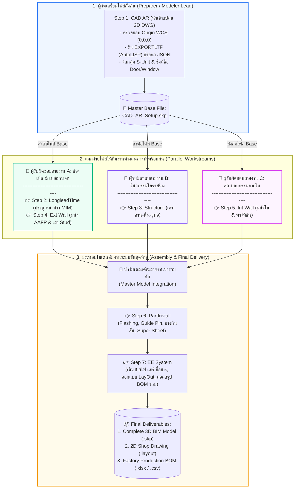
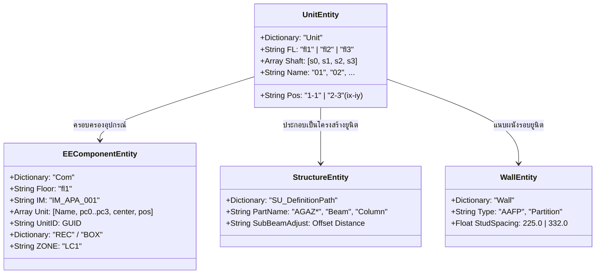

# 🏗️ QHeim Modular BIM System - คู่มือระบบและเอกสารส่งมอบงานฉบับสมบูรณ์ (Master Manual & Handover Guide)

> **🎯 เป้าหมายของเอกสารชุดนี้:**  
> เอกสารชุดนี้ถูกรวบรวมและจัดทำขึ้นเพื่อเป็น **Single Source of Truth** สำหรับระบบโปรแกรมส่วนขยาย **QHeim (SketchUp Ruby Extension & AutoCAD Automation)**:
> 1. 🔰 **สำหรับพนักงานใหม่ (Onboarding Guide):** เริ่มต้นเรียนรู้ตั้งแต่ศูนย์ เข้าใจคอนเซปต์ Modular House, การเตรียมสภาพแวดล้อม, ขั้นตอนการทำงานจริง และ**การแบ่งหน้าที่ในทีมแบบคู่ขนาน (Parallel Workflow)**
> 2. ⚡ **สำหรับคนที่ลืม (Quick Reference & Operator Cheat Sheet):** รวบรวมกฎเหล็ก ลำดับการกดปุ่ม แถบเครื่องมือ และแนวทางแก้ไขปัญหาที่พบบ่อย (Troubleshooting) เปิดดูได้ทันทีไม่ต้องเสียเวลางม
> 3. 🏛️ **สำหรับส่งมอบงาน / สืบทอดสู่คนรุ่นหลัง (Handover & Architecture Guide):** เพื่อให้เมื่อผู้พัฒนางานเดิมสิ้นสุดวาระหรือลาออกไปแล้ว ทีมงานรุ่นถัดไปจะเข้าใจโครงสร้างโค้ด การจัดเก็บไฟล์ ฐานข้อมูล และสามารถดูแล บำรุงรักษา หรือพัฒนาต่อยอดฟังก์ชันใหม่ได้อย่างมั่นคง ปลอดภัย และยั่งยืน

🌐 **เข้าชมคู่มือรูปแบบเว็บไซต์ (GitHub Pages):**  
👉 **[https://suteechu.github.io/manual-QHeim/](https://suteechu.github.io/manual-QHeim/)**

---

## 📑 สารบัญหลัก (Table of Contents)

1. [ภาพรวม 7 ลำดับขั้นตอนหลัก (7 Standard Steps Overview)](#1-ภาพรวม-7-ลำดับขั้นตอนหลัก-7-standard-steps-overview)
2. [👥 การแบ่งสายงานในทีมแบบคู่ขนาน (Multi-User Collaborative & Parallel Workflow)](#2--การแบ่งสายงานในทีมแบบคู่ขนาน-multi-user-collaborative--parallel-workflow)
3. [🔰 คู่มือสำหรับพนักงานใหม่ (Onboarding & Getting Started Guide)](#3--คู่มือสำหรับพนักงานใหม่-onboarding--getting-started-guide)
4. [⚡ คู่มือสำหรับคนที่ลืม (Quick Reference & Operator Cheat Sheet)](#4--คู่มือสำหรับคนที่ลืม-quick-reference--operator-cheat-sheet)
5. [🏛️ เอกสารส่งมอบงานและสถาปัตยกรรมระบบสำหรับนักพัฒนา (Handover & Developer Architecture)](#5-️-เอกสารส่งมอบงานและสถาปัตยกรรมระบบสำหรับนักพัฒนา-handover--developer-architecture)
6. [📚 สารบัญคู่มือเจาะลึก 7 ระบบหลัก (System Modules Catalog)](#6--สารบัญคู่มือเจาะลึก-7-ระบบหลัก-system-modules-catalog)
7. [🛠️ แนวทางการพัฒนาต่อยอดและการบำรุงรักษา (Future Roadmap & Maintenance)](#7-️-แนวทางการพัฒนาต่อยอดและการบำรุงรักษา-future-roadmap--maintenance)

---

## 1. ภาพรวม 7 ลำดับขั้นตอนหลัก (7 Standard Steps Overview)

ระบบ QHeim เรียงลำดับสายการทำงานตั้งแต่แบบสถาปัตยกรรม 2D จนถึงแบบ 2D Shop Drawing และการถอดประกอบวัสดุ (BOM) เป็น 7 ขั้นตอนมาตรฐาน:

| ขั้นตอน (Step) | ระบบงาน (Module) | รายละเอียดหน้าที่ | ลิงก์คู่มือฉบับเต็ม (Web HTML / Markdown) |
| :---: | :--- | :--- | :---: |
| **Step 1** | **CAD AR** | นำเข้าแปลน 2D DWG, Text JSON, จัดกลุ่ม `S-Unit`, ตั้งชื่อประตู-หน้าต่าง | [🌐 Web HTML](https://suteechu.github.io/manual-QHeim/CAD_AR_Doc.html) &bull; [📄 Markdown](CAD_AR_Doc.md) |
| **Step 2** | **Longlead** | สร้างโมเดลประตู-หน้าต่าง 3D, ถอดรหัส MIM, สรุป BOM สั่งผลิตล่วงหน้า | [🌐 Web HTML](https://suteechu.github.io/manual-QHeim/LongleadTime_Doc.html) &bull; [📄 Markdown](LongleadTime_Doc.md) |
| **Step 3** | **Structure** | เสา, คาน, ตง, พื้น Smartboard, รูท่อ (BR/FS/CS/AC), ชาร์ป, Ceiling Joint | [🌐 Web HTML](https://suteechu.github.io/manual-QHeim/Struc_Doc.html) &bull; [📄 Markdown](Struc_Doc.md) |
| **Step 4** | **Ext Wall** | ผนังภายนอก AAFP, เสา Stud, เสามุม Corner, เสา Window Set, กันซึม C3 | [🌐 Web HTML](https://suteechu.github.io/manual-QHeim/ExteriorWall_Doc.html) &bull; [📄 Markdown](ExteriorWall_Doc.md) |
| **Step 5** | **Int Wall** | ผนังภายในและพาร์ทิชันแบ่งห้อง, เสากรอบช่องเปิด, บล็อกปิดรอยต่อ | [🌐 Web HTML](https://suteechu.github.io/manual-QHeim/InteriorWall_Doc.html) &bull; [📄 Markdown](InteriorWall_Doc.md) |
| **Step 6** | **PartInstall** | ติดตั้ง Flashing กันน้ำ, Guide Pin, ยางกันสั่น, รหัสทิศทางโมดูลาร์ 01-12 | [🌐 Web HTML](https://suteechu.github.io/manual-QHeim/PartInstall_Doc.html) &bull; [📄 Markdown](PartInstall_Doc.md) |
| **Step 7** | **EE System** | ระบบไฟฟ้าแสงสว่าง, เต้ารับ, แอร์ CDU/FCU, สื่อสาร COMMU, LayOut, BOM | [🌐 Web HTML](https://suteechu.github.io/manual-QHeim/EE_Doc.html) &bull; [📄 Markdown](EE_Doc.md) |

---

## 2. 👥 การแบ่งสายงานในทีมแบบคู่ขนาน (Multi-User Collaborative & Parallel Workflow)

ในสภาพแวดล้อมการทำงานจริงของโรงงานและทีมวิศวกรรม SCG HEIM **โปรเจกต์ไม่ได้ทำทีละขั้นตอนโดยคนๆ เดียวตั้งแต่ต้นจนจบ** แต่จะมีการแบ่งบทบาทหน้าที่การทำงานร่วมกันเป็นทีม (Team Collaboration) ดังนี้:

### 2.1 แผนผังการกระจายงานในทีม (Parallel Task Distribution Flowchart)



---

### 2.2 รายละเอียดหน้าที่ประจำแต่ละบทบาทในทีม

#### 1) 🧑‍💻 ผู้จัดเตรียมไฟล์ตั้งต้น (Step 1 Master Preparer)
* **ใครทำ:** หัวหน้าทีม หรือโมเดลเลอร์ผู้เชี่ยวชาญการเตรียมไฟล์ CAD
* **สิ่งที่ต้องส่งมอบ:** ไฟล์โมเดล SketchUp ตั้งต้น (`Master_Base.skp`) ที่ผ่านการรัน:
  1. `Import CAD Original`
  2. `Unit Number` (ลงเลเยอร์ `S-Unit` ครบถ้วน)
  3. `Door Window Name` (จับคู่ชื่อบานและทิศทาง `_L`/`_R` เรียบร้อย)
* **ความสำคัญ:** ถ้าขั้นตอนนี้ผิดพลาด หรือ Origin เลื่อน ทุกคนที่นำไฟล์ไปทำต่อจะผิดพลาดทั้งหมด

#### 2) 👷 คนที่ทำ Step 2 (Longlead) ควบคู่กับ Step 4 (Ext Wall)
* **ทำไมถึงควบคู่กัน:** ประตู-หน้าต่าง และผนังภายนอก AAFP มีความสัมพันธ์กันโดยตรง เสาข้างช่องเปิด (`Window Set`) ของผนังภายนอกต้องอ้างอิงตำแหน่งและขนาดของกรอบประตู-หน้าต่างจาก Longlead
* **ผลลัพธ์ที่ได้:**
  * โมเดลประตู-หน้าต่าง 3D พร้อมรหัส MIM สั่งซื้อล่วงหน้า
  * เสา Stud, เสามุม Corner, แผ่นผนัง AAFP และระบบกันซึม C3 รอบตัวบ้าน

#### 3) 👷 คนที่ทำ Step 3 (Structure)
* **หน้าที่หลัก:** สร้างโครงสร้างหลักของบ้านโมดูลาร์: เสาเหล็กกล่อง, คาน Main Beam, คานซอย Sub-Beam, แผ่นพื้น Smartboard, ดรอปพื้นห้องน้ำ (Bathroom), ช่องเปิดบันได (Stair), ช่องเปิดโล่ง (Void), ชานเข้าบ้าน (Entrance)
* **ขั้นตอนสำคัญ:** เจาะรูท่อ Service Hole (BR/FS/CS/AC) ให้คานขยับหลบแนวท่อ &rarr; ติดตั้ง Ceiling Joint &rarr; ตรวจสอบ QTO Check Data

#### 4) 👷 คนที่ทำ Step 5 (Int Wall)
* **หน้าที่หลัก:** วางแนวผนังพาร์ทิชันภายในอาคารตามฟังก์ชันห้อง, ติดตั้งเสากรอบช่องเปิดประตู-หน้าต่างภายใน, และวางบล็อกปิดรอยต่อระหว่างยูนิตกล่องโมดูลาร์

#### 5) 👷 คนที่ทำ Step 6 (PartInstall) และ Step 7 (EE System)
* **หน้าที่หลัก:** เมื่อนำงานโครงสร้างและผนังมารวมกัน ช่างหรือวิศวกรระบบจะเข้ามาดำเนินการ:
  * ติดตั้งอุปกรณ์ยึดและกันน้ำรอยต่อ (Flashing, Guide Pin, Antivibration Rubber)
  * รันคำสั่ง Shaft และ Floor Area
  * เดินสายไฟฟ้ากำลัง, สวิตช์, แอร์, และสายสัญญาณสื่อสาร
  * ส่งออก Shop Drawing A3 ไปยัง Trimble LayOut และส่งออกยอดวัสดุเข้าสู่ระบบผลิตโรงงาน

---

## 3. 🔰 คู่มือสำหรับพนักงานใหม่ (Onboarding & Getting Started Guide)

ยินดีต้อนรับสู่ทีมงาน QHeim! หากคุณเพิ่งเริ่มเข้ามาร่วมงาน กรุณาทำตามขั้นตอนต่อไปนี้ตามลำดับ:

### 3.1 สิ่งที่ต้องเตรียมและติดตั้งในเครื่องคอมพิวเตอร์ (Prerequisites)
1. **Windows 10 หรือ Windows 11 (64-bit)**
2. **AutoCAD (เวอร์ชัน 2020 ขึ้นไป):** ต้องเปิดใช้งาน Visual LISP / ActiveX ได้
3. **Trimble SketchUp Pro (เวอร์ชัน 2021 ขึ้นไป):** แนะนำเวอร์ชันที่รองรับ Ruby 2.7+ (เช่น SketchUp 2022-2024)
4. **Microsoft Excel:** สำหรับเปิดไฟล์คำนวณและตรวจสอบ BOM
5. **โปรแกรมส่วนขยาย QHeim:**
   * นำโฟลเดอร์หลักไปวางไว้ที่ `C:\QHeim\` (ห้ามเปลี่ยนไดรฟ์หรือชื่อโฟลเดอร์เด็ดขาด)
   * นำ `C:\QHeim\Setup\QHeim.rb` ไปใส่ในโฟลเดอร์ SketchUp Plugins:
     ```
     %AppData%\SketchUp\SketchUp 202X\SketchUp\Plugins     ```
   * เมื่อเปิด SketchUp จะปรากฏแถบเครื่องมือ QHeim Toolbar ทั้งหมด

### 3.2 โครงสร้างโฟลเดอร์โปรเจกต์งานที่ถูกต้อง
เพื่อป้องกันไฟล์สูญหายและให้ระบบส่งออก LayOut / BOM ทำงานได้ถูกต้องเสมอ:
```
D:_QHeim_Work └── [ชื่อโครงการ หรือ House ID]      ├── CAD\          <- เก็บไฟล์ 2D DWG ที่ผ่านการ Clean แล้ว
      ├── Model\        <- เก็บไฟล์ 3D SketchUp (.skp)
      ├── Output\       <- เก็บไฟล์ SKU.layout, File Upload.csv, Excel BOM
      └── Temp\         <- พักไฟล์ชั่วคราว
```

---

## 4. ⚡ คู่มือสำหรับคนที่ลืม (Quick Reference & Operator Cheat Sheet)

### ⚠️ 7 กฎเหล็กที่ห้ามทำผิดเด็ดขาด (Critical Golden Rules)

1. **พิกัดจุด Origin (0,0,0) ใน AutoCAD ต้องตรงกันทุกชั้น:**  
   หากพิกัดใน CAD เคลื่อน เมื่อนำเข้า SketchUp ด้วยตัวเลือก Preserve Origin โมเดลชั้น 1, 2, 3 จะไม่ซ้อนทับกัน
2. **ห้ามรันข้ามขั้นตอนในการนำเข้า CAD AR (Step 1):**  
   ต้องกดตามลำดับ: `Import CAD Original` $
ightarrow$ `Unit Number` $
ightarrow$ `Door Window Name` เท่านั้น
3. **ต้องเจาะรูท่อ (Hole SB) ก่อนรัน Ceiling Joint เสมอ (Step 3):**  
   หากมีคอมโพเนนต์ `AGAZ*` ค้างอยู่ในโมเดล ระบบ Hole SB จะถูกบล็อกทันทีเพื่อป้องกันคานขยับไม่ได้
4. **ต้องรันปุ่ม Shaft และ Floor Area ก่อนเริ่มเดินสายระบบ EE เสมอ (Step 7):**  
   เพื่อให้ระบบจำพิกัดกริดยูนิต `ix-iy` และทราบตำแหน่งช่องชาร์ป มิฉะนั้นสายไฟจะไม่ยอมวิ่ง
5. **ห้ามขยับหรือหมุนยูนิตหลังจากรัน Floor Area แล้ว:**  
   หากจำเป็นต้องย้ายยูนิต ต้องกดปุ่ม Floor Area ซ้ำใหม่ทุกครั้งเพื่ออัปเดต Attribute
6. **ปิดโปรแกรม Microsoft Excel ทุกครั้งก่อนกด Export BOM:**  
   หากไฟล์ Excel เช่น `Job Order.xlsx` ถูกเปิดค้างไว้ สคริปต์ Ruby จะเขียนทับไม่ได้และเกิดข้อผิดพลาด Permission Denied
7. **ห้าม Explode กรุ๊ปชั้นในของคอมโพเนนต์มาตรฐาน:**  
   คอมโพเนนต์ของ QHeim มีพจนานุกรม Attribute ซ่อนอยู่ภายใน การระเบิดกรุ๊ปจะทำให้ข้อมูล BOM สูญหาย

---

### 🔍 ตารางแก้ปัญหาด่วน (Troubleshooting Quick Fix)

| อาการที่พบบ่อย | สาเหตุ | วิธีแก้ปัญหาทันที |
| :--- | :--- | :--- |
| **นำเข้า DWG แล้วไม่มีตัวหนังสือภาษาไทยขึ้น** | ไม่ได้รัน LISP ส่งออก `export-text.json` | เปิด AutoCAD รันคำสั่ง `EXPORTLTF` เลือกส่งออก Text ให้ได้ไฟล์ใน `C:/QHeim/DATA/` แล้วกดนำเข้าใหม่ |
| **กด Door Window Name แล้วชื่อไม่เปลี่ยน** | เลเยอร์ `S-Unit` ยังไม่ถูกสร้าง | ตรวจสอบว่าได้กดปุ่ม `Unit Number` ก่อนหรือไม่ หากยัง ให้กด Unit Number ให้เสร็จก่อน |
| **เจาะรูท่อ Hole SB แล้วระบบฟ้องเตือนสีแดง** | มีชิ้นส่วน Ceiling Joint ค้างอยู่ในโมเดล | ซ่อนหรือลบ Ceiling Joint ชั่วคราว ทำการเจาะรูท่อให้เสร็จเรียบร้อย แล้วจึงค่อยรัน Ceiling Joint ใหม่อีกครั้ง |
| **สายไฟ EE ฟ้องเตือน "Please Set FloorArea"** | ยังไม่ได้กำหนดชั้นและพิกัดยูนิต | ลากครอบโมเดลของชั้นนั้น กดไอคอน **Floor Area** เลือก `fl1`/`fl2`/`fl3` รอขึ้น OK แล้วเริ่มเดินสาย |
| **สายไฟ EE ขึ้นเตือน "cannot find route"** | กล่องโมดูลาร์วางไม่แนบสนิท หรือช่องชาร์ปถูกปิด | เช็คระยะห่างระหว่างยูนิตให้ชิดกันสนิท และตรวจสอบว่าไม่มีวัตถุอื่นบังหน้าช่องชาร์ป |
| **ส่งออก BOM แล้วโปรแกรมค้าง** | เปิดไฟล์ Excel ค้างอยู่ในเครื่อง | ปิดโปรแกรม Excel ทั้งหมด แล้วกลับมากดปุ่ม Export BOM ใหม่อีกครั้ง |
| **ส่งออก LayOut แล้วหน้ากระดาษว่างเปล่า** | ยังไม่ได้สร้าง Scene ใน SketchUp | กดไอคอน **Scene** ใน Toolbar Layout เพื่อสร้างแท็บ FL1-FL3 ก่อน แล้วจึงกดปุ่ม Layout |

---

## 5. 🏛️ เอกสารส่งมอบงานและสถาปัตยกรรมระบบสำหรับนักพัฒนา (Handover & Developer Architecture)

> 📌 **บันทึกสำหรับผู้สืบทอดงาน (To Future Maintainers):**  
> หากผม (ผู้พัฒนางานเดิม) ลาออกไปแล้ว ข้อมูลในส่วนนี้คือพิมพ์เขียว (Blueprint) ทั้งหมดของระบบ เพื่อให้คุณสามารถอ่านโค้ด แก้ไขบั๊ก และพัฒนาฟีเจอร์ใหม่ได้อย่างถูกต้องโดยไม่ต้องเริ่มต้นใหม่จากศูนย์

### 5.1 แผนผังโครงสร้างโฟลเดอร์หลัก (`C:\QHeim\`)

```
C:\QHeim├── AutoLISP_ExportLTF\   # สคริปต์ AutoLISP/DCL ฝั่ง AutoCAD (ExportLTF.lsp, ExportLTF.dcl)
├── Comp\                 # คลัง 3D Components ชิ้นส่วนมาตรฐานสำเร็จรูป (.skp)
│   ├── EE\               # คอมโพเนนต์งานระบบไฟฟ้า เช่น shaftbox.skp, ตู้ LC
│   └── PartInstall\      # คอมโพเนนต์ Flashing, Guide Pin, Antivibration Rubber
├── Config\               # ค่าคอนฟิกูเรชันของระบบ
├── DATA\                 # คลัง Master Data, ฐานข้อมูล Excel, และโฟลเดอร์รับส่ง JSON
│   ├── export-text.json  # ไฟล์ JSON แลกเปลี่ยนตัวหนังสือระหว่าง AutoCAD และ SketchUp
│   ├── Data MIM&IM*.xlsx # ฐานข้อมูลรหัสวัสดุและอุปกรณ์มาตรฐานโรงงาน
│   ├── New-A3.layout     # เทมเพลตมาตรฐานสำหรับสร้างแบบ LayOut A3
│   └── *.skp             # ไฟล์ต้นแบบชิ้นส่วนโครงสร้าง (ST Component, Installation Part)
├── EXTERIOR-WALL\        # คลังแผ่นผนังภายนอกและเสา
├── ICON\                 # คลังรูปภาพไอคอนสำหรับปุ่มเมนูและ Toolbar ทั้งหมด (.jpg, .png)
├── Longleadtime\         # ฐานข้อมูลและคอมโพเนนต์ประตู-หน้าต่างสั่งผลิตล่วงหน้า
├── manual\               # ศูนย์รวมคู่มือและเอกสารการทำงานระบบทั้งหมด (Repository นี้)
├── Mat\                  # ไฟล์ Materials และ Textures สำหรับพื้นผิว
├── Ruby\                 # ซอร์สโค้ดภาษา Ruby ทั้งหมดของ Extension (หัวใจหลักของระบบ)
│   ├── CADLTF\           # โมดูลนำเข้าแบบ CAD, JSON Parser, เปลี่ยนชื่อประตู-หน้าต่าง
│   ├── EE\               # โมดูลระบบไฟฟ้า, แอร์, สื่อสาร, Pathfinding, LayOut, BOM EE
│   │   ├── AC\           # สคริปต์ระบบแอร์และอุปกรณ์กำลัง
│   │   ├── Layout\       # สคริปต์สร้าง Single-line และส่งออก LayOut
│   │   └── Light\        # สคริปต์ระบบแสงสว่าง สวิตช์ เต้ารับ มาร์กเกอร์สี
│   ├── Exterior\ & STD\  # โมดูลระบบผนังภายนอก เสา Stud เสามุม Corner
│   ├── Heim_C3Wall\      # โมดูลระบบผนังกันซึม C3
│   ├── Interior\         # โมดูลระบบผนังภายในและพาร์ทิชัน
│   ├── LongleadTime\     # โมดูลระบบประตู-หน้าต่าง 3D และถอดรหัส MIM
│   ├── Struc\            # โมดูลโครงสร้างโมดูลาร์ เสา คาน พื้น รูท่อ
│   ├── Switch\           # โมดูลสวิตช์และชิ้นส่วนเสริม
│   └── *.rb, *.html      # สคริปต์ Controller และหน้าต่าง Dialog หลัก
└── Setup\                # สคริปต์ติดตั้งระบบ และไฟล์ acad.lsp
```

### 5.2 สถาปัตยกรรมโค้ดและการไหลของข้อมูล (Data Architecture & Attribute Schema)



---

## 6. 📚 สารบัญคู่มือเจาะลึก 7 ระบบหลัก (System Modules Catalog)

คลิกที่ชื่อระบบเพื่อเปิดอ่านคู่มือฉบับเต็ม ทั้งในรูปแบบ Web HTML บน GitHub Pages และไฟล์ Markdown:

| ลำดับ (Step) | ระบบย่อย (Subsystem) | รายละเอียดและขอบเขตการทำงาน | ลิงก์ Web HTML (GitHub Pages) | ลิงก์ Markdown |
| :---: | :--- | :--- | :---: | :---: |
| **Step 1** | **CAD AR** | การเตรียมไฟล์ AutoCAD 2D DWG, การส่งออก Text JSON, การนำเข้าแบบพิกัดเดิม (Preserve Origin), การจัดกลุ่ม `S-Unit`, และการเปลี่ยนชื่อบล็อกช่องเปิดประตู-หน้าต่างอัตโนมัติ | [🌐 CAD_AR_Doc.html](https://suteechu.github.io/manual-QHeim/CAD_AR_Doc.html) | [CAD_AR_Doc.md](CAD_AR_Doc.md) |
| **Step 2** | **Longlead** | ระบบสร้างโมเดลบานประตูและหน้าต่าง 3D, การจับคู่ชื่อแปลนกับรหัส MIM, และการถอดสรุปรายการวัสดุสำหรับสั่งผลิตล่วงหน้า | [🌐 LongleadTime_Doc.html](https://suteechu.github.io/manual-QHeim/LongleadTime_Doc.html) | [LongleadTime_Doc.md](LongleadTime_Doc.md) |
| **Step 3** | **Structure** | ระบบสร้างโครงสร้างโมดูลาร์ 3D (ชั้น 1-3), ปรับระดับพื้น Smartboard, งานระบบห้องน้ำ-บันได-Void-ทางเข้า, งานเจาะท่อ Service Hole (BR/FS/CS/AC), ชิ้นส่วนพิเศษ Setback/Turnbuckle, ข้อต่อเพดาน Ceiling Joint, และการถอด BOM | [🌐 Struc_Doc.html](https://suteechu.github.io/manual-QHeim/Struc_Doc.html) | [Struc_Doc.md](Struc_Doc.md) |
| **Step 4** | **Ext Wall** | ระบบผนังภายนอกสำเร็จรูป AAFP, เสา Stud, เสามุม Corner, เสา Window Set, ระบบกันซึม C3, ระบบตรวจสอบระยะเสา 225/332 มม. อัตโนมัติ, และการถอดรายการวัสดุ | [🌐 ExteriorWall_Doc.html](https://suteechu.github.io/manual-QHeim/ExteriorWall_Doc.html) | [ExteriorWall_Doc.md](ExteriorWall_Doc.md) |
| **Step 5** | **Int Wall** | ระบบผนังภายในและพาร์ทิชันแบ่งห้อง, เสากรอบช่องเปิด, บล็อกปิดรอยต่อระหว่างยูนิต, และการคำนวณถอดแบบโครงคร่าว | [🌐 InteriorWall_Doc.html](https://suteechu.github.io/manual-QHeim/InteriorWall_Doc.html) | [InteriorWall_Doc.md](InteriorWall_Doc.md) |
| **Step 6** | **PartInstall** | ระบบชิ้นส่วนติดตั้งและตัวยึด, Flashing, Guide Pin, ยางกันสั่น Antivibration Rubber, Super Sheet, และการคำนวณรหัสทิศทางโมดูลาร์ 01-12 | [🌐 PartInstall_Doc.html](https://suteechu.github.io/manual-QHeim/PartInstall_Doc.html) | [PartInstall_Doc.md](PartInstall_Doc.md) |
| **Step 7** | **EE System** | ระบบไฟฟ้าแสงสว่าง, เต้ารับ, สวิตช์ 1-3 ทาง, ระบบแอร์ CDU/FCU, ระบบสื่อสาร LAN/TV/CCTV/Aiphone, อัลกอริทึม Pathfinding, การสร้างผัง Single-line Loop, ส่งออก LayOut 2D, และการสรุป BOM | [🌐 EE_Doc.html](https://suteechu.github.io/manual-QHeim/EE_Doc.html) | [EE_Doc.md](EE_Doc.md) |

---

## 7. 🛠️ แนวทางการพัฒนาต่อยอดและการบำรุงรักษา (Future Roadmap & Maintenance)

สำหรับทีมงานรุ่นหลังที่ต้องการปรับปรุง พัฒนา หรือขยายขีดความสามารถของระบบ QHeim:

1. **การเปลี่ยนผ่านจาก AutoCAD VBA สู่ Pure AutoLISP:**  
   สคริปต์ใน `AutoLISP_ExportLTF/` ถูกพัฒนาขึ้นเพื่อทดแทน VBA DVB เดิม เพื่อให้สามารถทำงานบน AutoCAD เวอร์ชันใหม่ๆ (รวมถึงระบบที่ปิดกั้น VBA) ได้อย่างราบรื่น ควรทดสอบและย้ายมาใช้ `ExportLTF.lsp` เป็นหลัก
2. **การอัปเดตรหัสชิ้นส่วนและราคา (Master Data Updates):**  
   เมื่อมีการเปลี่ยนแปลงสเปกวัสดุหรือรหัสสินค้าในโรงงาน ให้อัปเดตที่ตาราง `C:/QHeim/DATA/Data MIM&IM - Component Block.xlsx` ระบบถอด BOM จะดึงข้อมูลล่าสุดไปใช้โดยอัตโนมัติ
3. **การเชื่อมต่อ API ตรงกับระบบ ERP:**  
   ปัจจุบันระบบสร้างไฟล์ `File Upload.csv` เพื่อให้นำไปอัปโหลดแบบ Manual ในอนาคตสามารถพัฒนาโมดูล Ruby ด้วย `Net::HTTP` หรือ REST API เพื่อยิงข้อมูลเข้าสู่ระบบ SAP หรือ MES ของโรงงานได้โดยตรงแบบอัตโนมัติ
4. **การรองรับ SketchUp เวอร์ชันใหม่ในอนาคต:**  
   ตรวจสอบการเปลี่ยนแปลงของ SketchUp Ruby API ในแต่ละปี โดยเฉพาะส่วนของ `Geom::Transformation` และ `Layout::Document` เมื่ออัปเกรดเวอร์ชัน SketchUp ให้ทดสอบการสร้าง Viewport ในไฟล์ LayOut เป็นลำดับแรก

---

> 🏢 **จัดทำโดย:** ทีมพัฒนาระบบ QHeim Automation & BIM Modular Construction  
> 🔗 **Repository:** [https://github.com/suteechu/manual-QHeim.git](https://github.com/suteechu/manual-QHeim.git)  
> 🌐 **Web Documentation:** [https://suteechu.github.io/manual-QHeim/](https://suteechu.github.io/manual-QHeim/)  
> 📅 **ปรับปรุงล่าสุด:** ตุลาคม 2026
