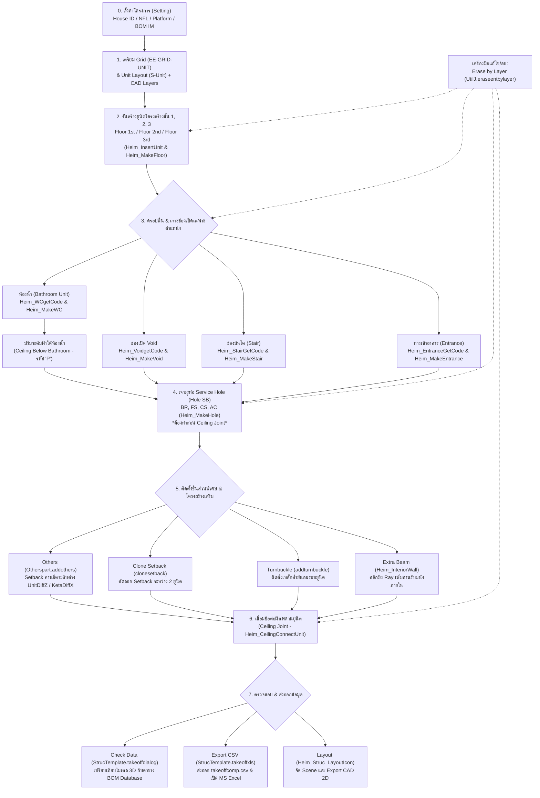
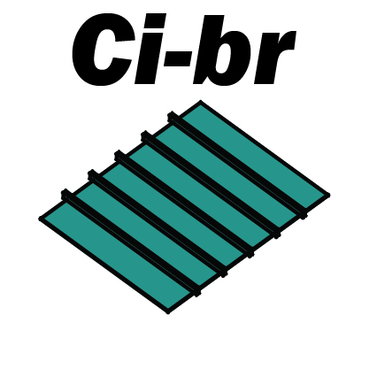
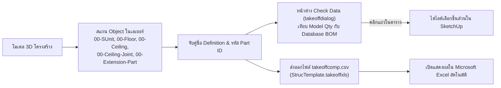

# คู่มือและเอกสารการทำงานระบบ Struc (QHeim)

เอกสารฉบับนี้จัดทำขึ้นเพื่ออธิบายหลักการทำงาน, สถาปัตยกรรมโค้ด (Code Architecture), ตรรกะการคำนวณ (Business Logic), โครงสร้างเลเยอร์ (Layers), กระบวนการสร้างและดรอปพื้นยูนิตโมดูลาร์สำเร็จรูป (Modular Units), การจัดการงานระบบสุขาภิบาล/ท่อ (Plumbing/Piping Holes), การติดตั้งชิ้นส่วนข้อต่อยึดโครงสร้าง (Ceiling Joints, Turnbuckles, Setbacks), ระบบเปรียบเทียบโมเดลกับฐานข้อมูล (QTO Check Data), และการส่งออกรายการถอดแบบวัสดุ (BOM) ของระบบ **Structure (Struc)** ในส่วนขยาย **QHeim (SketchUp Ruby Extension)**

---

## 1. ภาพรวมระบบ (System Overview)

ระบบ **Structure (Struc)** เป็นระบบแกนหลัก (Core Engine) ของ QHeim ทำหน้าที่สร้างโมเดลโครงสร้าง 3D ของอาคารโมดูลาร์เหล็กสำเร็จรูป (Modular Steel Construction) จากแปลน 2D CAD โดยทำการแปลง Unit Grid ให้กลายเป็นยูนิต 3D ที่สมบูรณ์ ครอบคลุมโครงสร้างเสา-คาน (Column/Beam), คานซอยรับพื้น (Floor Sub-Beams), แผ่นพื้น Smartboard, โครงฝ้าเพดาน (Ceiling Trusses/Joists), พื้นดรอปห้องน้ำ (Bathroom Drop Floor), ช่องเปิดบันได (Stairwells), ช่องเปิด Void, ทางเข้าบ้าน (Entrance Drops), รูเจาะงานระบบท่อ (Service Holes: BR, FS, CS, AC), อุปกรณ์ยึดรอยต่อพิเศษ (Turnbuckles, Setbacks), แผ่นข้อต่อเพดาน (Ceiling Joints), ไปจนถึงการตรวจสอบปริมาณงานและการส่งออกไฟล์ BOM

### แผนผังลำดับขั้นตอนการทำงาน (Workflow Lifecycle)

> [!IMPORTANT]
> **กฎเหล็กและข้อกำหนดสำคัญที่สุดในการทำงาน:**
> 1. **ต้องตั้งค่า Model Parameters ก่อนเสมอ:** กดปุ่ม **Setting** (หรือ `StrucTemplate.strsetting`) เพื่อกำหนด `House ID`, `Floor Total (NFL)`, `Platform`, และรหัส `House BOM IM` มิฉะนั้นระบบจะไม่สามารถส่งออกข้อมูล BOM ได้
> 2. **ลำดับการเจาะ Hole และใส่ Ceiling Joint:** **ห้ามใส่ Ceiling Joint ก่อนเจาะรู Hole** เด็ดขาด หากมีคอมโพเนนต์ Ceiling Joint (`AGAZ*`) อยู่ในโมเดล ระบบ `MakeHole` จะบล็อกการทำงานและขึ้นแจ้งเตือนให้ลบ Ceiling Joint ออกก่อนเสมอ
> 3. **เลเยอร์ตั้งต้นในโมเดล:** ต้องมีกริดอาคารในเลเยอร์ `EE-GRID-UNIT`, มีกล่องขอบเขตยูนิตในเลเยอร์ `S-Unit`, และแบบแปลนเส้น CAD 2D อยู่ในเลเยอร์มาตรฐาน (`A-WALL`, `A-DOOR`, `A-WIND`, `AR-DIM`, `SN-DIMENSION`, `E-EQPM`, `AC-PIPE` ฯลฯ)

---

## 2. หน้าต่างเมนูควบคุม (UI Controller)

แถบเครื่องมือหลักของระบบ Structure ทำงานผ่านไดอะล็อกแถบเครื่องมือ HTML:
* **Ruby Controller:** [Heim_StructureIcon.rb](file:///C:/QHeim/Ruby/Heim_StructureIcon.rb)
* **HTML Dialog View:** [Heim_Structure.html](file:///C:/QHeim/Ruby/Heim_Structure.html)
* **Template & Database Core:** [Heim_LoadComp.rb](file:///C:/QHeim/Ruby/Struc/Heim_LoadComp.rb)

### รายการไอคอนและฟังก์ชันเรียกใช้งาน (18 ไอคอน)

| ไอคอน | ชื่อคำสั่ง (Tool Title) | Action / Script ที่เรียกใช้ | หน้าที่หลัก |
| :---: | :--- | :--- | :--- |
|  | **Floor 1st** | `Heim_InsertUnit.new("FL1")` | สร้างโครงสร้าง 3D ยูนิตชั้น 1 พร้อมวิเคราะห์ทิศทาง 01-12 |
|  | **Floor 2nd** | `Heim_InsertUnit.new("FL2")` | สร้างโครงสร้าง 3D ยูนิตชั้น 2 และใส่ Joint ต่อช่วง U63 |
|  | **Floor 3rd** | `Heim_InsertUnit.new("FL3")` | สร้างโครงสร้าง 3D ยูนิตชั้น 3 |
|  | **Bathroom** | `Heim_WCgetCode.new` &rarr; `MakeWC` | เปลี่ยนยูนิตปกติเป็นยูนิตห้องน้ำ ดรอปพื้น เสริม Double Board |
|  | **Void** | `Heim_VoidgetCode.new` &rarr; `MakeVoid` | เจาะช่องเปิด Void บนพื้นและฝ้าเพดาน พร้อมวางคานซอยรอบช่อง |
|  | **Stair** | `Heim_StairGetCode.new` &rarr; `MakeStair` | เจาะช่องเปิดบันไดตามโมเดลบันได C22-C45 / U24-U36 |
|  | **Entrance** | `Heim_EntranceGetCode.new` &rarr; `MakeEntrance` | ดรอปพื้นทางเข้าบ้าน Keta/Tsuma ตามขนาดและตำแหน่งประตู |
|  | **Ceiling below BR** | `MakeWC.genceilingunderbathroom` | ปรับระดับโครงฝ้าเพดานของห้องด้านล่างห้องน้ำ (รหัส `P`) |
|  | **Hole SB** | `MakeHole.new` | เจาะรูท่อบน Smartboard (BR, FS, CS, AC) พร้อมขยับหลบคานซอย |
|  | **Others** | `Otherspart.addothers` | สร้างชิ้นส่วน Setback รับระดับต่าง UnitDiffZ และ KetaDiffX |
|  | **SetBack** | `Otherspart.clonesetback` | คัดลอกชิ้นส่วน Setback จากยูนิตต้นทางไปยังยูนิตปลายทาง |
|  | **TurnBuckle** | `Otherspart.addturnbuckle` | ติดตั้งเหล็กค้ำยันลม Turnbuckle (`ABL*`) ที่ระดับเสาด้านบน |
|  | **Extra Beam** | `Heim_InteriorWall.new` | คลิกบนแปลนเพื่อยิงลำแสงตรวจหาระยะและสร้างคานเสริมรับผนัง |
|  | **Ceiling Joint** | `Heim_CeilingConnectUnit.new` | ตรวจจับรอยต่อยูนิต Keta/Tsuma และติดตั้งข้อต่อฝ้าเพดาน `AGAZ*` |
|  | **Check Data** | `StrucTemplate.takeoffdialog` | เปิดหน้าต่างเปรียบเทียบชิ้นส่วนในโมเดลกับฐานข้อมูล Heim BOM |
|  | **Export CSV** | `StrucTemplate.takeoffxls` | ส่งออก BOM โครงสร้างลงไฟล์ `takeoffcomp.csv` และเปิด Excel |
|  | **Erase by Layer** | `UtilJ.eraseentbylayer` | เลือกลบคอมโพเนนต์/กลุ่มลูกภายในยูนิตตามเลเยอร์ที่กำหนด |
|  | **Layout** | `Heim_Struc_LayoutIcon.new` | เปิดแถบเครื่องมือเขียนแบบและจัด Scene งานโครงสร้าง 2D |

---

## 3. คู่มือขั้นตอนการกดใช้งานแต่ละไอคอน (SOP สำหรับคนทำงาน)

### 📌 สรุปขั้นตอนหลักตามลำดับมาตรฐาน (Standard Operating Procedure):
1. **เตรียมไฟล์ & ตั้งค่าโครงการ:** รันคำสั่ง `Setting` (ผ่านเมนูหลักหรือเปิดไดอะล็อก) กำหนด House ID, Floor Total (NFL), และ Platform
2. **สร้างยูนิตโครงสร้างทีละชั้น:** ครอบยูนิตของชั้นนั้นใน `S-Unit` &rarr; กดปุ่ม **Floor 1st**, **Floor 2nd**, หรือ **Floor 3rd**
3. **ปรับแต่งพื้นที่การใช้งานพิเศษ:**
   * เลือกยูนิตห้องน้ำ &rarr; กด **Bathroom** &rarr; เลือกสเปกในหน้าต่าง
   * ปรับระดับฝ้าใต้ห้องน้ำ &rarr; เลือกยูนิตชั้นล่าง &rarr; กด **Ceiling below BR**
   * เลือกยูนิตบันได &rarr; กด **Stair** &rarr; เลือกรูปแบบบันได
   * เลือกยูนิต Void &rarr; กด **Void** &rarr; เลือกรหัสและตำแหน่ง
   * เลือกยูนิตทางเข้า &rarr; กด **Entrance** &rarr; เลือกขนาดประตูและทิศทาง
4. **เจาะรูงานระบบท่อ:** กดปุ่ม **Hole SB** เพื่อเจาะรู Smartboard สำหรับท่อสุขาภิบาล, ไฟฟ้า, และแอร์
5. **ใส่อุปกรณ์ยึดและโครงสร้างเสริม:** กด **Others**, **TurnBuckle**, หรือ **Extra Beam** ตามแบบก่อสร้าง
6. **เชื่อมข้อต่อฝ้าเพดาน:** กดปุ่ม **Ceiling Joint** เพื่อผูกข้อต่อระหว่างยูนิตทั้งชั้น
7. **ตรวจเช็คข้อมูล & ส่งออก BOM:** กด **Check Data** ตรวจความถูกต้อง &rarr; กด **Export CSV** เปิดดูรายการสรุปวัสดุใน Excel

---

### 📋 รายละเอียดการกดใช้งานทีละไอคอน:

#### 1. Floor 1st / Floor 2nd / Floor 3rd ([`Heim_InsertUnit.rb`](file:///C:/QHeim/Ruby/Struc/Heim_InsertUnit.rb))
* **การเลือกวัตถุ:** ลากเมาส์ครอบกลุ่ม Unit ทั้งหมดของชั้นในเลเยอร์ `S-Unit` พร้อมทั้งเปิดเลเยอร์ CAD 2D ไว้อ้างอิง
* **การคลิก & ตั้งค่า:** กดไอคอน **Floor 1st**, **Floor 2nd**, หรือ **Floor 3rd** ให้ตรงกับชั้นที่กำลังทำ
* **ผลลัพธ์ในโมเดล:**
  * รวบรวม Entity CAD ของชั้นนั้นแยกเป็นกลุ่ม `wallgroup-fl*`, `fscsgroup-fl*`, `wcgroup-fl*`
  * ยิง Raytest 4 ทิศ วิเคราะห์เพื่อนบ้าน กำหนด Direction Code `01` ถึง `12`
  * โหลดชุดประกอบโมดูลาร์ `08_U36`, `08_U45`, `08_U54`, `08_U59`, หรือ `08_U63` วางลงในตำแหน่ง
  * ปรับแต่งขอบแผ่นพื้น Smartboard (`ABD*`), คานซอย Sub-beam (`AABI*`), และเหล็กรางตัวยู (`AAD*`) ตามแนวขอบนอกอาคาร
  * หากเป็นชั้น 1-2 ที่มีชั้นบนซ้อนทับ และมียูนิต `U63` ต่อชนกัน จะติดตั้งชิ้นส่วน Joint ต่อยูนิต `AABP21000` ให้โดยอัตโนมัติ

#### 2. Bathroom Unit ([`Heim_WCgetCode.rb`](file:///C:/QHeim/Ruby/Struc/Heim_WCgetCode.rb) & [`Heim_MakeWC.rb`](file:///C:/QHeim/Ruby/Struc/Heim_MakeWC.rb))
* **การเลือกวัตถุ:** คลิกเลือก **Unit (00-SUnit)** บริเวณที่ต้องการทำเป็นห้องน้ำ 1 ยูนิต
* **การคลิก & ตั้งค่า:** กดปุ่ม **Bathroom** &rarr; หน้าต่าง **Select bathroom unit** จะปรากฏขึ้น:
  * เลือก **Floor Board Type:** `AD`, `BD`, หรือ `DD`
  * เลือก **Size:** เช่น `1822`, `1827`, `2215`, `2218`, `2222`, `2231`, `2236`, `2245`, `2254` (ระบุ T หรือ B)
  * เลือก **Position:** `0` (กึ่งกลาง) หรือ `L` (ชิดซ้าย)
  * เลือก **Double Board Thickness:** `18` มม. หรือ `25` มม. แล้วกดยืนยัน
* **ผลลัพธ์ในโมเดล:** แปลงพื้นยูนิตเดิมเป็นพื้นลดระดับ (Drop Floor), ปรับแนวคานซอย Sub-beam, เสริมแผ่น Smartboard สองชั้น (Double Board) รับน้ำหนักกระเบื้อง/สุขภัณฑ์ และเซ็ตฝ้าเพดานห้องน้ำ

#### 3. Ceiling Below Bathroom ([`Heim_MakeWC.rb`](file:///C:/QHeim/Ruby/Struc/Heim_MakeWC.rb#L1032))
* **การเลือกวัตถุ:** คลิกเลือกยูนิตชั้นล่างที่อยู่ **"ใต้ห้องน้ำ"** โดยตรง
* **การคลิก & ตั้งค่า:** กดไอคอน **Ceiling below BR**
* **ผลลัพธ์ในโมเดล:** แปลงชุดฝ้าเพดานของยูนิตนั้นให้มีรหัสกำกับตัวอักษร `P` (เช่น `AGA5FSDK01****1P**`) เพื่อดรอประดับแปฝ้าเพดาน ให้มีช่องว่างใต้ท้องคานเพียงพอสำหรับเดินท่อน้ำทิ้งและท่อโสโครกจากห้องน้ำชั้นบน

#### 4. Void ([`Heim_VoidgetCode.rb`](file:///C:/QHeim/Ruby/Struc/Heim_VoidgetCode.rb) & [`Heim_MakeVoid.rb`](file:///C:/QHeim/Ruby/Struc/Heim_MakeVoid.rb))
* **การเลือกวัตถุ:** คลิกเลือกยูนิตที่ต้องการเจาะช่องเปิด Void
* **การคลิก & ตั้งค่า:** กดไอคอน **Void** &rarr; หน้าต่าง **Select void type** จะปรากฏขึ้น:
  * เลือกขนาด Void: `2222` (`VFA`), `2227` (`VFB`), `2231` (`VFC`), `2236` (`VFD`), `2241` (`VFE`), หรือ `2245` (`VFF`)
  * เลือกตำแหน่ง: `0` หรือ `L` แล้วกดยืนยัน
* **ผลลัพธ์ในโมเดล:** เจาะทะลุพื้น Smartboard และฝ้าเพดาน พร้อมทั้งติดตั้งคานซอยรับแรงรอบขอบช่องเปิด Void (Trimmer Beams) ให้อัตโนมัติ

#### 5. Stair ([`Heim_StairGetCode.rb`](file:///C:/QHeim/Ruby/Struc/Heim_StairGetCode.rb) & [`Heim_MakeStair.rb`](file:///C:/QHeim/Ruby/Struc/Heim_MakeStair.rb))
* **การเลือกวัตถุ:** คลิกเลือกยูนิตโถงบันได
* **การคลิก & ตั้งค่า:** กดไอคอน **Stair** &rarr; เลือกโมเดลบันไดจากรูปภาพ (เช่น `C22`, `C27`, `C36`, `C45`, `U24`, `U29`, `U31`, `U36` รูปแบบ Edgeup L/R หรือ Middleup L/R) เลือกว่าจะเปิด Floor และ/หรือ Ceiling แล้วกดยืนยัน
* **ผลลัพธ์ในโมเดล:** เจาะช่องเปิดรับบันไดตามขนาดมาตรฐาน พร้อมติดตั้งคานและเหล็กยึดหัว-ท้ายบันได

#### 6. Entrance ([`Heim_EntranceGetCode.rb`](file:///C:/QHeim/Ruby/Struc/Heim_EntranceGetCode.rb) & [`Heim_MakeEntrance.rb`](file:///C:/QHeim/Ruby/Struc/Heim_MakeEntrance.rb))
* **การเลือกวัตถุ:** คลิกเลือกยูนิตทางเข้าหลักของอาคาร (ชั้น 1)
* **การคลิก & ตั้งค่า:** กดไอคอน **Entrance** &rarr; หน้าต่างโต้ตอบจะแสดงตัวเลือก:
  * แถบ **Side:** เลือกว่าทางเข้าอยู่ด้าน `KETA` (ด้านยาว) หรือ `TSUMA` (ด้านสั้น)
  * ขนาดประตู: `1350` หรือ `1800` มม.
  * ตำแหน่งประตู: `L`, `L900`, `L1800`, `L2700`, `CL`, `R`, `R900`, `R1800`, `R2700`, `CR`
  * สเปกโครงสร้าง: เลือกประเภท เช่น `KAA`, `KHB`, `KMB`, `KSA`, `KWD`, `011`, `013`, `018`
* **ผลลัพธ์ในโมเดล:** ดรอปพื้น Smartboard สร้างชานบันไดทางเข้าบ้าน วางโครงเหล็กขอบชาน และปรับตำแหน่งคานรับขั้นบันได

#### 7. Hole SB ([`Heim_MakeHole.rb`](file:///C:/QHeim/Ruby/Struc/Heim_MakeHole.rb))
* **การเลือกวัตถุ:** **ไม่ต้องเลือกวัตถุ** (หรือเลือกยูนิตที่ต้องการเจาะ)
* **การคลิก & ตั้งค่า:** กดไอคอน **Hole SB** ครั้งเดียว ระบบจะประมวลผลโดยอัตโนมัติ
* **ผลลัพธ์ในโมเดล:**
  * อ่านตำแหน่งแนวท่อสุขาภิบาล (`SN-S PIPE`), ท่อน้ำยาแอร์ (`AC-PIPE`), จุดเซอร์วิสพื้น (`E-EQPM`), และโคมไฟ Downlight (`EE-EQPM-LTG`) จากเลเยอร์ CAD
  * เจาะรูแผ่น Smartboard ตามขนาดท่อมาตรฐาน (เส้นผ่านศูนย์กลาง 48, 60, 120, 134, 155 มม.)
  * สแกนตำแหน่งคานซอย Sub-beam หากพบว่าชนกับรูเจาะ ระบบจะทำการ **เลื่อนขยับคานซอยหนีระยะท่อ** ให้อัตโนมัติ
  * ทาสีแฮตช์มาร์กจุดเจาะ พร้อมจัดเข้าเลเยอร์ `Tag-SB-Floor 25mm.(Hole)`
  * ปรับแปฝ้าบริเวณที่มีโคมไฟ Downlight เป็นชนิดโครงฝ้าพิเศษ `DS` (`AAGA0101D#DS`)

#### 8. Others (Setback ต่างระดับ) ([`Heim_CeilingConnectUnit.rb`](file:///C:/QHeim/Ruby/Struc/Heim_CeilingConnectUnit.rb#L1239))
* **การเลือกวัตถุ:** คลิกเลือกกลุ่มยูนิตที่มีการลดระดับ หรือร่นระยะระหว่างชั้น
* **การคลิก & ตั้งค่า:** กดไอคอน **Others**
* **ผลลัพธ์ในโมเดล:** ระบบคำนวณระยะเหลื่อมระหว่างยูนิต:
  * กรณีระยะกว้างด้าน Keta ไม่เท่ากัน (`ketadiffx`): ติดตั้งเหล็กปิดรอยต่อ `2ZY2FCTT***4***`
  * กรณีความสูงหรือขนาดชั้นไม่เท่ากัน (`unitdiffz`): ติดตั้งชิ้นส่วน `2ZY2FCTS*D*4*A*`, `AABE09250`, `AABE06070`, หรือ `AABE06080`

#### 9. Clone SetBack ([`Heim_CeilingConnectUnit.rb`](file:///C:/QHeim/Ruby/Struc/Heim_CeilingConnectUnit.rb#L1393))
* **การเลือกวัตถุ:** กดปุ่ม `Ctrl` แล้วคลิกเลือก **2 Units** ที่เป็น Full Unit (`08_U*F`) (ยูนิตต้นทางที่มีชิ้นส่วน Setback อยู่แล้ว และยูนิตปลายทางที่ต้องการคัดลอกไปใส่)
* **การคลิก & ตั้งค่า:** กดไอคอน **SetBack**
* **ผลลัพธ์ในโมเดล:** คัดลอกชิ้นส่วน Setback จากยูนิตต้นทางไปประกอบเข้ากับยูนิตปลายทางในตำแหน่งและพิกัดเดียวกันทันที

#### 10. TurnBuckle ([`Heim_CeilingConnectUnit.rb`](file:///C:/QHeim/Ruby/Struc/Heim_CeilingConnectUnit.rb#L1366))
* **การเลือกวัตถุ:** ลากครอบยูนิตที่ต้องการติดตั้งเหล็กค้ำยันลม
* **การคลิก & ตั้งค่า:** กดไอคอน **TurnBuckle**
* **ผลลัพธ์ในโมเดล:** นำคอมโพเนนต์ Turnbuckle รหัส `ABL###_______**` (โดย `###` จะแปลงเป็นขนาดของยูนิต เช่น `U45`, `U54`) ไปติดตั้งที่ขอบบนของเสาโครงสร้างที่ระดับ $Z = 3,245\,\text{mm}$ ในเลเยอร์ `00-Extension-Part`

#### 11. Extra Beam ([`Heim_InteriorWall.rb`](file:///C:/QHeim/Ruby/Heim_InteriorWall.rb))
* **การเลือกวัตถุ:** **ไม่ต้องเลือกวัตถุล่วงหน้า** (เครื่องมือ Interactive Tool)
* **การคลิก & ตั้งค่า:** กดไอคอน **Extra Beam** &rarr; เลื่อนเมาส์ไปคลิกบนจุดในแปลนที่ต้องการวางคานเสริมรับผนังเบา
* **ผลลัพธ์ในโมเดล:** ระบบยิงลำแสง 4 ทิศ (ซ้าย, ขวา, บน, ล่าง) เพื่อคำนวณระยะช่องว่างระหว่างเสา/คาน และสร้างคานเสริมรับผนังในเลเยอร์ `S-InteriorWall`

#### 12. Ceiling Joint ([`Heim_CeilingConnectUnit.rb`](file:///C:/QHeim/Ruby/Struc/Heim_CeilingConnectUnit.rb))
* **การเลือกวัตถุ:** ไม่ต้องเลือกวัตถุเพื่อรันทั้งชั้น (หรือเลือกเฉพาะกลุ่มยูนิตที่ต้องการเชื่อม)
* **การคลิก & ตั้งค่า:** กดไอคอน **Ceiling Joint** ครั้งเดียว
* **ผลลัพธ์ในโมเดล:** ตรวจสอบแนวรอยต่อระหว่างยูนิตข้างเคียงทั้งด้าน Keta (ด้านยาว) และ Tsuma (ด้านสั้น) แล้วติดตั้งชุดข้อต่อแปฝ้าเพดาน `AGAZ*` ในเลเยอร์ `00-Ceiling-Joint` ให้ครบทุกรอยต่อ

#### 13. Check Data ([`Heim_LoadComp.rb`](file:///C:/QHeim/Ruby/Struc/Heim_LoadComp.rb#L1311))
* **การเลือกวัตถุ:** ไม่ต้องเลือกวัตถุ
* **การคลิก & ตั้งค่า:** กดไอคอน **Check Data**
* **ผลลัพธ์ในโมเดล:** เปิดหน้าต่าง HTML Dialog **"Component takeoff : HeimDb"** แสดงตารางเปรียบเทียบรายการชิ้นส่วนระหว่างโมเดล 3D กับตาราง BOM Database:
  * แสดงรหัสชิ้นส่วน, ชื่อวัสดุ, จำนวนในโมเดล (Model Qty), จำนวนในฐานข้อมูล (DB Qty), และสถานะความต่าง (Diff)
  * **Interactive Selection:** เมื่อคลิกที่แถวใดในตาราง ระบบจะไฮไลต์เลือกตัวชิ้นส่วนนั้นในโมเดล 3D SketchUp ให้ทันที ช่วยให้ตรวจหาชิ้นส่วนที่ตกหล่นหรือเกินมาได้อย่างแม่นยำ

#### 14. Export CSV ([`Heim_LoadComp.rb`](file:///C:/QHeim/Ruby/Struc/Heim_LoadComp.rb#L730))
* **การเลือกวัตถุ:** ลากครอบยูนิตทั้งหมดของอาคาร
* **การคลิก & ตั้งค่า:** ตรวจสอบว่าปิดไฟล์ Excel เก่าแล้ว &rarr; กดไอคอน **Export CSV**
* **ผลลัพธ์ในโมเดล:** ถอดปริมาณชิ้นส่วนทั้งหมดบันทึกลงไฟล์ `C:/QHeim/takeoffcomp.csv` และสั่งเปิดโปรแกรม Microsoft Excel ขึ้นมาแสดงผลรายงาน BOM โครงสร้างทันที

#### 15. Erase by Layer ([`QJ_util.rb`](file:///C:/QHeim/Ruby/QJ_util.rb#L369))
* **การเลือกวัตถุ:** เลือกยูนิตหรือคอมโพเนนต์โครงสร้างที่ต้องการลบชิ้นส่วนย่อยภายใน
* **การคลิก & ตั้งค่า:** กดปุ่ม **ถังขยะ (Delete)** &rarr; เลือกเลเยอร์ที่ต้องการลบจาก Dropdown (เช่น `00-Ceiling-Joint`, `00-Extension-Part` หรือ `Tag-SB-Floor 25mm.(Hole)`) แล้วกด ตกลง
* **ผลลัพธ์ในโมเดล:** ลบคอมโพเนนต์และกลุ่มลูกที่อยู่ในเลเยอร์นั้นออกอย่างปลอดภัย โดยไม่กระทบกระเทือนโครงสร้างหลักของยูนิต

#### 16. Layout ([`Heim_Struc_LayoutIcon.rb`](file:///C:/QHeim/Ruby/Layout/StrucLayout/Heim_Struc_LayoutIcon.rb))
* **การเลือกวัตถุ:** ไม่ต้องเลือกวัตถุ
* **การคลิก & ตั้งค่า:** กดไอคอน **Layout (M-Layout.png)**
* **ผลลัพธ์ในโมเดล:** เปิดหน้าต่างควบคุม `LayoutStruc` สำหรับส่งออกไฟล์ CAD 2D, สร้าง Scene แปลนโครงสร้างแต่ละชั้น และเตรียมหน้ากระดาษแบบก่อสร้าง

---

## 4. สถาปัตยกรรมและตรรกะการทำงานเชิงลึก (Detailed Module Logic)

### 4.1 การตั้งค่าพารามิเตอร์อาคาร (Model Parameters - Setting.html)

ระบบจัดเก็บตัวแปรหลักของอาคารไว้ใน Attribute Dictionary ของโมเดลภายใต้คีย์ `"QHeim"`:

| Parameter Key | ชื่อฟิลด์ใน UI | คำอธิบาย | ตัวอย่างค่า |
| :--- | :--- | :--- | :--- |
| `HouseID` | **House ID** | รหัสประจำหลังของโครงการ | `H23089` |
| `NFL` | **Floor total** | จำนวนชั้นทั้งหมดของอาคาร | `2` หรือ `3` |
| `Platform` | **Platform** | ซีรีส์รุ่นบ้านของ Heim | `Ultimate`, `Harmony`, `Smart`, `Trust` |
| `HouseType` | **Type** | สไตล์แบบบ้าน | `CUSTOMIZED`, `S25H01B` |
| `HouseBOM` | **House BOM IM** | รหัสสูตรโครงสร้างอาคารรวม | `2X0Z1ZTEIBN` |
| `UnitBOM` | **Unit BOM IM** | รหัสสูตรชิ้นส่วนยูนิต | `2X0Z1ZUNITBN` |
| `HaveScreen` | **Door/window screen** | ตัวเลือกติดตั้งมุ้งลวด | `true` / `false` |
| `Drawn` | **DrawnBy** | ชื่อผู้จัดทำโมเดล | `Somchai` |

---

### 4.2 ตรรกะการคำนวณและวางยูนิตโครงสร้าง (Heim_InsertUnit.rb & Heim_MakeFloor.rb)

เมื่อผู้ใช้กดเลือกชั้น (`Floor 1st`, `2nd`, `3rd`):

1. **การคัดแยกเลเยอร์ CAD 2D เข้า Group ประจำชั้น:**
   * สคริปต์จะค้นหาวัตถุเส้นและบล็อก CAD ในเลเยอร์ `A-WALL`, `A-DOOR`, `A-WIND`, `A-DETL`, `AR-DIM` นำมารวมไว้ในกลุ่ม `wallgroup-fl*`
   * รวมบล็อกงานระบบ `E-EQPM` เข้าใน `fscsgroup-fl*`
   * รวมบล็อกห้องน้ำ `SN-DIMENSION` และ `SN-S PIPE` เข้าใน `wcgroup-fl*`
2. **การยิงลำแสง Raytest ตรวจสอบเพื่อนบ้าน 4 ทิศ (`checkCorner`):**
   * ซ้าย (Left: $-X$), ขวา (Right: $+X$), บน (Top: $+Y$), ล่าง (Bot: $-Y$)
   * แปลงผลการมี/ไม่มีเพื่อนบ้านเป็นรหัส Direction **`dir` (01 ถึง 12)**:

| รหัส Direction (`dir`) | ซ้าย (Left) | ล่าง (Bot) | ขวา (Right) | บน (Top) | ตำแหน่งในแปลน |
| :---: | :---: | :---: | :---: | :---: | :--- |
| **01** | เปิด (1) | ติด (0) | เปิด (1) | เปิด (1) | ยูนิตเดี่ยว ยื่นปลายด้านบน |
| **02** | เปิด (1) | ติด (0) | เปิด (1) | ติด (0) | ยูนิตแถวกลาง เปิดซ้าย-ขวา |
| **03** | เปิด (1) | เปิด (1) | เปิด (1) | ติด (0) | ยูนิตเดี่ยว ยื่นปลายด้านล่าง |
| **04** | เปิด (1) | ติด (0) | ติด (0) | เปิด (1) | มุมบนซ้าย (Top-Left Corner) |
| **05** | เปิด (1) | ติด (0) | ติด (0) | ติด (0) | ขอบซ้าย (Left Edge) |
| **06** | เปิด (1) | เปิด (1) | ติด (0) | ติด (0) | มุมล่างซ้าย (Bottom-Left Corner) |
| **07** | ติด (0) | ติด (0) | ติด (0) | เปิด (1) | ขอบบน (Top Edge) |
| **08** | ติด (0) | ติด (0) | ติด (0) | ติด (0) | กึ่งกลางอาคาร ล้อมรอบ 4 ด้าน (Center Core) |
| **09** | ติด (0) | เปิด (1) | ติด (0) | ติด (0) | ขอบล่าง (Bottom Edge) |
| **10** | ติด (0) | ติด (0) | เปิด (1) | เปิด (1) | มุมบนขวา (Top-Right Corner) |
| **11** | ติด (0) | ติด (0) | เปิด (1) | ติด (0) | ขอบขวา (Right Edge) |
| **12** | ติด (0) | เปิด (1) | เปิด (1) | ติด (0) | มุมล่างขวา (Bottom-Right Corner) |

3. **การจำแนกขนาดโมดูลาร์ (Unit Dimensions):**
   * **ความกว้าง:**
     * $3,810 - 3,820\,\text{mm} \implies$ **`U36`** (Grid 3)
     * $4,710 - 4,720\,\text{mm} \implies$ **`U45`** (Grid 4)
     * $5,610 - 5,620\,\text{mm} \implies$ **`U54`** (Grid 5)
     * $6,060 - 6,070\,\text{mm} \implies$ **`U59`** (Grid 7)
     * $6,510 - 6,520\,\text{mm} \implies$ **`U63`** (Grid 6)
   * **ความสูง:**
     * $2,460 - 2,470\,\text{mm} \implies$ **`F`** (Full Unit)
     * นอกเหนือจากนี้ $\implies$ **`S`** (Short Unit)
4. **การปรับแต่งแผ่นพื้น Smartboard และคานซอย (`MakeFloor`):**
   * กำหนดชุดด้านขอบอาคารตาม Direction Code:
     $$\$dcposborder = \{\text{"01"}\!: [\text{T,L,R}],\, \text{"04"}\!: [\text{T,L}],\, \text{"08"}\!: [],\, \text{"12"}\!: [\text{R,B}] \dots\}$$
   * หากด้านใดเป็นขอบเปิดสู่ภายนอก แผ่นพื้น Smartboard (`ABD*`) จะถูกตัดชดเชยระยะขอบเสาออก $83\,\text{mm}$
   * คานย่อย Sub-beam (`AABI*`) และ U-steel (`AAD*`) ตามแนวขอบจะถูกปรับสเปกและลบส่วนที่เกินออกให้พอดีแนวอาคาร
5. **การติดตั้ง Extension Joint สำหรับ U63:**
   * หากเป็นยูนิต `U63` ซ้อนกันระหว่างชั้น จะติดตั้งชิ้นส่วนรอยต่อ **`AABP21000`** ที่ระดับความสูง $Z = 3,080\,\text{mm}$ ในเลเยอร์ `00-Extension-Part`

---

### 4.3 โมดูลห้องน้ำ Bathroom Unit & Dropped Floor (Heim_WCgetCode.rb & Heim_MakeWC.rb)

* แปลงขนาดห้องน้ำเป็นรหัสมาตรฐาน:
  * $1822 \rightarrow$ `SDB`, $1827 \rightarrow$ `SDC`, $2213 \rightarrow$ `SDD`, $2215 \rightarrow$ `SDE`, $2218 \rightarrow$ `SDF`, $2222 \rightarrow$ `SDG`, $2227 \rightarrow$ `SDH`, $2231 \rightarrow$ `SDI`, $2236 \rightarrow$ `SDJ`, $2245 \rightarrow$ `SDK`, $2254 \rightarrow$ `SDL`
* **Dropped Floor:** ดึงชุดพื้นห้องน้ำลดระดับจากเทมเพลตมาสวมแทนที่พื้นเดิม ปรับระดับโครงสร้างคานซอยรับแรง
* **Double Board:** เสริมแผ่น Smartboard ชั้นที่สอง (`SB_18X` หรือ `SB_25X`) โดยยกขึ้นจากแผ่นล่าง $+25\,\text{mm}$ เพื่อรองรับงานปูกระเบื้องและกันซึม
* **Ceiling Below Bathroom (`genceilingunderbathroom`):**
  * ค้นหายูนิตชั้นล่าง (`currentfloor - 1`) ที่อยู่ใต้ห้องน้ำ
  * เปลี่ยนชื่อ Definition ของฝ้าเพดานให้มีรหัส `P` ต่อท้าย (เช่น `AGA5FSDK01****1P**`) เพื่อจัดเตรียมระยะช่องว่างใต้ท้องคานสำหรับท่อโสโครกและท่อน้ำทิ้ง

---

### 4.4 โมดูลเจาะช่องเปิด Void & บันได Stair

* **Void (`MakeVoid.rb`):**
  * รหัสขนาด: `2222` (`VFA`), `2227` (`VFB`), `2231` (`VFC`), `2236` (`VFD`), `2241` (`VFE`), `2245` (`VFF`)
  * ปรับแต่งทั้งพื้น (`makevoidfloor`) และฝ้าเพดาน (`MakeVoidCeiling`)
  * วางคานเสริม Trimmer Beam ล้อมรอบขอบช่องเปิดเพื่อรักษาความแข็งแรงของโมดูลาร์
* **Stair (`MakeStair.rb`):**
  * รหัสบันไดมาตรฐาน: `CR20`/`CR2L` (C22), `C2R0`/`C2RL` (C27), `C3R0`/`C3RL` (C36), `C4R0`/`C4RL` (C45), `U240`/`U24L` (U24), `U290`/`U29L` (U29), `U3R0`/`U3RL` (U31), `U36R`/`U36L` (U36)
  * ทำการเปิดช่องและติดตั้งคานรับแรงจุดยึดแม่บันได

---

### 4.5 โมดูลเจาะรูงานระบบท่อและแอร์ (Heim_MakeHole.rb)

ระบบเจาะรู Smartboard เป็นโมดูลที่มีความซับซ้อนสูง ทำงานโดยอัตโนมัติ:
1. **การตรวจสอบความปลอดภัยก่อนรัน:** สแกนหาคอมโพเนนต์ `AGAZ*` (Ceiling Joint) หากพบ จะหยุดการทำงานทันทีและเตือนให้ผู้ใช้ลบ Ceiling Joint ออกก่อน
2. **การจับพิกัดจากเลเยอร์ CAD 2D:**
   * สุขาภิบาล (`SN-S PIPE`): ท่อขนาด 48, 60, 120, 134, 155 มม. (`PIPESEC1` ถึง `PIPESEC5`)
   * จุดเซอร์วิสพื้น (`E-EQPM`): ช่องเปิดเซอร์วิส `FS`, `CS`
   * ท่อแอร์ (`AC-PIPE`, `AC-DUCT`): ท่อระบายน้ำทิ้งและท่อลมแอร์
3. **ระบบตรวจสอบและหลบคานย่อย (Beam Conflict & Repositioning):**
   * ยิง Raytest ตรวจสอบว่ามีคานซอย Sub-beam (`AABI*`) ขวางตำแหน่งรูเจาะหรือไม่
   * หากคานซอยขวางแนวท่อ ระบบจะทำการขยับเลื่อนตำแหน่งคานซอยให้ออกห่างจากศูนย์กลางรูเจาะโดยอัตโนมัติ เพื่อป้องกันการเจาะทะลุโครงสร้างเหล็ก
4. **การแสดงผลและการทำมาร์กเกอร์:**
   * ตัดเจาะผิว Smartboard และเปลี่ยน Material ผิวบนเป็นแฮตช์สัญลักษณ์งานระบบ
   * จัดเก็บเข้าเลเยอร์ `Tag-SB-Floor 25mm.(Hole)`
5. **การเปลี่ยนฝ้าโคมไฟ Downlight:**
   * ค้นหาตำแหน่งโคมไฟ Downlight จากเลเยอร์ `EE-EQPM-LTG`
   * หากมีโคมไฟชนแนวแปฝ้า ระบบจะสลับแปฝ้าเพดานบริเวณนั้นเป็นรุ่นพิเศษ `DS` (`AAGA0101D#DS`)

---

### 4.6 โมดูลชิ้นส่วนพิเศษและข้อต่อยึดยูนิต

* **Setback & Level Differences (`Otherspart.addothers`):**
  * `ketadiffx`: ติดตั้งชิ้นส่วนปิดรอยต่อระหว่างยูนิตที่มีความยาวด้าน Keta ไม่เท่ากัน (`2ZY2FCTT***4***`)
  * `unitdiffz`: คำนวณความต่างระดับของยูนิตชั้นบนและล่าง ติดตั้งคอมโพเนนต์ `2ZY2FCTS*D*4*A*`, `AABE09250`, `AABE06070`, `AABE06080`
* **Turnbuckle Bracing (`Otherspart.addturnbuckle`):**
  * ติดตั้งเหล็กค้ำยันลม `ABL###_______**` ที่ด้านบนของเสายูนิต ระดับ $Z = 3,245\,\text{mm}$ ในเลเยอร์ `00-Extension-Part`
* **Extra Support Beams (`Heim_InteriorWall.rb`):**
  * เครื่องมือ Interactive คลิก 1 จุด ยิงลำแสง Raytest ตรวจหาระยะห่างของผนัง/เสาในระยะ $0.05 - 0.35\,\text{m}$ และสร้างคานเสริมรับผนังเบาในเลเยอร์ `S-InteriorWall`
* **Ceiling Joint Connection (`Heim_CeilingConnectUnit.rb`):**
  * สแกนขอบยูนิตชนกัน (`checkconnectingunit`) ทั้งแกน Keta และ Tsuma
  * ติดตั้งชุดข้อต่อเหล็กเชื่อมยึดแปฝ้าเพดาน รหัสขึ้นต้นด้วย **`AGAZ`** ลงในเลเยอร์ `00-Ceiling-Joint`

---

### 4.7 โมดูลตรวจสอบ QTO และส่งออกรายการวัสดุ BOM

#### โครงสร้างฟิลด์ของไฟล์ `C:/QHeim/takeoffcomp.csv`:
`House_ID, Unit(XX), Part_ID, Qty, Method, Place, Station, Position`

---

## 5. ตารางสรุปเลเยอร์และคอมโพเนนต์ (Component & Layer Matrix)

### ตารางเลเยอร์หลักในระบบ Structure (Layer Architecture)

| ชื่อ Layer ใน SketchUp | บทบาทและหน้าที่ | ตัวอย่าง Entity ภายใน |
| :--- | :--- | :--- |
| `S-Unit` | กรอบขอบเขตยูนิตตั้งต้น สำหรับการเลือกและวิเคราะห์พิกัด | Solid Box ขอบเขตโมดูลาร์ |
| `EE-GRID-UNIT` | เส้นกริดและชื่อยูนิตอ้างอิงจากแบบสถาปัตย์/ไฟฟ้า | Grid lines, Unit labels |
| `00-SUnit` | กรุ๊ป/คอมโพเนนต์ยูนิตโครงสร้าง 3D หลังการรัน `Floor 1st/2nd/3rd` | `08_U36F`, `08_U45F`, `08_U54F` ฯลฯ |
| `00-Structure` | ชิ้นส่วนโครงสร้างเหล็กหลัก (เสาและคานหลักของยูนิต) | `ABE3F`, `ABE4F`, `ABE5F`, `ABE6F` |
| `00-Floor` | ชุดโครงสร้างพื้น แผ่น Smartboard และคานซอยรับพื้น | `ADH*`, `ABD*` (Smartboard), `AABI*` (Sub-beam) |
| `00-Ceiling` | ชุดโครงสร้างฝ้าเพดาน แปฝ้า และค้ำยันฝ้าเพดาน | `AGA*`, `AAGY*` (Gypsum 9mm) |
| `00-Ceiling-Joint` | ชุดแผ่นเหล็กข้อต่อเชื่อมแปฝ้าเพดานระหว่างยูนิตข้างเคียง | `AGAZ*` |
| `00-Extension-Part` | ชิ้นส่วนต่อยื่นพิเศษ เช่น Extension U63, Setback, Turnbuckle | `AABP21000`, `ABL*`, `2ZY2FCT*` |
| `Tag-SB-Floor 25mm.(Unit Bord)` | แผ่น Smartboard พื้นมาตรฐานความหนา 25 มม. | `ABD*` |
| `Tag-SB-Floor 25mm.(Hole)` | แผ่น Smartboard พื้นที่ผ่านการเจาะรูงานระบบท่อแล้ว | `ABD*` ที่มีแฮตช์มาร์ก |
| `Tag-Sub-ceiling` | แปฝ้าเพดานมาตรฐาน | แปฝ้าทั่วไป |
| `Tag-Sub-ceiling(downlight)` | แปฝ้าเพดานตำแหน่งที่มีการหลบโคมไฟ Downlight | `AAGA0101D#DS` |
| `Tag-Gypsum 9mm.` | แผ่นยิปซัมฝ้าเพดานความหนา 9 มม. | `AAGY0005A` |
| `S-InteriorWall` | คานเสริมรับผนังภายในจากการรัน Extra Beam | คานเสริมเหล็กรับผนังเบา |

---

### ตารางคอมโพเนนต์หลักในระบบ (Core Component Catalog)

| รหัส Part ID / Pattern | รายละเอียดคอมโพเนนต์ | หมวดงาน | หน่วยใน BOM |
| :--- | :--- | :--- | :---: |
| `08_U36F` / `08_U36S` | ยูนิตโครงสร้างโมดูลาร์ U36 (กว้าง 3.81 ม.) | Unit Framework | Unit |
| `08_U45F` / `08_U45S` | ยูนิตโครงสร้างโมดูลาร์ U45 (กว้าง 4.71 ม.) | Unit Framework | Unit |
| `08_U54F` / `08_U54S` | ยูนิตโครงสร้างโมดูลาร์ U54 (กว้าง 5.61 ม.) | Unit Framework | Unit |
| `08_U59F` / `08_U59S` | ยูนิตโครงสร้างโมดูลาร์ U59 (กว้าง 6.06 ม.) | Unit Framework | Unit |
| `08_U63F` / `08_U63S` | ยูนิตโครงสร้างโมดูลาร์ U63 (กว้าง 6.51 ม.) | Unit Framework | Unit |
| `ADH*` | ชุดโครงสร้างพื้นโมดูลาร์ตาม Direction Code 01-12 | Floor Assembly | Set |
| `AGA*` | ชุดโครงสร้างฝ้าเพดานโมดูลาร์ตาม Direction Code | Ceiling Assembly | Set |
| `ABD*` | แผ่นพื้นไฟเบอร์ซีเมนต์ Smartboard (ขนาดต่างๆ) | Floor Board | EA |
| `AABI*` | คานเหล็กซอยรับพื้น (Floor Sub-Beam) | Floor Structure | EA |
| `AAD*` | เหล็กรางตัวยูขอบพื้น (Floor Edge U-Steel) | Floor Structure | EA |
| `AABP21000` | ชิ้นส่วนข้อต่อยูนิต U63 ระหว่างชั้น (Extension Joint) | Extension Part | EA |
| `ABL###_______**` | ชุดเหล็กค้ำยันลม Turnbuckle ประจำขนาดโมดูลาร์ | Bracing | EA |
| `2ZY2FCTT***4***` | ชิ้นส่วนรอยต่อระดับต่างด้าน Keta (KetaDiffX) | Setback Part | EA |
| `2ZY2FCTS*D*4*A*` | ชิ้นส่วนรอยต่อระดับต่างข้ามชั้น (UnitDiffZ) | Setback Part | EA |
| `AABE06070` / `06080` | ชิ้นส่วนปรับระดับขอบ Tsuma ซ้าย-ขวา | Setback Part | EA |
| `AGAZ*` | ชุดเหล็กยึดข้อต่อฝ้าเพดานระหว่างยูนิต | Ceiling Joint | EA |
| `AAGA0101D#DS` | โครงแปฝ้าเพดานหลบแนวโคมไฟ Downlight | Sub-ceiling | EA |
| `AAGY0005A` | แผ่นยิปซัมบอร์ดฝ้าเพดาน 9 มม. | Ceiling Board | EA |

---

## 6. ลำดับการใช้งานและข้อแนะนำ (Best Practices & Troubleshooting)

### 💡 ข้อแนะนำและลำดับการกดคำสั่งที่ถูกต้อง:
1. **ตั้งค่าโครงการก่อนเริ่มเสมอ:** กำหนด `House ID` และ `NFL` ใน Setting ให้ถูกต้องก่อน มิฉะนั้นการ Export BOM จะไม่สมบูรณ์
2. **รันสร้างยูนิตทีละชั้นจากล่างขึ้นบน:** ทำชั้น 1 (`Floor 1st`) &rarr; ตรวจสอบ &rarr; ทำชั้น 2 (`Floor 2nd`) &rarr; ทำชั้น 3 (`Floor 3rd`)
3. **ปรับแต่งพื้นที่เฉพาะให้ครบก่อนเจาะรู:** กำหนดห้องน้ำ (`Bathroom`), ช่องเปิดบันได (`Stair`), ทางเข้า (`Entrance`), และช่องเปิด `Void` ให้เรียบร้อยทั้งหมดก่อนที่จะรันคำสั่งเจาะรู
4. **เจาะรูงานระบบก่อนใส่ Ceiling Joint เสมอ:** กฎสำคัญที่สุดคือต้องรัน **`Hole SB` ก่อน `Ceiling Joint`** เสมอ เพราะระบบ Hole ต้องมีการขยับเลื่อนคานซอย Sub-beam หากใส่ Ceiling Joint ไปแล้ว คานและแปฝ้าจะถูกล็อกตำแหน่ง
5. **สร้าง Ceiling Joint เป็นขั้นตอนสุดท้ายของงานโมเดล:** เมื่อโมเดลโครงสร้าง, รูเจาะ, และอุปกรณ์เสริมทุกอย่างนิ่งแล้ว ให้รัน **`Ceiling Joint`** เพื่อติดตั้งข้อต่อฝ้าเพดานทั้งชั้น
6. **ตรวจเช็คด้วย Check Data ก่อน Export:** เปิดหน้าต่าง **`Check Data`** เพื่อดูตารางเปรียบเทียบชิ้นส่วน หากพบรายการ Diff ให้คลิกแถวนั้นเพื่อกระโดดไปดูตำแหน่งใน 3D และแก้ไขให้ถูกต้องก่อนส่งมอบงาน

---

### 🛠️ การแก้ไขปัญหาที่พบบ่อย (Troubleshooting Guide):

| ปัญหาที่พบ (Symptom) | สาเหตุที่เป็นไปได้ (Root Cause) | วิธีการแก้ไข (Solution) |
| :--- | :--- | :--- |
| **กด Hole SB แล้วมี Popup เตือน:** `"Please remove ceiling joint components before use hole command"` | มีคอมโพเนนต์ `AGAZ*` (Ceiling Joint) อยู่ในโมเดลแล้ว | 1. เลือกยูนิต &rarr; กดปุ่ม **ถังขยะ (Erase by Layer)** 2. เลือกเลเยอร์ `00-Ceiling-Joint` เพื่อลบข้อต่อออก 3. รันคำสั่ง **Hole SB** ใหม่อีกครั้ง 4. เมื่อเจาะรูเสร็จแล้ว ค่อยกดรัน **Ceiling Joint** กลับเข้ามาใหม่ |
| **กด Floor 1st แล้วขึ้น Error:** `"Some unit don't have unit number"` | กล่องยูนิตในเลเยอร์ `S-Unit` บางตัวยังไม่มีชื่อยูนิตกำกับ | ตรวจสอบกล่องยูนิตใน `S-Unit` คลิกดู Entity Info และตั้งชื่อยูนิตให้ครบถ้วน เช่น `U01`, `U02` เป็นต้น |
| **กด Export CSV แล้วโปรแกรมค้างหรือแจ้งเตือน Error** | ไฟล์ `C:/QHeim/takeoffcomp.csv` กำลังถูกเปิดค้างอยู่ใน Microsoft Excel | สลับไปปิดหน้าต่าง Microsoft Excel ที่เปิดไฟล์ `takeoffcomp.csv` หรือ `BOM*.xlsx` อยู่ทั้งหมด แล้วกด Export CSV ใหม่อีกครั้ง |
| **ขึ้นแจ้งเตือน `"House ID not found"`** | ยังไม่ได้กำหนด House ID ในโมเดล | เปิดเมนู **Setting** (หรือกด `strsetting`) กรอกช่อง **House ID** และกดบันทึก |
| **กด Clone Setback แล้วมีข้อความเตือน:** `"Select 2 units to clone set-back"` | ไม่ได้กดเลือกยูนิตให้ครบ 2 ยูนิต หรือยูนิตที่เลือกไม่ใช่ Full Unit (`08_U*F`) | กดปุ่ม `Ctrl` ค้างไว้ แล้วคลิกเลือก 2 ยูนิต (ต้นทางที่มีชิ้นส่วน Setback 1 ยูนิต และปลายทาง 1 ยูนิต) จากนั้นกดไอคอน SetBack อีกครั้ง |
| **คานซอย Sub-beam ซ้อนทับกับรูเจาะท่อ** | ไม่ได้รันคำสั่ง Hole SB อัตโนมัติ หรือมีการขยับตำแหน่ง CAD ทีหลัง | ให้รันคำสั่ง **Hole SB** ซ้ำอีกครั้ง ระบบจะทำการตรวจจับและเลื่อนขยับคานซอยหลบรูเจาะให้โดยอัตโนมัติ |
